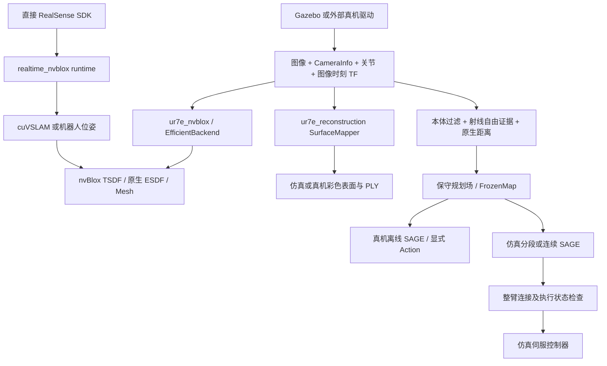
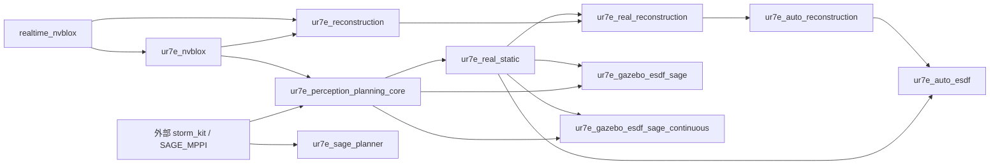

# 架构与数据流

[返回文档索引](README.md)

## 整体分层

项目围绕眼在手上相机构建三维场景，并将场景几何用于仿真或真机规划。它包含多组可独立启动的实验应用，不能理解为一个启动文件会运行所有功能包。

| 层次 | 实现 | 职责 |
| --- | --- | --- |
| 输入与场景 | RealSense SDK、外部相机/UR 驱动、`ur7e_d435_gazebo` | 图像、内参、关节反馈、TF、仿真控制器 |
| 实时基础 | `realtime_nvblox` | 队列、位姿缓存、cuVSLAM、nvBlox 封装、ROS 消息和运行统计 |
| 几何与建图 | `ur7e_nvblox`、`ur7e_reconstruction`、`ur7e_perception_planning_core` | 深度解码、GPU 查询、表面融合、整臂几何、自由空间与距离场 |
| 真机应用 | `ur7e_real_static`、`ur7e_real_reconstruction`、两种 `auto_*` | 停稳采集、会话管理、冻结/预览、显式控制 |
| 规划应用 | `ur7e_sage_planner`、`ur7e_perception_planning`、两种 `gazebo_esdf_sage*` | SAGE 任务、地图接入、路线搜索、执行保护与伺服 |
| 证据与工具 | `test/`、`validation/`、`report/`、`artifacts/` | 单元核查、集成/故障脚本、独立审计及实验结果 |

## 各条主链路

直接 SDK 链路由程序接管相机设备；ROS 图像链路消费驱动已经发布的数据。Gazebo/TF mapper 不需要 cuVSLAM 跟踪。彩色表面重建使用深度与彩色各自的标定和位姿，不能默认二者已经像素对齐。

## 实际源码复用关系

以下是源码 import 层面的主要关系；ROS `package.xml` 声明不完全等价于所有 Python 运行依赖。

箭头表示左侧提供代码、右侧复用；这张图提炼主要关系，完整直接 import 见分包文档。例如，自动 ESDF 复用自动重建的 `transport.py`，真机重建复用静态规划包的几何模型和模型一致性检查。因此只构建某个应用包时，相关底层包仍须已安装并在环境中可见。

## 坐标与时间约定

大部分 UR7e 应用将地图固定在 `base_link`。`T_base_depth` 表示把深度光学坐标转换到基座坐标的齐次矩阵；`tool0`、彩色光学坐标和深度光学坐标是不同坐标系。读取代码时以具体配置的 frame 字段为准。

融合要求图像**曝光时刻**的 TF 和关节状态。当前或最新 TF 不能随意替代历史 TF：机械臂运动加上相机安装偏置会使这种替代产生空间误差。真机停稳采集还要求停稳历史、关节插值以及 CPU 模型与 TF 相符。

ROS/仿真时间用于消息和运动状态，单调墙钟用于接收年龄、计算耗时和 watchdog。`epoch` 隔离重置前后的地图，`sequence` 区分提交；后台完成的结果必须仍属于有效会话。具体拒绝规则因运行路径而异：基础仿真 mapper 可处理时钟回退，真机自动控制的 RTDE 时间回退会要求重新准备。

## 四种几何输出的区别

| 输出 | 实现/内容 | 正确用途 |
| --- | --- | --- |
| 彩色 TSDF 表面 | `SurfaceMapper` 提取 vertices/triangles/colors | 重建显示、PLY、表面误差评价；不直接证明通道自由 |
| 原生 ESDF | nvBlox 根据 TSDF 更新后查询的距离，含未知哨兵 | 距离分析和显示；须单独识别未知值 |
| 保守规划距离场 | 观测自由边界距离与原生障碍距离取最小，包含离散化余量 | 规划同时避开障碍与未观测区域 |
| 仿真派生可行性场 | ownership、桌面推断或显式 bounded_unknown 策略 | 带明确假设的仿真实验；不能标为全部实测自由 |

`grid.py` 的来源值为 `0` 未知/占据、`1` 深度观测自由、`2` 经委托的初始自由先验。仿真策略可增加其他推断逻辑，必须保留其证据与策略边界。`FrozenMap.create` 拒绝未知格拥有正距离。

网格 `dimensions` 按 `[nx,ny,nz]` 保存，距离数组按 C 顺序 `[z,y,x]` 展开。`PlanningMap.msg` 的压缩载荷依次为 n 个 float32 原生距离、n 个 float32 规划距离、n 个 uint8 来源；共 `9*n` 字节，使用 zlib。`Snapshot.query` 在边界外返回负值，并在插值后扣除离散化余量。

## 并发和执行

基础 runtime 使用有界队列及 latest-only 交换槽；Mapper 用 `RLock` 串行访问，查询线程独立不意味着 GPU Mapper 可并行修改。`ur7e_nvblox` 与真机采集采用预分配 GPU 查询缓冲，显示线程处理点云打包。

`ur7e_perception_planning` 的 combined 模式在同一应用内协调建图与 SAGE 的 GPU 使用。`ur7e_gazebo_esdf_sage_continuous` 的优化进程、在线感知进程和伺服相互分离，通过版本化快照与有限任务通道通信。这两种设计不能混为同一线程模型。

自动真机扫描有独立 RTDE 反馈线程和显式取得的控制接口。每点释放控制后再采集，使 RGB-D/GPU 工作不占用 500 Hz 伺服周期；采集期间继续检查停稳、反馈、状态和 lease。静态真机目标执行走 ROS Action，与 RTDE 自动扫描是不同控制路径。

规划周期、地图更新率、点云显示率、命令发布率和实际运动完成率是不同指标。源码中的频率是目标值，运行性能应查看对应会话记录。
