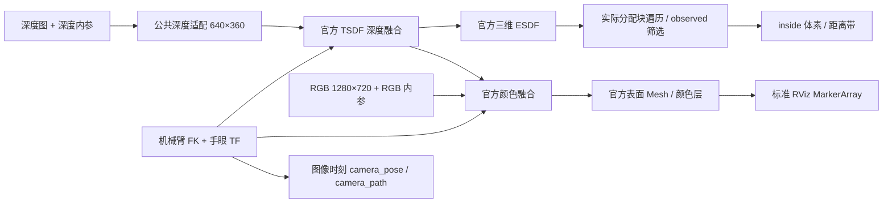

# RGB 颜色、ESDF 图例与话题整理说明（原生接口 v3 / 0.3.0）

> **当前版本 0.4.0 / 接口 v4：** 主处理恢复为 workspaces 官方 ROS tick，Mesh 显示拆为模块，统计改用非阻塞 CUDA 事件；默认 ESDF 5 Hz，另有 30 Hz 目标配置。3 cm 体素与原输入/范围保持不变。修改和完整命令见 [官方结构对齐实现说明](/home/czz/perception_eye_in_hand/docs/ESDF_OFFICIAL_ALIGNMENT_V4_IMPLEMENTATION.md)。已完成构建与离线协议检查，未启动新版仿真，未实测频率/延迟/几何质量。

日期：2026-10-27。修改对象为 `/home/czz/perception_eye_in_hand`，没有修改 workspaces 的源码或安装库。本说明取代旧文档中的默认显示方式、话题名及颜色配置；旧实验数据仍仅代表当时版本。

## 1. 为什么之前的 color 没有信息

这次检查发现两个实际断点：

1. 原生配置 `use_color: false`。官方节点因此不建立颜色输入订阅，应用的 tick 也不处理颜色队列。
2. `run_ur7e_native.sh` 只映射深度和深度 CameraInfo，没有映射官方节点需要的 `camera_0/color/image`、`camera_0/color/camera_info`。

官方基类仍会创建 `color_layer` 和 `color_layer_marker` 发布器，因此 `topic list` 中有名字不代表已融合颜色。颜色层还需要 RGB 图像、对应内参、图像时刻 TF、已重建的 TSDF 表面，以及订阅者。旧配置中没有完成 RGB 融合，不能期待颜色层或 Mesh 显示场景真实颜色。

原来的 ESDF 点云虽有 `rgb` 字段，但它由距离计算产生，只是伪彩色。它不从相机取颜色。RViz PointCloud2 的 `Color Transformer: RGB8` 表示读取点云中的打包颜色字段，不表示 RGB 相机已被接入。真实颜色应看 Mesh 或颜色体素层。

## 2. 这次的实现与之前有什么不同

| 项目 | 早期固定查询网格 | 上一版 sparse-v2 | 本次 v3 |
| --- | --- | --- | --- |
| 地图计算 | 原生地图外叠加 AABB 查询/导出 | 官方 ROS 输入、TF、TSDF 和三维 ESDF | 继续复用官方模块 |
| 实时点云位置 | 由导出采样网格决定，可能与地图体素不同 | 实际分配块中的原生体素中心 | 保留 sparse-v2 的原生体素遍历 |
| 未知点 | 早期完整网格容易把未知占位也显示出来 | 不发布 `observed=false` 的体素 | 不发布未知占位，保持不变 |
| 表面真实颜色 | 不构成完整 RGB 表面融合链路 | 关闭颜色融合，只接深度 | RGB + 独立 CameraInfo + 图像时刻 TF，交给官方颜色积分器 |
| 默认视图 | 容易混淆完整距离场与表面 | 红色 inside ESDF 体素 + 轨迹 | 相机 RGB Mesh + 绿色相机轨迹 |
| ESDF 图例 | 灰色/距离显示容易误解 | 红、绿、蓝渐变 | inside 红；已知自由距离由黄→青→蓝 |
| 路径命名 | 不同实现来源不一致 | camera_path 和 slam_path 内容相同 | 只保留 camera_path，明确为机械臂 TF 轨迹 |
| 全距离点云 | 可能成为主要导出负担 | 按订阅导出 | 创建开关默认关闭，防止误选后显示整个已知自由空间 |
| 颜色诊断 | 无明确状态 | 无颜色状态 | RGB 积分计数、接受时间、尺寸、编码、状态和拒绝原因 |

本次没有重新实现 NVIDIA 的 TSDF、颜色积分或 ESDF 传播算法；接入的是 workspaces 中官方 ROS 移植实现的实际调用路径。应用层补齐输入、校验、显示、稀疏导出和接口说明。



深度和颜色相机各用自己的内参及 optical frame。仿真 URDF 中颜色相机与深度相机存在约 15 mm 的位置差，不能把深度内参或深度 TF 直接套到 RGB 上。本次保留这个外参关系，由官方颜色积分器投影到 TSDF 表面；没有强行逐像素对齐 RGB 与深度图。

## 3. 保持的精度、输入与工作范围

| 参数 | 当前值 | 说明 |
| --- | --- | --- |
| voxel_size | 0.03 m | 没有通过改成 0.05 m 提速 |
| 原始深度 | 1280×720 | 场景相机输入 |
| 公共深度输入 | 640×360，32FC1 | stride=2，与上一版一致 |
| RGB | 1280×720，rgb8 | 独立颜色相机原始分辨率，没有额外降采样 |
| global_frame | base_link | 由机械臂与手眼 TF 定位 |
| ESDF 点云 ROI | 中心 [0,0,0.5]，尺寸 [2,2,1.5] m | x、y 为 [-1,1)，z 为 [-0.25,1.25) |
| 距离带 | ±0.15 m | 可视化选择范围，非 ESDF 计算最大距离 |
| ESDF 最大距离 | 2 m | 与上一版一致 |
| 深度队列上限 | 2 | 避免积累过时帧 |

ROI 是点云导出边界，标准 Mesh 显示按与该 ROI 相交的块筛选，边缘三角形可以跨出 ROI。原生地图融合配置仍是 `unbounded`，官方原生 Mesh/颜色层受原有半径和高度过滤约束，不能把它们说成严格裁剪在同一 ROI 中。本次没有扩大或收缩原有融合范围。

体素改变后，分配块、原生体素中心间距、表面采样和传播计算规模都会改变；在同样充分观测的三维区域，体素数大体随体素边长的三次方反比变化，但实际取决于观测、块分配和输出筛选。Mesh 顶点和表面体素并不遵循完整立方体点数公式。`topic hz` 是消息频率，不能用点数或 voxel_size 直接推出。

## 4. 颜色必须这样区分

| 视图 | 颜色 | 含义 |
| --- | --- | --- |
| Surface Mesh - Camera RGB | 相机融合颜色 | 重建表面的真实颜色，不是距离 |
| Color Surface Voxels - Camera RGB | 相机融合颜色 | 官方 TSDF 筛选后的颜色体素视图 |
| ESDF Inside | 红色 `#FF3030` | 已观测且 `is_inside` 的原生 ESDF 体素 |
| ESDF Band 的自由侧 | 距离 0 黄、半带宽青、带宽蓝 | 正距离越远越偏蓝；默认 0、0.075、0.15 m |
| Camera Path | 绿色 `#19FF00` | 机械臂运动学/手眼 TF 得到的深度相机路径 |
| 未观测区域 | 不画点 | 不能据此当作自由空间 |

inside 判断来自 ESDF 的 `is_inside` 标志，表面可能有带负号的零距离，不能仅按 `distance < 0` 重建这个判断。这里的 occupied 是可视化简称，不是额外计算的概率占用栅格。

默认仅开启 RGB Mesh、轨迹和基准网格。需要查看 ESDF 时，关闭 Mesh，再勾选 Inside 或 Band。多个视图叠加会遮挡颜色；不要把遮挡误认为颜色融合失败。颜色层是 Marker，应选 RViz 的 **Marker**；标准 Mesh 是 **MarkerArray**；原生 `/mesh` 是 NVIDIA 自定义消息，三者不能混选。

## 5. 话题命名、类型、内容与 QoS

以下输出以 `/ur7e_nvblox` 为前缀。

| 后缀 | 类型 | 内容 | QoS / 开关 |
| --- | --- | --- | --- |
| esdf_occupied | sensor_msgs/msg/PointCloud2 | observed && is_inside 体素中心，红色 | Reliable / Volatile / depth 1，按需 |
| esdf_distance_band | sensor_msgs/msg/PointCloud2 | 已观测且绝对距离 ≤ export_band_m 的体素 | Best Effort / Volatile / depth 1，按需 |
| esdf_distance | sensor_msgs/msg/PointCloud2 | ROI 内全部已观测有限距离，含自由空间 | 默认不存在；publish_full_distance_cloud=true 后按需 |
| mesh | nvblox_msgs/msg/Mesh | 官方增量索引三角形及颜色、删除信息 | Reliable / Volatile；需累积块并处理 clear/delete |
| mesh_markers | visualization_msgs/msg/MarkerArray | 同一 Mesh 的标准 RViz 桥接 | Reliable / Volatile / depth 10；新订阅者触发快照 |
| color_layer_marker | visualization_msgs/msg/Marker | 官方表面筛选的颜色体素 | Reliable / Volatile / depth 1；按订阅串行化 |
| color_layer | nvblox_msgs/msg/VoxelBlockLayer | 官方插件颜色层 | Reliable / Volatile；需要 NVIDIA 对应插件 |
| camera_pose | geometry_msgs/msg/PoseStamped | 成功深度融合帧对应的 optical camera 位姿 | Best Effort / Volatile / depth 1 |
| camera_path | nav_msgs/msg/Path | 上述位姿形成的有限长度轨迹 | Reliable / Transient Local / depth 1，最多 2000 位姿 |
| stats | std_msgs/msg/String | JSON 频率、延迟、颜色状态、点数 | Reliable / Volatile / depth 2，约 1 Hz |
| topic_info | std_msgs/msg/String | JSON 接口版本、主要显示话题、语义和颜色图例 | Reliable / Transient Local / depth 1 |
| map_epoch | std_msgs/msg/UInt64 | 地图清空代际 | Reliable / Transient Local / depth 1 |

点云字段为 x/y/z（float32，m）、rgb（uint32 打包 RGB）、distance（float32，m）；无未知占位。每条点云的时间戳为生成该 ESDF 版本的最近深度帧时间。Mesh 来自独立层更新，不能用 Mesh 消息时间戳直接计算深度端到端延迟。Path 的时间戳是源图像时间，其位置是相机光学坐标系原点在 base_link 中的位置。

名称迁移：`esdf_3d` → `esdf_occupied`；`esdf_observed` → `esdf_distance_band`。仅原生新接口改名，旧 Python 入口保留原来的话题。新原生节点不再并行发布旧名称，避免产生重复大消息；外部消费者应修改订阅名。

删除了 `slam_path` 重复发布，因为它没有任何独立 SLAM 估计。真实视觉 SLAM、回环和全局优化没有在本模块中实现。删除 `stats.latest` 与 `stats.map_latest` 的重复内容，统一使用 `map_latest`；仓库的验证脚本兼容新字段。保留 `mesh` 和 `mesh_markers`，它们分别服务原生消费者和标准 RViz，桥接只在被订阅时工作，并非两次重建。

删除了重复且依赖当前缺失 GLSL150 资源的 `native_with_mesh.rviz`；只维护 `native.rviz`。已清理静态 TSDF 模式下未启用的 lidar、动态占用、概率占用、衰减和有界融合示例参数；没有删除官方库及历史实验文件。官方基类仍会注册部分 2D、TSDF 和服务接口，3D 模式下部分话题没有数据，这是继承接口的行为，不表示已启用相应处理。

## 6. RGB 的状态和故障定位

`stats.map_latest` 新增：

- `color_enabled`：是否开启颜色输入/融合。
- `color_integration_size`：最近一次接受的颜色积分输入尺寸；未接受时 [0,0]。
- `color_encoding`：接受输入的编码。
- `color_stamp_ns`：最近接受颜色帧的 ROS 时间戳。
- `color_age_ros_sec`：该时间戳距当前 ROS 时间的秒数，未收到时 null；不是墙钟端到端延迟。
- `color_state`：disabled、waiting_for_valid_rgb_info_tf、integrating、stale。
- `full_distance_cloud_enabled`：大范围诊断点云是否启用。

`rates_hz` 和 `totals` 中：`color_integrated` 表示官方颜色处理成功并提交积分；`color_calibration_mismatch` 表示 optical frame/尺寸/焦距校验失败；`unsupported_color_encoding` 表示该版本不支持编码；`stale_color` 表示超出时效；`color_tf_wait_attempts` 表示官方处理等待 TF 的尝试；`color_rate_or_order_skipped` 表示限频/顺序或清图时间门限跳过。部分字段在首次出现相应事件后才出现在 JSON 中。attempts 包含重试，不是独立图像接收数。

`color_process_submit` 是主机调用提交耗时，没有为统计强行同步整个 CUDA 流，因此不能当作 GPU 颜色计算完成延迟。原有 `depth_process_complete`、`esdf_complete` 包含同步等待，`queue_seen_to_publish` 从应用首次在深度队列中观察到图像开始，不含相机曝光、传输和进入队列之前的时间。最新成功提交不保证每个表面体素已经得到颜色；相机视野、遮挡、TSDF 权重和投影都会限制覆盖。

该官方版本的颜色转换明确支持 rgb8、bgra8。仿真相机发布 rgb8，可以直接接入；实机如果发布 bgr8，需先转换成 rgb8 并保留原时间戳和 frame，不能仅修改 encoding 字符串。

## 7. 完整操作顺序

以下为用户下一步操作，本次修改过程没有执行这些仿真命令。不要将 Markdown 的三反引号粘贴进终端。

### 7.1 构建

```bash
cd /home/czz/perception_eye_in_hand
./build_ur7e_d435_scene.sh
./build_ur7e_native.sh
./run_ur7e_native.sh --check-build
```

### 7.2 启动（终端 A）

```bash
cd /home/czz/perception_eye_in_hand
export ROS_DOMAIN_ID=127 ROS_LOCALHOST_ONLY=1
export RMW_IMPLEMENTATION=rmw_cyclonedds_cpp
export CYCLONEDDS_URI=file:///home/czz/perception_eye_in_hand/src/ur7e_nvblox_native/config/cyclonedds_local.xml
export GAZEBO_MASTER_URI=http://127.0.0.1:11457
./run_ur7e_perception.sh gazebo_gui:=true
```

入口会联合启动场景、公共深度适配、原生感知和 RViz。不要同时再运行旧 Python 感知节点。如果已独立启动了相同场景，使用 `./run_ur7e_perception.sh start_scene:=false`。端口被占用时先查看 `ss -ltnp 'sport = :11457'`，确认已有场景是否需要继续使用；不要仅关闭 Gazebo 窗口后重复启动服务器。

自定义颜色来源可传 `color_topic:=/实际图像话题 color_camera_info_topic:=/实际颜色内参话题`。更换光学 frame 时还需在 mapper_config 中设置 `expected_color_frame` 并确保对应 TF 正确。RViz 的 RGB Input 显示默认绑定仿真原始 RGB 话题，自定义输入时需在该显示项同步改名。

### 7.2.1 让机械臂完成采集视角转动

统一感知入口本身不发送关节命令。默认初始姿态并非之前测试时的观察姿态，因此应用启动后，机械臂可能没有朝向需要重建的目标。之前验证脚本是在采样前主动移动到观察姿态，再摆动 wrist_1；不是旋转 RViz 视角。

现在提供独立入口，场景和感知保持运行，在另一个终端执行：

```bash
cd /home/czz/perception_eye_in_hand
# 可选：只检查仿真、关节状态与控制器，不发送运动命令
./run_ur7e_view_sweep.sh --check-only
# 平滑到达之前的观察姿态，然后小幅摆腕采集 20 秒
./run_ur7e_view_sweep.sh --seconds 20
```

仅移到观察姿态、不连续摆动：`./run_ur7e_view_sweep.sh --seconds 0`。调整摆幅可加 `--amplitude 0.08`，上限 0.10 rad；默认 ±0.06 rad，约 ±3.44°，周期约 4.19 秒。这是围绕现有观察姿态的小幅关节扫描，不是保证始终对准同一目标的圆弧轨迹或完整多视角规划。

观察姿态沿用之前验证脚本的 `[0, -1.57, 1.1, -0.90879335, -3.21580312, -0.69520875]` rad，顺序为 shoulder_pan、shoulder_lift、elbow、wrist_1、wrist_2、wrist_3。新脚本读取当前关节值后进行 smoothstep 插值，接近阶段指令速度不超过 0.20 rad/s，并等待实际关节跟随到位；不直接一次跳变到目标。

执行前要求测试域 127、推进中的 `/clock`、新鲜关节反馈、含 gazebo_ros2_control 的机器人描述以及活动的 position controller。它只供当前 Gazebo 场景使用，没有碰撞规划或实机运行能力。反馈停止时停止发送新指令；Ctrl+C 后位置控制器保留最后目标。正常结束会回到观察姿态，保留地图，不重置或重启感知。不要同时运行另一个关节运动脚本。

脚本从源码直接运行，无需重新编译 mapper。新增文件为根目录 `run_ur7e_view_sweep.sh` 和 `src/ur7e_d435_gazebo/scripts/view_sweep.py`。本次只进行语法、依赖导入和 CLI 帮助检查，没有执行运动。

若转动后仍没有重建信息，应依次检查：原始 RGB 是否看得到目标、深度是否有有效值、`stats` 的 depth_integrated/esdf_updated 是否增长、RGB 是否 integrating、RViz 是否订阅本版本的新话题。只移动机械臂不能解决缺少图像、TF、错误话题或未启用消费者的问题。

### 7.3 查看话题和颜色（终端 B）

```bash
cd /home/czz/perception_eye_in_hand
export ROS_DOMAIN_ID=127 ROS_LOCALHOST_ONLY=1
export RMW_IMPLEMENTATION=rmw_cyclonedds_cpp
export CYCLONEDDS_URI=file:///home/czz/perception_eye_in_hand/src/ur7e_nvblox_native/config/cyclonedds_local.xml
source /opt/ros/humble/setup.bash
source /home/czz/workspaces/isaac_ros-dev/install/setup.bash
ros2 node list
ros2 topic list -t
ros2 topic echo /ur7e_nvblox/topic_info --once --qos-durability transient_local
ros2 topic echo /ur7e_nvblox/stats --once
ros2 topic info /camera/color/image_raw --verbose
ros2 topic info /camera/color/camera_info --verbose
```

先观察 RViz 默认 RGB Mesh；随后可单独勾选 `RGB Input` 检查源图像，或关闭 Mesh、勾选 `Color Surface Voxels` 查看融合体素。RGB 原图能显示而 `color_state` 一直等待时，检查内参和 TF；`color_integrated` 持续增长但局部灰色时，检查那些区域是否被彩色相机看到以及深度几何是否有效。

```bash
ros2 run tf2_ros tf2_echo base_link camera_color_optical_frame
```

`tf2_echo` 只证明 TF 可查询，仍需保证图像时刻的历史 TF 存在。相机轨迹不是颜色相机的独立定位结果。

### 7.4 更新频率、延迟和轨迹

下面 hz 命令分别执行，Ctrl+C 结束当前命令后再执行下一条：

```bash
ros2 topic hz /camera/color/image_raw --wall-time
ros2 topic hz /esdf_input/depth --wall-time
ros2 topic hz /ur7e_nvblox/esdf_distance_band --wall-time
ros2 topic hz /ur7e_nvblox/mesh_markers --wall-time
ros2 topic echo /ur7e_nvblox/stats --once
ros2 topic echo /ur7e_nvblox/camera_path --once --qos-durability transient_local
```

点云按订阅导出：hz 自身就会使这个输出开始工作。ESDF 更新、深度融合、RGB 融合应看 stats 中各自计数增量和 `rates_hz`；Mesh 在启用默认视图后才有消费者。配置目标为深度不额外限制相机、颜色 5 Hz、ESDF 30 Hz、层发布 5 Hz；是调度上限或目标，实际受输入频率、仿真实时因子、GPU 和显示开销影响。此版本 Mesh 更新在官方 `publishLayers` 路径内按需执行，有效节奏由层发布节奏控制，不能仅凭 `update_mesh_rate_hz` 名称判断。

实时终端监视器可以直接从项目源码运行，无需启动第二个 mapper：

```bash
PYTHONPATH=/home/czz/perception_eye_in_hand/src/ur7e_nvblox python3 -m ur7e_nvblox.monitor --seconds 30
```

它显示融合、ESDF、导出、收到的不同源时间戳、RGB 接受频率和颜色状态；它会订阅距离带，也会增加可视化导出工作。观察旧 Python 节点时另加 `--cloud-topic /ur7e_nvblox/esdf_observed`。

### 7.5 重置、Mesh 重发和诊断点云

```bash
ros2 service call /ur7e_nvblox/reset_map std_srvs/srv/Trigger '{}'
ros2 service call /ur7e_nvblox/republish_mesh std_srvs/srv/Trigger '{}'
```

重置会清除颜色输入队列和颜色限频时间，防止仿真时间回退后继续沿用旧 RGB 状态。Mesh 重发需要先启用标准 Mesh 显示。

全部已知距离点云仅在确实需要排查自由空间时使用：复制 `config/gazebo.yaml` 到本仓库的临时配置，把 `publish_full_distance_cloud` 改为 true，通过 `mapper_config:=/绝对路径/配置.yaml` 重新启动。它包含已知自由空间，点多是有意的诊断语义；不要默认开启它判断表面质量。

## 8. 预期能力、边界与验收

本次应能呈现融合后的彩色表面 Mesh、可选彩色表面体素、具有明确图例的稀疏 ESDF，以及基于机械臂位姿的相机采集路径。观察空区域不会因为导出器补点而出现未知点阵。已观测自由空间仍然参与 TSDF/ESDF 计算，是距离查询和碰撞规划所需信息；隐藏它们并不等于可以从地图计算中全部删除。

实时性方面，本次保持原生 GPU ESDF 和按需稀疏导出，关闭默认全距离诊断接口；但新增 RGB 融合和默认 Mesh 显示会增加计算、传输和绘制成本。颜色融合采用 5 Hz，独立于 ESDF 目标。不能承诺开启所有视图后频率更高；与 workspaces 比较时必须使用相同输入、体素、范围、RGB 开关、显示订阅和仿真运动。只比较一边 Mesh、另一边全自由空间点云的 hz 没有可比性。

后续仿真验收应记录：RGB 状态/接受频率、depth_integrated、esdf_updated、不同源时间戳的点云频率、queue_seen_to_publish 的 P50/P95、Mesh 接收频率、点数和分配块数；同时保存 RGB Mesh 与 ESDF 分开展示的截图。不能把接口版本 1 的历史截图或延迟作为本版本实测。

本轮仅做源码修改、静态检查和构建验证，没有启动 ROS 感知、Gazebo、RViz 或 CUDA 诊断程序。实际显示、实际频率与端到端延迟留待上述仿真验收，本说明没有将配置值冒充实测值。

已通过：生产目标 C++/CUDA 编译、链接及安装；三个修改的 Python 文件语法检查；四个入口脚本 shell 语法检查；YAML、默认显示及诊断开关一致性检查；`--check-build` 安装新旧校验。未编译或执行本次可选几何工具。证据见 [构建日志](/home/czz/perception_eye_in_hand/artifacts/esdf_color_v3_20261027/build.log) 和 [验证记录](/home/czz/perception_eye_in_hand/artifacts/esdf_color_v3_20261027/verification.json)。

## 9. 修改文件索引

| 文件 | 本次职责 |
| --- | --- |
| src/ur7e_nvblox_native/src/native_mapper.cpp | RGB 校验/官方融合调用/状态统计；清图时清颜色队列；话题改名和 topic_info；去路径别名和重复 JSON |
| src/ur7e_nvblox_native/src/block_export.cu | inside 红色与自由距离黄青蓝图例 |
| src/ur7e_nvblox_native/config/gazebo.yaml | 开启颜色，增加 frame/诊断开关，清理未使用参数 |
| src/ur7e_nvblox_native/launch/perception.launch.py | 可配置 RGB 图像、颜色内参输入话题 |
| run_ur7e_native.sh | 官方颜色输入映射 |
| src/ur7e_nvblox_native/rviz/native.rviz | 默认 RGB Mesh；添加原始图像/颜色体素视图；明确图例 |
| src/ur7e_nvblox_native/package.xml | 版本 0.3.0 |
| src/ur7e_nvblox/ur7e_nvblox/monitor.py | 新距离带话题和 RGB 状态监视，可指定旧话题 |
| src/ur7e_nvblox/test/run_gazebo_validation.py | 新话题/统计字段兼容，重订阅路径同步更新 |

官方参考：workspaces 中 `nvblox_ros/src/lib/nvblox_node.cpp` 的颜色订阅、processColorImage、publishLayers；`src/lib/conversions/image_conversions.cpp` 的颜色编码转换；`src/lib/layer_publishing.cpp` 的颜色表面过滤和按需 Mesh 发布；本仓库仿真 URDF 中的颜色传感器、话题及光学坐标定义。
