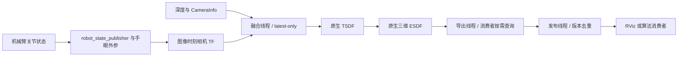

# 面向实际应用的 ESDF 实时性说明与原生模块接入设计

> 2026-10-27 实施更新：原生 C++ 模块已接入并完成同精度仿真对照。本文保留早期设计/操作历史；最新代码状态、实测结果和运行方式以 [接入报告](/home/czz/perception_eye_in_hand/docs/NATIVE_CPP_INTEGRATION_REPORT.md) 和 [完整操作说明](/home/czz/perception_eye_in_hand/docs/NATIVE_CPP_USER_GUIDE.md) 为准。

日期：2026-10-27。本文基于磁盘源码与 2026-10-26 保存的测试记录；本轮新增文档，没有新执行安装、C++ 接入、GPU 或仿真测试。

配套操作手册：[ESDF 完整操作与验收手册](ESDF_OPERATION_MANUAL.md)。历史实施记录：[Python 调度与查询层改进及实测](ESDF_ROS_ALIGNMENT_IMPLEMENTATION.md)。

## 1. 目标、当前状态和不能混淆的结论

目标是在实际应用所需的地图精度、相机输入和机械臂工作范围下，提高新地图生成与消费的实时性，参照 `/home/czz/workspaces/isaac_ros-dev` 的官方 ROS 移植方案。**将 voxel_size 调粗、减少显示点、重复发布旧地图或仅在合成输入中达到 30 Hz，都不能单独作为目标完成的证据。**

| 项目 | 状态 | 证据或边界 |
| --- | --- | --- |
| 分析 workspaces 官方 ROS 更新、服务导出、地图显示模块 | 已完成静态分析 | [两版源码对比](ROS_NVBLOX_QUERY_VOXEL_COMPARISON.md) |
| Python 前端拆分融合/导出/发布、按需查询、版本去重 | 已实现并做过仿真 | 当前 `src/ur7e_nvblox`，历史结果在 artifacts |
| 默认 native 采样跟随内部体素尺寸 | 已实现 | 仍经 Torch 任意点查询 API，不是 C++ 块级 exporter |
| 同条件与修改前 Python 版比较 | 已执行 | 5 cm、同一 Cyclone DDS 场景，约 11–12 Hz 对约 18.6 Hz |
| workspaces 官方 ROS 在同一新场景下的实测基线 | 尚未执行 | 原先观察到的 30 Hz 没有运行参数和地图版本快照 |
| 将官方 C++ 原生块导出/地图层发布接入本仓库 | 尚未完成 | 不能将现有 `native` 模式称为已经完成原生 ROS 模块迁移 |
| 实机机械臂感知性能和同步验收 | 尚未执行 | 目前仅仿真移动验证 |

已有改进有价值，但还没有证明仓库达到了 workspaces 方案的实际应用效果。后续应先取得官方 ROS 同输入基线，再选择模块复用和实现路径。

## 2. 各种“频率”和“效果”分别是什么

| 指标 | 定义 | 常见误读 |
| --- | --- | --- |
| 相机产生频率 | 深度采集或 Gazebo 传感器更新速度 | 配置 30 Hz 不代表订阅端收到 30 Hz |
| 深度接收频率 | mapper 实际收到有效输入的频率 | 网络/DDS 丢帧会使它低于传感器目标 |
| 融合频率 | 深度实际进入 TSDF 积分的频率 | 收到但因 TF、帧龄或标定不匹配丢弃的帧不算 |
| ESDF 更新频率 | 执行原生 ESDF 更新的次数 | 必须同时知道最新融合图像时刻；调用更新不保证场景几何变化 |
| 导出频率 | 距离场读取、筛选、读回的次数 | 可以多次读取同一版 ESDF |
| 消息接收频率 | `ros2 topic hz` 看到的到达频率 | 不证明每条消息包含新地图 |
| RViz 帧率 | 图形窗口刷新速度 | 不是 TSDF/ESDF 更新频率 |
| 新鲜度 | 输出相对其使用的最新图像、位姿和地图版本的时间差 | 不能简单把输出 header 改成 now 来改善数值 |
| 效果 | 表面形状、距离值、覆盖/未知、自身污染、动态残影和观察延迟 | “点多”或“画面平滑”不是距离正确的充分条件 |

用户测到 5 cm 时话题约 30 Hz，是合理的现场观测。之前文档中的 5 Hz 来自一份本地 YAML，不是那次运行的参数快照。存在两种需要区分的情况：运行时覆盖后确实 30 Hz 更新；或者 30 Hz 查询/发布已有的低频地图。没有对应参数、话题名和版本信息，不能把其中任何一种写成已证实的原因。

## 3. 当前 Python 实现的模块与数据流

### 3.1 文件职责

| 当前仓库文件 | 职责 |
| --- | --- |
| [node.py](/home/czz/perception_eye_in_hand/src/ur7e_nvblox/ur7e_nvblox/node.py) | ROS 输入、图像时刻 TF、帧龄/epoch、地图更新、导出及发布线程、统计与服务 |
| [depth.py](/home/czz/perception_eye_in_hand/src/ur7e_nvblox/ur7e_nvblox/depth.py) | 深度格式/单位/行填充、内参降采样、TF 矩阵和未知值判定 |
| [sampling.py](/home/czz/perception_eye_in_hand/src/ur7e_nvblox/ur7e_nvblox/sampling.py) | 世界坐标对齐的原生体素中心、ROI 上限、有限更新预算及导出节奏 |
| [esdf.py](/home/czz/perception_eye_in_hand/src/ur7e_nvblox/ur7e_nvblox/esdf.py) | 查询缓冲复用、GPU 显示过滤、历史 sparse 导出 |
| [共享后端](/home/czz/perception_eye_in_hand/src/realtime_nvblox/realtime_nvblox/nvblox_backend.py) | 创建 Torch Mapper、原生积分/ESDF 调用、保存地图及旧固定网格 |
| [点云打包](/home/czz/perception_eye_in_hand/src/realtime_nvblox/realtime_nvblox/ros_publishers.py) | PointCloud2 字段、距离颜色、完整与已观测距离带选择 |
| [monitor.py](/home/czz/perception_eye_in_hand/src/ur7e_nvblox/ur7e_nvblox/monitor.py) | 输出融合、更新、导出、接收频率及源图像时间戳数 |

### 3.2 三种输出模式

| 模式 | 采样来源 | 分辨率与用途 | 限制 |
| --- | --- | --- | --- |
| `dense` | 用户指定规则盒 | `grid_resolution_m` 独立控制，兼容旧消费者 | 不随 voxel_size 自动改变采样；包含未知 |
| `native` | 有界 ROI 中原生体素中心 | 间距与 `voxel_size_m` 相同，默认显示路径 | 仍枚举 ROI、执行点查询，不是块级零拷贝导出 |
| `sparse` | 正 TSDF 权重原生候选位置，再查原生 ESDF | 有效候选随原生地图变化 | 不是完整 ESDF 层枚举；遍历活动地图可能更贵 |

完整点云和 observed 是两种话题选择，不是两种内部地图。unknown 必须保持未知；已观测自由空间的正距离仍是避障需要的信息。显示剔除 unknown 或远距离点，不等于删除原生地图自由空间。

### 3.3 已实现改进及其边界

- 融合路径不再强制执行每次完整点云查询；导出按订阅需求独立工作。
- 没有点云消费者时不查询；同一话题同一地图版本不重复发布。
- 输出保留源图像时间，地图与导出各有可观测计数。
- 使用有限预算吸收到达抖动，避免略小于一个周期的帧间隔导致交替跳过更新；预算最多两帧，不积累补算队列。
- 只有 observed 订阅时在 GPU 筛选距离带和 unknown，再读回有效点；完整话题有人订阅时仍需完整读回。

GPU 筛选不是免费优化。历史同一对照中，原完整查询读回 P50 约 0.16 ms，新 observed GPU 筛选加读回约 1.16–1.19 ms。它减少后续显示数据，却没有使这个小查询的 kernel 更快。当前结果不能支持“主要耗时全部在查询中”或“查询优化已经解决根因”的结论。

## 4. 官方 ROS 可以直接参考的真正代码模块

参考根目录：`/home/czz/workspaces/isaac_ros-dev/src/isaac_ros_nvblox/`。本地 HEAD 为 `bc181942202b24fd47b2f3db8f77c3c82d484566`，YAML 有本地改动；应固定源码和运行配置一起记录。

| 模块 | 实际位置（相对参考根目录） | 可复用逻辑 | 与实际机械臂的适配 |
| --- | --- | --- | --- |
| 节点调度/输入队列 | `nvblox_ros/src/lib/nvblox_node.cpp` | tick 分别处理深度、ESDF、层发布、服务任务 | 检查位姿可用后处理图像，限制排队年龄 |
| 时间戳 TF | `nvblox_ros/src/lib/transformer.cpp` | 按消息时间 canTransform/lookupTransform | global_frame 适配 base_link，不引入静态 odom 相机位姿 |
| 原生 Mapper | `nvblox_ros/nvblox_core/nvblox/src/mapper/mapper.cpp` | 待更新块跟踪、TSDF/ESDF、层序列化 | 保持精度、积分范围、观测阈值与工作范围一致 |
| 规则场原生导出 | `nvblox_ros/src/lib/conversions/esdf_and_gradients_conversions.cu` | 原生层到 dense grid、observed/符号/米制转换 | 仅在算法要求完整规则场时导出必要 AABB |
| GPU 块式读取 | `nvblox_ros/nvblox_core/nvblox/include/nvblox/map/internal/cuda/impl/layer_to_3d_grid_impl.cuh` | 一个线程查块指针、块内共享、连续访问 | 作为原生对齐场导出，不必构造任意点 Nx4 查询 |
| 地图层显示 | `nvblox_ros/src/lib/layer_publishing.cpp` | 按订阅选择层、Mesh、块消息及传统 Marker | 图形显示与算法查询分开预算 |
| RViz 插件 | `nvblox_rviz_plugin/src/nvblox_plugin_visual.cpp` | 保留块对象、局部更新/移除、原生尺寸显示 | 用正确消息类型，不把 PointCloud2 当成 Mesh |
| 二维切片 | `nvblox_ros/src/lib/conversions/esdf_slice_conversions.cu` | GPU 切片与未知过滤 | 作为调试显示，不能替代机械臂三维碰撞场 |

配套 `/home/czz/workspaces/isaac_ros-dev/src/live_esdf_query` 是另一条服务查询与显示链。其 `stride` 在客户端过滤，不能减少服务端完整 dense 导出量；`update_esdf=false` 不强制更新原生场。不能把这条链的点云 Hz 直接作为上述 Mapper 的新地图 Hz。

## 5. 推荐接入路线与依赖策略

### 路线 A：优先复用已安装的官方 ROS C++ 节点

先直接启动 workspaces 已构建的 `nvblox_ros/nvblox_node`，使用本仓库相机图像、深度内参和机械臂 TF，取得基线。这个方案复用原生节点、队列、Mapper、服务转换、层发布和 RViz 插件，避免在 Python 中再复制一套调度与导出。

需要完成：

1. 检查二进制、共享库、NITROS/GXF、CUDA、消息和 RViz 插件是否全部可加载。
2. 用独立配置覆盖 global_frame、相机话题、输入 QoS、地图精度、积分范围、ESDF 及显示频率。
3. 使用 3D ESDF；Mesh/体素层作为几何显示，距离服务作为算法数据接口，切片作为辅助观察。
4. 为最新融合图像时间、ESDF 版本、输出新鲜度补齐统计；原节点的 timer 频率仍不足以证明新地图频率。
5. 验收后再添加仓库内启动适配包、依赖发现与接口兼容层，记录来源和版本。

**该路线尚未在本仓库完成接入。** 操作手册给出的官方节点命令用于独立基线验证，不是已经存在的“新 C++ 后端入口”。

### 路线 B：直接链接原生核心，编写小型 C++ 感知适配包

如果路线 A 的 NITROS/GXF 耦合阻止部署，才考虑只链接官方核心库，复用其 Mapper、ESDF integrator、块导出和必要转换模块。

拟建的包可以负责 Image/CameraInfo/TF 接入、epoch/帧龄、统计与接口；不应重新写 ESDF 距离传播算法。需要配置图像内存、CUDA stream、地图锁、异步复制、未知状态和缓冲区生命周期，并承担相机格式转换、同步和块删除语义的验证成本。

这条路线的 C++ 包名、可执行文件、服务和 launch 尚不存在。不得在操作命令中假装它们已安装。引用/复制第三方源码时保留原许可证和来源，记录本地修改；不能把使用不同核心版本的结果归结为语言差异。

### 安装原则

优先使用现有匹配版本的 CUDA、ROS 和官方工作区安装；缺失才补装。ROS C++ 节点的 NITROS/GXF 依赖不是 `pip install nvblox_torch` 能替代的。不要在工作环境直接升级 Torch、CUDA 和全部 ROS 包后，再与升级前结果比较。

先导出已安装版本和依赖解析结果，再决定补装范围。完整 ROS 节点的 CMake 依赖以本地 `nvblox_ros/package.xml` 和 `CMakeLists.txt` 为准；源码重新构建必须能解析 Isaac ROS 相关包，而非仅装 Eigen/glog 就认为依赖齐备。

## 6. 机械臂位姿与时间必须保持的约束

设 B 为 base_link、E 为手眼标定使用的末端、C 为当前深度光学系，则每一帧使用：

`T_B_C(t_image) = T_B_E(t_image) × T_E_C`。

若标定文件给的是 color optical frame，则还要使用正确的 color/depth 光学系静态关系，不能把外参数字直接填到另一个相机 frame。

- 深度内参必须对应送入融合的实际图像、分辨率与光学坐标。
- 相机/机器人时钟若不在同一基准，要先处理同步偏差；高频错误位姿不会生成正确地图。
- 图像时刻 TF 尚未到达时可有限等待或排队；过期后丢帧并记录，不用 latest TF 强行融合。
- 不同时发布另一套冲突机器人 TF；pose 话题若被采用，需要明确其方向和时间戳，不能再重复叠乘手眼变换。
- 仿真 use_sim_time=true，实机通常 false；二者不能交叉使用时间戳。
- 手动移动描述运动操作方式，并不保证运动中的自滤波、噪声和位姿延迟已解决。

## 7. 以应用为目标的同条件验收矩阵

| 控制项 | 要求 |
| --- | --- |
| 输入 | 相同深度数据、帧率、格式、分辨率、降采样和图像时刻位姿；优先使用同一 bag 回放 |
| 地图 | 相同 voxel_size、积分距离、截断/权重阈值、ESDF 最大距离和工作范围 |
| 显示 | 同样显示 Mesh、切片或三维距离带，不能用一种表面显示对比另一种全体积点云 |
| 消费者 | RViz、记录器、完整场服务客户端数量一致 |
| DDS/机器 | 同一 RMW、硬件、CUDA 版本，记录仿真实时率和其他负载 |
| 频率 | 同时记录深度接收/融合、ESDF 更新、导出、实际消息 Hz、新版本 Hz |
| 延迟 | 输入到融合、到新 ESDF、到算法消费；区分 CPU submit、GPU 完成和 ROS 接收 |
| 正确性 | 有符号米制距离、unknown、pose 对齐、空地图/重置、停止输入不伪造新结果 |
| 场景 | 静止、连续手动移动、遮挡、新障碍进入/移除、机械臂自身进入视野 |

建议静止和运动各做至少 60 秒有效窗口，并重复运行；这是后续验收建议，不是此前已执行的 12 秒试验。冷启动与热运行分别统计。先在用户指定业务精度下验收，再做 2/3/5 cm 的成本曲线；10 cm 结果不能替代更细地图要求。

验收阈值应来自下游避障/规划的反应时间与工作速度。当前没有足够依据保证某个固定 30 Hz、延迟上界或动态清除时间；应以官方 ROS 同输入实测和业务容许地图年龄共同确定，不以 30 Hz topic 消息数作为唯一通过条件。

## 8. 已有证据如何使用

[最终历史报告](ESDF_ROS_ALIGNMENT_IMPLEMENTATION.md)和 [JSON/图像目录](../artifacts/esdf_ros_alignment_20261026/)说明：5 cm 新版相对旧 Python 版有提升；稳定小尺寸合成流达到约 30 Hz；实际 Gazebo 未证明稳定 30 Hz；查询 kernel 没有因 GPU 筛选而加速。

它们不证明：已达到官方 ROS 效果、已复用原生块导出、实机满足业务实时要求、或者 5 cm 就是用户需要的最终精度。后续接入和实测结果应新增报告，不能覆盖历史失败记录或将历史数字改写成新后端的成绩。
