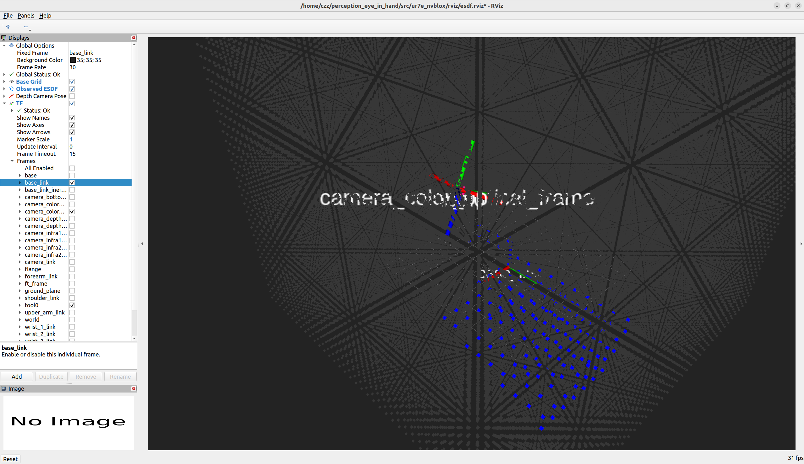
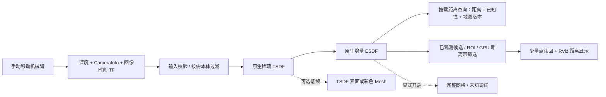

# 手动眼在手采集：原生 ESDF 感知修改方案

日期：2026-10-26。状态：**方案文档，尚未实施任何代码或配置修改**。

状态更新：以上是本方案初稿的历史状态。用户随后授权修改并进行仿真，已实施的采样、按需导出、更新/发布调度和监测改动见[实施与实测说明](ESDF_ROS_ALIGNMENT_IMPLEMENTATION.md)。原生 C++ 块级导出等未完成部分不能据此视为已经实施。

后续补充：用户确认正常参考版是 workspaces 中的官方 ROS 移植库。新对比见[查询、体素尺寸与实时性差异](ROS_NVBLOX_QUERY_VOXEL_COMPARISON.md)，进一步区分原生分辨率导出、固定分辨率查询、地图更新频率和重复显示频率，并细化本方案的导出接口选择。

目标：按当前 UR7e/D435 位姿配置，保留人工移动机械臂、多视角采集方式，让实时画面准确显示已观测场景，并减少整盒未知采样、无关自由空间显示、重复导出和传输。ESDF 数值继续由原生 nvBlox 生成。

本方案只处理感知和显示，不引入自动扫描、RTDE 运动、SAGE 或轨迹执行。这里“手动采集”描述谁移动机械臂；“移动中融合/停稳后融合”是另一个设置，不能由包名有无 auto 直接推断。本轮以用户要求的手动流程为准。

## 1. 为什么你看到的画面与报告不同

### 1.1 图一所指报告与图二不是同一种输出

图一指向 `ur7e_auto_reconstruction/report/`。该目录中的[地图图片](../src/ur7e_auto_reconstruction/report/assets/saved_mesh.png)是 RGB-D 融合后的**彩色三角网格**，由保存的 `surface.npz` 离线绘制；[原报告](../src/ur7e_auto_reconstruction/report/2026-09-29_real_auto_scan_test.md)明确说明它不是实时 RViz 截图。图中对应 58 帧、八个记录视角、15 mm 内部体素的部分重建。

图二是 `ur7e_nvblox` 的 ESDF 点云显示：颜色表示距离，没有 RGB 表面纹理；当前默认内部体素 30 mm，dense 输出采样间距 50 mm。单个/少数相机视角与多视角累计地图的覆盖也不同。

因此，**换成手动操作不影响能否重建，但 ESDF 距离点云不会自然变成报告里的彩色 Mesh。** 如果需要同样的彩色表面外观，应明确提供单独 TSDF/Mesh 显示；它不能代替 ESDF 正确性验收。我前面给出的运行指令是原生 ESDF 基线，不能据此直接复现该彩色报告图。

### 1.2 大量灰点的判断：高度可疑，但不能仅凭截图定案



当前代码将未知 ESDF 样本画为 RGB `[55,55,55]`；`full_grid=True` 会把整个规则采样盒里的未知位置也打包成点云。截图里的规则灰色阵列与这种输出很相似。

但源码中存在两条不同路径：

| 路径 | 当前行为 |
| --- | --- |
| `/ur7e_nvblox/esdf_3d` | 完整规则网格，`full_grid=True`，包括未知灰点 |
| `/ur7e_nvblox/esdf_observed` | 默认过滤未知，只保留 `abs(distance) ≤ 0.5 m` 的有效距离样本 |

证据：[发布路径](../src/ur7e_nvblox/ur7e_nvblox/node.py) L268–288；[未知着色/过滤](../src/realtime_nvblox/realtime_nvblox/ros_publishers.py) L47–109、L140–155。

截图的 `Observed ESDF` 是 **RViz 显示项名称**，没有展开 Topic，不能证明订阅的就是 `/esdf_observed`。标题中的 `*` 表示 RViz 设置有未保存修改，但不能说明改了哪一项。因此优先怀疑并需要核实：

1. 该显示项实际订阅了完整网格话题。
2. 运行的是安装目录/旧 overlay 中不同的实现或配置。
3. 有同名节点、其他发布者、话题重映射或 RGB 着色设置变化。

若实际订阅确为 `/esdf_observed` 且采用当前 RGB8 路径，那么大量“未知灰点”与当前过滤逻辑不一致，应先定位发布者/代码来源，不能以修改原生 ESDF 算法掩盖此问题。

另外：截图右下角约 31 fps 是渲染帧率，不是 ESDF 更新率；`No Image` 只说明该 Image 显示没有图像，不能单凭它认定深度输入断流。透视下规则点阵的放射状纹理，也不能单凭外观认定相机外参错误。

当前 50 mm 规则查询位置也不等于 30 mm 原生体素中心，更不是表面 Mesh 顶点。它会产生明显的格点重采样外观；应通过改变显示/导出方式处理，而不是为了让画面好看去移动相机外参。

## 2. “空白/未占用体素”必须拆成三类

| 类别 | 原生语义 | 是否应该计算 | 默认是否应该画满屏 |
| --- | --- | --- | --- |
| 未知：未分配或未有效观测 | 没有可靠距离；查询返回未知 | 不必为了显示在整个工作盒枚举查询；必要位置仍须报告未知 | 否，只在明确调试时显示 |
| 已观测自由：有可靠正距离 | 机器人与障碍间的净空信息 | **需要**，否则 ESDF 失去主要用途 | 通常只画近表面带或选定切片 |
| 表面/内部：模型距离近零或负值 | 对应重建模型表面或内部 | 需要；不是完整概率占据模型 | 可显示，负距离需与正距离区分 |

“没有障碍物”不等于“应该删除的无效体素”。原生 TSDF/ESDF 也会为深度射线经过的自由空间维护块，块中还可能包含未观测格及预留内存。应区分**活动地图块、内存池预留块、查询样本、发布点数**。

当前 dense 的问题主要是：在稀疏地图外再枚举完整规则查询盒，包括大量未知坐标。**查询一个未知坐标不等于在地图中创建一个 ESDF 体素。** 官方查询 kernel 做哈希查找并返回距离/未知；不能把 RViz 上的 52,111 个点直接当作原生地图实际分配的体素数。

默认 2×2×1.5 m、50 mm 网格有 `41×41×31=52,111` 个查询点。完整点云按 20 字节/点约 1.04 MB；15 Hz 时约 15.6 MB/s 原始点数据，不含 DDS 和额外复制。历史某视角约 2,590 个已知格仅约占 5%；这说明存在明显无效导出空间，但不是当前截图的实测计数，也不证明全部计算都花在未知上。

## 3. 与原生 nvBlox 对齐的总体选择

**保留原生 TSDF→增量 ESDF；改变默认导出、显示和调度，不另写一套全域 ESDF 替代算法。**

当前 `NvbloxBackend.update_esdf()` 已调用原生 `Mapper.update_esdf(0)`。官方通过待更新块、site 标记、块内扫掠和邻块传播维护 ESDF。差异主要发生在 Python 应用如何选择查询坐标、如何读回和发布，而不是已经证明使用了另一种核心 ESDF 算法。

固定参考提交：[`5bd2d73da901ce0ba279c997a4c1f9f632b9309c`](https://github.com/nvidia-isaac/nvblox/tree/5bd2d73da901ce0ba279c997a4c1f9f632b9309c)。本轮复用了已读取的官方源码，未重新取可变分支：

- [Mapper 更新入口](https://github.com/nvidia-isaac/nvblox/blob/5bd2d73da901ce0ba279c997a4c1f9f632b9309c/nvblox/src/mapper/mapper.cpp#L217-L239)：默认依据待更新块更新 ESDF，而非要求导出全场。
- [原生 integrator](https://github.com/nvidia-isaac/nvblox/blob/5bd2d73da901ce0ba279c997a4c1f9f632b9309c/nvblox/src/integrators/esdf_integrator.cu#L240-L283)：分配相关块、标记 sites、处理失效和传播；内部有同步，并非绝对无等待。
- [ESDF 查询 kernel](https://github.com/nvidia-isaac/nvblox/blob/5bd2d73da901ce0ba279c997a4c1f9f632b9309c/nvblox_torch/cpp/src/sdf_query.cu#L61-L98)：区分 observed、signed distance 和球半径，不靠“只保留占据格”实现距离查询。
- [未知策略](https://github.com/nvidia-isaac/nvblox/blob/5bd2d73da901ce0ba279c997a4c1f9f632b9309c/nvblox/include/nvblox/integrators/esdf_integrator_params.h)：默认忽略未知；本方案不为了显示连贯将未知改为自由。

推荐数据流如下，图中“导出点”与“供算法查询的 ESDF”不是一回事：



## 4. 位姿、内参和人工操作约束

### 4.1 沿用现有手眼链，不重新估外参

| 项目 | 方案约束 |
| --- | --- |
| 固定地图坐标系 | `base_link`，人工移动相机时地图不跟随相机平移 |
| 深度光学系 | `camera_depth_optical_frame` |
| 工具系 | `tool0` |
| 图像时间 | 严格使用深度图 header stamp；有界等待对应 TF，不替换为 latest |
| 深度输入 | 16UC1 毫米或 32FC1 米，保留 step/大小端校验 |
| 内参 | 对 rectified depth 优先使用对应 CameraInfo.P；降采样同步缩放 fx/fy/cx/cy |
| 外参 | tool0→color optical 标定与 color←depth 内部变换组合；不能把彩色外参直接当深度外参 |
| 地图会话 | 仿真时钟回退、相机标定改变或不兼容模型改变时切换 epoch/重建 |

现有仿真标定来自 [ur7e_d435_handeye_20260907.yaml](../src/ur7e_d435_gazebo/config/ur7e_d435_handeye_20260907.yaml)：平移约 `[-0.029901376,-0.069185919,-0.012263443] m`，四元数 xyzw 约 `[-0.272590219,-0.651342998,0.654944769,0.269247508]`。本方案不修改这些值，也不为了使画面对齐而手动移动相机模型。

变换关系为：

```text
T_base_depth(t) = T_base_tool0(t) · T_tool0_color · T_color_depth
p_base = T_base_depth(t_depth) · p_depth
```

现有 TF 已组成完整链时直接查询 `base_link ← depth optical`，**不再重复乘手眼外参**。仿真与真机使用各自有效 URDF/相机内部变换；不能将仿真相机内部偏移当作真实 D435i 标定。

### 4.2 手动移动不等于必须自动扫描或必须停稳

现有 `ur7e_nvblox` 可以依据图像时刻 TF 连续融合；第一阶段保留这一能力，人工移动不会触发任何自动关节动作，也不强行加入自动包的八点路线或采集 lease。

若实机需要复用已有停稳采集规则，可作为明确的独立模式，界面应显示“等待停稳”，与“正在融合”分开。旧 `ur7e_real_static` 的冻结/执行规则本轮不修改。手动运动时几何时序不可靠的帧应被拒绝，不能用放宽时间约束来掩盖重影。

## 5. 逐项修改：改什么、解决什么、预期什么

### M0：先锁定截图对应的运行版本与话题

**拟改内容：** 在节点启动日志/状态增加实际解释器、模块 `__file__`、wheel 版本、配置绝对路径、输出模式、输入/输出话题、frame、未知标记、颜色模式和 epoch。核查 RViz 实际 Topic、Color Transformer、Style、Decay Time 及每个话题的发布者数量。

本次读取的系统 Python 包元数据为 `nvblox_torch 0.0.10.dev1+cu12ubuntu22`；其 mapper.py 明确有 TSDF layer view，但没有公开 `esdf_layer_view()`。这只证明磁盘上这个安装的接口，尚不能证明截图进程一定加载了它。

**解决：** 修改了源码但运行旧 install、同名包/节点、显示项名称与实际话题不一致、未知被错误着色等问题。

**预期：** 能用一份运行清单解释每个画面；若是错误话题，先纠正话题即可去掉灰色整盒显示，不需要改 ESDF 内核。无法重现截图时，不宣称已经找到唯一原因。

### M1：将默认结果改为有效原生采样，dense 只保留为显式兼容/调试输出

**拟改位置：** `ur7e_nvblox/node.py`、本包 `config/gazebo.yaml` 和 launch。

**拟改行为：** 默认不准备、不周期查询、不发布整个固定盒体；以原生已观测候选上的有效 ESDF 作为可视化数据。保留原 dense 规则网格能力，只有明确打开 debug 或已有消费者指定兼容模式才执行。

默认不再为“以防有人订阅”而每帧全域读回；无显示订阅且无 dense 请求时，继续按配置融合/更新原生 ESDF，但跳过显示导出。出现新订阅时交付最新快照，不伪造新的地图更新时间。

**解决：** 无效未知坐标查询、整盒点云读回/着色/传输，以及默认接口把内部地图与可视化采样混在一起的问题。

**预期：** 默认画面不再出现未知整盒阵列；周期导出成本随可见/活动支持域而非人为大查询盒增长。点数减少不等于原生地图丢弃自由空间；原生 ESDF 仍可查询有效自由区。

**兼容限制：** 不能把原 dense 话题在同名接口下悄悄变成 sparse 并让规划器继续按固定顺序解析。原完整接口保留且标注启用条件；依赖它的使用者需显式选择兼容模式。

### M2：先利用现有桥接导出，再决定是否增加原生 ESDF 层接口

**第一阶段拟改位置：** 本包 `esdf.py`，复用已有 `observed_esdf_numpy()` 的框架，而非复制第二套 Mapper。

现有 API 可行的桥接步骤：

1. 获取 TSDF 活动块及块索引，不构造全局 AABB 内每个格子的 meshgrid。
2. 按块 ROI 和有效 TSDF 权重筛选候选，生成原生体素中心，按块/批量执行。
3. 对候选调用原生 ESDF query，**距离绝不直接使用 TSDF 值冒充 ESDF**。
4. 在 GPU 上过滤非有限值、原生 unknown、ROI 外和显示距离带之外的结果，之后才读回。
5. 查询输出复用时每轮先填未知值；导出结果拥有独立存储，reset 后旧 epoch 结果不能发布。

建议候选权重至少与实际原生 ESDF 的最小有效权重规则协调；不能只假定 `weight>0` 等价于 ESDF 已观测，最终仍以原生 ESDF 查询有效性为准。

**桥接局限：** TSDF 正权重候选不保证覆盖 ESDF 层所有有效体素，所以输出应准确命名/说明为“已观测候选上的原生 ESDF 样本”，不能当成原生完整层导出或规划空间全集。它也仍会扫描活动块，地图变大后可能比小范围 dense 查询更慢。

**第二阶段条件方案：** 若第一阶段活动块遍历成为瓶颈，再在与已安装 nvblox/torch/CUDA ABI 一致的受控绑定中提供原生 ESDF 有效体素导出、变化块/版本和距离带 GPU compact。若现有 wheel 不支持，需要明确构建相应原生绑定或独立原生节点；不是在 Python 中调用一个目前不存在的 API，也不能通过未验证指针绕过 ABI。

**解决：** 从“先读回全体积，再 CPU 删除”改为“GPU 选出需要的数据再传输”；第二阶段进一步减少全活动块枚举。

**预期：** 已知样本的距离与原生 query 一致，unknown 在默认显示中为零个；传输量下降。不能预先保证 ESDF 更新率必然达到 15 Hz，须通过同输入对照决定是否进入第二阶段。

### M3：把近表面、自由空间切片、未知调试三个显示明确分开

**拟改位置：** 本包新增独立显示辅助模块，调整 RViz 配置；尽量不改变共享 `realtime_nvblox.ros_publishers` 的既有语义。

| 建议接口/视图 | 方案定义 | 默认 |
| --- | --- | --- |
| 新增 `~/esdf_surface` | 有效原生采样且 `abs(d)≤0.06 m`，符号/距离着色，按原生体素中心显示 | 开启 |
| `~/esdf_observed` | 保留并文档化原已知距离带语义；需要兼容时启用 | 不与 surface 重复开启 |
| 自由空间切片 | 在指定高度/截面按需查询，显示该截面的正距离；未知透明 | 关闭，调试时开启 |
| 原 `~/esdf_3d` dense | 兼容原完整网格与字段/顺序，显式启用 | 关闭 |
| 未知诊断 | 明确标为未知的网格/边界；不得只凭颜色推断占据 | 关闭 |
| 可选 TSDF/Mesh | 只看场景表面，若需要 RGB 则接入独立彩色标定/图像 | 可选低频 |

`±0.06 m` 是以当前 30 mm 体素为起点的**候选显示参数**，不是改变 ESDF 最大计算距离或碰撞阈值。截图现有 `max_visualized_distance_m=0.5` 使较厚自由体积也进入显示，容易遮住表面；收窄显示距离带能提高可读性，但不会自动减少原生有效自由体素。

RViz 固定 `base_link`、RGB8、Decay Time=0，避免不同时刻点云堆叠；TF 名称默认关闭，机器人模型/相机轴可按需显示。显示面板名称写明“近表面 ESDF”，避免再次把整场可查询距离与物体表面混淆。

**预期：** 场景轮廓更清楚、未知不铺满屏、移动采集时不因显示积累制造假重影。ESDF 仍是距离图，不承诺出现报告里的真实纹理；如需彩色 Mesh，须以同一地图/位姿链独立提供，不用 Mesh 代替 ESDF。

### M4：区分原生更新、显示导出、发布三个频率

**拟改位置：** `node.py` 的任务调度和统计。

保留一个负责地图一致性的 GPU 所有者，按优先级处理融合/原生 ESDF；显示导出独立限频，CPU 打包/发布继续使用 latest-only 工作线程。不能把“显示独立线程”误实现成多个线程无锁操作同一 Mapper。

建议初始目标为原生 ESDF 15 Hz、近表面显示 10 Hz、可选 Mesh 1–2 Hz；频率是后续验证目标，不是已达到的性能。显示不必与每帧 ESDF 同频。无新地图版本时不重复发布旧数据冒充更新；允许按需重发保留快照给新订阅者。

导出要绑定 `map_epoch/esdf_version/source_stamp`；GPU 操作完成后再移交拥有独立存储的结果。CPU 发布不持有地图锁。显示任务不可无限排队，过期显示直接丢弃，但不能因此回退原生地图版本。

**解决：** 发布/着色/可靠传输与原生更新绑定、重复输出、频率统计混淆。

**预期：** 关闭 RViz 时仍持续更新地图；打开近表面显示不需要恢复整盒查询；可以直接判断慢在融合、ESDF、导出还是 DDS。

### M5：人工多视角融合中的本体过滤作为独立增强项

`ur7e_nvblox` 当前没有完整机器人本体过滤。手动移动时机械臂/相机进入画面可能被当成环境融合，产生不需要的本体残影；它与未知灰格问题不是同一个原因。

**方案：** 仅在提供与当前 URDF/安装一致的模型时启用图像时刻的本体像素过滤，缓存相机射线和固定几何；被过滤像素设为无效，不能把后方遮挡区域清成自由。没有可靠模型时不使用随手扩大 ROI 或大球删除环境表面。

不要直接复用 `RobotGeometry()` 的默认模型来代表真机：该默认实现从仿真规划包读 URDF，并含场景相机球。可复用纯数学/射线求交实现，但模型必须由当前仿真 URDF 或真机校准 URDF/球文件明确提供。也不为过滤而导入规划器、启动 SAGE。

**预期：** 减少本体进入地图；保留真实遮挡导致的未知。该增强会增加计算，先单独测量，不把它与第一阶段稀疏显示收益混在一起。

### M6：将图像 ROI、工作区、显示裁剪和原生参数分清

当前 `grid_center_m/grid_size_m` 主要定义输出查询盒，不代表已经限制原生地图分配或积分工作区。缩小这个盒子只减少输出，不一定减少 native ESDF 工作。

方案中分别定义：

- 深度量程：沿用当前 0.2–4 m，过滤错误/超量程输入；不能将远处有效返回截为假表面。
- 显示 ROI：只裁剪导出结果，不改变地图或已知性；第一阶段不缩小现有视野/工作区来制造提速。
- 原生 workspace bounds、最大积分距离、ESDF 最大距离、内存池：检查实际 wheel 能力后显式传递/报告；若不支持必须报告不支持，不能只写一个 YAML 键假装生效。
- 内部体素：第一轮保持 30 mm；先消除导出差异。需要更精细表面时，再将 15/20/30 mm 做同输入对照。30→15 mm 在固定体积下理论节点数量可能约增八倍，不应仅为接近报告外观而默默修改。

**解决：** 误以为缩小显示盒就限制了所有计算、参数名称存在但未进入原生 Mapper、分辨率变化掩盖真实性能差异。

**预期：** 状态能区分有效原生参数和显示参数，位姿/场景范围保持可核查。

## 6. 建议修改文件与影响范围

以下是待实施清单，不代表文件已修改或新增：

| 文件 | 拟修改内容 | 解决的问题/影响 |
| --- | --- | --- |
| `src/ur7e_nvblox/ur7e_nvblox/esdf.py` | 增加带 ROI/距离带的 GPU 筛选导出；保留 prepare/query 既有接口 | 避免无效读回；不破坏共享 fixed query 消费者 |
| `src/ur7e_nvblox/ur7e_nvblox/node.py` | 原生更新/显示导出解耦、默认不做全盒导出、输出版本/来源清单 | 减少非必要工作，避免运行版本/话题混乱 |
| 本包新增 `visualization.py` | 近表面/切片显示与颜色打包，保留符号/未知规则 | 提高可读性，避免直接改共享发布器影响其他包 |
| 本包 `config/gazebo.yaml`、launch | 明确原生更新率、显示率、dense debug、显示距离带 | 默认行为与用户目标一致；参数有校验 |
| 本包新增手动实机配置 | 沿用实际相机话题/TF，`use_sim_time=false`，不包含 IP 控制或自动路线 | 复用同一感知逻辑，区分输入源 |
| 本包 `rviz/esdf.rviz` | 默认只看近表面 ESDF、关闭未知整盒/TF 名称；明确颜色含义 | 解决截图式遮挡和视觉混淆 |
| 本包 setup/package/README | 安装新增资源，声明真实依赖，文档化话题兼容开关 | 避免源码/安装目录不一致 |
| 本包 test/验证工具 | 未知过滤、GPU/CPU距离一致、版本/位姿、订阅门控、同输入性能 | 证明正确性和收益，而非只看画面 |
| 原生绑定：条件性第二阶段 | 增加有效 ESDF 层/变化块导出，受控编译部署 | 第一阶段全活动块扫描若超预算再实施 |

本轮设计不要求修改 `auto_*` 扫描控制、真机控制驱动、工厂校准、既有手眼 YAML 或 SAGE。`ur7e_real_static`/`ur7e_perception_planning` 仍可使用它们自己的保守完整场；**不能用新的显示稀疏点云直接替换其规划地图**。

## 7. 方案参数与接口草案

以下是新增参数的**设计草案，当前代码尚不支持，不能直接拿来运行**：

| 字段 | 建议起点 | 含义 |
| --- | --- | --- |
| `esdf_hz` | 15 | 原生更新目标，沿用并明确统计 |
| `visualization_hz` | 10 | 新增显示导出/发布目标上限 |
| `surface_band_m` | 0.06 | 只影响近表面显示，不改变原生最大距离 |
| `publish_dense_debug` | false | 默认不执行完整规则查询；旧消费者显式启用 |
| `publish_unknown_debug` | false | 不默认发送/渲染未知点阵 |
| `export_backend` | `observed_candidates` | 第一阶段桥接路线；不能命名为完整原生层 |
| `capture_policy` | `continuous` | 手动运动时按图像 TF 融合；可另选停稳模式 |
| `self_filter_enabled` | 按模型配置启用 | 缺少可信模型时明确状态，不加载仿真默认模型代替真机 |

旧 `esdf_output_mode=dense/sparse` 与新增开关应在实现时给出唯一解析规则；冲突配置必须拒绝并提示，不能某个分支悄悄优先。兼容模式保留原字段、固定网格位置/顺序和未知值含义；新 surface 话题单独说明采样支持域。

## 8. 如何证明修改有效

### 8.1 先验证语义与显示，再验证速度

| 验收项 | 方法 | 预期结果 |
| --- | --- | --- |
| 默认未知显示 | 人工构造空图/少观测图并查看发布数据 | surface 话题中 unknown/sentinel/非有限值为零；未知不转为自由 |
| 原生数值一致 | 同一地图同一坐标，比较新导出与 native query | 在既定数值容差内一致，不以 TSDF 代替 ESDF |
| 已知自由查询 | 在观测到的自由区域单独查询 | 即使不显示自由体积，仍能得到有效正距离；未观测位置仍未知 |
| 候选支持域 | 桥接导出 vs 原生 query | 准确报告为候选采样，不宣称覆盖完整原生层 |
| 位姿不回归 | 用多帧已知平面/静态物体与图像时间 TF 对照 | 手动移动后物体仍在 base_link 同一位置；与旧正确链路无额外偏移 |
| reset/重启 | epoch 改变、旧任务延迟完成 | 旧点云不重新出现，未知不保留旧距离缓存 |
| 参数生效 | 记录实际原生参数与运行模块路径 | 不能只验证 YAML 中写了值 |
| 消费者兼容 | 显式 dense 模式回归共享查询/规划消费者 | 网格协议、未知和距离语义保持兼容 |

### 8.2 性能对照必须分三步

在同一已记录深度/CameraInfo/图像时刻位姿输入、相同体素和场景下比较：

1. 当前 dense 基线。
2. dense 计算不变，仅过滤/调整 RViz 显示：隔离视觉与打包收益。
3. 新 GPU 候选/距离带导出，关闭全盒周期查询：隔离计算/传输收益。

若第 2 步画面好了但更新率没变化，说明主要解决了显示，不应报告为核心 ESDF 加速。若第 3 步全活动块导出反而慢，则保留有限窗口/降低显示导出频率并进入原生绑定评估，不用点数减少作为性能通过证据。

每组先预热，再至少取 60 秒稳态窗口，同时做人工多视角运动和停留。记录输入 Hz、融合 Hz、原生 ESDF Hz、导出 Hz、实际订阅端 Hz、图像年龄、各阶段 P50/P95/P99/最大、最长提交间隔、GPU/CPU/内存及活动块数。仿真另记墙钟/仿真时间与 RTF。

**候选目标，而非承诺：** 输入/RTF 足够且当前硬件有余量时，原生更新接近 15 Hz、显示接近 10 Hz；相比同条件基线，CPU 打包/传输下降、端到端长尾不恶化。不设置未经测量的“必提速十倍”或“必须零延迟”结论。原生更新不能因展示变密而明显退化。

### 8.3 新统计字段要说清楚测到了什么

- `native_esdf_updates_hz`：真正完成原生更新的频率。
- 同时区分原生 update 调用完成、新输入驱动的版本提交，以及距离内容实际改变；只有调用次数的统计不能命名为内容变化率，静态场景距离不变也不意味着传感器没有更新。
- `export_frames_hz`、`surface_publish_hz`：导出和调用发布的频率；订阅端接收率另测。
- `candidate_points`、`valid_candidate_points`、`surface_points`：候选/有效/显示点数，不能把它们叫“全 ESDF 已知体素数”。
- `unknown_query_ratio`：仅对启用的 dense/诊断查询统计；没查询不能填零假装没有未知。
- `tsdf_active_blocks`、可得到时的 `esdf_active_blocks`、pool bytes：区分活动地图和预分配；接口不支持时标 unavailable。
- `fusion_ms`、`native_esdf_ms`、`candidate_build_ms`、`query_ms`、`readback_ms`、`pack_ms`、`publish_ms`、`image_to_result_ms`：明确同步和计时边界，统计成功/丢弃原因。
- `loaded_module_paths`、`config_path`、`wheel_version`、`map_epoch`、`esdf_version`：避免再次比较不同运行实现。

## 9. 实施顺序与交付边界

1. **定位阶段 M0：** 核实截图真正订阅的话题、发布者、加载版本和显示参数。这个阶段可能已解决大部分灰格外观问题。
2. **第一阶段 M1–M4：** 局限在 `ur7e_nvblox`，实现默认近表面、显式 dense debug、GPU 端过滤和独立频率；不改原生算法/校准，也不增加机器人动作。
3. **增强阶段 M5–M6：** 根据人工运动测试的本体残影与实际参数验证，决定本体过滤及显式原生工作区参数。
4. **条件性第二阶段：** 只有测得现有候选导出/绑定成为瓶颈，才做原生 ESDF 层与变化块接口；单独验收 ABI、数值、支持域和部署。
5. **可选外观交付：** 如果目标还包括报告中的彩色场景，再提供低频彩色 Mesh 视图，与 ESDF 分别验收；仍由人工移动采集。

预期最终效果是：**近表面距离场可读、未知不铺满画面、已知自由仍可查询、原生 ESDF 保持正确、人工多视角地图固定在 base_link，并能分项看到真实更新率与成本。** 原生地图内必要的自由空间不会被错误删除，视觉改善也不会被冒充为已完成实机规划安全验收。

本次只提交本方案。没有修改源码、参数、RViz 配置、安装包或机器人状态；当前截图的唯一运行原因和改动后的实测 Hz，留待实施/运行核查后确认。
