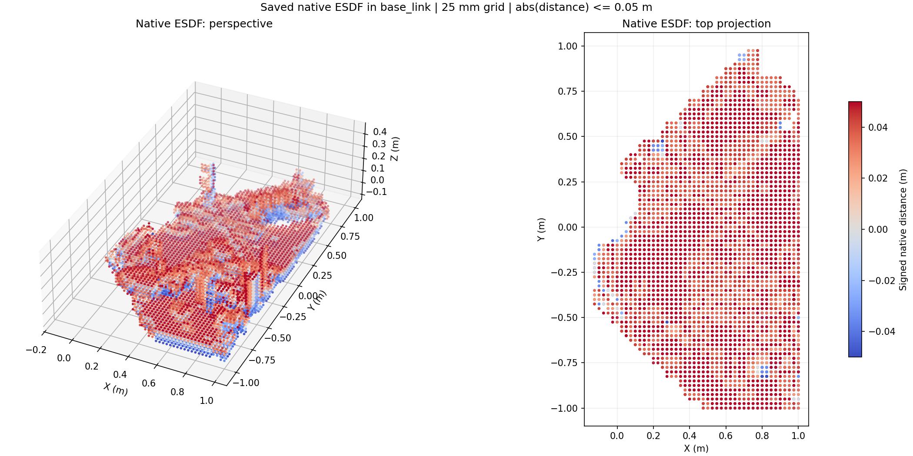
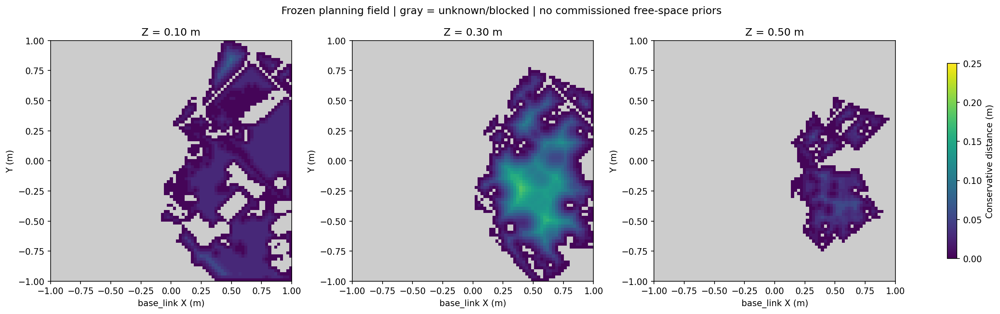

# ESDF 生成效果与实时性问题分析

分析日期：2026-10-26。对象：当前工作区、用户提供的 `realtime_nvblox_ws.zip`，以及 NVIDIA 官方 nvblox 源码。

本次只新增分析文档及证据清单，没有修改算法、配置、启动脚本或测试代码，没有运行机器人、Gazebo、GPU 建图或性能压力测试。下文数值分为“已有历史测量”和“由源码计算的工作量”，均不冒充当前机器上的新测量。

- [版本、源码位置与证据索引](esdf_analysis/EVIDENCE.md)
- [可机器读取的比较结果与工作量](esdf_analysis/evidence.json)
- [项目架构导读](ARCHITECTURE.md)

## 1. 结论：主要慢在什么地方

**现有证据不支持“原生 nvBlox ESDF 算法本身慢了几十倍”。更符合源码和历史记录的解释是：原生 ESDF 外面叠加了全体积规划场构建、CPU/GPU 往返、时间匹配、进程/线程竞争和执行策略；长尾使有效结果被拒绝，继而触发保持。**

最有说服力的三组证据是：

1. **基础核心没有因迁入当前仓库而整体重写。** 压缩包基础包中 47 个非缓存文件与当前同路径比较，45 个完全相同，只有 `setup.py` 和 `package.xml` 不同；`runtime.py`、`nvblox_backend.py`、`ros_node.py` 等运行核心一致。当前新增的仿真/规划应用才承担额外工作。文件清单见 [evidence.json](esdf_analysis/evidence.json)。
2. **原生阶段快，完整链路仍有长尾。** 2026-10-13 实机自动 ESDF 的 64 个成功样本中，原生融合/更新/查询 P50/P95 为 **2.23/24.08 ms**，自由场及记录提交为 **14.46/194.24 ms**，接收到结果为 **81.15/343.11 ms**。这些计时区间并不完全互斥，不能直接相加，也不能把第二项全归为 EDT。见[历史指标](../src/ur7e_auto_esdf/report/metrics.json)及[统计口径说明](../src/ur7e_auto_esdf/report/2026-10-13_real_auto_esdf_test.md)。
3. **加速单个算子没有等比例加速完整任务。** 历史同图实验把 373,977 点查询 P50 从 1.267 ms 降到 0.283 ms、保守场从 32.204 ms 降到 10.870 ms；但在线绕墙实验仍存在等待，最终完整任务时间没有改善。见[算子原始结果](../src/ur7e_real_static/validation/upgrade_20260924/benchmark.json)和[闭环比较](../src/ur7e_perception_planning/validation/NVBLOX2_LEARNING.md)。

当前最优先的问题依次是：

| 优先级 | 问题 | 确定程度 |
| --- | --- | --- |
| P1 | 每个有效帧将稀疏原生地图转为全体积规则规划场，CPU 投影和数组处理未按更新区域局部化 | 源码确定，历史计时支持其重要性 |
| P1 | 自写 CUDA EDT 按每条轴线枚举所有候选，不是与原生稀疏 ESDF 相同的算法；改变较大地图时工作量增长很快 | 算法结构确定；当前各场景的耗时占比仍需测量 |
| P1 | 长计算、状态/TF 对齐与结果年龄门限相互作用，出现“算过但未成功提交”的长空档 | 拒绝路径和历史长空档确定；各因素贡献不能完全分离 |
| P1 | 原在线 v1 不保留等待同步的选定图像，可能持续追逐比 TF 更新的最新图像 | 源码可构造触发；不能把历史全部空档只归因于它 |
| P2 | 高频关节回调、Python 几何、自滤波、SAGE、粗粒度锁和同步读回争用资源 | 结构确定，实机/仿真历史记录支持；GIL/调频占比未证实 |
| P2 | 采集临界区压缩落盘；v2 几何进程逐帧传递完整数组，更新变化时再做整场 CPU EDT | 源码确定，I/O/IPC 的实际占比未测 |
| P2 | 旧闭环先完整搜索，再分段优化/等待执行；这部分响应慢与 ESDF 生成慢不是同一问题 | 源码和历史时间线确定 |

这里 P1/P2 是后续诊断与优化顺序，不是已经批准实施的代码改动。

## 2. 先分清仓库实际上运行哪一种“ESDF”

| 运行路径 | 输入与主要处理 | 输出及更新特点 |
| --- | --- | --- |
| 压缩包/当前 `realtime_nvblox` SDK runtime | 相机 SDK、VIO 或机器人位姿、原生 TSDF/ESDF | 规则查询/点云；不构建应用层的保守自由空间 EDT |
| `ur7e_nvblox` | ROS 深度、图像时间 TF、EfficientBackend | 原生 ESDF dense/sparse 输出；不自动获得可规划的未知空间语义 |
| `ur7e_perception_planning` | 原生 ESDF + 本体过滤 + 自由证据 + 保守场 | 持续生成规划 Snapshot/PlanningMap，与 SAGE 共享运行资源 |
| `ur7e_real_static` / `ur7e_auto_esdf` | 停稳图像、实际关节/TF、原生 ESDF、自由场 | 扫描阶段生成冻结地图；冻结后不持续接收动态障碍 |
| `ur7e_gazebo_esdf_sage*` 预扫描 | 上述停稳建图 + 桌面证据/本体实体/可选有限未知策略 | 形成仿真可行性底图；不能全部称为纯实测自由空间 |
| 两个仿真包的 `online.py` / `online_v2.py` | 深度端点 → 新增占据 → 有效自由射线清除 → SciPy EDT | **在线变化层是 CPU 几何/占据距离变换，不是每帧调用 nvBlox 更新 ESDF** |

`ur7e_reconstruction` 和 `ur7e_real_reconstruction` 是彩色 TSDF **表面重建**，不生成 ESDF；不能将 Mesh 更新效果当作规划距离场实时性。

因此，“参考包显示流畅，而仿真/实机规划不流畅”首先存在工作内容差异，并不自动说明调用了错误的 nvBlox 内核。

还需排除**配置上本就限频或停止更新**的情况：

| 当前仓库默认配置 | 计算/显示目标 | 如何解释 |
| --- | --- | --- |
| `ur7e_nvblox/config/gazebo.yaml` | ESDF 15 Hz | 是更新上限，不是已达到的频率 |
| `ur7e_perception_planning/config/demo.yaml` | 地图 10 Hz；自由扩张 EDT 合并上限 5 Hz | 原生新障碍仍参与当前场；不能认为只每秒处理五张图 |
| `ur7e_real_static/config/real.yaml` | 采集 15 Hz，显示 1 Hz | 显示一秒一更不能直接证明采集只有 1 Hz；实机现场副本可能已改为 5 Hz |
| `ur7e_auto_esdf/config/mapping.yaml` | 采集 5 Hz，显示 1 Hz | 仅采集门打开且停稳时计帧；移动/切换控制时不应生成有效扫描帧 |
| 两个 `gazebo_esdf_sage*/config/mapping.yaml` | 预扫描采集 2.5 Hz，显示 1 Hz | 是预扫描设置，不是在线 v2 动态层更新目标 |

`freeze_map/freeze_scan` 后，静态底图不再融合是设计行为；若要持续感知变化，应确认运行的是在线障碍层，而不是把冻结预览误当成在线建图。目标频率、接受频率、显示频率必须分别观察。

## 3. 压缩包比较：参考代码没有额外的实时性魔法

压缩包 SHA256 为 `63445819083e1eb9bc36191bcea20ff2f46388bc6f7014e7333bc7aa26773eb6`。本次只将源码/配置解压到 `/tmp/eye_esdf_audit/`，没有运行其中的脚本，也不把其中说明文字视为本次操作指令。

| 比较对象 | 压缩包对应的 47 个文件中相同 | 不同 | 当前新增 |
| --- | ---: | --- | ---: |
| `src/realtime_nvblox` | 45 | `setup.py`、`package.xml` | 13 个非缓存文件 |
| `src/realtime_nvblox_2` | 43 | 上述两个、README、后端文件 | 15 个非缓存文件 |

第二份后端相对压缩包增加 `observed_esdf_numpy()`：取 TSDF 正权重体素作为候选坐标，查询其**原生 ESDF**，过滤未知，再导出。其开销与当前分配块数有关，并非永远优于小范围固定查询。当前两个目录的包名仍都为 `realtime_nvblox`，实际使用哪份要核实安装 overlay/PYTHONPATH。

压缩包的 `esdf_final.yaml` 使用 5 cm 原生体素、10 cm 输出网格、4×4×2 m 查询范围，对应 **35,301 点**；当前 demo 为 2.5 cm 原生体素、2 cm 规划网格、**356,136 点**。仅网格查询点数就约为前者的 **10.1 倍**；后者还有自由场和整臂检查。配置中的 30 Hz 是调度目标，压缩包没有因此证明相同硬件、相同输入、相同完整规划语义下稳定达到 30 Hz。

本节“相同”是逐文件字节比较，不是只比较文件名。详细差异和新增文件见[比较清单](esdf_analysis/evidence.json)。

## 4. 当前生成效果：功能可用，但地图覆盖与实时性不能合并验收

### 4.1 三种不同的距离含义

原生 ESDF 为 nvBlox 在其有效支持域内计算的带符号障碍距离；没有有效观测的位置返回未知标记。dense 查询只是在规则位置采样它，sparse 导出只显示候选已观测体素，均不意味着未知区域自由。

真机规划场还计算“到未观测/占据边界的距离”，再与有效原生障碍距离取最小。简化表示为：

```text
free = 已证明自由的格子 − 原生近障碍格子
d_boundary = EDT(free) × 网格间距
d_planning = min(d_boundary − 离散化余量, 已知的原生距离)
未知或非自由格子：d_planning ≤ 0
整臂检查：查询距离 − 碰撞球半径 ≥ 环境余量
```

实现见 [FieldBuilder.update](../src/ur7e_real_static/ur7e_real_static/field.py) L74–98、[conservative_field / Snapshot.query](../src/ur7e_perception_planning/ur7e_perception_planning_core/grid.py) L65–137。查询插值再扣一次几何余量；这属于保守建模。不能看到通道变窄就把两处余量直接当成重复错误删除，须先证明各自覆盖的离散化误差。

仿真 `bounded_unknown`、桌面推断、本体实体派生场又是另一种**运动可行性场**，包含明确的额外假设；不能拿它与无先验真机场直接比较可通行区域大小。

### 4.2 已有图片表明什么

以下图片来自 2026-10-13 真机自动 ESDF 的已有报告，本次已查看，没有重新生成地图：



近表面采样保留了桌面/物体等几何形态；这里仅显示 `abs(distance) ≤ 0.05 m` 的带状区域。正负着色不是场景 RGB，也不是绝对几何误差图。



切片显示可证明自由的区域集中在观察方向，其他区域保持灰色未知/阻挡；较高切片更破碎。这与视场、遮挡、自滤波、无效深度、自由射线余量及有限观察路线一致。图片能说明空间覆盖形状，不能单凭图片判定每个缺口的具体成因或绝对精度。

### 4.3 可核查的效果与边界

| 历史证据 | 已达到的效果 | 不能推导出的结论 |
| --- | --- | --- |
| 仿真基础建图 `artifacts/gazebo_perception/verification.json` | 图像时刻 TF 数值一致；运动前后共同体素距离变化 P95 约 4.87 mm | 共同支持域中的一致性不是对全空间真值的绝对 ESDF 精度 |
| 同目录球体视角验证 | 球体分区有 89 个共同格，变化 P95 约 7.46 mm | 不能等同于球体实体表面误差 7.46 mm |
| 2026-09-27 手动实机扫描 | 1,233 帧、21 姿态冻结；373,977 格中 22,329 个观测自由格，约 5.97% | 不是整个工作区 94% 都有实体障碍；大量格子只是未知 |
| 2026-10-13 自动实机扫描 | 八点/64 帧、冻结重载成功；原生已知查询格 60,557，近表面带 14,712 | “原生已知”不等于“满足整臂余量的自由”；不等于已经完成目标避障 |

引用：[仿真验证](../artifacts/gazebo_perception/verification.json)、[球体视角验证](../artifacts/gazebo_perception/sphere_verification.json)、[手动实机记录](../src/ur7e_real_static/validation/FIRST_REAL_SCAN.md)、[自动实机指标](../src/ur7e_auto_esdf/report/metrics.json)。不同实验的格子计数不能混为同一张地图。

手动实机记录中，当前整臂 17 个球中心没有足够正距离，且相机球与腕部模型表面间距 6.55 mm 低于配置 15 mm；这会让规划拒绝启动，和实体是否已碰撞不是同一回事。自动 ESDF 的 `planning_ready=false` 在 [freeze_scan](../src/ur7e_auto_esdf/ur7e_auto_esdf/mapper.py) L156–164 中是有意固定的扫描产物标记，另有 `current_arm_observed_safe` 检查；不能把这个固定 false 单独解释成实时 ESDF 更新失败。

实际 D435i 的独立真值/标尺误差、细薄障碍检出率，以及未知边界附近的距离保守性，还缺少完整量化验收。当前代码保护未知是合理设计，视野不完整则是观测能力约束；不能以直接清空未知来获得更流畅的演示。

## 5. 历史性能证据：应当比较哪些数字

| 场景/日期 | 原生或算子阶段 | 完整链路/任务表现 | 说明 |
| --- | --- | --- | --- |
| 基础仿真已有 artifact | 带读回建图 P50 约 2.03 ms、P95 5.79 ms | 接收到结果 P50 103.75 ms、P95 145.42 ms；输出约 4.99 Hz | 核心 GPU 工作不是这组约 100 ms 延迟的全部来源 |
| 2026-09-16 TF mapper 历史记录 | 融合及查询 P50 1.86 ms、P95 4.94 ms | 完整点云窗口约 3.09 Hz，另一负载窗口约 0.87 Hz | 不是当前版本的受控复测；不能据此分配每项责任 |
| 2026-09-23 同输入 ROS 合成流 | 优化后 dense 13.99 Hz，sparse 13.75 Hz | 延迟 P50 分别 60.45 / 24.29 ms | sparse 数据支持域不同；dense P95 没改善 |
| 2026-09-24 同原生地图 | prepared 查询 P50 0.283 ms；新自由场 10.870 ms | 高分辨率合成闭环约 5.49 Hz；有样本完整延迟约 200 ms | 不能用小算子实验宣称真实相机 15 Hz |
| 2026-09-27 首次实机扫描 | 相机独立接收约 14.90 Hz | 曾约 30 秒有效帧不增加；降采集目标并采样关节后短窗口约 4.23 Hz | 没有单变量证明 CPU 降频是唯一根因 |
| 2026-10-13 自动实机扫描 | 原生 P95 24.08 ms，自由场/提交 P95 194.24 ms | 接收到结果 P95 343.11 ms；成功样本最大 498.75 ms | 统计只覆盖成功接受的 64 个样本 |
| 2026-10-17 仿真在线 v1 | 成功帧接收至提交 P50/P95 101/202 ms | 最长提交空档 70.280 s | 只看成功帧延迟会严重漏掉不可用时间 |
| 2026-10-18 仿真在线 v2 r4 | 全轮处理延迟 P95 195 ms | 最大地图提交间隔 470 ms；存在短时年龄过期等待 | 测试条件限定；debug7 仍有 810 ms 间隔 |

来源分别为本仓库 [基础 artifact](../artifacts/gazebo_perception/verification.json)、[TF mapper 记录](../src/ur7e_nvblox/TEST_RESULTS.md)、[同输入比较](../src/ur7e_perception_planning/validation/NVBLOX2_LEARNING.md)、[真机感知优化记录](../src/ur7e_real_static/validation/REAL_STATIC_OPTIMIZATION.md)、[首次实机记录](../src/ur7e_real_static/validation/FIRST_REAL_SCAN.md)、[自动扫描指标](../src/ur7e_auto_esdf/report/metrics.json)、[在线 v1](../src/ur7e_gazebo_esdf_sage/validation/online_stage1/REPORT.md)、[在线 v2](../src/ur7e_gazebo_esdf_sage/validation/moving_stage2/REPORT.md)。

**不应做的换算：**

- `1 / 原生阶段耗时` 不是系统更新频率，因为还存在输入、对齐、其他处理和输出。
- 64 帧 ÷ 196 秒不是 ESDF 活跃采集频率，196 秒包含 32.6 秒预热、约 94 秒标称运动、停稳/控制切换和导出。
- P95(阶段 A) + P95(阶段 B) 不是 P95(总延迟)，尤其这里部分计时还包含记录/提交或重叠。
- 200 Hz 伺服定时器、15 Hz 相机、10 Hz mapper 目标、点云发布 Hz 和成功地图提交 Hz 是不同指标。
- 仿真时间上的 Hz 与墙钟 Hz 不同，需同时记录 real-time factor。

## 6. NVIDIA 官方代码为何不同

本次固定分析官方默认分支 `public` 的提交 **`5bd2d73da901ce0ba279c997a4c1f9f632b9309c`**，提交时间 2026-10-23。读取的 16 个源码/说明文件及 SHA256 见[来源索引](esdf_analysis/EVIDENCE.md)。本仓库没有锁定到该提交，故以下是源码架构比较，不是两个二进制版本的等条件速度测试。

### 6.1 核心更新是稀疏块和传播，不是应用层整张规则数组重建

官方 `Mapper` 在深度融合后登记更新块，`updateEsdf()` 默认读取这些待更新块，调用 ESDF integrator，再清除对应更新标志。第一次/显式全层更新可能处理全层。它没有强制每帧导出整场 CPU 点云这一前提。[深度融合实现](https://github.com/nvidia-isaac/nvblox/blob/5bd2d73da901ce0ba279c997a4c1f9f632b9309c/nvblox/include/nvblox/mapper/internal/impl/mapper_impl.h#L30-L81)、[Mapper::updateEsdf](https://github.com/nvidia-isaac/nvblox/blob/5bd2d73da901ce0ba279c997a4c1f9f632b9309c/nvblox/src/mapper/mapper.cpp#L217-L239)、[默认参数](https://github.com/nvidia-isaac/nvblox/blob/5bd2d73da901ce0ba279c997a4c1f9f632b9309c/nvblox/include/nvblox/mapper/mapper.h#L375-L380)。

integrator 分配相关 ESDF 块、GPU 标记障碍 sites/失效项、在块内 sweep 并向邻块传播，直到本轮传播完成；删除/清理时还可能扩大处理范围。**增量不等于每次只处理一个局部块，也不等于有硬实时上界。** [积分入口](https://github.com/nvidia-isaac/nvblox/blob/5bd2d73da901ce0ba279c997a4c1f9f632b9309c/nvblox/src/integrators/esdf_integrator.cu#L240-L283)、[块扫掠与传播](https://github.com/nvidia-isaac/nvblox/blob/5bd2d73da901ce0ba279c997a4c1f9f632b9309c/nvblox/src/integrators/esdf_integrator.cu#L1525-L1585)。

当前 Python 后端本来就调用了这套原生 `Mapper.update_esdf(0)`。因此不能说“我们没有用原生增量更新，完全重算了原生 ESDF”；真正额外全量化的是后续导出和自建规划场。

### 6.2 官方也有同步，不能把差异简化为“C++ 全异步、Python 全同步”

该提交的 ESDF integrator 本身有 stream synchronize。`nvblox_torch` 的 `queryEsdf` 也在查询 kernel 后同步当前 stream。Python 调用返回耗时与随后 CPU 拷贝耗时的归属取决于具体绑定版本；不能假定所有内核成本都推迟到 `.cpu()` 才显现。[原生 integrator](https://github.com/nvidia-isaac/nvblox/blob/5bd2d73da901ce0ba279c997a4c1f9f632b9309c/nvblox/src/integrators/esdf_integrator.cu#L265-L283)、[Torch 查询绑定](https://github.com/nvidia-isaac/nvblox/blob/5bd2d73da901ce0ba279c997a4c1f9f632b9309c/nvblox_torch/cpp/src/py_mapper.cu#L600-L645)。

差异在于：当前应用在原生更新外又建立多轮 CPU/GPU 数据依赖；这些往返和临界区会进一步限制流水。保留数据在 GPU、减少不必要阶段边界，依然有价值；“删除所有同步”则不是正确分析。

### 6.3 官方未知策略可配置，但不能直接代替当前规划语义

该提交提供 `kIgnore`、`kFree`、`kOccupied`，默认忽略未观测体素；也有限距离和最小权重参数。这些控制已分配层内的 ESDF 支持/传播，与当前“独立自由射线证据 + 固定工作区边界 + 整臂余量”的场并非一一等价。尤其不能为了得到连续正距离直接使用 `kFree` 并宣称解决未知安全问题。[参数源码](https://github.com/nvidia-isaac/nvblox/blob/5bd2d73da901ce0ba279c997a4c1f9f632b9309c/nvblox/include/nvblox/integrators/esdf_integrator_params.h#L23-L83)。

`kOccupied` 可能成为后续减少重复距离场的研究方向，但需核对已分配块之外、自由射线有效性、未知边界、查询插值、球包络以及实际安装 wheel 的支持情况，先做数值/语义等价验证。

### 6.4 官方性能口径与示例不等于我们的完整场景

官方 release notes 给出的 1 cm、8 m³、30 Hz 指标描述的是特定平台/工作区的深度融合能力，不能直接解读成任意 Python/ROS/整臂动态规划链路 30 Hz。官方也专门优化内存池、视点缓存、流式传输和按需 ESDF/可视化。[release notes](https://github.com/nvidia-isaac/nvblox/blob/5bd2d73da901ce0ba279c997a4c1f9f632b9309c/release-notes.md)。

官方 fuser 分别控制深度、ESDF、Mesh 等处理频次；官方 RealSense 示例主要是 VSLAM+TSDF/彩色 Mesh，不能用它的流畅显示来证明同样进行了实时保守 ESDF 规划。ESDF 可视化示例也会构建稠密查询网格并转 CPU，因此不能泛化成“官方绝不稠密导出”。[fuser 调度](https://github.com/nvidia-isaac/nvblox/blob/5bd2d73da901ce0ba279c997a4c1f9f632b9309c/executables/src/fuser/fuser.cpp#L299-L337)、[RealSense 示例](https://github.com/nvidia-isaac/nvblox/blob/5bd2d73da901ce0ba279c997a4c1f9f632b9309c/nvblox_torch/nvblox_torch/examples/realsense/run_realsense_mapper.py)、[ESDF 可视化示例](https://github.com/nvidia-isaac/nvblox/blob/5bd2d73da901ce0ba279c997a4c1f9f632b9309c/nvblox_torch/nvblox_torch/examples/esdf/esdf.py)。

## 7. 具体代码问题与形成延迟的机制

### F01：在原生增量地图外，每帧又处理整个规则工作区

位置：[PlanningMapper._worker](../src/ur7e_perception_planning/ur7e_perception_planning_core/mapper.py) L175–208、[FieldBuilder.update](../src/ur7e_real_static/ur7e_real_static/field.py) L74–98、[observed_free](../src/ur7e_perception_planning/ur7e_perception_planning_core/grid.py) L40–50。

每帧全网格查询 → 原生距离 D2H → CPU 将每个网格点变换到相机系 → 投影/过滤 → 产生自由数组 → 比较旧自由数组 → 必要时 EDT → 全数组取最小、类型转换、复制来源。即使 EDT 没重算，其他 O(N) 操作仍会执行。当前 `grid_points` 由 NumPy 默认精度生成的坐标一般为 float64，CPU 中间数组也可能是 float64，不能只按最终 float32 输出估算内存流量。

| 工作区 | 网格点 | 单份 float32 场 | 20 字节/点的全量点云 | 原生+规划+来源的未压缩地图 |
| --- | ---: | ---: | ---: | ---: |
| 基础 ESDF dense | 52,111 | 0.208 MB | 1.042 MB | 0.469 MB |
| 感知规划 demo | 356,136 | 1.425 MB | 7.123 MB | 3.205 MB |
| 真机静态默认 | 373,977 | 1.496 MB | 7.480 MB | 3.366 MB |
| 后期仿真工作区 | 724,271 | 2.897 MB | 14.485 MB | 6.518 MB |

这些是**结构大小计算**，使用十进制 MB；没有说所有运行模式都会发送全点云。当前真机显示已经筛选点并降频，combined 模式也能绕过地图 DDS。问题仍在于生成完整规划场时，全数组成本与观测变化量脱钩。

后续应测量 FOV/变化块/局部工作区更新能否在不削弱未知约束的前提下取代全域处理。不能直接把 sparse 点云替换 PlanningMap：缺点不代表自由，二者接口语义不同。

### F02：自写 CUDA EDT 的复杂度与原生 ESDF 不同

位置：[CudaEDT.__call__](../src/ur7e_perception_planning/ur7e_perception_planning_core/edt.py) L16–38。

对长度 n 的每条轴线，代码显式构造 n×n 代价，并对 `(rows[..., :, None] + cost)` 求 min。于是每轴的总候选量约为 N×n，三轴合计约为 **N×(nx+ny+nz)**，不是体积 N 的线性变换，也不是原生 ESDF 的稀疏增量传播。32 MB 分块限制的是单次临时张量大小，**没有减少总候选比较次数**；movedim/reshape 和逐 batch 的 PyTorch 调度还有额外成本。

若以完整盒体、未裁剪/未 padding 估算，373,977 点约需处理 8,190 万候选，724,271 点约 1.977 亿；实际调用已裁剪自由区域并加边界，大小会改变，所以这不是实测 FLOP 或真实耗时。固定物理体积、各方向同时缩小网格间距时，此实现的总候选量近似按间距的四次方倒数增长。

小裁剪区域下它在历史测试中确实比旧 CPU 路径快，因此“用了 CUDA 就错误”同样不成立。问题是扩展性、重复全场代价和长尾，而不是已证明数值错误。应评估真正适合三维的并行/线性 EDT、原生未知策略，或增量/局部维护，先验证误差与保守性。

### F03：CPU/GPU 往返和粗粒度锁把阶段串成流水瓶颈

位置：[EfficientBackend.query_prepared](../src/ur7e_nvblox/ur7e_nvblox/esdf.py) L21–28、[GPU_LOCK](../src/ur7e_perception_planning/ur7e_perception_planning_core/runtime.py)、[EsdfRollout.set_map](../src/ur7e_perception_planning/ur7e_perception_planning_core/sage.py) L28–40。

典型路径是：


GPU mapper 的 RLock 会覆盖查询和读回。combined 模式的 `MappingPriorityLock` 只优先排队的建图，不能抢占已经在运行的 SAGE；CUDA EDT 又要取得该锁。一个长优化或长 EDT 就可能占掉下一次有效帧的年龄预算。

**当前已做到的事不能算未修复缺陷：** EfficientBackend 已预分配查询/输出缓冲，CPU 结果独立拥有存储；连续版 optimizer 已按地图版本减少传输/上传。旧仿真 `reach` 则在每个在线短段调用 `rollout.set_map(snapshot)`，即使版本不变也可能重新复制/上传，位置在[旧版 node.py](../src/ur7e_gazebo_esdf_sage/ur7e_gazebo_esdf_sage/node.py) L300–304。

优化方向应是缩短临界区、按版本/变化传递和减少跨设备边界，并保持快照原子性。不能简单解除 Mapper 锁，让查询与地图修改同时无保护执行。

### F04：成功帧年龄门限将长尾转化成“地图不更新”

位置：[真机 capture](../src/ur7e_real_static/ur7e_real_static/capture.py) L39–61、L93–109；[自动 ESDF capture](../src/ur7e_auto_esdf/ur7e_auto_esdf/capture.py) L94–110；[在线 v2 worker](../src/ur7e_gazebo_esdf_sage_continuous/ur7e_gazebo_esdf_sage_continuous/online_v2.py) L99–150。

输入要先等待关节插值、TF 到齐和停稳证据；完成全套融合/自由场后，还可能因超龄或门/lease 已变而拒绝提交。在负载升高时：

```text
回调/TF 变迟 → 可用计算预算减少 → 完整处理超龄
       → 已完成结果不提交 → 规划图过期 → 控制保持
       → 下一帧重新支付处理成本，直到有一帧及时完成
```

所以 GPU 工作不一定空闲，但“有效场计数”可以长时间不增加。真机静态场、动态层和仿真停稳采集的接受规则并不一样：后期仿真 `stationary.result_rejection` 在声明静态且持续停稳证据完整时允许部分延迟结果；不能据此把实机/动态数据年龄门限一并放宽。

该保护本身合理；架构问题是没有为每个阶段分配并保障端到端时延预算。应报告**所有输入的处理/拒绝原因、最长成功提交间隔和可用占空比**。只报告成功样本 P95 会把 70 秒无结果隐藏在统计之外。过期拒绝前若已修改了静态 TSDF，原生内部地图仍可能前进，而对外规划快照没更新；这也说明两个计数不应混用。

### F05：在线 v1 有可构造的同步饥饿路径，v2 已针对性修正

位置：[online.py](../src/ur7e_gazebo_esdf_sage_continuous/ur7e_gazebo_esdf_sage_continuous/online.py) L33–63；[online_v2.py](../src/ur7e_gazebo_esdf_sage_continuous/ur7e_gazebo_esdf_sage_continuous/online_v2.py) L99–122。

v1 每次循环取 `self.pending`，而新图像不断覆盖这个槽。如果关节/TF 总比最新图像迟一点，本轮等到下一次循环时又可能转去更新图像，始终没等到选定图像的几何状态。例：10 Hz 图像、对应 TF 固定迟约 120 ms、轮询 10 ms；每张图像在其 TF 就绪前就被 100 ms 后的新图像替换，便存在持续处理“最新但尚未 ready”图像的调度方式。这里是可构造的调度例子，不是对历史 TF 延迟的测量。

v2 把选定图像从 pending 取出，在有界期限内等待同一张图像状态/TF；新到图像只覆盖下一槽。PlanningMapper 的 `newest_ready` 也已保留多个候选并寻找最新可解析帧。因此这条问题主要针对**仍可选择的 v1 路径**，不能再当成全部版本共同存在的问题，更不能在没有逐帧诊断时断言它解释了全部 70 秒空档。

连续版 launch 当前默认 `online_engine=v1`，v2 在线实验需要显式启用；仅包名带 continuous 不代表运行的在线感知实现也已切到 v2。

### F06：CPU 几何和高频关节回调仍会影响建图，而不只影响显示

位置：[通用 self_filter](../src/ur7e_perception_planning/ur7e_perception_planning_core/self_filter.py)、[仿真批量 self_filter](../src/ur7e_gazebo_esdf_sage_continuous/ur7e_gazebo_esdf_sage_continuous/self_filter.py)、[RealStatic.on_state/state_at/settled_at](../src/ur7e_real_static/ur7e_real_static/node.py) L123–147。

本体过滤要补球间连接、构造像素射线，再按球做求交。通用版本是大量小 NumPy 调用；后期仿真版改为 32 球批量，但会计算像素×球的中间矩阵，成本依赖图像尺寸、球数和 BLAS 线程设置。两者没有脱离 CPU。

真机扫描通常只需图像频率的几何匹配，却可能接收 500 Hz 关节状态；每条回调有 Python/ROS 转换、数组构造和共享锁。`state_at` 把最多 2,000 个样本复制为列表并顺序寻找，`settled_at` 再筛历史；图像不 ready 时还可能多次重复查找。

2026-09-27 降到专用 50 Hz 采样通道后恢复到短窗口约 4.23 Hz，支持“输入/调度成本值得处理”，但当时也同时改了采集上限，不能证明单一回调频率就是根因。CPU 约 400 MHz 的历史样本同样不能直接证明热降频：缺少活跃核心、功耗/温度和线程调度的同步记录。

后续先核实活跃回调量、状态样本范围和自滤波耗时，再决定缓存射线/连接球、历史索引或进程隔离。不能跳过图像时刻模型校验来提速。

### F07：压缩观测证据在采集锁内执行，计时标签混入记录成本

位置：[自动 ESDF capture](../src/ur7e_auto_esdf/ur7e_auto_esdf/capture.py) L107–127、[record_capture/publish_cloud](../src/ur7e_auto_esdf/ur7e_auto_esdf/mapper.py) L133–146；仿真预扫描有对应实现。

每个停靠点首个接受帧在 `node.lock` 内解码全尺寸深度、`np.savez_compressed`，并写 pose/observations JSON。该锁也是关节接收、状态查询等共享锁，慢压缩/磁盘会阻塞几何状态推进。之后保存用于显示的 raw_surface 时还复制完整坐标和距离。

`free_field_ms` 从原生查询完成后计到记录与部分提交之后，所以 194 ms 的 P95 **既可能有自由场计算，也可能有锁等待和该点首帧落盘**。不能把它直接称为“CUDA EDT 内核耗时”；`receive_to_result_ms` 也在最终显示缓存复制之前采样，不包含真正的消息发布/控制响应。

可考虑后续把证据写入独立有界记录通道、缩短锁内提交，但需要明确丢弃策略及审计完整性；本次未改动记录代码。

### F08：在线 v2 虽隔离进程，仍存在逐帧大数组 IPC 和同步记录

位置：[online_v2.process_geometry](../src/ur7e_gazebo_esdf_sage_continuous/ur7e_gazebo_esdf_sage_continuous/online_v2.py) L36–69、worker L134–149、共享快照 L193–197。

传给 `ProcessPoolExecutor` 的参数每帧含 `occupied` 和 `old_distance`，返回值也含完整 occupied/hit/distance；即使距离未变化，也仍经进程池返回完整距离。主控制读取已使用共享内存并仅在版本变化复制，这是正确改进，但**感知到几何工作进程之间并没有因此零拷贝**。

724,271 格时，仅输入占据 bool+旧 float32 距离约 3.62 MB，输出占据+hit+距离约 4.35 MB，合计约 **7.97 MB/帧**，不含图像、pickle 元数据和其他拷贝；10 Hz 对应约 79.7 MB/s 的数组载荷。这是布局计算，不能直接换算成若干毫秒，也不能断言内存带宽已耗尽。

占据变化时仍调用 CPU `distance_transform_edt(~updated)` 处理整个在线网格；每个变化版本压缩保存占据及观测发生在同一个 worker。移动物体会频繁触发，I/O 虽在当前快照提交后进行，仍可能延迟下一帧。应分别测量排队/pickle、几何、EDT、提交、记录，决定局部距离更新及固定共享缓冲是否值得实施。

### F09：基线导出/显示的开销不能泛化到已经优化的应用

位置：[基础 runtime](../src/realtime_nvblox/realtime_nvblox/runtime.py) L352–386、[基础 ROS 发布](../src/realtime_nvblox/realtime_nvblox/ros_node.py) L174–197、[esdf_cloud](../src/realtime_nvblox/realtime_nvblox/ros_publishers.py) L150–190。

基础 SDK 分支会生成规则网格结果，ROS 定时器对新结果着色并构造 PointCloud2；这一发布函数没有订阅数量门控，开启生成时没有消费者也会付出打包成本。完整点云保留未知，20 字节/点，还可能存在可靠 DDS 等待。该逻辑在压缩包中同样存在。

但当前 `ur7e_nvblox` 已把发布移到独立 latest-only 线程并按订阅门控；`real_static.visualization` 已独立线程、1 Hz 目标、筛选可见点；PlanningMapper combined 模式会直接传 Snapshot，不必经完整地图压缩/DDS。因此“全部慢都因为 RViz”“给所有包加发布线程”均不符合当前代码。显示线程仍共享 CPU/内存/GIL/驱动资源，关闭 RViz应作为测量变量，不是未经验证的唯一修复。

### F10：规划/执行策略造成响应迟缓，不等于地图慢

位置：[旧版 reach](../src/ur7e_gazebo_esdf_sage/ur7e_gazebo_esdf_sage/node.py) L277–342、[连续版 continuous](../src/ur7e_gazebo_esdf_sage_continuous/ur7e_gazebo_esdf_sage_continuous/continuous.py)、[optimizer](../src/ur7e_gazebo_esdf_sage_continuous/ur7e_gazebo_esdf_sage_continuous/optimizer.py)。

旧版先完整 IK/引导搜索，再逐段 SAGE；每步等待上一段完成，重设速度均值，`shift_steps=0`。即使地图一直有效，也可能几十秒后才开始动作。历史 r4 中障碍横穿时仍在求引导、首个执行步迟到，属于真实的规划策略限制。

连续版已把最终目标优化放入独立常驻进程，保留分布并按时间平移，原子替换检查后的短前缀；后台路线仅辅助。其开发记录有成功样本优化延迟 P95 约 74 ms、过期计划拒绝和 0.765 秒地图空档，证明改进了部分行为，但不证明消除了所有长尾。某次目标首提交仍迟约 32 秒，需结合是否堵塞和保持状态解释，不能仅凭这一数字反推 ESDF 内核耗时。[连续版开发记录](../src/ur7e_gazebo_esdf_sage_continuous/validation/DEVELOPMENT.md)、[审计 JSON](../src/ur7e_gazebo_esdf_sage_continuous/validation/debug4_continuous_audit.json)。

## 8. 哪些属于合理代价，哪些属于待改的组织方式

| 应保留的语义/约束 | 可重新设计的实现成本 |
| --- | --- |
| 图像曝光时刻几何，不能用 latest TF 随意替换 | 采用有界同步队列、缓存固定变换和有效状态索引，减少重复解析 |
| 未知不自动作为自由；碰撞余量不能随意降低 | 尽量局部/增量维护未知边界距离，验证与完整参考场一致或更保守 |
| 原生 Mapper 访问一致性、不可变快照 | 缩短临界区，版本化 GPU 数据；避免把磁盘操作放在状态锁内 |
| 地图/反馈过期时停止使用旧结果 | 控制计算预算、提前取消无望完成的工作，记录所有拒绝和空档 |
| 整臂及相机本体遮挡和碰撞检查 | 缓存几何常量、优化射线求交与数据布局，保持同样的屏蔽规则 |
| 结果能被独立审计 | 独立有界记录通道，区分提交与落盘时间 |

没有证据支持以下简单归因：Python 本身必然比 C++ 慢固定倍数、换 sparse 就自动具备完整规划空间、只关闭 SLAM 就解决 TF 路径、只升级 nvblox 就恢复目标 Hz、降低地图分辨率就没有语义损失。

另外，[NvbloxBackend._initialize](../src/realtime_nvblox/realtime_nvblox/nvblox_backend.py) 主要传入体素大小/TSDF 类型；`max_integration_distance_m` 当前还用于 Python 深度有效性遮罩，并不等于已经把官方所有 projective/ESDF 参数都显式传入。后续应打印 wheel 版本与实际 MapperParams，核对截断范围、最大 ESDF 距离、workspace bounds、内存池和未知策略；仅凭这个接口差异还不能确定它就是主要性能瓶颈。

## 9. 后续建议顺序：先测清，再选择改动

### 第一步：固定基线和指标，不改算法

记录实际导入的 `realtime_nvblox.__file__`、nvblox_torch/Torch/CUDA 版本、GPU/CPU、运行配置、是否 RViz、是否 combined、v1/v2、相机实际输入 Hz 与仿真 RTF。对比须使用相同原始深度、图像时刻位姿、体素、网格、未知语义和预热状态。

每帧贯穿同一个 frame_id/epoch/sequence，至少分出以下时间：

| 阶段 | 测量目标 |
| --- | --- |
| 输入 | 图像时间、接收单调钟、输入年龄、原始/有效输入率 |
| 匹配 | 等关节、等 TF、停稳等待；分别计次数与时间 |
| 几何 | 解码、各 link 变换、自滤波、像素/球数 |
| 原生 | 上传、TSDF、ESDF、查询、CPU 读回；同时关联原生 timing/Nsight |
| 自建场 | CPU 投影、source 更新、EDT 是否重算、裁剪形状、EDT 后合成 |
| 协作 | GPU 锁等待、进程任务排队、序列化/复制、地图版本上传 |
| 提交 | 完成时年龄、接受/拒绝理由、可用地图年龄 |
| 输出 | 快照交付、ROS 打包/publish、证据排队/落盘 |
| 规划执行 | 目标接收、引导搜索、优化、整臂 guard、首条有效轨迹提交、实际命令 |

统计 P50/P95/P99/最大值、最长提交空档、超龄率、有效地图可用比例；成功帧和全部尝试均需统计。GPU 时间用事件或分析器核实，不能只看 `perf_counter` 的 kernel 提交区间；分析器会扰动负载，也需记录。

### 第二步：用隔离比较定位瓶颈

在后续明确授权运行测试后，可按同一录制输入依次比较：原生更新无导出 → 固定网格查询 → 加自由投影 → 加 EDT → 加记录/显示 → 加 SAGE → combined 与隔离进程。每次只改变一项，保留正常年龄/未知保护和完整拒绝日志。

比较 CPU EDT 与当前 CUDA EDT时，要固定同一份 free mask 和裁剪大小，分别查看稳态重复与持续变化场景；比较 v1/v2 时固定输入和同步延迟，不能把降低端点分辨率带来的收益全部计为进程隔离收益。

### 第三步：按收益和语义风险选择方案

1. **先做组织成本项：** 将锁内压缩落盘解耦，复用几何/射线常量，关节历史按时间索引，按地图版本避免重复复制，消除 v1 追新同步路径。
2. **再做全场成本项：** 为全网格投影和保守距离建立局部/变化区域更新，评估替代 EDT；保持未知边界和新障碍立即生效，并以完整参考场验证。
3. **再评估数据主驻留：** 尽量在 GPU 留存原生/规划数据，CPU 只取独立 guard 或显示需要的数据；执行保护所需的 CPU 快照版本一致性仍必须保留。
4. **动态层独立设计：** 解决 v2 进程池全数组往返和变化时整场 CPU EDT，不能把替换一层 nvBlox wrapper 当作已经优化动态感知。
5. **单独优化规划策略：** 新目标响应/局部优化/后台搜索与地图提交分别验收；不以伺服 Hz 替代规划 Hz。

具体是否改用原生未知策略、稀疏块、局部密集窗口或 C++/CUDA 扩展，应由阶段测量和语义等价验证决定。本次不实施这些改动。

## 10. 本次能确认与仍不能确认的事项

已经确认：压缩包比较、当前各条代码调用链、全数组与二次距离变换成本、v1 同步风险、锁内落盘、v2 IPC、旧/新规划差异，以及历史测量对“原生快而完整链路慢”的支持。

仍不能确认：当前机器各线程真实占比、当前 wheel 对应的原生提交、某个具体 30/70 秒停顿的唯一原因、CPU 降频机制、GIL 与浮点非正规数各自的贡献、改动后的可达 Hz、以及实机动态避障能力。代码分析能排除若干错误归因，不能替代受控性能采样。

**建议的总体方向是：保留已有的时间/未知/碰撞语义，把原生稀疏更新之后的全场派生、跨设备复制和调度阻塞逐项消掉；同时将“地图何时可用”和“轨迹何时可执行”分开测量。**
