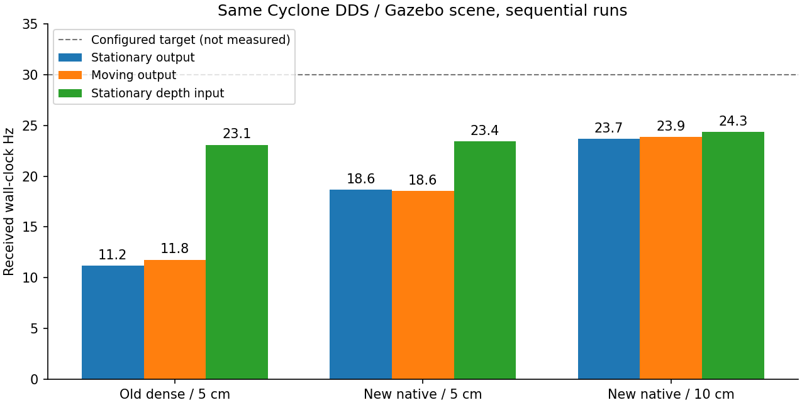
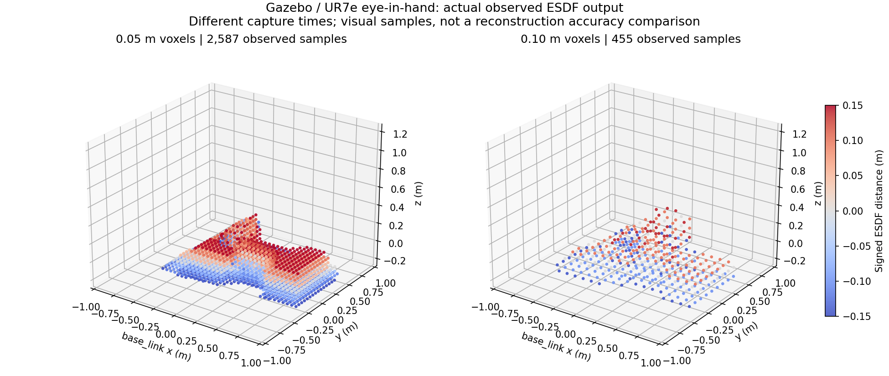

# ROS 逻辑对齐：感知修改说明与仿真实测

日期：2026-10-26。已修改、构建并在本机 Gazebo/CUDA 测试；未连接或控制真实机械臂，未修改手眼标定和机器人运动规划代码。

2026-10-27 补充：本文记录的是 Python 查询与调度层的阶段性修改，不能代表已完成官方 ROS C++ 模块迁移或达到用户的最终实际应用目标。新的范围说明见[原生实时性设计](ESDF_NATIVE_REALTIME_DESIGN.md)，完整命令见[操作与验收手册](ESDF_OPERATION_MANUAL.md)。

## 1. 为什么你用 topic hz 能看到 30 Hz

之前文档的“深度 30 / ESDF 5 / 层发布 5 Hz”是 **workspaces 中当时读取的 nvblox_base.yaml 文件值**，不是你那次运行的参数快照。不能据此断定你当时的 ESDF 一定只有 5 Hz；launch 覆盖参数后也可能实际配置成 30 Hz。

另一方面，配套 `live_esdf_query` 的 launch 确实设置了 `rate_hz=30`、`update_esdf=false`，允许按 30 Hz 读取已有地图。它用当前时间给点云打时间戳，服务返回的数据可能来自重复的 ESDF 版本。5 cm 比 2 cm 体素导出的数据少得多，读取与显示更容易达到 30 Hz，这与地图更新仍为 5 Hz 并不矛盾。

**所以你测到 30 Hz 是合理观测，但仅凭 topic hz 还不能判断是哪一种情况。** 当时查询的具体话题及实际参数没有保存，不能把“30 Hz 都是重复地图”作为已经证实的结论。旧版复查应在其实际 ROS 域内执行：

```bash
ros2 topic info /global_esdf_cloud --verbose
ros2 param get /nvblox_node voxel_size
ros2 param get /nvblox_node update_esdf_rate_hz
ros2 param get /nvblox_node publish_layer_rate_hz
ros2 param get /global_esdf_query_node rate_hz
ros2 param get /global_esdf_query_node update_esdf
```

新代码直接分别报告融合、ESDF 更新、导出和两路点云发布次数，并给出地图版本及源图像时间，避免再用一个话题频率代表整条链路。

## 2. 本次修改了什么

| 文件 | 修改 | 解决的问题 |
| --- | --- | --- |
| `src/ur7e_nvblox/ur7e_nvblox/sampling.py`（新增） | 固定 base_link ROI 内生成原生体素中心；最多 200 万候选；加入限频工具 | voxel_size 与显示采样脱节、查询坐标不在原生中心 |
| `src/ur7e_nvblox/ur7e_nvblox/node.py` | 融合、导出、发布三个线程；更新和导出分别限频；按订阅导出；地图版本去重 | 无人显示仍查询、更新与读回强制绑定、重复地图频率混淆 |
| 同上 | 更新使用最多两帧的有限预算，吸收图像/TF 到达抖动；不积累无界补算任务 | 约 30 Hz 输入轻微抖动导致隔帧跳过 ESDF 更新 |
| `src/ur7e_nvblox/ur7e_nvblox/esdf.py` | 复用查询缓冲；仅 observed 订阅时在 GPU 剔除未知/距离带外数据 | 为显示读回和打包整盒未知样本 |
| `src/ur7e_nvblox/ur7e_nvblox/monitor.py`（新增）及 `setup.py` | `esdf_rates` 命令 | 同时看到地图更新、导出、消息和不同源图像频率 |
| `config/gazebo.yaml` | 默认 native、5 cm、更新/导出目标 30 Hz、显示距离带 0.15 m | 默认显示与原生尺寸一致，避免画满灰色未知盒和宽自由距离带 |
| 启动脚本及 launch | 本机 Python 回退与显式解释器覆盖；只加载所需感知包 | 本机没有旧 whole_control 环境，实际 Torch/nvBlox 安装在系统用户目录 |
| `build_ur7e_esdf.sh` | 限定两包路径；清理两包失效生成链接；移出非法备份索引 | 同名包发现冲突、旧 /home/wqj 安装链接、非法 ROS 包名阻止启动 |
| `verify.py` 与测试 | 校验有效运行解释器，新增 CUDA/版本/采样/真实 Gazebo 测量 | 原验证器把旧 conda 路径硬编码成唯一正确环境 |

`build/`、`install/` 中的生成文件也随真实构建更新，没有将它们当作手写算法修改。共享 `src/realtime_nvblox` 的实现和 workspaces 官方库源码未改动。

### 位姿和几何约束

仍使用机械臂 `/joint_states` → `robot_state_publisher` 正运动学 → 手眼标定 → 图像时刻 `base_link <- camera_depth_optical_frame`。
没有使用 latest TF 替代过期位姿，没有复制其他机器的 odom 静态相机安装方式，也没有依赖视觉 SLAM 获得位姿。深度格式、深度内参和光学坐标系配对仍保留原校验。

### native 与兼容模式

默认 `native` 通过已有 Torch 查询 API 读取固定世界 ROI 内的原生体素中心。ROI 为半开上界，5 cm 时为 `40×40×30=48,000` 个候选，10 cm 时为 `20×20×15=6,000`；显示只保留有效距离带，因此实际点更少。

`dense` 仍保留旧接口，独立 `grid_resolution_m`、对称网格和顺序都不变。需要原来的 52,111 点固定坐标接口时，必须显式配置 `esdf_output_mode: dense`。默认模式改变是有意的接口行为变化，不应让依赖固定坐标的算法静默使用 native。

**本次没有完成 C++ 原生块级 exporter 的移植。** 已安装 Torch API 没有公开 ESDF layer view；本次选择有界、原生中心对齐的查询方案，没有通过扫描全部 TSDF 块假装获得完整 ESDF 层。内部三维 ESDF 仍由原生 nvBlox 更新，未用二维场替代。地图锁仍使 GPU 访问串行，分线程不代表查询没有资源竞争。

### 输出与计时语义

- `esdf_updated`：新深度融合后实际调用 ESDF 更新的次数。
- `esdf_exported`：实际查询/读回次数；无点云订阅者时为零。
- `full_cloud_published` / `observed_cloud_published`：实际调用对应 publish 的次数。
- `esdf_published`：至少发布一路点云的结果批次，不把两路订阅计成两次。
- `map_latest.map_version/input_stamp_ns`：最新 ESDF 更新版本和源图像时间；`latest` 是最近导出结果摘要。
- `receive_to_publish`：从收到图像到调用发布完成的墙钟耗时，不包含相机曝光到 ROS 接收的传输，也不是控制执行延迟。

同一话题、同一地图版本最多发布一次；停止输入不会依靠 30 Hz 定时器重复旧图。图像时间戳保持原值，不改成当前时间。统计中的不同图像时间戳代表新融合输入，不保证场景几何一定改变。

## 3. 测试环境与比较口径

Ubuntu 22.04 / ROS2 Humble / Gazebo Classic；RTX 4060 Laptop 8 GB；驱动 580.178.04；系统 Python 3.10；PyTorch 2.9.1+cu128；本机已有 nvblox_torch。

仿真使用本仓库 UR7e/D435 场景、原始 1280×720 深度、stride 2 后 640×360 融合、4 m 深度上限、原始手眼标定、2×2×1.5 m ROI、0.15 m 显示距离带。主对照中新旧两版均设 **5 cm 体素和 30 Hz 更新目标**，不是把旧版 3 cm 与新版 5 cm 的性能混比。

测试域 `ROS_DOMAIN_ID=127`，Gazebo master `http://127.0.0.1:11457`；稳定合成输入另用域 128。只在本轮隔离场景中插值到测试观察姿态，并以 wrist_1 ±0.06 rad 小幅运动验证移动眼在手流程。

修改前代码保存于 `/tmp/esdf_change_baseline`，其 node.py/esdf.py 与 Git HEAD `3ac915bb9adde9f2b9a3717d7332d29501f8eca2` 逐字节相同。基线与新版顺序运行，均在相同 Cyclone DDS 场景测量；环境存在正常负载波动，不是同步硬实时基准。

## 4. Gazebo 最终归档结果

单位均为墙钟 Hz；每个阶段约 12 秒。实际点云接收频率单独计算，不是配置值。完整 JSON 见 [实测目录](../artifacts/esdf_ros_alignment_20261026/)。

| 版本 | 工况 | 深度接收 | 融合 | ESDF 更新 | 点云接收 | 显示点数 |
| --- | --- | ---: | ---: | ---: | ---: | ---: |
| 修改前 dense / 5 cm | 静止 | 23.08 | 22.17 | 11.25 | 11.19 | 2756–2756 |
| 修改前 dense / 5 cm | 移动 | 25.42 | 23.67 | 11.75 | 11.77 | 2756–3147 |
| 修改后 native / 5 cm | 静止 | 23.41 | 23.33 | 18.58 | 18.64 | 2587–2587 |
| 修改后 native / 5 cm | 移动 | 22.09 | 22.17 | 18.67 | 18.56 | 2587–2978 |
| 修改后 native / 10 cm | 静止 | 24.33 | 24.50 | 24.17 | 23.66 | 420–420 |
| 修改后 native / 10 cm | 移动 | 23.58 | 23.50 | 23.33 | 23.86 | 401–457 |



5 cm 最终归档的输出约 18.6 Hz，旧版约 11.2–11.8 Hz；前一轮新版约 21–23 Hz。**本轮真实 Gazebo 没有验证完整链路稳定 30 Hz**：深度接收本身约 22–25 Hz，还存在 TF 等待、GPU 和调度竞争。不能把合成测试 30 Hz 写成真实 Gazebo 30 Hz。

每个输出阶段均验证源图像时间戳严格递增、坐标为 base_link、原生体素中心对齐、没有未知 sentinel 泄漏到 observed、距离在显示带内。5 cm 最终运行检查 565 个相机位姿，最大矩阵误差约 `2.98×10^-8`；10 cm 检查 723 个，最大约 `2.97×10^-8`。

无点云订阅者阶段，5 cm 地图继续更新 11 次而查询为 0；重新订阅并 reset_map 后恢复，epoch 变为 2。它验证的是当前消费者为空的按需行为，不意味着有其他服务查询时也零开销。

5 cm 静止显示 2,587 点、10 cm 静止显示 420 点，候选分别 48,000/6,000，说明 voxel_size 确实影响采样与点数。最终显示点数经过观测和距离带过滤，不要求精确八倍关系；画面采集时间也不同，不能把两幅图作为严格重建精度评测。



这是实际输出点云保存后绘制的三维散点图，颜色来自有符号 ESDF 距离，不是 Mesh，也不是 RViz 屏幕截图。

### 查询本身并没有因 GPU 筛选而变快

同一 Cyclone DDS 对照中，旧版查询读回 P50 约 0.16 ms，新版 5 cm 的 GPU 距离带筛选加读回 P50 约 1.16–1.19 ms。小数据量下额外筛选 kernel 有固定开销，**不宣称查询 kernel 加速**。收益主要是正确的更新调度、按需查询、减少无用读回/显示以及频率可观测性。

新版 5 cm 接收到调用发布完成的墙钟延迟 P50 约 29.7–41.4 ms、P95 约 52.1–56.8 ms；这些是各阶段结束时的最近最多 512 次滚动统计，不是严格按阶段重新清零后的分位数。CUDA submit 指标不能当成纯 GPU 完成耗时，读回也可能等待前序任务。

### DDS 是本轮额外确认的重要因素

最初使用默认 Fast DDS 时，独立场景原始深度传输严重波动，部分验收窗口约 1 Hz；独立 topic hz 又观察到约 8–19 Hz 的波动，说明不是恒定 1 Hz。保持场景和相机分辨率，切换本机已安装的 Cyclone DDS 后，接收约 22–25 Hz。

这是本机这次配置下的对照现象，不是“Fast DDS 必然慢、Cyclone 必然快”的通用结论。没有修改内核缓冲区或安装系统依赖。两版性能主对照都使用 Cyclone，避免把 RMW 改变的收益算进代码优化。

初轮 `native_005.json` 留存了失败结果：3 秒无订阅窗口恰好没有新输入，因而无法证明“地图继续更新”。测试后来改为最长等待 20 秒内至少 3 次真实更新，仍要求查询严格为 0；最终 Cyclone 运行通过。没有删除初轮失败或将其当作成功。

## 5. 稳定 30 Hz 输入与回归

合成测试使用真实 CUDA、160×90 的稳定 30 Hz 平面深度、移动相机 TF、5 cm 原生体素、仅 observed 订阅；只用于隔离管线能力，不代表 Gazebo 传感器或真实机械臂结果。结果见 `final_synthetic_observed_005.json`。

最终 CUDA/ROS 回归 **13 项通过**：平移坐标系中的平面距离、未知值、读回数组所有权、GPU 筛选与原生距离逐点一致、原生体素中心、ROI 上限、抖动调度、时钟回退图像拒绝，以及同一地图不重复发布/旧 epoch 拒绝。

停止合成深度输入、排空在途数据后，检查窗口没有新增点云，证明不会把重复旧图的消息频率当作地图更新频率。最终实测输出 **30.00 Hz**，源图像到点云订阅接收延迟 P50/P95 为 **8.96/11.08 ms**，显示 1528 点；停帧后新增消息为 0。

## 6. 启动与实时查看

```bash
cd /home/czz/perception_eye_in_hand
./build_ur7e_esdf.sh
```

同一组终端使用一致环境。本轮推荐对照环境为：

```bash
export RMW_IMPLEMENTATION=rmw_cyclonedds_cpp
export ROS_DOMAIN_ID=127 ROS_LOCALHOST_ONLY=1
export GAZEBO_MASTER_URI=http://127.0.0.1:11457
```

终端 1（同域已有本轮场景时不重复启动）：

```bash
./run_ur7e_d435_scene.sh gazebo_gui:=false
```

终端 2（同域仅保留一个 mapper）：

```bash
./run_ur7e_esdf.sh run_rviz:=true
```

终端 3：

```bash
source /opt/ros/humble/setup.bash
source install/local_setup.bash
ros2 run ur7e_nvblox esdf_rates
# 只看接收消息频率也可以，但不能取代上面的分阶段监测：
ros2 topic hz /ur7e_nvblox/esdf_observed
```

RViz 固定坐标 `base_link`，显示 `/ur7e_nvblox/esdf_observed`。没有显示消费者时按设计不导出点云，`esdf_rates` 会订阅 observed 并触发导出；查看完整 `esdf_3d` 话题则会主动增加完整数组读回与传输负担。RViz 点大小仍是像素设置，原生体素改变影响坐标间距和数量，不会自动把 PointCloud2 改为物理立方体 glyph。

需要改为 10 cm 时复制配置文件，将 `voxel_size_m` 设为 0.10；保持 `esdf_output_mode: native`。`grid_resolution_m` 仅影响 legacy dense。启动后参数需要重启生效；不是动态在线重建服务。

## 7. 尚存限制

- 保留原生 ESDF 的有效自由空间，不把“非障碍点”全部删除；显示过滤不改变地图内部距离语义。
- 尚未添加机械臂自身过滤、动态分离、地图衰减、完整 Mesh 默认显示或 C++ 块级 exporter；机器人进入视野仍可能被融合。
- 原生体素越小，地图与查询规模通常越大。native 模式是有界 ROI，不等于完整全局原生 ESDF 枚举。
- 双路消费者同时订阅会增加 CPU/DDS 开销；线程之间仍共享地图锁，不能据“线程拆开”保证硬实时。
- 本次只对仿真关节状态生成的位姿链做运动测试，真实机械臂的时间同步和数据率需要单独验收。
- 旧 workspaces ROS 节点没有在本轮重新运行；其 5/30 Hz 差异的解释来自源码与配置，不能替代你原运行场景的参数快照。
