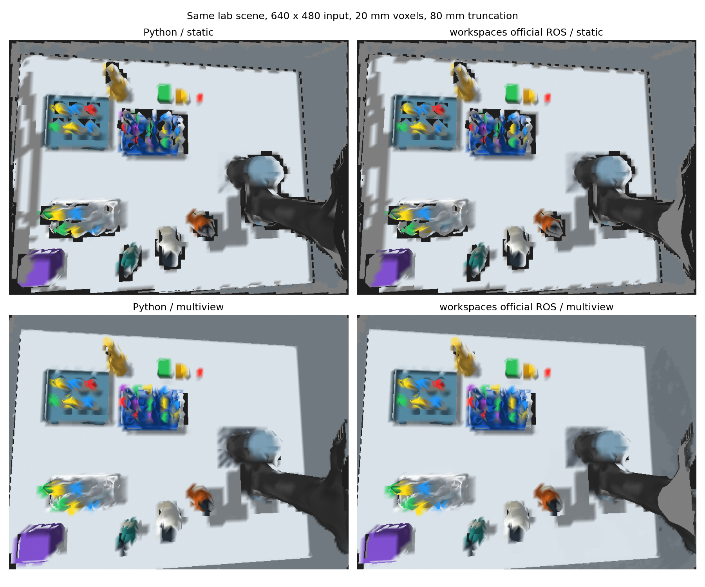

# Gazebo 机械臂位姿接入 workspaces：官方节点测试与抓取可用性

2026-11-10。已在 `/home/czz/workspaces/isaac_ros-dev/src/isaac_ros_nvblox/nvblox_examples/nvblox_examples_bringup` 增加独立入口，使用当前工作台场景、UR7e/D435 仿真图像和机械臂动态 TF，实际运行本机 workspaces 中的 `nvblox::NvbloxNode`。完成静止和左右多视角测试，导出官方节点的 Mesh、原生地图、三维 ESDF 查询及原生 rates/timings。

**主要结论：同样输入规格和体素参数下，workspaces 这套 ROS 官方节点的几何结果与 UR7e Python 包基本一致；换接口没有解决当前细结构糊化。现阶段不能仅凭这些地图宣称可以可靠完成试管等小物体的抓取。**

## 1. 新增位置与运行主体

新增文件：

- `workspaces/isaac_ros-dev/src/isaac_ros_nvblox/nvblox_examples/nvblox_examples_bringup/launch/ur7e_lab_tf.launch.py`
- 同一包的 `config/nvblox/ur7e_lab_tf.yaml`

同样文件已放入该包的 install/share 对应位置，可直接 `ros2 launch`。这两种文件无需编译 C++；包原 CMake 的 `install(DIRECTORY config launch ...)` 会在以后正常构建时继续安装它们。没有覆盖原启动项或修改 nvBlox 融合源代码。

项目内保留可审查副本与环境入口：`/home/czz/perception_eye_in_hand/tools/workspaces_lab_reference/`。其中 `env.sh` 只加载 `/opt/ros/humble` 和 workspaces 安装环境，补齐现有 GXF 动态库路径，不加载 `nvblox_in_hand` 的 mapper 覆盖层。

运行主体是：

```text
rclcpp_components/component_container_mt
  └─ nvblox_ros : nvblox::NvbloxNode
```

不是 `ur7e_nvblox_in_hand` 的 Python mapper，也不是项目自定义 C++ 诊断节点。它复用 workspaces 原有 `nvblox_base.yaml` 和 RealSense specialization，再由新配置覆盖仿真输入、位姿、精度与调度。代码来源是本机已有移植及改动后的 workspaces 工作副本，记录的 Git HEAD 为 `dd26972c86d0fa366b41d8491379b50bec05badc`；不把本机工作副本称为完全未修改的远端官方版本。

## 2. pose 如何接入

实际输入链路：

```text
Gazebo joint_states → robot_state_publisher → 动态 TF
                                           ├→ base_link 到 depth optical frame
                                           └→ base_link 到 color optical frame
Gazebo depth + depth CameraInfo ──────────────→ NvbloxNode 深度融合
Gazebo RGB   + color CameraInfo ──────────────→ NvbloxNode 颜色融合
```

配置 `global_frame=base_link`、`use_tf_transforms=true`、`use_topic_transforms=false`。因此位姿通过现有 TF 树提供，不额外生成一条可能冲突的 PoseStamped 位姿链。ROS 官方 `Transformer::lookupTransformToGlobalFrame()` 在该模式下按传入的 **sensor_frame 与图像时间戳** 查询 global→sensor 变换。

`pose_frame=camera_link` 不会把深度图强行解释为 camera_link 坐标；每幅图像仍使用自己的 header frame。RGB 与深度光学坐标不同，应各用其对应内参及外参。这里保留实测手眼挂载和相机内部 TF，没有统一改名为 color 或 depth。

| 官方输入名 | 实际仿真话题 |
|---|---|
| `camera_0/depth/image` | `/camera/depth/image_rect_raw` |
| `camera_0/depth/camera_info` | `/camera/depth/camera_info` |
| `camera_0/color/image` | `/camera/color/image_raw` |
| `camera_0/color/camera_info` | `/camera/color/camera_info` |

没有调用旧 `sensors/gazebo_realsense.launch.py` 的 relay/别名链，因为该本地适配包含单位变换 `camera_link → base_link`，与当前机械臂运动场景不适用。也没有把 depth CameraInfo 替换给 color，没有启动 VSLAM、IR 位姿估计、人物检测或实机相机。

## 3. 实际测试条件

640×480 RGB-D，2 cm 体素，4 体素即 8 cm TSDF 截断，最大融合距离 3 m，颜色启用，ESDF=3d；沿用两功能包对比时的权重、最大权重、最小权重及 max_site_distance。关闭地图半径清除与 TSDF 衰减。

深度/颜色融合上限 40 Hz，ESDF 调度 33.4 Hz，Mesh 5 Hz。先静止采集并保存，再执行上一轮检查过的相机定高 0.82 m、左右总跨度约 36 cm 扫描，回到初始视角后再次保存。扫描由仿真控制器驱动，位姿来自实际关节反馈；测试结束后相关进程已关闭。

这不是同一份 rosbag 的逐帧回放：不同实现的测试帧数和墙钟时长不同。下面是相同场景、名义观察轨迹和算法参数下的实际结果，不是严格相同输入序列的性能基准。

## 4. workspaces 与 UR7e 包结果

几何参照、相机同射线深度误差、台面评估 ROI 与前两轮一致。Mesh 覆盖率指参照可见像素有 Mesh 命中，不保证命中位置正确。ESDF 精度仅统计真值自由且 observed 的点；unknown 单独统计。

| 实现与观测方式 | Mesh 顶点/三角形 | Mesh 覆盖率 | Mesh 深度 MAE / P95 | ROI unknown | ESDF MAE / P95 |
|---|---:|---:|---:|---:|---:|
| UR7e Python，静止 | 15305 / 22095 | 94.44% | 6.02 / 32.38 mm | 24.29% | 12.05 / 21.04 mm |
| workspaces ROS，静止 | 15305 / 22095 | 94.44% | 6.02 / 32.38 mm | 24.29% | 12.05 / 21.04 mm |
| UR7e Python，多视角 | 32456 / 49472 | 99.47% | 6.77 / 35.65 mm | 9.49% | 11.86 / 20.54 mm |
| workspaces ROS，多视角 | 32529 / 49619 | 99.47% | 6.82 / 35.59 mm | 9.47% | 11.85 / 20.53 mm |

静止两份 Mesh 的双向顶点最近距离：中位数约 0.00027 mm，P95 约 **0.00102 mm**，最大约 **1.21 mm**。拓扑数量完全一致，说明静止情况下不是仅凭图片“看起来像”，而是输出几何数值上几乎重合。



图片直接由各自导出的三角形和顶点颜色渲染，绕过 RViz。上排静止，下排多视角；左列 UR7e Python，右列 workspaces。显示差异很小与量化结果一致。

**能够支持的判断：** 在本场景与参数下，Python 封装或 RViz 渲染不是几何糊化的主要解释。两者共享的投影式 TSDF、离散体素精度、截断尺度、观测遮挡及网格提取机制更值得优先检查。不能仅凭这次测试就认定所有参数、位姿时间对应或底层实现都没有问题。

### ESDF 异常同样复现

多视角 workspaces 地图同样在评估自由空间发现 **4 个距离达到 2 m 的点**。例如 `(0.83,0.15,0.35)` m 附近，真值距离约 0.157 m，返回 2.0 m，误差约 1.843 m。其整体 RMSE 约 23.30 mm，与 Python 结果也接近。

官方服务的本地 `SignedDistanceFunctor` 同样主要依据 `observed` 取平方距离开方，再应用 inside 符号；没有直接检查最近 site/parent 是否可用。共同复现说明不能把这四点简单归因于项目 Python 查询封装；还需结合输入/观测拓扑、site/parent 及增量传播状态追踪。也不能由此未经排查就断言是官方库缺陷。

官方服务 `get_esdf_and_gradient` 在这个本地版本实际返回三维 **距离标量数组**（x/y/z 三维布局），本次依据返回 origin、voxel_size 和维度索引，抽取与此前一致的 42000 个中心坐标。没有杜撰梯度，也没有把 unknown 当作自由距离。保存的 `esdf_observed.ply` 仅为这次服务 ROI 的 observed 子集，不是官方全图原生体素导出。

## 5. workspaces 原生频率的正确解释

原生 `save_rates` 返回末段 100 样本窗口统计：

| 官方统计标签 | 静止保存时 | 多视角保存时 |
|---|---:|---:|
| `ros/depth` | 19.2 Hz | 22.2 Hz |
| `ros/color` | 19.3 Hz | 21.1 Hz |
| `ros/update_esdf` | 29.5 Hz | 26.0 Hz |

`processEsdf()` 每次调用会执行 `Rates::tick("ros/update_esdf")`，其调度并不要求每次都有新深度帧。因此 **29.5 Hz 不等于每秒 29.5 份新传感器信息被融合到距离场**。它也不是 RViz 显示频率、GPU 完成频率或端到端延迟。

当前 workspaces 的 `processEsdf()` 仅在 2d 模式调用切片发布分支；3d 模式下，创建了 `/nvblox_node/static_esdf_pointcloud` publisher 也不代表会连续发布整幅 3D ESDF。此次通过三维服务验证实际场，不通过“topic 存在”推断有场数据。

此前 Python 测试持续导出并打包几十万 3D ESDF 点；本次官方节点没有执行同等的连续全量 3D 发布负载，所以不能把频率差异全归因于 C++/Python，或宣传为相同工作量下的提速。

## 6. 这种重建质量能不能支持实际抓取

**目前没有证据证明可以直接依据这份 Mesh 精确抓取试管；现有异常 ESDF 也不能直接当作已验证的近距离碰撞依据。**

NVIDIA 的文档区分了深度/颜色融合后的 TSDF、用于路径规划的 ESDF，以及用于查看重建的 Mesh。这些输出本身没有提供目标识别、物体坐标系、夹爪接触点或抓取成功判据。[nvBlox 核心接口说明](https://nvidia-isaac.github.io/nvblox/v0.0.10/pages/core_library_interface.html)

本场景的架杆约 6 mm，试管直径约 23–30 mm，只有约 1–1.5 个当前体素。不能期望 2 cm 网格稳定恢复这样的细杆、管壁和孔洞。测得的 32–36 mm P95 是可见表面光轴深度误差，不应直接等同于物体抓取位姿误差；但结合细结构错连，已说明不能直接由这个 Mesh 推导可靠的接触面。

建议抓取数据流分成两个有明确验证目标的部分：

| 用途 | 合适的信息 | 仍须完成的检查 |
|---|---|---|
| 全局环境与机械臂远离目标的运动 | 台面/架体模型、经验证的环境 ESDF | unknown 策略、异常距离、机器人自体剔除、裕量与控制延迟 |
| 目标精确定位和手指接近 | 目标 ROI 的原始深度点云、RGB 分割、已知几何/CAD 配准，或局部更高分辨率融合 | 目标位置/方向误差、接触面、夹爪宽度、手眼与 TCP 标定、周围器具间隙 |

对于已知试管/瓶子，可以从分割点云拟合圆柱轴线与半径，或与已知模型配准，生成有明确偏移的预抓取位姿；不可见部分依靠模型假设时，应记录这一假设和置信度。对目标附近的小范围试验更小体素精度，但必须测量其定位误差与算力代价，不能承诺简单改到某一 voxel_size 就达到抓取要求。

MoveIt 的抓取文档也要求区分物体位置与抓取位姿，并结合运动学、碰撞、接近方向和夹爪几何验证；点云质心本身不等于可执行抓取。[抓取位姿选择说明](https://docs.picknik.ai/how_to/robotics_applications/choosing_grasp_poses/)

最终执行前应在近距离重新观测目标，验证预抓取到接触的轨迹、实际夹爪与 TCP。安全裕量不能仅取某个平均误差或 P95，因为本轮确实存在距离大异常；unknown 和未验证的最大距离不能直接放行为自由空间。

此外，**当前工作台器具是静态模型，且场景没有可操作的夹爪模型/控制器**。这套场景能验证感知和观察运动，尚不能验证抓取成功。开展抓取测试还需要将目标拆成带惯性、摩擦和接触参数的可运动独立物体，增加实际使用的末端执行器及控制接口，再统计物体位姿误差、碰撞、夹取、抬升与滑落。

## 7. 下一步验证顺序

1. 对当前 2 m 异常点检查 site/parent，比较增量更新与完整重算；先明确不可用距离的标识，保留 unknown，不直接接入近距离规划。
2. 使用相同录制 RGB-D/TF，比较 1 cm、2 cm 体素与不同截断带，分开报告架杆、试管和大平面的误差；不是只比较截图清晰度。
3. 从原始深度中分离一个目标，对比圆柱/CAD 位姿估计与 Mesh 位姿估计；使用仿真真值作离线评价，不把真值注入实际感知。
4. 验证机器人自体遮罩、手眼/相机内参、图像时间对应及目标附近的高分辨率表示。
5. 有了夹爪和动态目标后，再测试实际抓取成功率。之前没有进行抓取执行，也没有生成可宣称成功的抓取结果。

## 8. 完整运行与查看命令

终端一：当前 UR7e 场景只启动 Gazebo，不启动 Python mapper。

```bash
cd /home/czz/perception_eye_in_hand/ur7e_nvblox_in_hand
export ROS_DOMAIN_ID=136 ROS_LOCALHOST_ONLY=1
export GAZEBO_MASTER_URI=http://127.0.0.1:11566
source ./env.sh
ros2 launch ur7e_d435_gazebo lab_scene.launch.py gazebo_gui:=true
```

终端二：启动 workspaces 官方节点。

```bash
cd /home/czz/perception_eye_in_hand
source tools/workspaces_lab_reference/env.sh
ros2 launch nvblox_examples_bringup ur7e_lab_tf.launch.py
```

终端三：查看官方 Mesh。这里环境只加载官方工作区，RViz 配置只是显示配置，不参与融合。

```bash
cd /home/czz/perception_eye_in_hand
source tools/workspaces_lab_reference/env.sh
rviz2 -d /home/czz/perception_eye_in_hand/tools/workspaces_lab_reference/official_mesh.rviz
```

如需机械臂多视角扫描，另开终端：

```bash
cd /home/czz/perception_eye_in_hand/ur7e_nvblox_in_hand
export ROS_DOMAIN_ID=136 ROS_LOCALHOST_ONLY=1
export GAZEBO_MASTER_URI=http://127.0.0.1:11566
source ./env.sh
export UR7E_LAB_TEST_OUT="$PWD/artifacts/manual_official_scan_$(date +%Y%m%d_%H%M%S)"
python3 artifacts/lab_multiview_20261110/execute_motion.py
```

需要初始状态与已检查路径一致，脚本只支持该隔离仿真。不要同时运行另一个控制发布器。

在官方环境终端中检查位姿及保存地图：

```bash
ros2 run tf2_ros tf2_echo base_link camera_color_optical_frame
# Ctrl+C 后可检查另一相机的完整变换
ros2 run tf2_ros tf2_echo base_link camera_depth_optical_frame
```

两路检查分别对应各自图像坐标，并非改动了手眼标定。

```bash
mkdir -p /home/czz/perception_eye_in_hand/artifacts/manual_official_export
ros2 service call /nvblox_node/save_ply nvblox_msgs/srv/FilePath \
  "{file_path: '/home/czz/perception_eye_in_hand/artifacts/manual_official_export/mesh.ply'}"
ros2 service call /nvblox_node/save_map nvblox_msgs/srv/FilePath \
  "{file_path: '/home/czz/perception_eye_in_hand/artifacts/manual_official_export/map.blox'}"
python3 /home/czz/perception_eye_in_hand/artifacts/workspaces_lab_reference_20261110/query_esdf.py \
  /home/czz/perception_eye_in_hand/artifacts/manual_official_export
```

查看本轮已经保存的官方 Mesh：

```bash
CloudCompare /home/czz/perception_eye_in_hand/artifacts/workspaces_lab_reference_20261110/multiview/mesh.ply
```

## 9. 证据目录

`/home/czz/perception_eye_in_hand/artifacts/workspaces_lab_reference_20261110/`：

- `static/`、`multiview/`：官方 Mesh、`.blox`、实际参数、rates/timings、服务三维 ESDF、精度 JSON 和效果图。
- `views/`、`trajectory.json`、`motion_status.json`：实际视点及关节轨迹。
- `comparison_summary.json`：四组对比；`static/python_official_vertex_comparison.json`：顶点数值比较。
- `official_mapper.log`、`scene.log`、`motion.log`、保存服务日志：运行证据。
- `provenance.json`：来源、配置指纹和运行参数检查。

已验证两阶段实际参数为 2 cm、4 体素截断、3d ESDF、颜色启用、TF 输入、base_link 地图。此次保存的 workspaces 地图由官方 ROS 库序列化，分析没有强行用另一个 wheel 版本加载它，而是调用运行节点自身的三维服务，避免跨版本地图布局假设。
