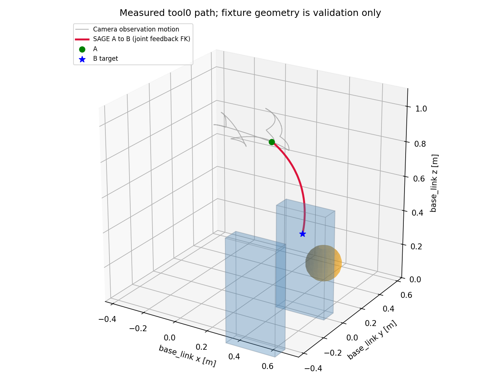

# A→B 最小 demo 实测

日期：2026-09-21。只修改 `ur7e_perception_planning`，感知与 SAGE 在 `whole_control` 中运行。

## 最终结果

最终版本使用 `./run_ur7e_perception_planning.sh` 冷启动，Gazebo headless、RViz 开启。
没有人工重发默认目标或外部脚本控制机械臂。12 姿态观察结束后返回高位 A，自动到达 B。
随后使用 `ros2 topic pub --once` 发布新的 world 坐标目标，完成第二次到达。

| 项目 | 冷启动 A→B | B→新目标 |
|---|---:|---:|
| 目标 xyz / m | [0.5, 0, 0.45] | [0.45, 0.03, 0.52] |
| 最终位置误差 | 1.04 cm | 1.06 cm |
| 碰撞球对场景几何的最小净空 | 6.61 cm | 6.50 cm |
| 非邻接碰撞球最小自碰撞净空 | 2.43 cm | 2.43 cm |
| 观测器总耗时（墙钟） | 389.5 s | 42.4 s |
| 地图序号增量 / 墙钟时间 | 1.34 Hz | 0.43 Hz |
| SAGE 实际用于到达动作 | 是 | 是 |
| 验收脚本结果 | PASS | PASS |

A 的 tool0 约为 `[0.220, 0.149, 0.855]` m。冷启动中的扫描及等待约 371.5 s，
到达阶段约 17.0 s。期间新观测两次使原引导失效，程序自动重规划后到达。
整段运行记录中的最大关节指令速度为 0.0800 rad/s，最大指令/反馈差约 0.00637 rad。
所有到达动作均来自 SAGE，demo 不使用局部雅可比控制器。

这些净空来自关节反馈、20 个整臂/相机/支架碰撞球与场景几何的独立计算；
不是 Gazebo 接触传感器或精细网格接触认证。场景真值仅用于验证，没有送入运行中的规划器。



灰线为观察动作，红线为 A→B。图中的墙和球用于独立展示，不是规划输入。

## 本次解决的问题

1. 单视角无法证明前臂未来扫掠空间为空：加入后退、高位伸肘、前向和俯视观察。
2. 3 m 融合上限丢掉了远处有效回波的近段自由空间证据：保留 0.2～6 m 实测射线；
   仍只融合 3 m 内表面，无效、自身遮挡和超量程像素不清空未知空间。
3. 终点逆解可行不等于途中可行：检查整臂关节插值路径，并用沿途净空调整冗余终点姿态。
4. 固定速度提议会越过近处观察姿态，独立关节限速会偏离已检查路径：改为同步减速提议，
   给 SAGE 加入偏离引导路径的代价，执行前仍独立检查最新地图。
5. 新地图可能使原引导失效，SAGE 持续减速而不前进：每秒复查剩余引导，失效后停用旧指令并重求。
6. 同进程地图经过压缩、DDS、解压增加延迟：内部直接交接独立快照，对外保留原子压缩地图接口。

早期调试运行曾因观测不足或引导没有更新而失败；`demo_v12` 依靠人工重发目标才到达，
没有将它算作自动冷启动通过。最终通过证据为下列 `demo_v13` 和 `v13_retarget`。

## 复现

在工作区根目录：

```bash
./build_ur7e_perception_planning.sh
./run_ur7e_perception_planning.sh
```

等待 `/perception_planning/status` 显示 `GOAL_REACHED`，随后在已 source ROS 和工作区的终端发送：

```bash
ros2 topic pub --once /target_pose geometry_msgs/msg/PoseStamped \
  '{header: {frame_id: world}, pose: {position: {x: 0.45, y: 0.03, z: 0.52}, orientation: {w: 1.0}}}'
```

可修改 xyz；world 经 TF 转到 base_link，目标姿态不参与约束。扫描中发布目标会保留最新值，
完成扫描后尝试到达。通道未观测、路径受阻或没有可行逆解时停动，不保证任意 xyz 可达。

19 项自动测试全部通过，包括 CPU/GPU 距离一致性、未知空间拒绝、整段碰撞检查、
观察走廊几何验证、沿途受阻时改变冗余姿态、SAGE 速度提议、远距离射线和地图 epoch 失效。

## 证据与限制

- [最终冷启动验收 JSON](../../../log/perception_planning_ab_demo/demo_v13.json)
- [最终目标切换验收 JSON](../../../log/perception_planning_ab_demo/v13_retarget.json)
- [冷启动日志及自动重规划记录](../../../log/perception_planning_ab_demo/demo_v13.log)
- [单元测试输出](../../../log/perception_planning_ab_demo/unit_tests.log)
- [原感知包 17 个 Python 文件的哈希校验](../../../log/perception_planning_ab_demo/original_integrity.log)
- 完整执行 CSV：`~/nvblox_output/perception_planning/20260921_221508/execution.csv`。

测试机器多次出现约 400 MHz 的 CPU 降频，与地图/规划耗时上升、`STALE_MAP` 暂停同时出现。
上述耗时和平均更新率包含暂停，不能据此声称已达到稳定实时频率。
地图看门狗仍为 1.5 s 仿真时间、3 s 墙钟时间，输入恢复后继续；未为通过测试放宽门槛。

此 demo 依赖当前静态布置已确认的高位观察走廊先验（碰撞球外 7.5 cm）及初始姿态先验
（12 cm）；这些被明确标记为 prior，不是相机实测自由空间。先验不会随目标和实际运动扩张，
测得的障碍始终覆盖先验。更改场景或初始姿态需要重新确认走廊。
本次通过不等于通用绕墙、动态障碍避障或与原 SAGE 包完整目标集等价。

测试结束后已停止本次启动的仿真、RViz 和规划节点。
