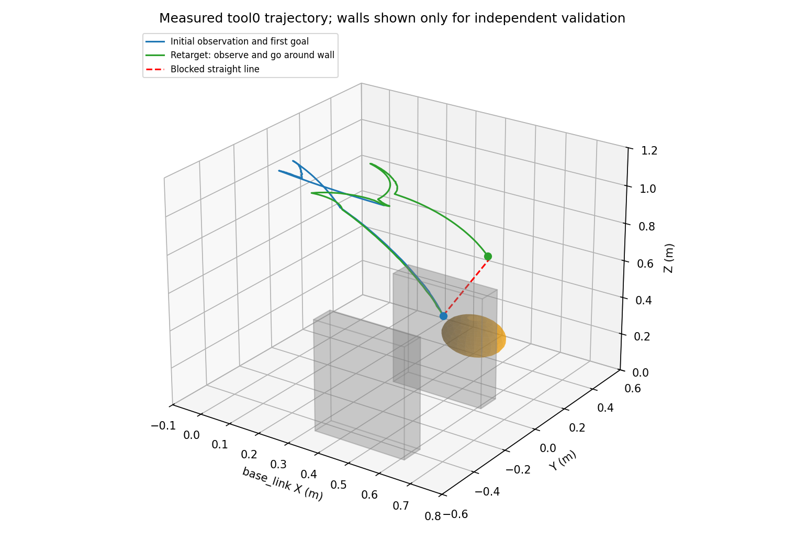

# 扫描提前结束与绕墙验证（2026-09-22）

## 实现范围

仅修改 `ur7e_perception_planning`。使用 whole_control、真实运行的 Gazebo 深度/TF、原生 nvBlox 和 SAGE；Gazebo GUI 默认关闭，RViz 可开启。原 `realtime_nvblox` 的 17 个 Python 文件 SHA256 校验通过。

1. 每个观察停靠点求解当前目标的整臂可行通道，找到后立即结束扫描，不再固定走完 12 点并返回 A。通道允许已声明的固定观察走廊先验，其余空间须有感知自由证据；不是“整个场景都已观测”的判据。
2. IK、观察姿态路网和有界双向 RRT 只查感知地图。初始扫描尚未完成时仅允许直接路径/路网提前结束；首个目标到达后允许 RRT。全部路径边均需密集净空检查，SAGE 优化每一步，独立执行检查继续生效。
3. 图像短队列选择具有采集时刻 TF 的最新帧；保留时间/标定/epoch 检查。批量 FK、精确距离变换缓存与包围区域裁剪、感知优先 GPU 锁、按开始时刻计算更新周期，减少重复计算和等待。
4. 自过滤使用射线与机器人球体相交关系；被遮挡的像素不证明后方自由。相机朝天曾使整帧深度无效，新增 demo 相机朝下的 IK/路径约束。空图不刷新地图，不伪造自由空间。
5. demo 按最近 8 帧地图延迟和规划耗时，从 0.08 分档提高至 0.16、0.24、0.30 rad/s。超过 1.5 s 仿真地图年龄或 3 s 墙钟年龄仍停动。观测恢复后重新检查。
6. RViz ESDF 最高 2 Hz、画面 15 FPS，RGB 1 Hz，深度保持 10 Hz。规划快照不受 RViz 限频影响。试验过缩短 Python 线程切换间隔，但未见足够收益，已撤销该额外调优。

## 冷启动与跨墙

首次目标 B=`[0.5,0,0.45]`；到达后通过 `/target_pose` 的 world/PoseStamped 发布 C=`[0.45,0.4,0.55]`。

| 轮次 | RViz | 启动至 B（含初始化/扫描） | 初始扫描 | B→C（含补观测/等待） | C 误差 | B→C 最小整臂球净空 |
|---|---|---:|---:|---:|---:|---:|
| v6 | 关闭 | 52.85 s | 5/12 | 110.61 s | 1.19 cm | 5.73 cm |
| v7_rviz | 开启 | 56.64 s | 5/12 | 144.19 s | 1.13 cm | 5.71 cm |

这两轮是加入相机观察方向约束后的完整验证。优化前的固定扫描基线为 389.5 s，见 [原 A→B 记录](AB_DEMO.md)。不同轮次机器负载不完全一致，不能把这些数字当作保证值。

- B 就绪后直接离开扫描；C 需要继续补观测，累计第 10 个视角时通道可行，仍未走完全部 12 点。
- 两轮 B→C 的起终点直线都穿过 `cube1`；实际反馈路径从高位绕过，路径约 2.15 m，最高 tool0 约 0.988 m。障碍真值仅在独立验收脚本中读取。
- 验收使用真实关节反馈计算整臂及负载球几何；另对反馈间的关节插值加密并扣除半采样间隔运动余量。加密并扣除余量后的环境净空分别约 5.55/5.56 cm，自碰撞净空均约 2.05 cm。它不是 Gazebo 接触传感器或精确网格碰撞证明。
- 指令日志按仿真时间差计算，两轮最大指令速度均为 0.300 rad/s。全程使用 SAGE；无跳过执行检查的控制分支。
- v7 的 RViz、Gazebo 和感知规划进程均正常退出，无 QoS 不兼容或 RViz 崩溃。



## 延迟与仍未解决的限制

- v6/v7 首次到达阶段地图平均约 4.75/4.73 Hz，无 `STALE_MAP` 状态采样；配置目标为 5 Hz。
- 跨墙阶段遇到 CPU 间歇降频，地图平均分别约 2.41/1.81 Hz，`STALE_MAP` 状态累计约 34.09/76.21 s。等待期间不继续追踪旧路径。
- 正常负载下 SAGE 单轮通常十几毫秒；低频期间可上升到秒级。线程切换调优不能消除硬件资源不足。
- **已修复可重复的软件性永久停滞，严重降频下“持续无停顿”尚未实现。** 没有修改系统功耗设置，也没有放宽时间和碰撞保护。
- 当前仍使用固定静态场景观察走廊先验，尚不能宣称达到原 SAGE 包完整目标集的到达能力。未知区域、相机盲区、动态障碍和真实机械臂另行验收。

`analysis.json` 的时长按状态采样归类，`SCANNING` 包含低速优化等待，不等于纯运动时长。耗时分位数来自状态/统计采样并按版本去重，不能等同逐次优化的完整跟踪。

## 额外调度实验（未通过，不计入成功轮次）

`v8_rviz` 试验缩短 Python 线程切换间隔并计划增加往返。首次 B 在 105.02 s 到达（包含约一分钟初始化/等待）；
后续 CPU 长时间约 400 MHz，跨墙在 240 s 测试上限时仍处于第 10 个观察动作，最终为 `STALE_MAP`，未到达 C。
这轮环境碰撞球净空检查通过，但到达测试失败，因此没有执行后续往返。该额外线程切换调优未显示足够收益，已经撤销。

这说明目前实现改善了扫描数量和正常负载耗时，但**仍不能保证严重降频时稳定完成任务或无停顿**。
不能只选择前两轮成功数据而忽略这轮。已有地图下的往返性能仍待完成，后续应优先处理长期资源不足与回归测试。
失败记录保留于 `log/perception_planning_fast_demo/v8_rviz/`，最终源码使用前两轮已验证的调度设置。

## 复现与证据

```bash
./build_ur7e_perception_planning.sh
./run_ur7e_perception_planning.sh
# 首次 B 到达后，在已 source ROS/工作区的终端：
ros2 topic pub --once /target_pose geometry_msgs/msg/PoseStamped \
  '{header: {frame_id: world}, pose: {position: {x: 0.45, y: 0.4, z: 0.55}, orientation: {w: 1.0}}}'
```

独占测试（先关闭已有仿真；源 ROS/工作区，使用 whole_control Python）：

```bash
python -B src/ur7e_perception_planning/test/run_benchmark.py \
  --tag my_wall_test --save-maps --repeat-wall --duration 240
# 关闭 RViz 可加 --no-rviz；tag 必须是尚未使用的目录名。
```

测试工具自己启动、发布目标、记录数据并关闭所启动的进程。`--repeat-wall` 在首次跨墙后返回 B 再次跨墙，检查已有地图下的到达。

- 工作区 `log/perception_planning_fast_demo/v6/`、`v7_rviz/`：阶段结果、地图快照、统计、实际关节状态及独立绕墙分析。
- 运行目录 `~/nvblox_output/perception_planning/20260922_195329/`、`20260922_195647/`：`execution.csv`、`routes.jsonl`、解析配置等。
- `test/report_benchmark.py` 从记录生成 `analysis.json` 和轨迹图。
- `log/perception_planning_fast_demo/tests_final.log`：29 项测试通过；另有 `entrypoint_final.log` 复核启动/退出处理。
- `log/perception_planning_fast_demo/original_integrity.log`：原感知源码校验结果。
