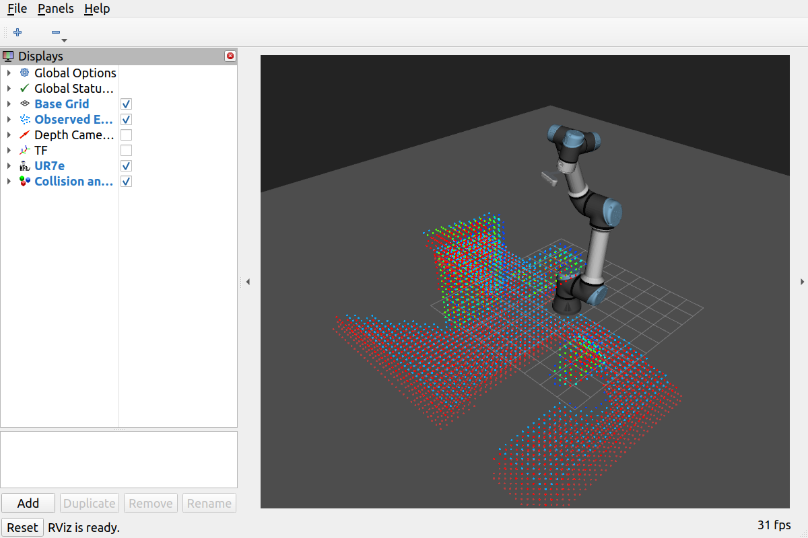

# 仿真验证结果

实现及闭环测试：2026-09-18；结果整理及进程清理：2026-09-20。

## 环境与复现

ROS 2 Humble、Gazebo Classic、whole_control 中的 PyTorch/CUDA、nvblox_torch、storm_kit。
使用新包场景启动器：原有两面墙和球、眼在手上 D435、高初始姿态；
Gazebo 服务端和 RViz 实际运行，Gazebo GUI 关闭。

```bash
./build_ur7e_perception_planning.sh
./run_ur7e_perception_planning.sh gazebo_gui:=false run_rviz:=true
# 另一个终端，source ROS 和工作区并激活 whole_control 后：
OPENBLAS_NUM_THREADS=1 python -B src/ur7e_perception_planning/test/validate_sim.py \
  --exercise --faults --duration 60 --output /tmp/closed_loop.json
```

## 验收结果

全新启动后的 **13 项闭环检查全部通过**。可机读结果见
[acceptance_summary.json](acceptance_summary.json)，测试期间的控制记录见
[execution_acceptance.csv](execution_acceptance.csv)。

| 检查 | 实测结果 |
| --- | --- |
| 默认小范围位置目标 | GOAL_REACHED，位置误差 11.61 mm |
| 第二位置目标 | GOAL_REACHED，位置误差 11.73 mm |
| 墙内目标 `[0.4, 0.2, 0.3]` m | BLOCKED，末端距目标 0.555 m |
| 返回目标 | GOAL_REACHED，位置误差 11.83 mm |
| SAGE 实际运行 | 墙内目标阶段累计 199 次优化；随后累计 201 次 |
| SAGE 指令确实发生运动 | 验收日志中 78 条带位移的 SAGE 指令 |
| 关节指令速度 | 最大 0.0800 rad/s，以仿真时间差计算 |
| 在线地图 | 接收到 75 次更新；间隔中位数 0.400 s，P95 0.520 s |
| 整段地图平均频率 | 2.04 Hz，包含人为暂停和地图重置 |
| 运动中暂停感知 | STALE_MAP；超时停动后两秒最大关节变化约 `5.3e-15` rad |
| 恢复感知 | 地图版本继续增加，约 1.29 s 后重新确认目标到达 |
| 重置地图 | epoch 改变，约 1.52 s 后连续三个状态样本恢复正常 |
| CPU 正运动学与 Gazebo TF | 最大末端位置差 `4.74e-16` m |
| 机器人碰撞球与场景真值几何 | 全程最小净空 0.0879 m，含地面 |

默认目标由启动器自动开始执行，因此脚本重新发送目标后的等待时间不等于完整运动时间。
到达判定要求三个独立状态样本；故障测试先确认机械臂实际运动，再暂停感知。
停动变化量是仿真数值结果，不代表真实机械臂能达到同等精度。

9 项自动测试通过，见 [tests.log](tests.log)：CPU/GPU FK 一致、网格轴向/符号/越界、
SAGE 真实 rollout 的 ESDF 代价响应、未知空间处理、遮挡后的空间不被清空、
地图完整性、压缩数据校验、运动段中间碰撞、初始自由空间先验的场景净空检查。

运行数据原件位于工作区 `log/perception_planning_validation/cold_acceptance.json`、
`cold_launch.log`，控制日志位于 `~/nvblox_output/perception_planning/20260918_204815/`。
长时间等待期间的完整 CSV 归档为 gzip；此目录保留了验收时间段的普通 CSV。
9 月 20 日清理前的状态快照见 [final_status.json](final_status.json)：地图已更新到
224233，状态 GOAL_REACHED、无节点报告异常。这是一个结束时快照，不作为长期稳定性验收。

## 解释与边界

- 墙/球位置仅被验证脚本用作测量真值，未送入运行中的感知或规划器。
- 初始碰撞球外 0.12 m 是针对该静态场景检查过的自由空间先验；地面另行裁剪。
  这不是纯粹从相机观测恢复出的全部自由空间。未知真实场景不能直接复用该先验。
- 小范围目标主要由经过同样碰撞检查的雅可比控制完成；目标更远或修正受阻时调用 SAGE。
  验证覆盖两条控制路径，并未证明 SAGE 能绕过整面墙到达任意目标。
- 墙内目标被阻止的判断来自感知地图及未知空间的联合约束，不能仅凭该项断言地图完整。
- 早期连续测试有间歇性 STALE_MAP，部分整轮验收因此未通过；保留在工作区日志中。
  最终从新场景启动的测试全部通过，但更新频率有波动，不能据此承诺硬实时性能。
  超时会冻结已检查的指令，允许停顿后继续；没有放宽或关闭超时保护来使测试通过。
- 当前没有主动探索、全局绕障搜索、动态障碍消退、姿态目标到达要求或真实硬件验证。
  碰撞球模型、有限分辨率距离场与采样检查的结果不等于精确网格碰撞证明。
- 本次最终测试的 Gazebo、RViz、感知规划和 TF 发布进程均正常退出。
  早期场景重启中曾出现 Gazebo 退出阶段 `exit code -11`，未修改原场景包来处理该问题。

## RViz



点云颜色表示距离值，并非 RGB 重建颜色。本包用于感知规划，原彩色重建功能仍由
`ur7e_reconstruction` 提供。
