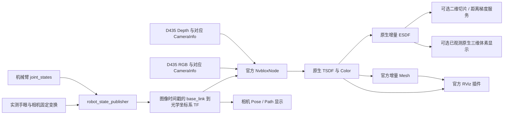

# 工程结构、官方模块和机械臂位姿链路

2026-11-04重构提示：本文保留此前结构/运行记录。当前默认已改为官方NvbloxNode组件，入口、配置及显示选择见 [重构分析](WORKSPACES_EXAMPLE_REFACTOR_20261104.md) 和 [最新操作说明](OPERATIONS.md)。此前inside-only默认、20字节点云及旧频率不能当作新版接口或结果；本轮未运行测试。

## 1. 结构及来源

```text
nvblox_in_hand/
├── COLCON_IGNORE                 隔离父工程默认递归构建；本目录 build.sh 显式构建 src
├── build.sh / run.sh / env.sh     独立构建、启动、通信与依赖环境
├── rviz.sh / test.sh             单独显示和离线测试
├── orbit_scan.sh                 可选固定场景多视角扫描，启动不自动执行
├── src/
│   ├── ur7e_d435_gazebo/         父工程的机器人、相机、障碍物、标定和碰撞检查副本
│   │   ├── urdf/ meshes/         实际机器人及 D435 安装
│   │   ├── config/               控制器、初始关节、手眼、障碍物和时钟配置
│   │   ├── launch/               场景与机器人启动
│   │   ├── scripts/              生成场景、几何核验、可选轨迹设计
│   │   └── src/ third_party/     FCL 检查器及本地 Gazebo RealSense 插件
│   └── nvblox_in_hand/
│       ├── src/mapper_node.cpp   官方节点薄适配；只附加计数和可选原生 ESDF 显示
│       ├── include/              已观测 ESDF 显示选择策略
│       ├── scripts/robot_pose.py 图像时间机器人 TF 路径及 TF 输入健康信息
│       ├── launch/
│       │   ├── bringup.launch.py 场景、传感器、感知、路径和 RViz 编排
│       │   ├── perception/       静态重建的完整参数及开关
│       │   └── sensors/          可选 D435 实机驱动
│       ├── config/
│       │   ├── nvblox/           基础、仿真、实机、精细体素和显示配置
│       │   ├── sensors/          D435 深度/颜色配置
│       │   └── robot/            ROS 本机通信配置
│       └── rviz/                 官方 Mesh/体素插件与标准 RViz 显示
├── upstream/                    workspaces 官方 ROS 移植源码快照
│   ├── nvblox_ros/               ROS node、转换、调度、服务、fuser
│   │   └── nvblox_core/          原生 mapper/integrators/map/serialization 等完整算法模块
│   ├── nvblox_msgs/              官方 Mesh、VoxelBlockLayer、ESDF/地图服务接口
│   ├── nvblox_ros_common/        CUDA/ROS 公共工具
│   ├── nvblox_ros_python_utils/  官方 Python 工具
│   └── nvblox_rviz_plugin/       原生增量 Mesh 与体素层显示插件
├── tests/                        开关/输入契约和原生体素显示策略测试
├── provenance/                   复制来源、哈希及局部差异说明
├── docs/                         本工程说明
└── artifacts/                    构建和离线验证记录
```

原生 ROS 源码来自 `/home/czz/workspaces/isaac_ros-dev/src/isaac_ros_nvblox`，该仓库 HEAD 为 `bc181942202b24fd47b2f3db8f77c3c82d484566`。这是本机移植版本快照，可能包含工作树改动，不能只凭 HEAD 声称所有文件与远端该提交完全一致。逐文件哈希记录实际复制内容。

复制保留版权与许可证。未复制上游大体积文档、媒体、rosbag、构建产物和 Git 元数据。未纳入示例中的人物检测/分割、任务识别、多相机、ZED、LiDAR、导航平台、VSLAM 和 RealSense 红外 metadata 分流工作流。

底层框架本身兼容多种 mapping type，内部仍包含通用 MultiMapper、dynamic/human/LiDAR 类型和相关基础方法。这些不是本工程启动的人物识别或动态任务节点。为保留 ABI 和官方算法模块结构，没有暴力删除共享库内部类型；本工程入口固定 static_tsdf、单 RGB-D、use_lidar=false，且没有相关模型、mask 输入或识别 launch。副本 CMake 中移除了原移植版本遗留的 NvbloxHumanNode 组件注册行；其余共享框架保留。

机器人副本沿用原项目包名 `ur7e_d435_gazebo`，便于保持 mesh/package URI 和 xacro 原样可用；新环境覆盖到本目录的安装结果。副本扫描脚本仅改接新话题、报告目录和新构建入口，运动与碰撞算法没有另造一套。

## 2. 数据流



不需要 VSLAM：位姿来自机械臂反馈、正运动学、手眼和相机内部外参。`robot_pose.py` 只观察 TF 并发布路径，不是 mapper 的位姿中转，不创建 TF，也不改变融合时间。Mapper 自己仍按官方 Transformer 读取每帧的光学坐标系 TF。

深度与彩色各自使用其 CameraInfo、时间戳和 optical frame。已有正确深度/颜色外参时，不需要为了上色先把两张图人工重采样到同一像素网格。不同分辨率也必须保留各自标定。真实 D435 驱动中 publish_tf=false，是为了避免与机械臂 URDF 提供的同一光学链冲突；前提是外部 URDF 已提供正确且完整的相机链。

## 3. 直接保留的官方核心路径

`nvblox_ros/src/lib/nvblox_node.cpp` 的 `tick()` 继续负责服务队列、深度、颜色、衰减/局部清图、ESDF、地图层和调试输出。`mapper_initialization.cpp`、`node_params.cpp`、`transformer.cpp`、`camera_cache.cpp`、各 conversions 模块继续沿用。

`nvblox_core/nvblox` 中的 TSDF/ESDF integrator、Mapper、block layer、GPU hash、serialization 和 Mesh 生成逻辑未重写。官方 `layer_publishing.cpp` 继续根据订阅需求选择地图层、构建 Mesh 和发送增量块，官方 RViz 插件接收更新及删除消息。

本项目适配类的 tick 首先完整调用 `NvbloxNode::tick()`；ESDF 回调首先完整调用 `NvbloxNode::processEsdf()`。计数通过原生成功融合时间推进判断，避免把“已丢弃但返回 true 的帧”计作融合。计数不是 GPU 完成计数。

`mapper_backend:=official` 可直接运行官方 `nvblox_ros/nvblox_node`，完全绕开薄适配类。这样可以把“官方核心算法”和“可选可视化/监控额外耗时”分开比较。

## 4. 三维 ESDF 显示为什么不是固定点阵查询

2026-11-04当前实现：`mapper_node.cpp` 调用项目 `esdf_pointcloud_exporter.cu`，取得 `esdf_layer.getAllBlockIndices()` → GPU检查真实体素的observed/inside及距离 → 紧凑读回入选体素中心 → 发布PointCloud2。此前官方序列化后CPU全块筛选的实现已被替换。

没有创建固定 ROI 网格，没有调用查询服务去逐点填数，没有把未知体素输出成已观测，也没有修改 ESDF。规则间距来自 ESDF 自身的体素结构；这与额外构造均匀查询网格有本质区别。

当前默认显示开启、目标30 Hz，有订阅者且有未导出更新版本时执行。GPU导出仍遍历分配块并同步流，尚非变化块增量导出；核心性能比较需记录显示负载。

当前surface默认只保留observed且inside，不是完整ESDF，也不是精确表面。band保留有限距离带，observed保留全部合法已观测距离。此前参考workspaces的EsdfVoxelFilter条件，但本轮发现该辅助类在所查ROS源码中未被调用，不能把它作为官方完整输出契约。详见 [ESDF内部点及简化审计](ESDF_SEMANTICS_AND_SIMPLIFICATION_AUDIT_20261104.md)。

原生二维切片为了输出图像/栅格，本来就会对一层距离图离散化，这是合理的输出表示；它不会反向构造或填充三维 ESDF。

## 5. 文档依据与版本边界

官方文档明确输入可以是深度、颜色和其他定位源提供的 pose，并支持 GPU 重建与增量 Mesh 发布，见 [Isaac ROS Nvblox](https://nvidia-isaac-ros.github.io/repositories_and_packages/isaac_ros_nvblox/index.html)。网页 latest 与本机 Humble 移植版本可能不同；本工程的参数名、服务名、行为以这里复制的本机源码为准。
