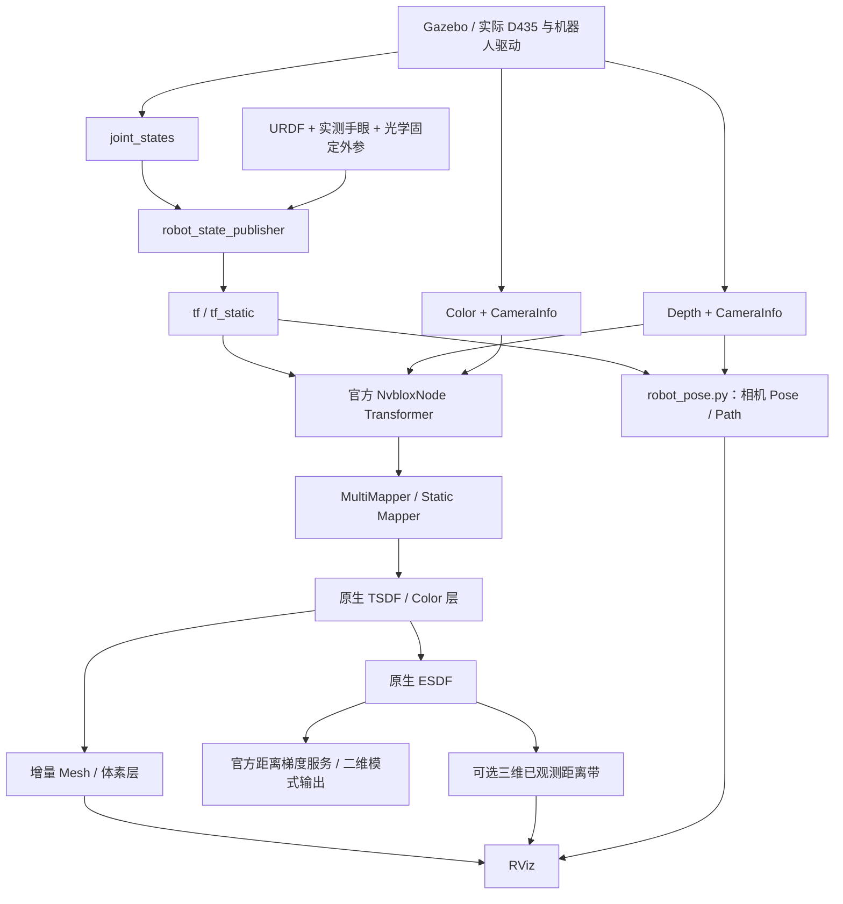

# nvblox_in_hand 代码分析：结构、功能与执行流程

2026-11-04重构提示：本文保留此前结构/运行记录。当前默认已改为官方NvbloxNode组件，入口、配置及显示选择见 [重构分析](WORKSPACES_EXAMPLE_REFACTOR_20261104.md) 和 [最新操作说明](OPERATIONS.md)。此前inside-only默认、20字节点云及旧频率不能当作新版接口或结果；本轮未运行测试。

分析日期：2026-10-28。分析对象为 `/home/czz/perception_eye_in_hand/nvblox_in_hand` 当前源码。本文解释代码实际职责和调用关系，不把历史配置目标当作实测结果。本轮只生成文档，不修改程序，不运行仿真。

配套阅读：[逐目录与逐文件职责](DIRECTORY_AND_MODULES.md)、[联系整个 perception 工程的分析](WHOLE_PROJECT_RELATIONSHIP.md)。操作命令另见 [仿真运行手册](SIMULATION_RUNBOOK.md)。

## 1. 先认识工程的四层

| 层次 | 对应代码 | 主要职责 |
| --- | --- | --- |
| 场景与机器人输入 | src/ur7e_d435_gazebo | 机器人、相机、障碍物、控制器、关节反馈、机器人 TF |
| 工程编排与适配 | src/nvblox_in_hand 的 launch、mapper_node.cpp、robot_pose.py | 选择功能、组织输入、监控、附加显示，不重写官方建图算法 |
| 官方 ROS 与 CUDA 核心 | upstream/nvblox_ros 等快照；默认实际链接 workspaces 的已安装版本 | 图像队列、时间变换、TSDF/Color/ESDF/Mesh、序列化与地图服务 |
| 检查与交互 | tools、tests、rviz、根目录脚本 | 状态一致性检查、显示、离线回归、可选扫描 |

工程包含两个本地功能包，而不是只有一个单节点程序：`ur7e_d435_gazebo` 保留机器人/场景，`nvblox_in_hand` 负责感知入口。官方包快照单独放在 upstream，不在默认构建时自动重编译。

## 2. 运行时总数据流



图中 robot_pose.py 只订阅深度 CameraInfo，以其时间戳查询 TF，不接收整幅深度图。它不是 mapper 的位姿输入中转。Mapper 自己直接查询 `/tf`、`/tf_static`。

默认不启动 VSLAM、人物分割/检测、动态分图、LiDAR 或多相机工作流。框架内部仍保留通用类型，详见第 12 节。

## 3. 从启动命令追踪调用

### 3.1 根目录脚本

[run.sh](/home/czz/perception_eye_in_hand/nvblox_in_hand/run.sh) 依次完成：

1. 定位新工程目录，加载 env.sh。
2. 按 IN_HAND_SOURCE_BUILD 决定是否加载 install_source 覆盖。
3. 检查 nvblox_in_hand 包解析位置属于本目录，防止误运行其他工作区的同名包。
4. exec `ros2 launch nvblox_in_hand bringup.launch.py`，转发用户参数。

[env.sh](/home/czz/perception_eye_in_hand/nvblox_in_hand/env.sh) 负责 ROS 域、本机通信、Gazebo master、CycloneDDS、ROS 日志目录、依赖环境和动态库搜索路径。它清理旧 overlay 路径后加载 Humble、workspaces 已安装依赖和新工程安装目录。

GXF 的部分库位于包 share 目录，单靠普通 overlay 不一定能找到。脚本通过 ldd 分析匹配的官方可执行文件，补齐依赖目录；这是运行时链接处理，不是额外启动一套感知。

env.sh 还检测 RViz GLSL150 资源是否存在。缺失时设置官方插件已有的 fallback 环境选项，避免收到第一条 Mesh 时因 box.geom 不存在而退出。

### 3.2 bringup.launch.py：组织模块

[bringup.launch.py](/home/czz/perception_eye_in_hand/nvblox_in_hand/src/nvblox_in_hand/launch/bringup.launch.py) 不计算地图，主要组织进程。

- 从 mapping.launch.py 动态取得参数声明并转发，避免顶层和感知层各维护一套不同的参数名。
- start_scene=true 时 include 本工程场景副本。
- launch_camera=true 时 include D435 驱动；禁止同时启动 Gazebo 或使用仿真时间。
- 加载 mapping.launch.py。
- 根据 publish_pose、publish_path 启动路径观察节点。
- 根据 run_rviz 启动 RViz。

Gazebo 必须使用 use_sim_time=true；实机驱动要求 start_scene=false、use_sim_time=false。这里没有自动启动真实机器人控制器，也没有自动执行轨迹。

### 3.3 mapping.launch.py：把工程参数翻译为官方参数

[mapping.launch.py](/home/czz/perception_eye_in_hand/nvblox_in_hand/src/nvblox_in_hand/launch/perception/mapping.launch.py) 负责：

1. 检查后端、ESDF 模式、布尔开关和数值范围。
2. 合并 base、仿真/实机、自定义 YAML 和最终启动覆盖。
3. 固定单相机、static_tsdf、TF 位姿输入、关闭 LiDAR。
4. 映射深度、颜色和各自 CameraInfo 到官方 camera_0 输入。
5. 选择直接官方节点，或本工程薄适配节点。
6. 注册 mapper 退出事件，防止 mapper 已退出而完整感知启动还保持正常运行的假象。

配置优先级：base → simulation/realsense → mapper_config → launch overrides。voxel_size、max_range_m 留空时不覆盖 YAML；其他公开开关、模式和频率会由 launch 默认值或显式值覆盖。因此不是加载一个 YAML 后，其中所有同名参数就一定最终生效。

## 4. 机器人和相机位姿如何得到

### 4.1 位姿链

[scene.launch.py](/home/czz/perception_eye_in_hand/nvblox_in_hand/src/ur7e_d435_gazebo/launch/scene.launch.py) 加载 URDF/xacro、实测手眼、初始关节和控制器，启动 robot_state_publisher、Gazebo、机器人/障碍物生成和控制器 spawner。

对于图像时刻 t：

```text
T_base_camera(t)
  = T_base_tool0(q(t)) × T_tool0_camera
```

其中 T_tool0_camera 包含手眼和相机物理/光学坐标系的固定链。深度与颜色各自使用正确 optical frame，不能将 tool0 朝向直接作为相机朝向。

核心 Transformer 在 `use_tf_transforms=true` 时，按每帧传感器 frame_id 和时间戳读取 TF。`pose_frame=camera_link` 并不表示应该把深度光学图当作 camera_link 坐标，实际图像 frame_id 仍参与变换。

### 4.2 robot_pose.py 的旁路观察

[robot_pose.py](/home/czz/perception_eye_in_hand/nvblox_in_hand/src/nvblox_in_hand/scripts/robot_pose.py) 中：

| 方法 | 行为 |
| --- | --- |
| __init__ | 建立 15 秒 TF 缓存、最长 10 条输入队列、最多 3000 个路径点和发布者 |
| info | 收到 CameraInfo，记录墙钟到达时间并排队；队列满时记录过期/挤出 |
| tick | 20 ms 定时尝试解析队首图像时刻 TF，最长等待约 0.5 秒；零时间戳和非递增时间戳不作为新位姿输出 |
| report | 1 秒定时发布 CameraInfo 接收、TF 成功、过期和最后错误信息 |
| main | spin，Ctrl+C/外部关闭后销毁节点并 try_shutdown |

Pose 保留图像时间戳。Path 以墙钟限频约 5 Hz 显示采样，并受最大点数限制，所以不是每帧都存一条无限增长的轨迹。

这里 Python create_timer 使用节点时钟；use_sim_time=true 时受仿真时间推进影响，队列等待阈值和路径限频则使用墙钟。因此暂停仿真时不能把“0.5 秒等待阈值”理解为无条件在真实时间 0.5 秒内执行丢弃，回调仍需获得调度。

`pose_health.image_time_tf_resolved` 说明这个旁路解析成功，不能等同于 mapper 成功融合帧数。它也不是视觉 SLAM 轨迹。

### 4.3 RViz 为什么不直接用 joint_states 绘制

joint_states 先经过 robot_state_publisher 和 URDF，变成各 link 的 TF；RobotModel 从 TF 更新几何。相同关节值配上不同 URDF、错误 TF Prefix、重复 TF 源或不同时钟，可能产生异常显示。

[check_simulation.py](/home/czz/perception_eye_in_hand/nvblox_in_hand/tools/check_simulation.py) 因而同时检查发布源数量、关节新鲜度、时钟推进以及相同时间戳下 FK 与 TF 的平移/旋转残差。它不发送运动指令，也不独立测量 Gazebo 物理 link 真值。

## 5. 一帧深度如何进入地图

源码入口：[官方 nvblox_node.cpp](/home/czz/perception_eye_in_hand/nvblox_in_hand/upstream/nvblox_ros/src/lib/nvblox_node.cpp)。

```text
D435 Image + 对应 CameraInfo
  → 官方图像订阅/匹配回调
  → 深度消息队列
  → tick → processDepthQueue
  → 检查图像时刻位姿可用性
  → processDepthImage
  → 时间间隔/旧消息检查
  → 对应图像时刻光学 TF
  → CameraInfo 转 Camera，深度转原生设备图像
  → MultiMapper::integrateDepth
  → Static Mapper / TSDF integrator
  → 记录相关块需要后续更新
```

默认直接映射原始深度，不调用父工程的 stride=2 深度适配器。默认仿真图像为 1280×720；实际输入尺寸仍由传感器决定。相机校正、深度单位和 CameraInfo 必须正确，仅改话题名称不会自动修复标定。

官方转换支持相应 16UC1 毫米和 32FC1 米输入，具体编码与转换实现位于 conversions/image_conversions.cpp。Color 同样使用独立图像、CameraInfo 和光学 TF，不要求先人为把两幅图缩成相同分辨率。

processDepthImage 返回 true 可能表示“已丢弃、无需重试”，不一定表示已融合。新适配节点检查最新成功融合时间是否推进来计数，避免把这种返回值误当成功帧。

## 6. TSDF、Color、Mesh 与 ESDF 各自代表什么

| 地图/输出 | 主要信息 | 用途 |
| --- | --- | --- |
| TSDF | 表面附近截断符号距离和融合权重 | 多帧几何融合及表面提取 |
| Color | 与地图体素关联的颜色 | Mesh/体素上色，不独立定义几何 |
| Mesh | 从 TSDF 提取的三角网格及颜色 | 看表面形状、导出几何 |
| ESDF | 已观测体素到障碍边界的欧氏距离相关信息 | 碰撞距离、梯度、规划查询 |

TSDF 融合可理解为按权重累计深度提供的表面约束；具体距离计算、截断、权重函数和 GPU kernel 以原生 projective_tsdf_integrator.cu 为准。不能把这个概念说明当作代码逐行相同的简化实现。

当前默认 0.02 m 体素、4 voxel 截断带、max_weight=5、最大融合距离 3 m。`raycast_subsampling_factor=4` 是原生块视场/射线计算中的参数，不等价于先把输入图像在 Python 中 stride=4。

保留的仿真深度传感器还在 URDF 中声明 Gaussian noise、stddev=0.02。它说明输入配置并非理想零噪声；实际施加效果须结合 Gazebo 传感器实现和运行数据判断。比较不同工作区时应同时核对传感器噪声，而不只核对 voxel_size。

Mesh 不是“把点云画得平滑”。原生 Mapper 根据待更新块调用 mesh integrator、提取三角面并着色；已有零交叉之外的细节不会凭空出现。精细体素、正确位姿和良好深度是表面清晰的前提。

## 7. ESDF 的计算路径与显示路径

### 7.1 原生三维距离场更新

核心源码：[Mapper::updateEsdf 所在文件](/home/czz/perception_eye_in_hand/nvblox_in_hand/upstream/nvblox_ros/nvblox_core/nvblox/src/mapper/mapper.cpp)、[CUDA ESDF integrator](/home/czz/perception_eye_in_hand/nvblox_in_hand/upstream/nvblox_ros/nvblox_core/nvblox/src/integrators/esdf_integrator.cu)。

```text
NvbloxNode::processEsdf
  → MultiMapper::updateEsdf
  → 静态 Mapper 的三维或二维更新
  → 读取 BlocksToUpdateType::kEsdf 的待更新块
  → ESDF integrator 依据 TSDF/占据约束更新距离
  → 标记这些块的 ESDF 更新完成
```

本工程 static_tsdf 路径使用 TSDF 约束。原生更新使用稀疏块及更新跟踪，不是每次先在固定长方体内构造查询点，再向查询点填写数据。稀疏不意味着每个已分配块中的每个体素都已观测，仍须检查 observed。

ESDF 体素中 `squared_distance_vox` 使用体素单位平方距离，`is_inside` 表示内外，`observed` 表示观测有效性。显示或转换为米时：

```text
d_m = sqrt(squared_distance_vox) × voxel_size_m
signed_d_m = is_inside ? -d_m : d_m
```

只有 observed 为真时，才能将该数值解释为有效已观测距离。正距离的已观测自由空间是有用信息，不等于未知区域。

### 7.2 可选三维显示的实际开销

[mapper_node.cpp](/home/czz/perception_eye_in_hand/nvblox_in_hand/src/nvblox_in_hand/src/mapper_node.cpp) 的 processEsdf 先完整调用官方实现，再按需显示：

1. 检查 enable_esdf_view、频率及订阅者。
2. 枚举 `esdf_layer.getAllBlockIndices()`。
3. 用官方 EsdfLayerSerializerGpu 读取已分配块。
4. 按每块原生 8×8×8 的索引访问体素。
5. 仅保留 observed、合法距离且位于距离带内的体素。
6. 从 block index + voxel index 还原原生中心坐标，发布 CUBE_LIST。

[esdf_view_policy.hpp](/home/czz/perception_eye_in_hand/nvblox_in_hand/src/nvblox_in_hand/include/nvblox_in_hand/esdf_view_policy.hpp) 单独实现第 5 步的观测和距离判断，便于不依赖 GPU 测试。

显示立方体边长为 voxel_size×0.95，留缝防止重叠；这是显示尺寸，不是重新定义地图精度。内部红色，外部随距离从绿变蓝。

这里确实会遍历体素，并且序列化会同步 CUDA 流、读回主机。过滤距离带发生在读回之后，因此“只显示少量点”不意味着“只读回这些点”。无订阅者时跳过，默认最多 1 Hz，适合诊断；大地图和高频显示仍可能显著拖慢处理。这是当前可明确指出的性能边界。

### 7.3 二维输出和查询服务

本机官方节点在 2d 模式中发布 static_esdf_pointcloud 等切片输出。3d 模式没有该二维点云，不意味着三维 ESDF 没有运行。原生 Mapper 对 2d/3d 更新存在模式互斥检查，不应承诺一个 Mapper 同时独立计算两套模式。

`get_esdf_and_gradient` 是按需输出 AABB 栅格/梯度的原生服务。服务可以产生稠密数组，但这属于输出查询，不是三维融合的基本计算方式。频繁请求大范围数组会增加开销，正常三维可视化不依赖该服务逐点填数。

## 8. InHandMapper 的类与方法

| 方法/成员 | 对官方行为的影响 | 说明 |
| --- | --- | --- |
| 构造函数 | 先构造官方 NvbloxNode | 新增显示参数、ESDF Marker 和 metrics 发布者 |
| processDepthImage | 调用原生处理 | 最新深度融合时间推进后计数 |
| processColorImage | 调用原生处理 | 彩色融合时间推进后计数 |
| tick | 先完整调用官方 tick | 约每墙钟 1 秒汇总一次计数变化 |
| processEsdf | 先完整调用官方更新 | 记录主机耗时，随后可选显示读回 |
| latestStamp | 不改地图 | 获取颜色流已处理时间的最大值；入口固定单相机 |
| main | 创建多线程 executor | 初始化 glog、rclcpp、CUDA warmup，添加节点并 spin |

executor 多线程不代表任意地图读写可以并行执行。官方处理 callback group、内部队列/锁和 CUDA 流仍决定安全顺序；本工程把读回放在 ESDF 处理链内，没有另开一个随意读取正在更新地图的线程。

## 9. 调度、功能开关与统计的含义

### 9.1 官方 tick 顺序

服务队列 → 深度队列 → 颜色队列 → 可选 LiDAR → 衰减 → 局部清图 → ESDF → 地图层 → 调试显示与统计。

tick_period_ms=10 是调度器周期；不是承诺每个功能都 100 Hz。深度 30、颜色 5、ESDF 5、地图层 5 是处理目标/上限，实际还受传感器、ROS 时间、仿真实时率和计算负载影响。

官方 setupTimers 实际使用 create_wall_timer 驱动 tick，而各功能 shouldProcess 使用节点 ROS 时间判断间隔。这与 Python 路径节点的定时方式不同；暂停仿真时即使 tick 继续被唤醒，也不意味着 ESDF 调度时间会继续推进。

shouldProcess 的时间间隔边界也会影响标称相同帧率的融合数量。不能看到相机 30 Hz，就认定每个图像都进入融合。

### 9.2 Mesh 和地图层共用调度

本机版本在 layer_publishing.cpp 检查订阅者、选择待流送层，有 Mesh 需求时更新 Mesh。`update_mesh_rate_hz` 不是独立生效的 Mesh 定时器。新入口以已启用 Mesh/Layer 请求频率的最大值设置公共发布调度。

enable_mesh/enable_layers 通过把关闭对象重映射到 disabled 命名空间来移除正常订阅需求。它依赖订阅驱动机制；若用户再次订阅 disabled 话题，会重新造成该层需求。因此不能把该开关描述为从库里禁用整个算法。

### 9.3 metrics 不代表 GPU 完成延迟

- depth_integrated_total、color_integrated_total：成功融合时间推进的计数。
- esdf_cycles_total：ESDF 调用次数，不代表每次都增加新地图信息。
- *_wall_hz：计数变化除以墙钟窗口。
- esdf_process_host_ms：最近一次官方 ESDF 回调的主机耗时。
- esdf_view_host_ms：最近一次额外视图的序列化、遍历和发布路径耗时。
- esdf_view_points：最近一次显示点数，关闭显示后可能保留旧值。
- gpu_completion_measured=false：明确没有额外测量 GPU 完成时间。

metrics 在 tick 之后汇总；若处理堵塞，统计自身也会延后。官方控制台 rates 使用 ROS 时间，不能直接与墙钟频率混比。这些数据都不能直接当作曝光到屏幕的端到端延迟。

## 10. 扫描、碰撞与重建之间的关系

扫描入口：[orbit_scan.sh](/home/czz/perception_eye_in_hand/nvblox_in_hand/orbit_scan.sh)。算法主要在复制的 orbit_scan.py、orbit_geometry.py、scan_collision_checker.cpp。

```text
读取关节、时钟、URDF、CameraInfo、metrics
  → 无运动前置检查
  → 活动位置控制器和默认场景核验
  → 构造真实机器人几何、手眼和 FCL 检查器
  → 按障碍物组包围范围搜索多高度观察点
  → IK / 视场条件 / 碰撞条件
  → 验证路径与当前姿态连接
  → 才创建关节命令发布者
  → 停稳并等待新增深度融合
```

Model 负责 URDF 运动学，Fixture 负责固定场景描述，Guard 负责状态/路径检查和连接搜索，CollisionOracle 与 C++ FCL 检查器通信，design 组织多高度候选。默认入口每层 6 个方位，在三个高度请求 18 个组合；函数自身的默认参数与入口传入值需区分。

这里使用已知障碍物几何做扫描运动检查，不代表感知拿这些几何作为重建结果。它们不写入 TSDF/ESDF。扫描规划也不是父工程的 SAGE 动态避障闭环。

--plan-only 不启动 ROS，--check-only 不发送运动，默认启动感知也不自动扫描。找到部分视角不代表完整覆盖；未找到的视角不能通过补地图伪装完成。

## 11. 显示、检查与测试分别证明什么

- 官方 Mesh 插件管理增量块更新及删除；标准 Marker 体素视图展示体素，不是平滑表面。
- Humble fallback 仅是材质兼容。Mesh 三角形不变，插件体素降级为点；需要真实尺寸体素时用官方 *_layer_marker。
- 状态审计验证关节→FK 与同时间 TF 的一致性，无法独立证明物理标定正确。
- 离线 FK/FCL 检查证明被测试的运动学/几何规则按预期工作，不证明实际扫描完成。
- 虚拟显示 Mesh 回归证明特定资源兼容路径接收测试消息后没有再闪退，不证明真实地图质量。

目前记录为默认两包构建成功，13 项 Python 离线测试与 C++ 显示策略测试通过；虚拟显示接收 48 条测试 Mesh、约 10 秒后正常退出。最新边界见 VALIDATION.md 和 artifacts/rviz_fix_20261028/verification.json。

## 12. 简化范围与当前不足

已剔除的是运行工作流中的识别网络、mask 链、多相机/其他相机/LiDAR/VSLAM 入口。没有为了删掉关键词而破坏官方共享框架中的 MultiMapper、通用 mapping type、转换和基础接口。

当前仍有明确边界：

1. 默认链接 workspaces 已安装官方库，upstream 快照不自动等于当前实际执行二进制；全源码构建是另一种安装模式，尚未整套验证。
2. 全块 ESDF 显示读回仍有同步成本；默认 1 Hz 只是限制，不是消除。
3. 没有接入父工程的机器人深度自过滤、保守未知空间规划场、地图冻结/版本握手或 SAGE 执行流程。
4. 实机入口需要外部机器人驱动和正确标定 TF；可启动 D435 驱动不等于实机运动系统已经接入。
5. 默认较细体素和完整输入会增加负载；效果好坏必须在相同输入与精度下比较，不能只依据屏幕点密度。

阅读完本文件后，建议沿“启动脚本 → launch → 官方 tick → Mapper/积分器 → 官方层发布 → 可选观察/显示 → 扫描使用方”的顺序看源码，再阅读整体工程关系文档。
