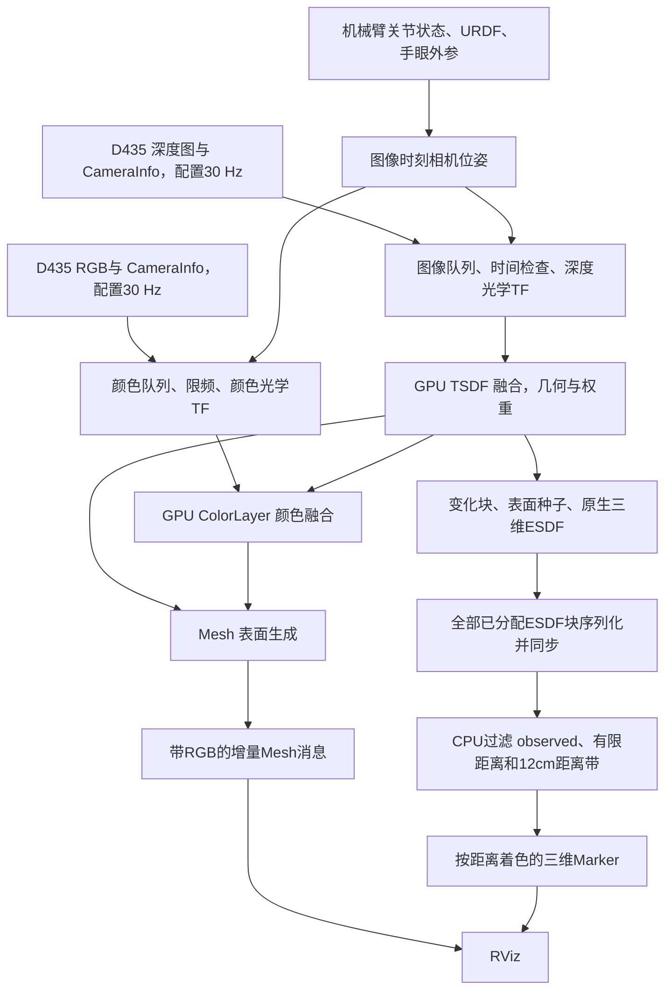

# 颜色与地图更新目标 30 Hz：数据流、ESDF 点数及实测

日期：2026-11-04。已修改默认参数、完成构建和离线检查，并实际启动 Gazebo、RViz 及之前的小幅腕部转动测试。本文结果来自复核后的原始消息探针，不是按配置值推算。

## 1. 修改了什么

RGB 相机原本已经配置为 1280×720、30 Hz，实机 D435 配置也是该 profile；此前 5 Hz 限制在建图端的颜色融合。本次没有提高分辨率或替换传感器。

| 参数 | 修改前默认目标 | 修改后默认目标 |
| --- | ---: | ---: |
| 深度融合 depth_hz | 30 Hz | 30 Hz，保持 |
| 颜色融合 color_hz | 5 Hz | 30 Hz |
| ESDF 调用 esdf_hz | 5 Hz | 30 Hz |
| Mesh 调度 mesh_hz | 5 Hz | 30 Hz |
| 地图层公共发布 layer_hz | 5 Hz | 30 Hz |
| 附加 ESDF 显示 esdf_view_hz | 1 Hz | 30 Hz |

体素保持 2 cm、输入保持 1280×720、最大融合距离保持 3 m、距离带保持 12 cm。静态建图、自过滤、时间戳处理、TSDF/ESDF 算法和队列策略均未在本次重写。相机路径和健康诊断也没有要求改成 30 Hz。

修改位置：

- [base.yaml](/home/czz/perception_eye_in_hand/nvblox_in_hand/src/nvblox_in_hand/config/nvblox/base.yaml)：原生颜色融合、ESDF、Mesh 和公共发布目标。
- [mapping.launch.py](/home/czz/perception_eye_in_hand/nvblox_in_hand/src/nvblox_in_hand/launch/perception/mapping.launch.py)：同步修改 launch 默认值，避免覆盖 YAML 时又回到旧频率。
- [view.yaml](/home/czz/perception_eye_in_hand/nvblox_in_hand/src/nvblox_in_hand/config/nvblox/view.yaml) 和 [mapper_node.cpp](/home/czz/perception_eye_in_hand/nvblox_in_hand/src/nvblox_in_hand/src/mapper_node.cpp)：三维显示默认目标统一为 30 Hz。
- mapper_node.cpp 在已有导出遍历中增加块数、已观测体素和 inside 标志体素统计，没有新增额外的全图读回。

默认构建仍复用 workspaces 已安装的官方库，没有修改 workspaces 或重新实现 ESDF。

## 2. 数据流：颜色和距离场分两条支路



深度支路决定几何表面和距离场；RGB 支路投影颜色到已有 TSDF 表面，再用于彩色 Mesh。两条支路各自使用对应图像时间的光学 TF，并非把所有颜色像素直接变成 ESDF 点。

提高颜色融合目标能更频繁地融合纹理，但不会直接增加 ESDF 种子、空间分辨率或可见范围。当前 ESDF 红/绿/蓝是距离伪彩色，不是 RGB 相机的物体颜色。

原生 NvbloxNode 负责队列、限频、转换与 GPU 调度；InHandMapper 负责附加显示和统计。核心 ESDF 由 TSDF 变化块更新，不是先铺一个固定大查询网格再赋值。

## 3. ESDF 点具体如何得到

每个原生块含 8×8×8=512 个体素。显示时读取实际分配的 ESDF 块，并依次执行：

1. 检查 `voxel.observed`，未知体素不输出。
2. 检查 `squared_distance_vox` 有限且非负。
3. 距离换算：`|d| = sqrt(squared_distance_vox) × voxel_size`，inside 标志用于负号及内部着色。
4. 只保留 `|d| ≤ 0.12 m` 的体素。
5. 显示位置采用原生体素中心：`p = (8 × block_index + voxel_index + 0.5) × voxel_size`，三轴分别计算，坐标系为 base_link。
6. 输出 CUBE_LIST，边长为 `0.95 × 0.02 = 0.019 m`；内部红色，外部按距离绿到蓝。

因此一个显示点对应一个原生体素中心，不是一个 RGB 像素、深度原始点或 Mesh 顶点，也不是累积了多少帧的计数。修改频率不会把同一个空间体素复制成 30 个点。

点数由体素大小、已观测范围、分配块、距离带宽和几何形状决定。增加有效视角可能增加覆盖；单纯提高 RGB 或 ESDF 频率不保证点数增加，更不能补齐遮挡后的 unknown。

## 4. 测试条件和测量方式

- RTX 4060 Laptop GPU，2 cm 体素，3 m 融合范围，3d/static_tsdf。
- 先启动场景、移到之前的观察姿态，再启动 mapper，避免初始大范围接近运动污染地图。
- 真正运行 RViz，显示 RGB、机器人和 Mesh；后半段开启三维距离带。
- 先静态，再 wrist_1 ±0.06 rad 往复 20 秒，再停稳；随后对开启距离带重复该流程。没有环绕扫描。
- 实际深度快照为 1280×720、16UC1；各主调度目标在运行参数中确认为 30 Hz。
- Mesh 和 Marker 频率使用原始 CDR 消息探针，Marker 点数只解析数组长度，避免创建数万个 Python 点对象。
- 本轮仍是单次顺序对照，不是随机化多轮实验；实际 Hz 使用墙钟时间。

## 5. 实际频率：设置 30 Hz 不等于达到 30 Hz

| 阶段 | RGB输入接收 Hz | 深度融合 Hz | 颜色融合 Hz | ESDF调用 Hz | Mesh接收 Hz | ESDF距离带接收 Hz |
| --- | ---: | ---: | ---: | ---: | ---: | ---: |
| Mesh 静态 | 29.26 | 20.69 | 20.69 | 27.48 | 15.93 | 未订阅 |
| Mesh 腕部运动 | 28.89 | 18.16 | 18.28 | 24.56 | 16.08 | 未订阅 |
| Mesh 停稳 | 28.39 | 18.22 | 18.05 | 24.84 | 15.25 | 未订阅 |
| Mesh+ESDF 静态 | 28.81 | 17.55 | 17.80 | 24.52 | 14.08 | 11.69 |
| Mesh+ESDF 腕部运动 | 28.75 | 17.39 | 17.54 | 24.38 | 14.41 | 11.75 |
| Mesh+ESDF 停稳 | 28.12 | 17.64 | 17.55 | 24.67 | 13.85 | 11.62 |

RGB 输入接收率是本测量节点实际收到的频率，可能受订阅和传输影响，并非对源相机每一帧都无丢失的证明。Gazebo 实时率为约 0.999–1.001，本次没有明显仿真降速。


内部 ESDF 计数是方法调用周期，不保证每次都有新的深度变化块。当前深度融合约 17–21 Hz，不能把约 24–27 Hz 的 ESDF 调用解读成每秒生成同样数量的全新几何地图。GPU 完成和屏幕端到端延迟仍未测量。

### 耗时和延迟

| 开启距离带阶段 | ESDF主机调用样本均值 | 附加显示样本均值 | 附加显示样本 P95 |
| --- | ---: | ---: | ---: |
| 静态 | 0.53 ms | 25.56 ms | 29.25 ms |
| 腕部运动 | 0.88 ms | 26.54 ms | 30.94 ms |
| 停稳 | 0.92 ms | 25.76 ms | 28.39 ms |

耗时来自每条 metrics 中最近一次调用的样本，不是全部调用逐次分布。约 26 ms 包含序列化、同步等待、CPU 筛选及发布；约 1 ms 的主机 ESDF 返回时间不能作为完整 GPU 算法耗时。

控制台 29 个统计窗口中，ESDF delay 滚动均值为 46–57 ms，深度为 23–34 ms，颜色为 26–35 ms。它们是各窗口均值范围，不是逐帧最小/最大延迟，也不包含完整屏幕链路。约 11.75 Hz 仅表示显示消息平均间隔约 85 ms，不能直接宣称端到端延迟只有 85 ms。

## 6. 改为 30 Hz 后实际得到多少点

| 阶段 | 每条距离带消息点数范围 | 平均点数 |
| --- | ---: | ---: |
| 静态 | 31,718–31,723 | 31,720.53 |
| 腕部运动 | 31,457–31,750 | 31,607.67 |
| 停稳 | 31,724–31,765 | 31,761.74 |

最终一次 metrics 导出快照：

| 层级 | 数量 | 含义 |
| --- | ---: | --- |
| 已分配 ESDF 块 | 210 | 当前稀疏层实际分配的块 |
| 块内体素槽位 | 107,520 | 210×512，包含未知位置 |
| observed 标志体素 | 42,622 | 块内已观测体素，并非全部都显示 |
| observed 且 inside 标志体素 | 12,574 | 原生内部标志，不是完整实体体积 |
| 最终距离带显示点 | 31,764 | observed、合法距离且在 12 cm 带内 |

块内其余 64,898 个槽位未观测，但这不是整个工作空间 unknown 的总数；未分配空间也没有在上述数值里。约 10,858 个已观测体素未进入最终显示带，可能位于带外或被合法性规则过滤。

诊断字段均代表最近一次显示导出快照。无订阅时不额外读回，字段为初始零或保留上次值；需要结合 `esdf_export_stats_valid` 判断。

## 7. 真实窗口截图与质量观察


截图均来自本轮真实 RViz 窗口，没有修改体素尺寸来制造更密集效果。右下角约 31 fps 是界面绘制帧率，不是地图实际更新率。静态截图不能证明 11.75 Hz，其依据是原始消息计数。

原始 RGB 仍有机械臂入图和目标偏在边缘的问题，改频率没有改变覆盖视角。采用与前一报告相同的局部墙面诊断，表面距离 P95 为静态约 9.03 mm、首次运动后约 9.36 mm、最终约 9.37 mm，未显示出因调频而发生明显精度变化。

这一指标只评价墙体邻域的网格顶点，与完整重建误差和实际传感器测量精度不同。未充分复现明显长尾，不能据此证明残影或 unknown 问题已解决。

## 8. 与旧设置的变化

前次相近腕部运动场景（颜色5、ESDF5、显示1目标）测到：颜色约 4.51 Hz、ESDF 调用约 4.74 Hz、距离带约 0.95 Hz，显示点数约 3.15 万。

本次对应阶段为：颜色 17.54 Hz、ESDF 调用 24.38 Hz、距离带 11.75 Hz，点数仍约 3.16 万。主要改善的是处理/显示节奏，几何精度与覆盖没有因此成倍增长。

两轮没有使用完全相同的录制输入，并且本轮改用了更轻的原始消息探针，所以这是历史参考，不是严格控制探针开销的因果实验。首轮使用 Python 对象型 Marker 探针时出现约 8 Hz 接收瓶颈，记录保留在 attempt1_typed_probe_saturation；本报告采用复核后的原始消息结果，不把探针瓶颈当成节点性能。

## 9. 为什么还没有完整 30 Hz

1. 官方 `shouldProcess` 使用严格“时间间隔 > 1/目标频率”；传感器恰好约 30 Hz 时，时间戳抖动和阈值边界可能跳帧。需要实际限频跳过计数，不能单凭配置断言 GPU 算不动。
2. 主 tick 配置为 10 ms，30 Hz 周期约 33.3 ms；轮询、处理负载和按当前时刻重置调度时间会量化实际节奏，而不是一个精确的 30 Hz 硬定时器。
3. 当前三维显示在主链路中同步导出全部分配块，再筛选约 3.17 万个点。每次约 26 ms，已经占用 33.3 ms 预算的大部分。
4. `last_view_` 记录在发布结束之后，再等待 33.3 ms 才允许下次显示。即使忽略其他工作，约 26 ms 处理加 33.3 ms 等待就已超过 30 Hz 周期；再与 ESDF 调用时刻对齐，可能出现隔次才发布。实际约 11.7 Hz 与这种机制相符，不能把 30 上限当成固定发布承诺。
5. Mesh/层按订阅需求和增量变化发布，不保证每个公共调度周期都产生一条新 Mesh；还受共享线程、GPU 和传输负载影响。

每条 3.17 万点 CUBE_LIST，仅 Point(double×3) 与 ColorRGBA(float×4) 的数据就约 1.27 MB，未计协议开销。若真发 30 Hz，约为 38 MB/s 的该部分载荷，还要承担接收端对象构造和绘制。数据体积是优化对象，但本次没有证明网络带宽是唯一瓶颈。

## 10. 下一步优化建议

- 首先增加限频跳过、帧龄、变化块和 GPU 事件统计，区分输入限频、空 ESDF 调用和真正计算瓶颈。
- 对显示做 GPU 筛选、紧凑输出和变化块增量更新，减少全层读回；设计有界一致快照后再与融合解耦。
- 在负载允许时评估以开始时刻/截止时间调度显示，避免处理时间额外叠加到节流周期；不能只改一个时间戳便保证30 Hz。
- 保持体素、分辨率、范围和 unknown 语义，在同一录制数据下重测；不能靠降低精度取得30 Hz后宣称等价优化。
- 重建质量仍需修正目标观察姿态、机械臂自过滤和图像/位姿一致性，调频不能替代这些工作。

## 11. 运行与回退指令

当前默认已是新目标，建议显式写出参数便于记录。先停止旧场景，构建后运行：

```bash
cd /home/czz/perception_eye_in_hand/nvblox_in_hand
./build.sh
./run.sh gazebo_gui:=true run_rviz:=false \
  mapper_backend:=observed_view esdf_mode:=3d \
  voxel_size:=0.02 max_range_m:=3.0 \
  depth_hz:=30 color_hz:=30 esdf_hz:=30 mesh_hz:=30 layer_hz:=30 \
  enable_esdf_view:=true esdf_view_hz:=30
```

另开终端，用本轮配置直接开启三维距离带：

```bash
cd /home/czz/perception_eye_in_hand/nvblox_in_hand
source ./env.sh
rviz2 -d artifacts/rate30_test_20261104/esdf_view.rviz --ros-args -p use_sim_time:=true
```

检查参数/统计，使用同样的 env.sh 环境：

```bash
ros2 param get /nvblox_node integrate_color_rate_hz
ros2 param get /nvblox_node update_esdf_rate_hz
ros2 param get /nvblox_node esdf_view_hz
ros2 topic echo /nvblox_node/metrics --once
```

小幅观察运动仍使用 `../run_ur7e_view_sweep.sh --check-only`，通过后 `../run_ur7e_view_sweep.sh --seconds 20 --amplitude 0.06`。不要与其他运动程序同时运行。严格复现本报告需先启动场景、完成观察姿态接近，再以 start_scene:=false 启动 mapper，具体结构同前次报告。

如需恢复旧调度进行对照，停止当前进程后显式启动，不需要改回源码：

```bash
./run.sh depth_hz:=30 color_hz:=5 esdf_hz:=5 mesh_hz:=5 layer_hz:=5 esdf_view_hz:=1
```

## 12. 验证与原始证据

默认构建两包成功，现有 6+7 项 Python 检查及 C++ ESDF 策略测试通过。运行后核对了参数为30、块数×512等于体素槽位数、inside≤observed≤allocated、显示点数≤observed。

- [实测结果](/home/czz/perception_eye_in_hand/nvblox_in_hand/artifacts/rate30_test_20261104/results.json)、[原始样本](/home/czz/perception_eye_in_hand/nvblox_in_hand/artifacts/rate30_test_20261104/samples.json)
- [运行参数](/home/czz/perception_eye_in_hand/nvblox_in_hand/artifacts/rate30_test_20261104/runtime_parameters.yaml)、[mapper日志](/home/czz/perception_eye_in_hand/nvblox_in_hand/artifacts/rate30_test_20261104/mapping.log)
- [测量脚本](/home/czz/perception_eye_in_hand/nvblox_in_hand/artifacts/rate30_test_20261104/run_measurement.py)、[原始Marker点数解析](/home/czz/perception_eye_in_hand/nvblox_in_hand/artifacts/rate30_test_20261104/cdr_marker_count.py)
- [局部质量数据](/home/czz/perception_eye_in_hand/nvblox_in_hand/artifacts/rate30_test_20261104/quality_metrics.json)、[最终Mesh](/home/czz/perception_eye_in_hand/nvblox_in_hand/artifacts/rate30_test_20261104/mesh_final.ply)
- [构建日志](/home/czz/perception_eye_in_hand/nvblox_in_hand/artifacts/rate30_test_20261104/build.log)、[离线检查](/home/czz/perception_eye_in_hand/nvblox_in_hand/artifacts/rate30_test_20261104/offline_tests.log)

本次已关闭测试 Gazebo、mapper 和 RViz，并确认端口 11457 释放。没有验证实机、完整扫描、大地图长时间运行或严格端到端延迟，30 Hz 默认目标不代表这些条件下已达到30 Hz。
