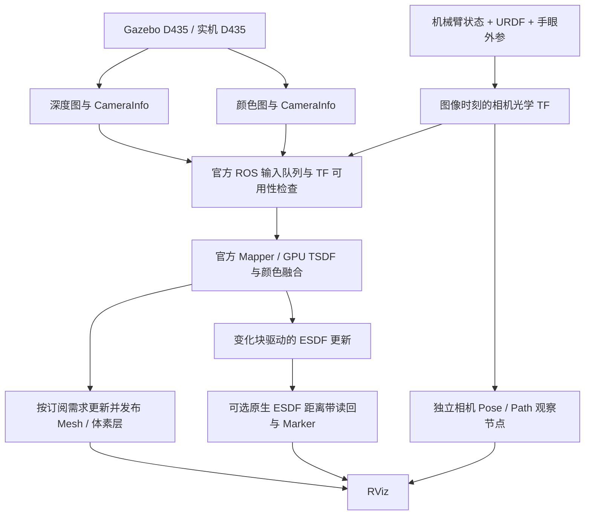

# 整体仓库与感知代码说明

日期：2026-11-03。父仓库为 `/home/czz/perception_eye_in_hand`，本轮重点感知工程为其下的 `nvblox_in_hand`。本文说明模块职责、执行链路、接口关系和已知不足，不将多个历史入口视为同一个运行程序。

配套操作文档：[仿真测试与效果采集](/home/czz/perception_eye_in_hand/nvblox_in_hand/docs/SIMULATION_TEST_GUIDE_20261103.md)。更细的逐模块说明见 [原有代码分析](/home/czz/perception_eye_in_hand/nvblox_in_hand/docs/CODE_ANALYSIS.md) 和 [目录与模块](/home/czz/perception_eye_in_hand/nvblox_in_hand/docs/DIRECTORY_AND_MODULES.md)。

## 1. 从整体理解仓库

父仓库包含基础建图封装、机器人仿真、表面重建、ESDF、规划、真机静态会话和自动采集等多条应用路径。运行某个入口只会启动相应依赖，不会自动启用所有功能。

```text
/home/czz/perception_eye_in_hand/
├── src/                         原有 ROS 包与应用
├── run_ur7e_*.sh                原有应用启动入口
├── run_ur7e_view_sweep.sh        已有观察姿态及腕部小幅转动入口
├── build_ur7e_*.sh              原有应用构建入口
├── docs/                        父工程说明资料
├── build/ install/ log/         父工程构建与运行产物
└── nvblox_in_hand/              新感知工作区，有独立构建、环境和文档
```

build/install/log 是生成物，不是主要源码入口。新工作区含 COLCON_IGNORE 隔离，使用自己的 build.sh，不在父工作区直接混合构建。两套场景包同名，必须核对实际加载路径。

## 2. 原有 src 包的职责

| 包及绝对路径 | 主要职责 | 与新感知工程关系 |
| --- | --- | --- |
| [realtime_nvblox](/home/czz/perception_eye_in_hand/src/realtime_nvblox) | Python 建图后端、ROS 输入和运行封装 | 新工程不经过这套 Python 后端 |
| [realtime_nvblox_2](/home/czz/perception_eye_in_hand/src/realtime_nvblox_2) | 保留的基础建图变体 | 不在新默认入口的依赖链内 |
| [ur7e_d435_gazebo](/home/czz/perception_eye_in_hand/src/ur7e_d435_gazebo) | 机械臂、D435、手眼配置、障碍物、控制器、视角/扫描脚本 | 场景复制到新工作区；视角转动入口仍可复用 |
| [ur7e_nvblox](/home/czz/perception_eye_in_hand/src/ur7e_nvblox) | Python TF mapper、ESDF 查询/导出、监控、深度适配 | 原有感知路径，未被新入口自动替换 |
| [ur7e_nvblox_native](/home/czz/perception_eye_in_hand/src/ur7e_nvblox_native) | 先前原生 C++ mapper、几何/网格导出与测试 | 与新工程同用官方核心，但封装和接口不同 |
| [ur7e_reconstruction](/home/czz/perception_eye_in_hand/src/ur7e_reconstruction) | 表面重建与扫描应用 | 独立应用，不自动切换到新后端 |
| [ur7e_perception_planning](/home/czz/perception_eye_in_hand/src/ur7e_perception_planning) | 规划地图协议、机器人几何、自过滤、地图查询及运行协调 | 新工程尚未发布其 PlanningMap |
| [ur7e_sage_planner](/home/czz/perception_eye_in_hand/src/ur7e_sage_planner) | SAGE 规划应用入口与配置 | 需要明确地图适配，不能直接读取显示 Marker 当距离场 |
| [ur7e_real_static](/home/czz/perception_eye_in_hand/src/ur7e_real_static) | 真机静态地图会话、冻结地图、规划和执行约束 | 地图身份和会话协议仍属原有体系 |
| [ur7e_real_reconstruction](/home/czz/perception_eye_in_hand/src/ur7e_real_reconstruction) | 真机重建与采集工作流 | 不因新 mapper 启动而自动接续 |
| [ur7e_auto_reconstruction](/home/czz/perception_eye_in_hand/src/ur7e_auto_reconstruction) | 自动采集重建及机器人传输协作 | 不属于新默认运行链路 |
| [ur7e_auto_esdf](/home/czz/perception_eye_in_hand/src/ur7e_auto_esdf) | 自动采集 ESDF 应用 | 与新环绕扫描、腕部转动不是同一套任务流程 |
| [ur7e_gazebo_esdf_sage](/home/czz/perception_eye_in_hand/src/ur7e_gazebo_esdf_sage) | Gazebo 中的 ESDF 感知、规划与执行应用 | 保留旧应用接口 |
| [ur7e_gazebo_esdf_sage_continuous](/home/czz/perception_eye_in_hand/src/ur7e_gazebo_esdf_sage_continuous) | 持续感知/规划/执行协调 | 尚未自动接入新地图 |

旧代码中的规则网格需要按用途区分：规划快照、距离查询采样、可视化点云都可能使用网格，但它们不等于 TSDF/ESDF 的底层生成算法。当前 `ur7e_nvblox/node.py` 已存在独立导出及按需求查询等逻辑，不能把早期固定查询开销的问题无条件套到所有后续版本。

## 3. 新工作区的组织

```text
/home/czz/perception_eye_in_hand/nvblox_in_hand/
├── build.sh / env.sh / run.sh    构建、依赖环境、统一启动
├── rviz.sh / check_sim.sh        显示与只读状态检查
├── test.sh / tests/              离线测试
├── orbit_scan.sh                 可选环绕扫描，本轮测试不使用
├── src/
│   ├── nvblox_in_hand/
│   │   ├── CMakeLists.txt        C++17/CUDA 目标和资源安装
│   │   ├── src/mapper_node.cpp   官方节点薄适配
│   │   ├── include/              原生 ESDF 显示选择策略
│   │   ├── scripts/robot_pose.py 相机位姿与路径诊断
│   │   ├── launch/              总入口、建图、D435 驱动入口
│   │   ├── config/              建图、传感器、DDS 配置
│   │   └── rviz/                Mesh、体素、路径、ESDF 显示配置
│   └── ur7e_d435_gazebo/         保留的场景、机器人与仿真相机副本
├── upstream/                    官方 ROS/core/messages/RViz 源码快照
├── provenance/                  来源清单与哈希
├── docs/                        操作与分析文档
├── artifacts/                   测试日志、地图和效果图
└── build/ install/ log/          本地构建与运行产物
```

## 4. 启动、环境和构建

### env.sh

清理容易混入旧工作区的环境变量，依次加载 ROS Humble、workspaces 官方依赖和本地安装覆盖层。默认域号 127，Gazebo master 端口 11457，CycloneDDS 使用本地配置。

同时检测 RViz shader 资源，在缺少 GLSL150 资源时启用官方插件 fallback 材质。fallback 解决兼容问题，不提高建图精度。插件体素点显示与真实大小立方体 Marker 是不同显示方式。

### build.sh 与 CMakeLists.txt

默认构建 `src` 下两个包，`mapper_node` 链接 `nvblox_ros::nvblox_ros_lib` 与 CUDA。launch/config/RViz/Python 脚本安装到 install，修改源码后需要重新构建和重启。

`./build.sh --from-source` 使用 upstream 快照并输出 build_source/install_source；运行时需设置 `IN_HAND_SOURCE_BUILD=1`。这是可选源码构建入口，不等于已经完成全量重编译验收。默认运行的核心通常来自 `/home/czz/workspaces/isaac_ros-dev/install`。

### run.sh 与 bringup.launch.py

run.sh 加载环境，检查新包来源，启动总 launch。bringup 按开关组合 Gazebo 场景、物理 D435 驱动、mapping、相机位姿观察节点和 RViz。物理相机与仿真入口有互斥检查。

默认不发送机械臂运动命令。观察运动由独立脚本明确触发。

## 5. 一帧数据如何进入地图



### mapping.launch.py：参数和后端

支持 observed_view 与 official 两种后端。前者运行本项目 C++ 薄适配，后者直接运行官方 nvblox_node。两者都使用官方建图算法；只有前者提供本项目 metrics 与自定义三维距离带。

配置顺序为 base → simulation/realsense → 自定义 mapper_config → launch overrides。公开开关与频率会被 launch 值覆盖；voxel_size 和 max_range_m 留空时保留配置文件设置。

Mesh 与体素层共享官方发布调度，发布频率取已启用请求频率的最大值。关闭某些输出采用重映射、消除常规订阅需求的方式，不代表从官方库中删除算法。不能对 disabled 命名空间额外订阅后仍声称没有这部分计算。

### 官方 NvbloxNode：输入、TF 和调度

核心位于 upstream 快照的 `nvblox_ros/src/lib/nvblox_node.cpp`、`transformer.cpp` 及输入队列模板。它承担图像接收、时间检查、TF 查询、深度/颜色融合、ESDF 定时调用、地图层发布和服务。

TF 查询使用图像请求的时间戳，缺少该时刻 TF 则等待/失败，不应随意换成最新位姿。输入队列有限长度，但长度限制不等于严格的最大帧龄保证。

### nvblox core：真正的融合与 ESDF

核心快照位于 `upstream/nvblox_ros/nvblox_core/nvblox`。Mapper 组织积分器及变化块；projective TSDF integrator 将深度沿射线投影并加权融合；颜色积分器融合 RGB；ESDF integrator 依据有效 TSDF 表面种子更新距离；Mesh 积分器生成表面三角网格。

稀疏块中的体素仍是规则体素，但只按算法需要分配和更新相关块。这与每帧在固定大 ROI 生成所有查询点、读回距离再发布，是不同的处理链路。

## 6. 本项目适配代码具体做了什么

| 类/方法 | 作用 | 边界 |
| --- | --- | --- |
| InHandMapper 构造 | 创建距离带 Marker、metrics，声明显示参数 | 不替换官方积分器 |
| processDepthImage / processColorImage | 调用基类后检查融合时间推进，累计计数 | 不把每条回调都当作有效融合 |
| tick | 先执行官方调度，再计算约一秒窗口的墙钟指标 | 指标非 GPU 完成测量 |
| processEsdf | 先调用官方 ESDF，再按显示开关、订阅者和墙钟节流导出 | 计数是调用周期，不保证每次有新数据 |
| EsdfLayerSerializerGpu | 将原生分配块序列化读回 | 当前读取全部分配 ESDF 块，会同步并增加开销 |
| observedDistance | 剔除 unknown、无效距离和距离带外体素，恢复米制有符号距离 | 显示过滤，不参与 ESDF 构建 |
| Marker 构造 | 固定 namespace/id 的 CUBE_LIST，尺寸为 0.95×体素边长 | 不按每帧新 id 无限累积；最后一帧可能持续显示 |

当前附加显示在读回后才做 CPU 筛选，因此“仅显示少量点”不等于“只读回少量数据”。这是实时性优化的重要候选，但需要开关对照才能判断它占实际负载的比例。

## 7. 相机 Pose/Path 节点

`robot_pose.py` 订阅深度 CameraInfo，以其时间戳查询光学相机到 global_frame 的 TF，发布 camera_pose、camera_path 和 pose_health。队列最长 10，TF 等待有超时；Path 最多 3000 点，约 5 Hz 墙钟节流。

它不产生 SLAM，不估计或修改 TF，也不把结果作为 mapper 的唯一位姿入口。mapper 自行查询 TF。Path 有数据只能说明这个观察节点解析过部分 TF，不能证明所有深度帧都已融合，更不能证明成像时间正确。

## 8. 场景与运动脚本

新场景包保留机器人模型、手眼标定、障碍物、Gazebo 相机插件、初始关节和位置控制器。scene.launch.py 检查端口和插件，加载场景、机器人与状态发布。

相机 URDF 声明深度分辨率 1280×720、30 Hz、近裁剪 0.1 m、远裁剪 10 m 和噪声配置。mapper 最大融合距离另设为 3 m，两者不能混为同一个范围。

仿真插件的 ROS 图像回调使用 world SimTime 打时间戳；是否与渲染测量时间一致仍需运行验证。此处是时间一致性的排查点，不是已经证实的错误。

本轮观察运动使用父工程 `run_ur7e_view_sweep.sh` → `src/ur7e_d435_gazebo/scripts/view_sweep.py`：预检查 Gazebo、关节、时钟和控制器，平滑到之前的观察姿态，再小幅转动 wrist_1。

新工程的 orbit_scan.sh 是另一套可选扫描入口，本轮不使用；它不等于实时规划器，也不能凭可达视点数量保证整个障碍物无死角覆盖。

## 9. 地图、显示与规划接口

| 接口 | 内容 | 不应误解为 |
| --- | --- | --- |
| 原生 TSDF/ESDF/Color 层 | 稀疏块、融合状态和距离 | RViz 显示点集合 |
| mesh | 增量三角网格及块更新 | 完整自由空间或碰撞距离查询 |
| esdf_native_band | 原生已观测近表面距离样本 | 全工作空间有效性或旧规划消息 |
| static_esdf_pointcloud | 本地版本的二维 ESDF 切片 | 默认三维模式应当持续发布的话题 |
| get_esdf_and_gradient | 按请求范围返回距离/梯度 | 每帧无成本的全图导出 |
| save_map / load_map | 原生地图序列化 | 父工程完整冻结会话与执行身份协议 |

父工程 [PlanningMap.msg](/home/czz/perception_eye_in_hand/src/ur7e_perception_planning/msg/PlanningMap.msg) 包含坐标、版本、分辨率、布局及原生/保守规划距离、自由来源等约定。新工程尚未实现对应发布者。后续接入需要处理 unknown、轴顺序、体素中心、地图版本和新鲜度，不能把 ESDF Marker 直接接入规划器。

## 10. 当前问题与改善方向

| 问题 | 源码依据/待确认点 | 改善方向 |
| --- | --- | --- |
| 墙角 unknown | 遮挡、无效深度、范围与权重限制；显示距离带又过滤部分有效区域 | 覆盖诊断、多视角补采、未知有效性独立表达 |
| 相机运动后墙面重影 | 图像测量时间与回调时间、手眼/光学 TF 待验证 | 同时刻真值对照，先修正时空一致性 |
| 机械臂扫过区域残影 | 新链路尚无机器人自身深度过滤 | 图像时刻几何投影、自过滤并保留遮挡未知 |
| 历史错误表面持续 | static_tsdf、周期衰减关闭；缺乏后续有效观测可能保留 | 先减少错误输入，再采用局部证据清除或非语义动态模式 |
| 更新跟不上运动 | 输入积压、没有严格帧龄约束 | 最新可用帧策略、帧龄与丢帧原因统计 |
| 开 ESDF 后变慢 | 全部分配块同步读回、CPU 遍历和 RViz 绘制 | 按变化块/ROI 导出、异步处理与受控显示频率 |
| 体素看起来大/粗糙 | 体素尺度、传感器噪声、融合错位、显示方式 | 核对真实尺寸和误差来源；不只缩小 voxel_size |

相机运动但环境静止，本身并不要求动态建图才能正确重建。处理延迟也不一定造成空间错位：旧图像配正确历史位姿时主要表现为滞后。全局强衰减可能把已扫描死角重新变为 unknown，不宜作为所有残影问题的第一修复手段。

详见 [问题专项分析](/home/czz/perception_eye_in_hand/nvblox_in_hand/docs/ESDF_UNKNOWN_AND_MOTION_GHOST_ANALYSIS.md)。

## 11. 验证状态与后续工作

历史构建、离线测试及 RViz 插件兼容验证记录见 [VALIDATION](/home/czz/perception_eye_in_hand/nvblox_in_hand/docs/VALIDATION.md)。其中虚拟显示的测试网格不是机器人重建效果，用户历史运行日志也不等于本轮同条件仿真成绩。

本次仅整理文档，没有重新构建或执行仿真，不能给出新的实际 Hz、精度或延迟数字。按照配套手册采集日志、原始输入和效果图后，才可评估是否达到 workspaces 的实时性与完整性。

建议后续顺序：先建立采集/位姿/帧龄证据，再处理机器人自过滤和输入质量，然后优化同步导出，最后明确动态障碍与旧规划接口的需求。完整性、精度和实时性分别验收，避免以更少显示点数代替更快的核心建图。
