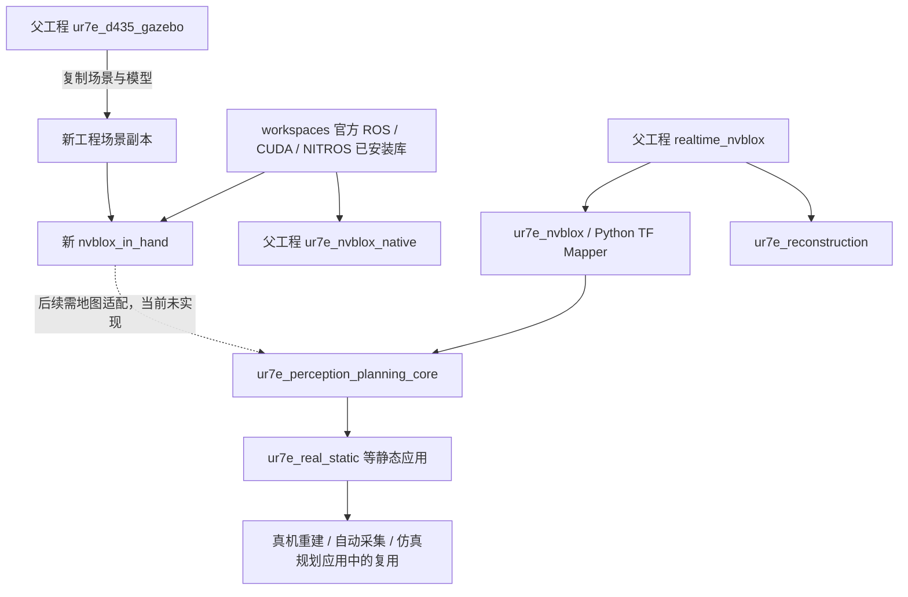

# 将 nvblox_in_hand 放回整体工程理解

分析日期：2026-10-28。本文联系三个范围：

1. `/home/czz/workspaces/isaac_ros-dev` 中的官方 ROS 移植实现与已安装依赖。
2. `/home/czz/perception_eye_in_hand` 原有感知、重建、规划和实机应用。
3. `/home/czz/perception_eye_in_hand/nvblox_in_hand` 新的独立感知工作区。

本文描述实际复用与尚未接入的关系，后续建议不代表已经完成代码实现。

## 1. 整体工程不是一个单一程序

父工程包含多套可独立启动的感知和应用路径。它们面向不同实验阶段：底层 RGB-D 运行、手动采集、表面重建、ESDF、SAGE 规划、静态地图会话、自动采集和连续感知/规划。

新工程目前主要承担“机器人/场景输入 → 官方原生建图 → 可视化/查询 → 可选扫描采集”。它没有替换父工程所有节点，也没有让旧的 SAGE 消费者自动改读新地图。



实线表示源码复用或当前依赖关系的概括；不是说图中所有进程会一起启动。虚线是待完成的接口接续。

## 2. 各部分在整体中的位置

| 部分 | 当前主要角色 | 与新工程的实际关系 |
| --- | --- | --- |
| workspaces/isaac_ros-dev 中 isaac_ros_nvblox | 官方 ROS/CUDA 地图实现及生态依赖 | 默认构建实际链接这里的已安装官方库 |
| 新工程 upstream/ | 上述 ROS/core/message/RViz 等源码快照 | 便于阅读、追溯和可选本地源码构建；默认不自动执行此处修改 |
| 父工程 ur7e_d435_gazebo | 机械臂、D435、手眼、障碍物与控制器 | 新工程复制保留，包名相同，运行时必须选清 overlay |
| 父工程 realtime_nvblox | Python/SDK/ROS 基础封装和原生后端桥接 | 新工程默认建图不经过它 |
| 父工程 realtime_nvblox_2 | 保留的基础库副本/变体 | 不属于新入口依赖链，不应与新模块混同 |
| 父工程 ur7e_nvblox | Python TF mapper、查询/导出及相关优化 | 保留为旧入口；新工程不继承它的 TfMapper |
| 父工程 ur7e_nvblox_native | 先前 C++ 接入、项目化导出/显示/统计 | 与新工程同样利用官方库，但输出接口和附加逻辑不同 |
| 父工程 ur7e_reconstruction | 独立表面重建应用 | 不因启动新 mapper 而自动切换其后端 |
| 父工程 ur7e_perception_planning | 规划地图消息、机器人几何、自过滤与 SAGE 关联 | 新工程尚未发布其 PlanningMap |
| 父工程 ur7e_real_static / ur7e_real_reconstruction | 静态场、地图冻结、采集会话和真机重建流程 | 其内部 Snapshot/FrozenMap 不等于原生 .nvblx 文件 |
| 父工程 ur7e_auto_reconstruction / ur7e_auto_esdf | 自动采集应用及共享 RTDE 传输 | 新工程没有自动接入它们的执行控制和会话协议 |
| 父工程 ur7e_gazebo_esdf_sage / continuous | 在线障碍层、规划和执行协调 | 不会自动消费新工程 ESDF Marker；需要明确地图接口 |
| 父工程 ur7e_sage_planner | 规划基线/任务入口 | 与新工程的观察点扫描不是同一种规划器 |

这些关系从实际 import、类继承与消息定义核对。例如旧 PlanningMapper 继承 ur7e_nvblox.node.TfMapper，并依赖 EfficientBackend；真机静态采集也导入该后端和 robot_depth_mask。新 InHandMapper 则继承官方 C++ NvbloxNode，没有复用这些 Python 应用契约。

## 3. 新工程与旧原生入口的差别

| 问题 | 父工程先前原生路径 | 新 nvblox_in_hand |
| --- | --- | --- |
| 默认入口 | 父工程 run_ur7e_perception.sh | 新目录 run.sh |
| 场景 | 父工程 scene 包 | 新目录场景副本 |
| 默认深度输入 | 先前统一入口含 stride=2 适配 | 直接原始深度及其 CameraInfo |
| 默认体素 | 先前 v4 默认 3 cm | 新 base 默认 2 cm |
| Mesh 查看 | 项目附加标准 Marker 桥接等逻辑 | 首选官方增量 Mesh 插件 |
| ESDF 显示 | 项目块导出和 PointCloud 输出 | 可选原生块序列化距离带 + 原生服务/二维模式 |
| 统计 | 先前 v4 含 CUDA 事件相关指标 | 新薄适配只提供融合时间推进计数、周期和主机耗时 |
| 后端对照 | 项目封装路径 | official 参数直接运行官方原始节点 |
| 话题 | 主要 /ur7e_nvblox/... | 主要 /nvblox_node/... 和 /nvblox_in_hand/... |

不能说所有新功能都比旧原生入口更丰富。新工程选择更直接的官方结构，但没有搬入旧入口全部诊断能力；例如新 metrics 明确没有测量 GPU 完成事件。默认精度和输入也变了，因此默认两张画面的差异不能作为公平性能结论。

旧 v4 导出也已经存在按分配块/observed 的路径，不能把它一概称为“仍用固定查询网格建图”。应按实际入口、版本和消费者判断。

## 4. 同名包、环境与二进制来源

新旧场景包同名，是为了保持 URDF 和资源引用兼容；源文件是副本，不是父工程的实时共享链接。修改父场景后，新副本不会自动同步；修改新副本后，也不应声称父场景已改变。

COLCON_IGNORE 将新工作区与父工程默认递归发现隔离。新 build.sh 显式构建自己的 src。新 env.sh 按依赖→本地 overlay 的顺序加载环境。

判断实际运行来源，应检查：

```bash
ros2 pkg prefix nvblox_in_hand
ros2 pkg prefix ur7e_d435_gazebo
ros2 pkg prefix nvblox_ros
```

默认模式前两者应指向新工程 install，第三者通常指向 workspaces 已安装包。源码构建模式则应核对 install_source 覆盖。仅看到 upstream/ 下有某文件，不能证明运行时用了它。

这也解释为什么修改源码后必须重新构建并重启：launch/config/Python 脚本存在安装副本，正在运行的进程也不会自动更换参数和 TF 链。

## 5. 四类地图接口不能直接等同

| 接口 | 保存的信息 | 典型消费者 |
| --- | --- | --- |
| 原生 nvblox 稀疏层 | 分配块、TSDF/ESDF/颜色等 | 原生 Mapper/积分器/序列化 |
| Mesh/Marker/PointCloud | 可视化几何、颜色或距离样本 | RViz 和调试工具 |
| 官方 ESDF/gradient 服务响应 | 请求范围内的数组、原点、分辨率及成功状态等 | 按需查询的客户端 |
| 父工程 PlanningMap/Snapshot/FrozenMap | 数组布局、已知/自由来源、保守距离、版本或冻结身份 | SAGE、静态会话及执行检查 |

Mesh 和近表面 ESDF Marker 不包含完整自由空间及 unknown 语义，不能直接作为规划距离场。也不能把“有 PointCloud 消息”当作“旧规划节点已经获得可用地图”。

父工程实际契约见 [PlanningMap.msg](/home/czz/perception_eye_in_hand/src/ur7e_perception_planning/msg/PlanningMap.msg)：

- header、epoch、sequence 表示坐标/时间及版本。
- origin、resolution、dimensions 定义离散几何。
- nvblox_distance 是原生距离样本。
- planning_distance 是到障碍物或未观测空间的保守距离。
- free_source 区分未知/占据、深度观测自由及经过确认的初始净空。
- 数组使用 C 顺序 [z,y,x]，dimensions 为 [nx,ny,nz]，也支持明确的压缩载荷。

新工程没有实现这个消息发布者。新 metrics 内的 totals 只是计数，不是上述 epoch/sequence 的地图快照版本协议。

## 6. 为什么规划层可能仍然需要规则网格

父工程 [grid.py](/home/czz/perception_eye_in_hand/src/ur7e_perception_planning/ur7e_perception_planning_core/grid.py) 的 grid_points 生成采样点，Snapshot.query 进行插值并考虑离散误差；它是规划表示与查询策略，不应直接等同于原生 TSDF/ESDF 的生成算法。

两者可以同时成立：

```text
原生稀疏增量地图负责融合/距离更新
  → 按需为规划生成有明确范围的规则快照
  → 规划器对一致快照做快速批量插值
```

问题通常在于快照范围、频率、数据复制、未知语义、版本和新鲜度，而不是“任何规则网格都必须删除”。避免把这个适配层放回每帧融合必经路径，才能保留原生处理优势。

## 7. 以后接入父工程需要补齐的内容（尚未实现）

### 7.1 地图适配与空间定义

建议独立模块负责官方原生地图/查询到 PlanningMap 或等价 Snapshot 的转换，不把协议转换塞进每帧 processDepthImage。

首先明确：base_link 或其他地图 frame、单位、体素中心约定、分辨率、范围、数组轴顺序和截断边界。

尤其要注意官方 ESDF 服务 origin 的体素角点约定与父工程采样原点定义不能机械套用。若需要转换到采样中心，应按 voxel_size/2 正确偏移，否则会系统性移动半格。必须用已知位置的几何样本验证布局，不能只看数组长度正确。

### 7.2 未知空间和保守场

官方 ESDF 转换会对 observed=false 使用配置的 unobserved 默认值。服务响应本身没有完整复刻旧 free_source 的来源分类。应明确无效/未知编码，必要时增加有效性来源，不能把数值默认值误当作已证实自由空间。

父工程 planning_distance 还约束未观测空间，新工程原生 ESDF 距离不能直接替代这种策略。把 unknown 一律当自由会改变规划行为；把所有 unknown 无条件填成障碍也需要按任务明确说明。

### 7.3 一致快照、冻结与重置

父工程 FrozenMap 有元数据、来源和校验身份。保存 .nvblx 只表示保存原生地图，不等于创建了满足原会话/规划验证的 FrozenMap。

后续适配需明确：一次输出对应哪个地图状态，更新/重置如何变更 epoch，序号如何递增，规划执行引用哪一版，以及地图过期时如何拒绝继续使用旧结果。稀疏层的变化与发布的规划数组应有一致边界。

### 7.4 机器人自过滤

父工程已有 robot_depth_mask、RobotGeometry 等辅助，新工程默认没有调用。相机看到机械臂时，原生静态融合可能把它也融合进环境。

若后续复用，需要按图像时刻机器人位姿生成一致掩码，并保留深度有效性/观测来源；不能只在 RViz 中隐藏机械臂就认为地图已剔除机器人。

### 7.5 GPU 资源调度

父工程 runtime.py 使用基于 threading.Condition 的 MappingPriorityLock 协调进程内 GPU 访问。新 C++ mapper 是独立进程，这把 Python 锁不会自动控制它。

新感知与 SAGE 共用 GPU 时，需要重新测量显存、占用、快照传输和调度影响，明确跨进程策略；不能因为两边各有锁，就断言全系统不存在争用。

### 7.6 执行与真机接口

新 orbit_scan 是默认 Gazebo 固定场景的观察点采集；父工程 auto_* 具有 RTDE 传输和更完整会话逻辑。不能把扫描脚本换一个控制话题就视作实机接入完成。

应明确地图身份、机器人模型/手眼身份、轨迹验证、反馈新鲜度与实际执行来源的一致性。此部分是接续工作，不在当前生成代码中自动完成。

## 8. 静态重建与动态场景的边界

本工程按用户要求不启用人物识别和动态语义工作流，默认 static_tsdf、关闭衰减和局部清图。这有利于保留静态场景完整地图，但移动障碍物可能留下旧表面。

父工程连续分支存在“不可变静态策略 + 传感器在线新增障碍层”的结构，并具有自己的清除规则。新工程没有自动实现这套策略。

开启 TSDF 衰减或局部清图只能改变地图保留/清理行为，不等于恢复了父工程全部动态阻挡策略；人物识别也不是唯一的动态环境处理方式。应按真实任务定义更新和清除语义。

## 9. 用一个完整任务联系所有模块

以“机械臂相机观察障碍物，重建后用于规划”为例：

1. Gazebo 或外部机器人驱动产生关节反馈；RSP 和手眼生成图像时刻 TF。
2. D435 深度/颜色和各自标定进入官方原生建图。
3. TSDF/Color 保存多帧观测，ESDF 计算距离，Mesh 提供表面观察。
4. 可选扫描器改变观察位置；它只帮助获取更多观测，不直接完成物体表面重建。
5. RViz 显示原生结果；显示成功与规划地图可用是不同验收项。
6. 若要接旧规划器，必须经过尚待实现的地图适配、unknown 策略、快照版本和模型身份约定。
7. 规划与执行模块再根据一致地图和机器人状态生成/验证/执行轨迹。

当前新工程已覆盖第 1–5 项相应代码及接口，但真实场景效果仍需运行验收；第 6 项没有实现，不能宣称第 7 项已经由新地图驱动。

## 10. 后续阅读与验证顺序

先读 [新代码执行分析](CODE_ANALYSIS.md) 和 [目录职责](DIRECTORY_AND_MODULES.md)，再按当前任务选择父工程入口：

- 感知输入/融合：[旧 TfMapper 所在源码](/home/czz/perception_eye_in_hand/src/ur7e_nvblox/ur7e_nvblox/node.py)。
- 旧规划地图生成：[PlanningMapper](/home/czz/perception_eye_in_hand/src/ur7e_perception_planning/ur7e_perception_planning_core/mapper.py)。
- 快照与查询：[grid.py](/home/czz/perception_eye_in_hand/src/ur7e_perception_planning/ur7e_perception_planning_core/grid.py)。
- 静态场持久化：[field.py](/home/czz/perception_eye_in_hand/src/ur7e_real_static/ur7e_real_static/field.py)。
- 进程内 GPU 互斥：[runtime.py](/home/czz/perception_eye_in_hand/src/ur7e_perception_planning/ur7e_perception_planning_core/runtime.py)。
- 父工程各应用概览：[原架构说明](/home/czz/perception_eye_in_hand/docs/ARCHITECTURE.md)，其历史状态应结合本次分析区分。

建议先验收新工程静止/移动时的输入、TF、表面和 ESDF，再完成地图适配，最后接规划与执行；不要用一次 RViz 正常显示代替整个感知—规划—执行链路的验证。
