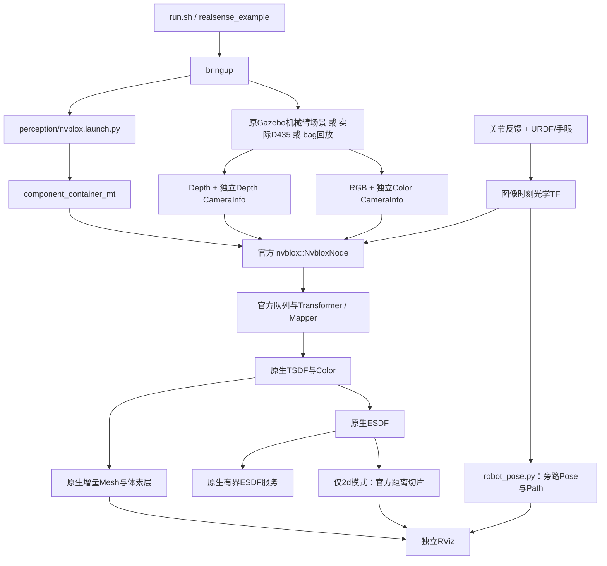

# 基于workspaces示例主体的nvblox_in_hand重构说明

后续验证：用户再次授权测试后，已完成三种后端/模式的仿真复测，见 [实际频率、质量与窗口截图](REFACTORED_EXAMPLE_TEST_20261104.md)。本文“本轮未测试”指重构交付阶段，以下保留当时实施记录；性能以复测报告为准。

日期：2026-11-04。修改范围仅 `/home/czz/perception_eye_in_hand/nvblox_in_hand`，未改workspaces及父工程感知模块。本轮完成代码重构、构建和静态解析；沿用“先不测试”的要求，没有启动仿真、相机、ROS感知节点或机械臂，没有运行单元/GPU/性能测试。本版没有新的质量或实时性实测结果。

## 1. 本次重构的原则与结果

主体参考目录为 `/home/czz/workspaces/isaac_ros-dev/src/isaac_ros_nvblox/nvblox_examples`。该目录本身主要是示例编排，实际建图在其加载的nvblox_ros与nvblox_core中。重构围绕“示例怎样组织与调用官方感知”进行，不再以三维点云显示器作为默认感知主体。

默认入口现在加载 **官方 `nvblox::NvbloxNode` 组件**，使用 `component_container_mt`，保留原生队列、TF、深度/颜色融合、ESDF、增量Mesh/体素层、地图服务和官方诊断。项目只适配D435输入、机械臂TF、原场景、功能开关及运行档。

旧InHandMapper仍可显式选择，但身份变为诊断后端；默认不创建它、不运行其GPU点云遍历，也不产生它的metrics。没有同时启动两套mapper。

这是运行组织和输出职责的实质改变；不会自动修复深度噪声、运动时序、手眼标定或静态融合残影，不宣称尚未测量的性能提升。

## 2. 仔细参考的示例及其真实用途

| workspaces文件/模块 | 实际用途 | 本次采用方式 |
| --- | --- | --- |
| nvblox_examples_bringup/launch/realsense_example.launch.py | 组织传感器、定位、识别、感知、显示、回放和组件容器 | 保留分层思想，限定单D435、机械臂pose；保留回放和容器挂载；删除无关定位/识别入口 |
| launch/gazebo_realsense_example.launch.py | 本机固定相机Gazebo迁移版的示例编排 | 参考仿真时间与感知组件启动；场景使用perception机械臂副本 |
| launch/perception/nvblox.launch.py | 组合base/mode/camera参数、remap，加载NvbloxNode组件 | 新建同职责入口，默认加载相同package/plugin |
| config/nvblox/nvblox_base.yaml | 核心算法、调度、ESDF和Mesh公共参数 | 提取静态D435相关键，保留原值；移除无关LiDAR/动态配置 |
| config/nvblox/specializations/nvblox_realsense.yaml | 输入QoS、TF来源、切片等相机特化 | 保留传感器QoS及TF输入方式；移除camera0固定平台坐标假设 |
| launch/visualization/* | 将显示与建图分开 | 新建visualization入口，按实际后端/ESDF模式选配置 |
| realsense_splitter | 按真实相机metadata分离发射器状态，配合VSLAM与建图 | 当前没有红外VSLAM链，因此不接入；不是删减TSDF/ESDF |
| semantic_label_conversion、nvblox_image_padding | 语义转换及相关图像预处理工作流 | 当前静态单D435链无相应消费者，不启动 |

本机示例已有迁移修改，不能把它与远端官方某一release完全等同。参考文件及哈希、配置删减键记录在 [重构来源清单](/home/czz/perception_eye_in_hand/nvblox_in_hand/provenance/example_refactor_20261104.json)。

### 2.1 为什么不直接include整个旧Gazebo桥接

本机 `sensors/gazebo_realsense.launch.py` 包含多路topic relay、将depth CameraInfo转给color CameraInfo、以及camera_link到base_link等零位姿静态别名。这些适用于其既定固定相机假设，不能原样套到已有机械臂TF树：

- 眼在手上相机相对base_link运动，不能发布相机到base的恒等静态TF。
- 彩色图像必须配自己的CameraInfo及光学坐标，不能为凑话题而替换为深度内参。
- 新工程已经输出所需RGB-D话题，直接remap四路输入即可；额外relay只为名称兼容，不是建图算法必需部分。

因此保留官方组件与配置组织，替换传感器/机械臂适配，而不是复制固定场景的错误假设。

## 3. 重构后的代码结构

```text
nvblox_in_hand/
├── run.sh                          默认启动realsense_example.launch.py
├── build.sh / env.sh               独立安装、官方依赖和通信环境
├── rviz.sh                         默认mesh；可选2d/diagnostic
├── src/
│   ├── ur7e_d435_gazebo/           原机器人、手眼、D435、场景和控制器副本
│   └── nvblox_in_hand/
│       ├── launch/
│       │   ├── realsense_example.launch.py  示例风格用户入口
│       │   ├── bringup.launch.py           场景/相机/回放/感知/路径/显示编排
│       │   ├── sensors/d435.launch.py      可选真实D435驱动
│       │   ├── perception/nvblox.launch.py 官方组件及配置/输入适配
│       │   ├── perception/mapping.launch.py 旧入口兼容转发
│       │   └── visualization/visualization.launch.py 独立显示选择
│       ├── config/
│       │   ├── nvblox/nvblox_base.yaml      workspaces静态核心参数
│       │   ├── nvblox/specializations/nvblox_realsense.yaml D435参数
│       │   ├── robot/ur7e.yaml             机械臂坐标、范围及切片
│       │   ├── profiles/reference.yaml     继承参考base数值
│       │   ├── profiles/realtime.yaml      当前3cm/30Hz目标运行档
│       │   └── nvblox/simulation.yaml、realsense.yaml 时间源
│       ├── scripts/robot_pose.py           图像时间TF路径旁路
│       ├── src/mapper_node.cpp             显式可选诊断后端
│       ├── src/esdf_pointcloud_exporter.cu 诊断后端原生体素导出
│       └── rviz/                          Mesh、官方2D、诊断3D分开
├── upstream/                          已保留官方ROS/core/msg/plugin源码快照
├── provenance/                        参考来源、配置删减和文件哈希
├── tests/                             更新后的检查代码，本轮未执行
└── docs/                              本文及操作、参数说明
```

## 4. 从启动到建图的实际调用链



官方tick依次处理原有任务，ESDF仍调用MultiMapper/Mapper更新真实稀疏块。新入口不构造固定ROI查询网格建图，不重写距离传播，也不把unknown当自由空间。

`robot_pose.py`不作为位姿中转。Mapper直接按图像时间戳查TF；路径节点的解析成功不能替代成功融合统计。

### 4.1 组件容器与挂载

默认创建一个 `nvblox_container`，其中加载一个 `nvblox::NvbloxNode`。`attach_to_container=true`时只向现有容器加载组件，不另起容器；此时感知的存活与退出管理由容器持有者负责，启动方不能保证容器内其他组件的生命周期。

诊断后端目前仍是独立进程，不能与attach模式混用。标准组件装载方式与workspaces一致，但只有一个外部Gazebo输入时，组件化本身不保证省去跨进程图像传输，也不保证NITROS端到端零拷贝。

### 4.2 感知主体的内部实现，不只看启动文件

| 核心模块 | 官方实际执行内容 | 本项目处理 |
| --- | --- | --- |
| NvbloxNode图像订阅 | 无mask的Depth/Image与对应CameraInfo精确时间同步，Color独立同步，然后排队 | 四路直接remap，保留各自标定，不人为假定RGB与Depth同一内参 |
| Transformer与processDepthQueue/ColorQueue | 按帧时间和frame_id检查TF可用，再进入原有处理/限频与图像转换 | 使用机械臂动态TF，不读取相机路径话题替代pose |
| NvbloxNode::tick | 服务队列→传感器队列→衰减→局部清图→ESDF→地图层→调试与统计 | 默认直接调用原组件，没有自定义tick附加任务 |
| Mapper::integrateDepth及TSDF integrator | 深度投影、块分配、截断距离和权重融合，登记受影响块 | 保留原实现，输入精度由传感器/体素/标定决定 |
| Mapper::updateEsdf | 从kEsdf更新跟踪取得待更新块，调用ESDF integrator，再标记已处理 | 稀疏块增量更新，不是每帧构造固定查询网格 |
| ESDF integrator | TSDF权重决定observed，符号决定inside，近表面inside标记site，处理变化及距离传播 | 不修改算法，不把unknown强行补成自由空间 |
| Mapper::updateMesh | 取得kMesh待更新块，GPU提取三角网格，再按Color层着色 | 保留原生几何与上色，不用体素点冒充Mesh |
| LayerPublisher | 根据订阅选择层；Mesh需要时才计算；序列化增量块并发布更新/删除 | 复用官方输出和插件，保留删除语义 |
| 原生ESDF服务 | 请求入任务队列，按需更新/清理并导出有界距离数组 | 保留；大请求会占用处理链，不是零开销后台查询 |

可追踪源码：[tick与队列](/home/czz/perception_eye_in_hand/nvblox_in_hand/upstream/nvblox_ros/src/lib/nvblox_node.cpp:576)、[Mesh/ESDF更新](/home/czz/perception_eye_in_hand/nvblox_in_hand/upstream/nvblox_ros/nvblox_core/nvblox/src/mapper/mapper.cpp:474)、[订阅驱动发布](/home/czz/perception_eye_in_hand/nvblox_in_hand/upstream/nvblox_ros/src/lib/layer_publishing.cpp:671)。

特别发现：本地ROS源码声明并读取update_mesh_rate_hz，但没有找到它作为Mesh周期判断的调用。实际LayerPublisher在发布已订阅Mesh时调用updateMesh，受publish_layer_rate_hz限制。因此新入口让mesh_hz成为实际公共发布频率的兼容别名；与layer_hz同时指定时必须相同，避免出现“配置独立Mesh频率、实际未生效”的假象。若要只关闭Mesh，使用enable_mesh=false。没有擅自改官方核心使Mesh和层分成两个新任务。

## 5. 参数分层与覆盖：避免“配置写了却没生效”

实际加载顺序：

1. nvblox_base.yaml：参考workspaces的静态公共数值。
2. specializations/nvblox_realsense.yaml：D435及QoS。
3. robot/ur7e.yaml：base_link/camera_link、3 m范围、机械臂场景切片高度。
4. profiles/reference.yaml或realtime.yaml：运行档。
5. simulation.yaml或realsense.yaml：时间源。
6. mapper_config：用户自定义YAML。
7. 显式CLI数值及功能开关、单D435/机械臂TF等固定约束。

频率、voxel_size、范围与清图半径的CLI默认值改为空，未指定就继承运行档或自定义YAML，避免旧launch默认数字静默覆盖用户配置。布尔功能开关、esdf_mode、global_frame及输入约束仍由launch最终决定，不能宣称YAML可以覆盖所有参数。

| 数值 | realtime默认档 | reference继承档 |
| --- | ---: | ---: |
| voxel_size | 0.03 m | 0.02 m |
| 深度融合目标 | 30 Hz | 30 Hz |
| 颜色融合目标 | 30 Hz | 5 Hz |
| ESDF更新目标 | 30 Hz | 5 Hz |
| Mesh/层实际公共发布调度目标 | 5 Hz | 5 Hz |
| TSDF衰减/范围清图目标 | 0/0 Hz | 2/1 Hz |
| 清图半径 | -1（关闭） | 7 m |

reference不是整个workspaces运行的完全复制：仍使用本项目场景、机械臂TF、3 m范围和切片高度，且颜色默认由enable_color=true开启。该档只是恢复其base数值的可追踪对照，不承诺两个档效果或负载相同。realtime保留用户此前3cm/30Hz目标要求，不凭名称宣称实时达标。

## 6. 功能保留、简化与优化的边界

| 项目 | 重构后行为 | 意义与边界 |
| --- | --- | --- |
| 主感知节点 | 默认官方组件，绕开自定义派生类 | 让workspaces的实际主体成为默认执行路径 |
| TSDF/Color/ESDF/Mesh算法 | 保留官方实现 | 没有为了更好看删掉地图实体能力 |
| 地图读写、原生ESDF服务、率/耗时保存 | 保留 | 仍由官方实现响应，非新增伪接口 |
| 功能开关 | 深度、颜色、ESDF、Mesh、层、路径、显示、驱动、衰减、清图保留 | Mesh和层共用发布任务；关闭层通过remap避免普通订阅需求，非彻底拆开内部计算 |
| 组件复用与bag回放 | 增加attach模式、受约束回放入口 | 可复用参考示例运行方式，回放需同一TF/时间源契约 |
| 识别、语义、VSLAM、其他设备入口 | 不启动 | 只裁掉当前任务不需要的工作流；共享库内部通用类型仍保留 |
| 机器人场景与pose | 使用原项目副本及机械臂TF | 不复制固定相机假TF，不用VSLAM代替机械臂pose |
| 三维点云显示 | 降为可选诊断，默认observed | 不再用inside集合冒充完整距离场；不增加默认全块读回负载 |
| 默认RViz | 官方3D模式看Mesh，2D模式看官方切片 | 默认画面不再决定建图数据是否存在 |

不复制整个固定相机桥接、减少无用relay，是输入组织优化。移除默认附加全块导出，是输出负载优化。它们不构成“核心ESDF数学算法重新优化”的证据。

## 7. ESDF输出：完整场、切片与诊断不再混淆

### 7.1 默认official + 3d

三维场存在于官方Mapper中，通过原生服务按需访问；Mesh/TSDF体素层用于观察几何。本地官方代码在3d模式不会发布二维 `static_esdf_pointcloud` 消息。话题可能已经advertise，但没有消息，不能用topic list证明其在更新。

因此默认不产生本项目 `/nvblox_node/esdf_points` 或 `/nvblox_node/metrics`。这不表示ESDF被关闭，表示没有把项目显示适配伪装成官方输出。要看三维诊断点，明确切到diagnostic；不要同时另起第二个mapper。

### 7.2 official + 2d

官方ESDF二维高度投影与点云转换按原实现运行，输出 `static_esdf_pointcloud`、DistanceMapSlice及OccupancyGrid。有效外侧自由距离保留，unknown按官方输出约定处理。二维模式不是额外并行运行在三维Mapper上的第二个场，切换需重启并单独验证。

### 7.3 显式diagnostic + 3d

仍调用官方父类处理融合和更新，然后附加真实分配ESDF体素的GPU导出。默认observed，包含所有合法已观测内外侧点；band是有限距离带；inside只用于内部侧诊断。旧surface参数保留为inside别名并警告，不再用于默认模式。

点云每点从20字节改为24字节：x/y/z、distance、同偏移intensity、rgb，以及UINT8 observed/is_inside/is_site。未观测体素不输出，因而所有输出点observed=1；缺少一个点不能单独判定该位置为自由或unknown。inside可区分零距离site的内侧语义，避免用distance>=0错误分类负零。

该点云仍不是Mesh表面，也不是带unknown掩码和完整梯度的规划地图。GPU导出仍全块扫描、同步、全帧替换；增量化/异步化尚未实现。默认诊断显示目标5 Hz，可显式调高；这与核心ESDF目标频率是不同参数。

### 7.4 规划接口现状

`get_esdf_and_gradient`保留官方AABB导出。本地实现实际返回标量距离栅格及origin/voxel_size，没有明确xyz梯度通道；unknown使用配置的默认值。规划器仍须核实未知策略、坐标、时间和所需梯度。本轮未把父工程规划器接入该场，不宣称闭环已完成。

## 8. 重构后代码逐模块说明

- [realsense_example.launch.py](/home/czz/perception_eye_in_hand/nvblox_in_hand/src/nvblox_in_hand/launch/realsense_example.launch.py)：示例风格入口，复用bringup声明，避免两套默认参数。
- [bringup.launch.py](/home/czz/perception_eye_in_hand/nvblox_in_hand/src/nvblox_in_hand/launch/bringup.launch.py)：保留机器人/场景，选择真实驱动或回放；检查时间源互斥；组织感知、路径与可视化。回放默认不额外造/clock。
- [perception/nvblox.launch.py](/home/czz/perception_eye_in_hand/nvblox_in_hand/src/nvblox_in_hand/launch/perception/nvblox.launch.py)：静态单D435特化，配置合并、数值检查、四路remap、功能开关和组件装载。默认调用官方插件，诊断分支独立选择。
- [visualization.launch.py](/home/czz/perception_eye_in_hand/nvblox_in_hand/src/nvblox_in_hand/launch/visualization/visualization.launch.py)：auto按ESDF模式/后端选择Mesh、2D或诊断配置，只创建显示节点。
- [mapper_node.cpp](/home/czz/perception_eye_in_hand/nvblox_in_hand/src/nvblox_in_hand/src/mapper_node.cpp)：仅诊断后端，统计含义仍为父类调用/成功融合时间推进；ESDF调用次数不等于新增地图信息。
- [esdf_pointcloud_exporter.cu](/home/czz/perception_eye_in_hand/nvblox_in_hand/src/nvblox_in_hand/src/esdf_pointcloud_exporter.cu)：原生体素中心和状态导出，不计算TSDF/ESDF数学积分。
- [robot_pose.py](/home/czz/perception_eye_in_hand/nvblox_in_hand/src/nvblox_in_hand/scripts/robot_pose.py)：按CameraInfo时刻查询机械臂TF，发布路径和健康信息，不改变mapper输入。
- [nvblox_base.yaml](/home/czz/perception_eye_in_hand/nvblox_in_hand/src/nvblox_in_hand/config/nvblox/nvblox_base.yaml)：保留参考静态算法参数，分离项目运行要求。

兼容保留mapping.launch.py、mapper_backend=observed_view、esdf_view_mode=surface及rviz.sh esdf别名；它们分别转发到新入口、诊断后端、inside模式和诊断视图。历史采样脚本可能硬编码20字节点布局，本轮未修改或重跑历史脚本，不能直接用于24字节新格式。

## 9. 保留的问题与下一阶段工作

本轮修正了主体运行、配置来源、inside-only默认和显示职责，不等于已经解决全部质量问题：

- 静态TSDF仍可能融合机器人本体，需要按图像时刻的几何自过滤。
- 仿真深度噪声、图像采样时刻与TF、内外参和机械臂观察姿态仍需独立核查。
- realtime档衰减/清图默认关闭，旧表面残影问题没有在本轮改写算法解决；reference档开清理也不等于残影必然消失。
- 保留的仿真URDF还声明1 Hz红外传感器；未启用红外定位不等于其输入开销已彻底删除。
- 本轮构建只重编本项目两个包；默认仍使用workspaces安装库，未全量重编upstream及所有依赖。
- 无实测，不宣称新版达到30 Hz、比旧版更准或与workspaces画面完全相同。

后续应先基于同一输入bag比较reference/realtime及官方/诊断负载，分别分析成功深度融合、官方更新调用、地图变化、GPU完成耗时、数据年龄、表面误差、unknown与残留时间；不能再以RViz点大小或fps代替感知质量。

## 10. 本轮构建和静态检查记录

本轮默认构建两个功能包成功（见 [构建日志](/home/czz/perception_eye_in_hand/nvblox_in_hand/artifacts/example_refactor_build_20261104.log)）。Python语法、YAML/RViz、package.xml和shell语法静态解析通过；`ros2 launch ... --show-args`可展开入口（见 [启动参数记录](/home/czz/perception_eye_in_hand/nvblox_in_hand/artifacts/example_refactor_launch_args_20261104.log)），没有执行launch启动动作。

更新了启动契约检查源码与GPU字段断言，但按要求没有运行测试。组件动态加载、GPU状态字段运行结果、图像融合、RViz窗口及性能尚未在本次重构后验收。此前24Hz等结果属于旧版，不能作为本版结果引用。

完整运行、查看、记录与保存指令见 [重构版操作说明](/home/czz/perception_eye_in_hand/nvblox_in_hand/docs/OPERATIONS.md)，参数和话题见 [参数与输出契约](/home/czz/perception_eye_in_hand/nvblox_in_hand/docs/PARAMETERS_AND_TOPICS.md)。
