# UR7e + D435i 自动预扫描 ESDF 真机测试报告

日期：2026-10-13；时区：Asia/Shanghai。功能包：`ur7e_auto_esdf`。

## 1. 测试结论

**第二轮完整扫描通过：依次到达 S01–S08，8 个观察点各采集 8 帧，共 64 帧，状态 DONE；静态 ESDF 已冻结保存并通过重新加载校验。** 用户对运行过程的现场反馈为 **“平稳”**。此前自动彩色重建在 S08 停稳采集时发生的控制线程超时，本轮没有再出现。

第一轮在取得 RTDE 控制权时出现 `ur_rtde: Failed to start control script, before timeout of 5 seconds`，未进入运动循环、没有扫描帧。暂停后进行了不含运动的脚本通道检查和独立 RTDE 启停诊断，均获得机器人端脚本执行记录；重新预览后第二轮成功。**首次启动超时根因仍未确定，不能写成已经修复。** 没有放宽超时、反馈、速度或跟踪误差保护。

本次通过的是“自动低速扫描 → TSDF/ESDF 更新 → 静态地图保存与预览”。**尚未通过真实 SAGE 避障 A→B 验收**。冻结结果保留 `planning_ready=false`：当前整臂自由空间与自身模型检查仍不满足规划执行条件。

完成后只读检查：六关节反馈速度均为 0，Robotmode RUNNING、Safetystatus NORMAL、机器人程序 STOPPED。机械臂停在 S08，没有自动返航。随后关闭允许运动的 launch，改为 **PREVIEW_ONLY、allow_motion=false** 的冻结地图回看；D435i、只读关节反馈/TF 和 RViz 保留。External Control 全程不需要启动。

用户本次只反馈“平稳”，未单独确认有无实物接触；正常安全状态和“平稳”都不能替代无碰撞证明。

## 2. 配置与过程

- 机器人地址：`192.168.56.100`；启动前 Dashboard 确认远程控制 true，机器人正常、静止，原示教器程序停止；未运行 UR ROS 控制驱动。
- D435i：`349622072343`；深度和彩色均 640×480、15 Hz。ESDF 仅使用深度与内参，彩色流单独用于报告预览。
- ROS Humble；Conda `whole_control`；`ur_rtde 1.6.3`；独立 RTDE 上传控制脚本。
- 工厂校准：`/home/wqj/ur_arm/my_robot_calibration.yaml`；运行模型：`/home/wqj/ur7e_real_setup/calibrated_with_camera.urdf`。
- 世界坐标系 `base_link`；外参沿用 `tool0 → camera_color_optical_frame`，组合相机内部变换得到深度光学坐标系；用实际关节反馈生成 TF，并检查图像时刻 TF 与模型一致性。
- 复用 8 个观察点；根据实时关节角重新生成起点轨迹。实际起点相机高度约 0.358 m；用户明确确认较低的进入段也空旷后才开始执行。
- 关节同步五次插值；目标伺服频率 500 Hz；计划速度上限 0.12 rad/s、加速度参数 0.18 rad/s²；lookahead 0.1 s、gain 300。
- 每点连续停稳后 `servoStop → stopScript → disconnect`，再次核实静止，才打开采集门；采集期间没有活动的伺服线程，下一段重新读实际关节角并取得控制权。
- 建图上限 5 Hz、体素及查询网格 0.025 m、深度 stride=2；未知空间阻挡，无人工自由空间先验。
- 不启用环境避障和完整自身碰撞规划；扫描路线依赖本次用户确认的空旷区域。

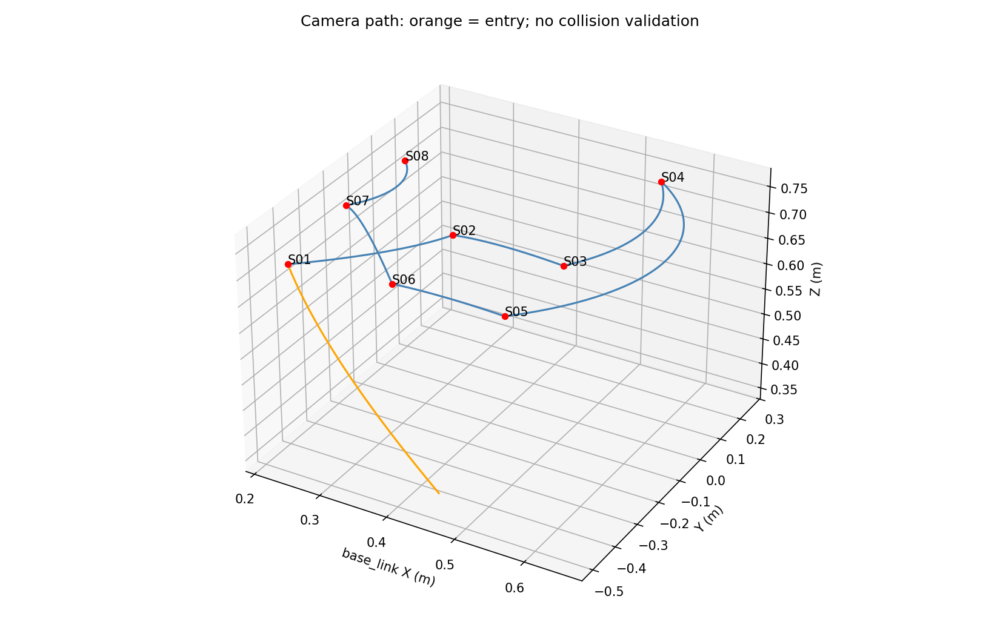

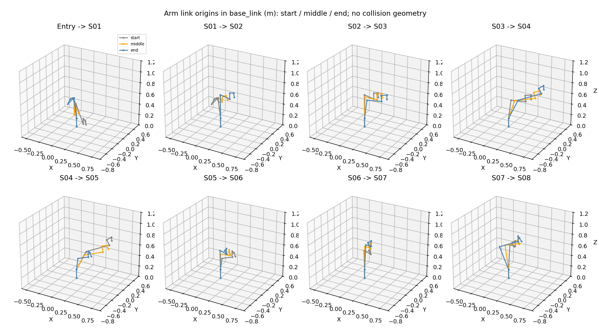

预览是关节插值与连杆原点示意，不是实体碰撞检验。

## 3. 两轮结果与诊断边界

| 项目 | 第一轮 | 第二轮 |
|---|---|---|
| 记录目录 | `run_20261013_200458_c7aafc` | `run_20261013_200952_9f3cf2` |
| 最终状态 | ERROR | DONE |
| 完成观察点 / ESDF 帧 | 0 / 0 | 8 / 64 |
| 机器人运动 | 未进入伺服执行 | S01–S08 完成 |
| 地图 | 没有真实地图，GPU 预热数据丢弃 | 已冻结、保存、重载校验 |
| 启停处理 | 停止，不自动续跑 | 每点停稳释放控制，完成后停在 S08 |

第一轮之后，用户检查示教器，反馈“无弹窗或错误”。不含运动的 `textmsg + sleep` 脚本在机器人 Primary 消息中出现 STARTED、文本输出、STOPPED；独立 RTDE 诊断也返回 `program_running=true`，随后主动停止。诊断没有调用 moveJ、servoJ 或其他运动命令。Dashboard 的 `programState` 在无运动短脚本运行期间仍返回原 `.urp` 停止，故该诊断以机器人端消息为执行证据，不能仅用 Dashboard 否定脚本执行。

第二轮前重新生成实时起点预览，起始关节角相对第一份预览最大差约 0.0000315 rad。扫描阶段另外保留 Primary 原始数据和机器人端脚本启停事件。整个测试没有修改扫描、RTDE 或 ESDF 算法源码；只增加测试记录和报告。

ROS 日志中出现 `sequence size exceeds remaining buffer` 消息，本次相机/状态通信仍持续、第二轮扫描完成；该消息来源尚未确定，不能宣称已消除。后续应检查 DDS 发现通信和多环境节点兼容性。

## 4. 耗时与控制结果

- 第二轮 STARTING → DONE：**196.05 s（约 3 分 16 秒）**，包括预热、运动、到点停稳、逐点脚本切换、采集、导出。
- 首次 GPU 预热阶段约 **32.60 s**；首次取得控制权到 DONE 约 **163.20 s**。计时来自状态事件接收时间，存在状态发布粒度误差；没有计入第一轮失败和人工检查等待。
- 轨迹标称纯运动时间约 94.07 s，不包含上述额外步骤。
- 保存 **52,419 条伺服样本**；最大实测关节速度 **0.126260 rad/s**。略高于 0.12 的轨迹设定，属于本轮实测反馈值，未达到 0.20 rad/s 的实际速度保护阈值；不能把设定值写成真实速度的硬上界。
- 最大命令与反馈关节差 **0.012896 rad**，为运动中跟踪指标。
- 同一运动段内记录周期 P50 / P95 / P99 / 最大值：**2.008 / 4.537 / 7.076 / 20.208 ms**。诊断最大周期亦为 20.208 ms，低于 40 ms 保护阈值；不是严格持续 500 Hz 的证明。
- 8 段均无故障，控制接口清理错误列表均为空。统计剔除了停止采集期间的段间空白，避免把正常停稳采集误算为伺服超时。

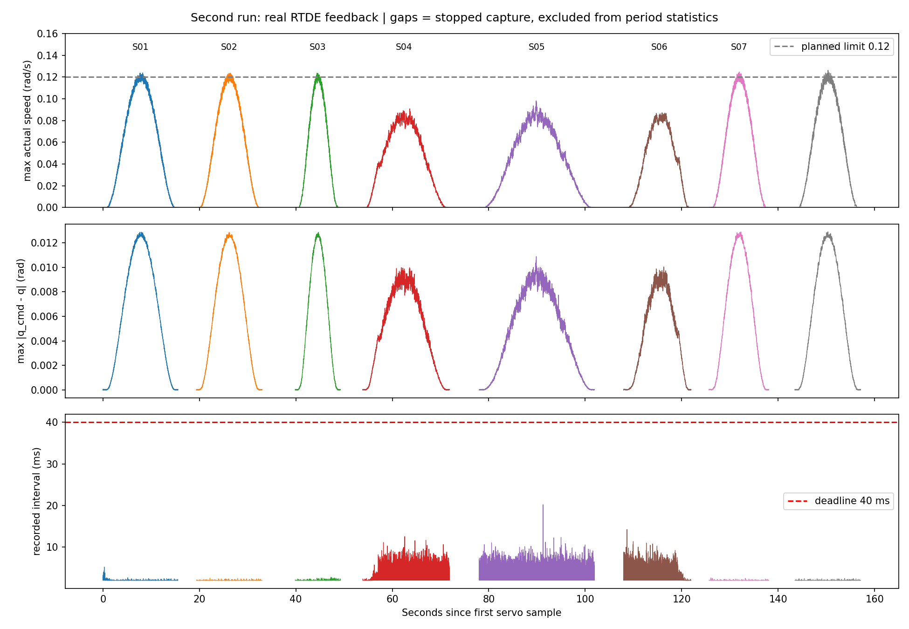

64 个已接收逐帧状态样本的感知耗时如下。原生 ESDF 栏包含捕获线程中的 TSDF 融合、ESDF 更新和查询，保守自由空间栏还包含当帧记录与锁内提交开销；“接收到结果”还包括队列、TF、自过滤、保守自由空间等本机处理，**不等于相机曝光到机器人响应的完整延迟**。

| 处理阶段 | P50 ms | P95 ms | 最大 ms |
|---|---:|---:|---:|
| 原生建图/ESDF 操作 | 2.23 | 24.08 | 29.06 |
| 保守自由空间与记录提交 | 14.46 | 194.24 | 392.07 |
| 接收到结果 | 81.15 | 343.11 | 498.75 |

仍存在感知计算长尾。本次采用停稳采集隔离了这类延迟，不能据此宣称已解决运动中实时更新的所有调度问题，也不能宣称全流程达到 15 Hz。

## 5. 8 个观察点与照片

表中 XYZ 是记录的深度光学坐标系原点在 `base_link` 下的位置。到点误差来自采集时关节反馈相对目标，**不代表外部测量的绝对定位精度**。

| 点位 | 相机 X / Y / Z（m） | 最大关节到点误差（rad） | 有效 ESDF 帧 |
|---|---|---:|---:|
| S01 | 0.21836 / -0.43025 / 0.70001 | 0.0000313 | 8 |
| S02 | 0.37999 / -0.19998 / 0.73002 | 0.0000286 | 8 |
| S03 | 0.54000 / -0.20001 / 0.73000 | 0.0000184 | 8 |
| S04 | 0.53999 / 0.24998 / 0.73001 | 0.0000330 | 8 |
| S05 | 0.53998 / -0.45000 / 0.73002 | 0.0000186 | 8 |
| S06 | 0.38000 / -0.44999 / 0.73001 | 0.0000328 | 8 |
| S07 | 0.22001 / -0.20000 / 0.73001 | 0.0000345 | 8 |
| S08 | 0.22000 / 0.05000 / 0.73001 | 0.0000207 | 8 |

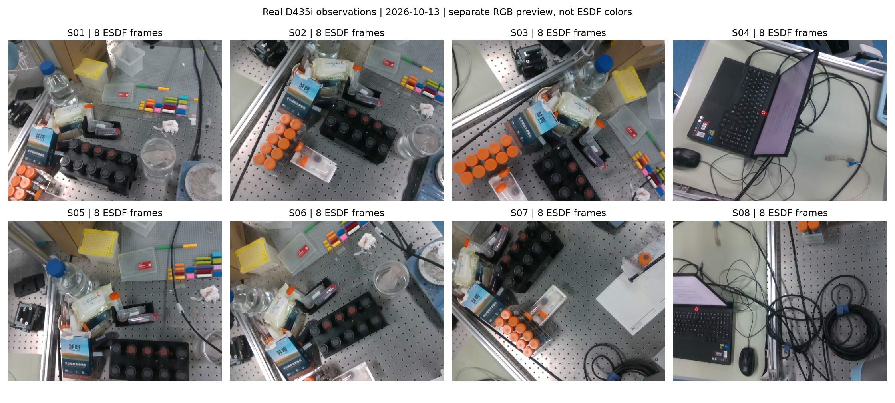

以下每幅左侧是独立记录的彩色预览，右侧是对应观察点保存的深度图。彩色与深度没有进行像素配准，也不是严格同一帧；两者时间差绝对值最大约 0.201 s，均用于本次静止点位的场景对照，**RGB 未参与 ESDF 融合**。深度值为米；白色为无效深度。每点保存一份深度原始矩阵和位姿，不是全部 64 帧原始 RGB-D 录像。

### S01

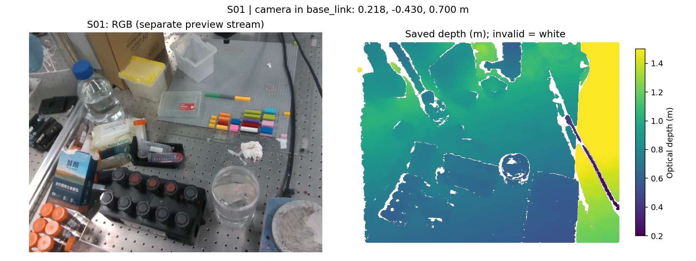

### S02

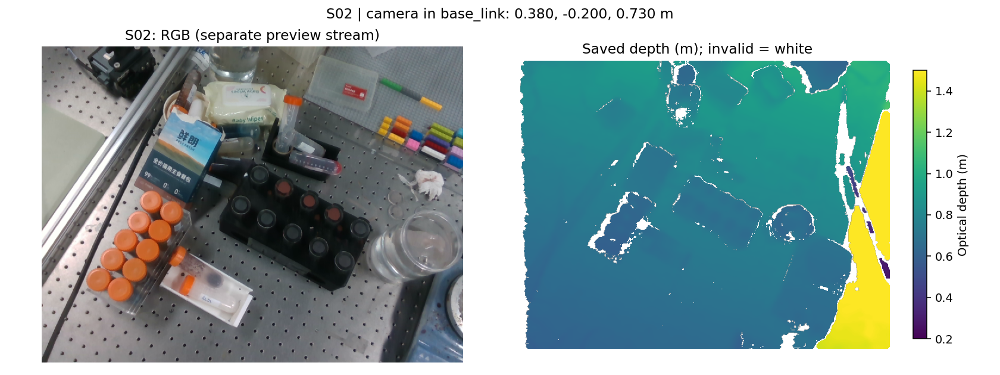

### S03

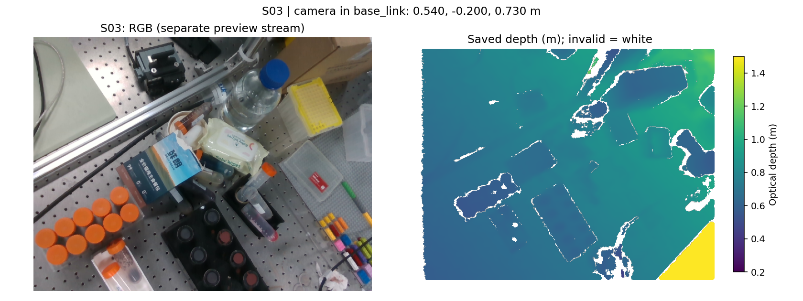

### S04

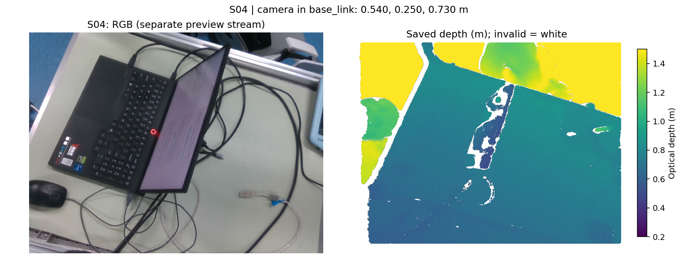

### S05

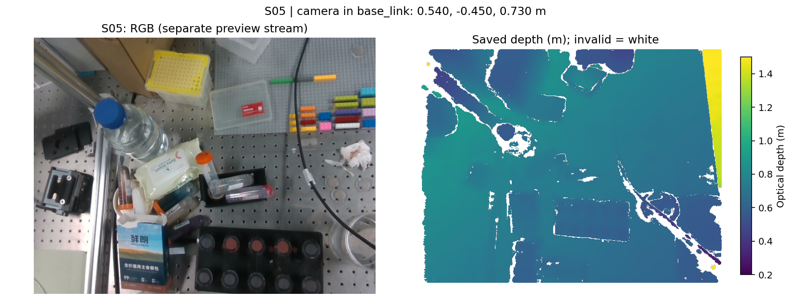

### S06

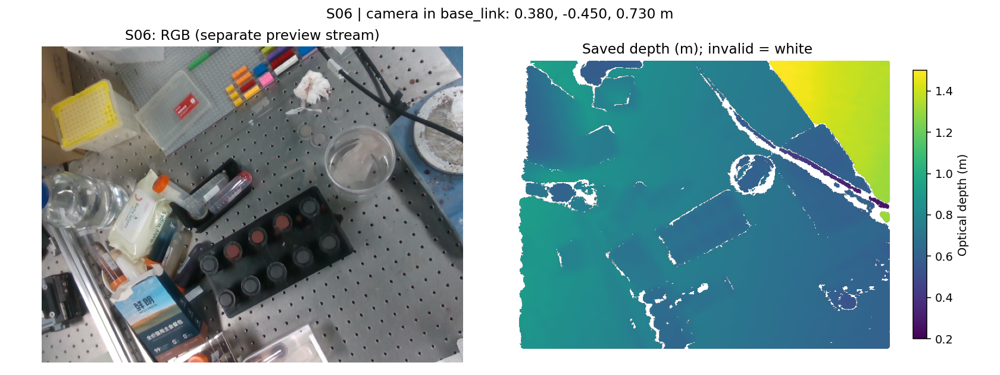

### S07

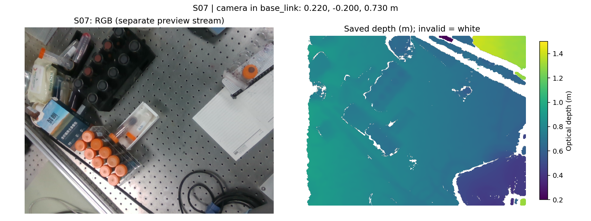

### S08

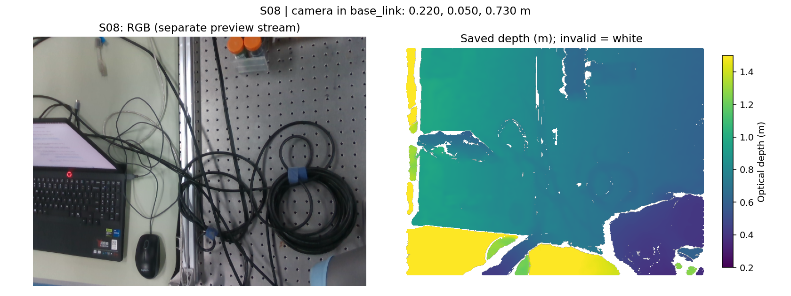

## 6. 最终地图与核验

冻结地图 UID：`626c058c897bf1f3f4fd554de24043b7c19514d74975f01a9e461f1c7ddf1b54`。

- 网格：81 × 81 × 57，共 373,977 个查询点，间距 2.5 cm。
- 原生 ESDF 有效查询点：60,557；以下近表面显示选取 `|distance| ≤ 0.05 m`，共 14,712 点。
- 保守规划场中观测有效自由空间单元：36,298；人工先验单元：0；其余未知/阻挡单元：337,679。该比例针对整个配置网格，不能当作实物表面完整度。
- 使用本次 mapping.yaml 的模型/标定身份重新加载，校验和匹配；所有 `source=0` 单元距离均不大于 0，没有把未知区当作正净空。

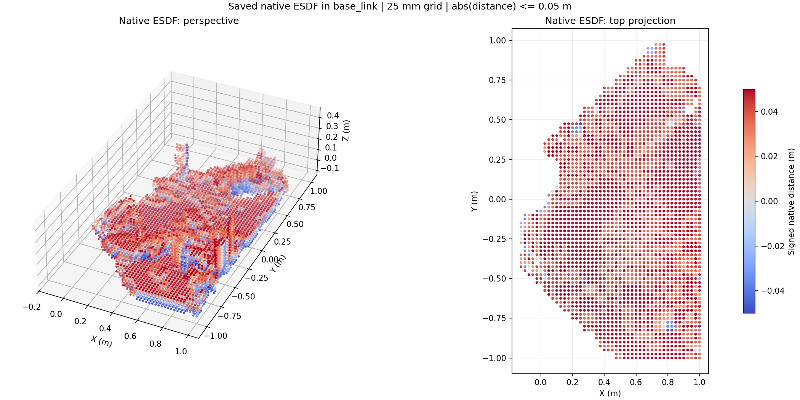

上图由本次 `native_esdf.npz` 离线绘制，颜色表示有符号距离，**不是物体彩色纹理或 mesh**。可见桌面及其上物体的粗略几何起伏；2.5 cm 网格、遮挡、透明容器和细小物体都会限制细节。本次没有外部几何真值或标定物精度测量，不能给出实景距离误差保证。

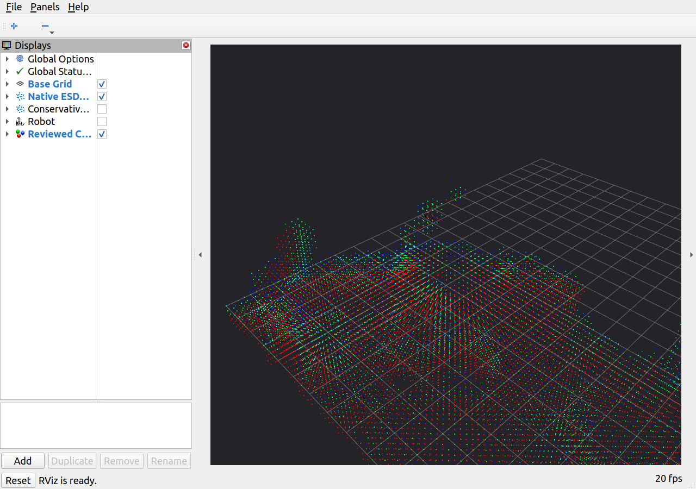

RViz 截图保留当时实际视角，部分地图处于画面边缘；完整近表面范围见前一张离线绘图。RViz 显示的是原生 ESDF 近表面点，不应与下面的保守规划距离场混淆。

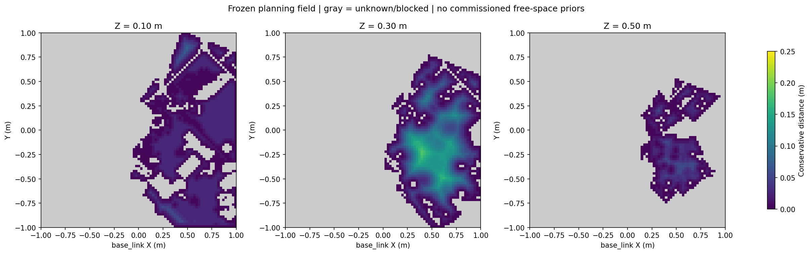

灰色为未知或阻挡；有色区域才是相机观测支持的自由空间。本次结果记录：

- `current_arm_observed_safe=false`
- `current_arm_min_clearance_m=-0.122801`
- `current_self_clearance_m=-0.013791`
- `planning_ready=false`

负净空来自当前保守地图和碰撞球模型的检验，**不等于本次发生实物接触**。后续必须具体排查未观测区域、基座/腕部/相机包络与模型，不能把未知区清空或降低阈值直接执行规划。

## 7. 已保留数据及复现

- 完整真实地图、配置和逐点原始深度：`/home/wqj/nvblox_output/ur7e_auto_esdf/scan_20261013_200952_ba2346/`。
- 成功轮结果、实际起点计划及控制轨迹：`/home/wqj/nvblox_output/ur7e_auto_esdf/plans/run_20261013_200952_9f3cf2/`。
- 第一轮失败结果：`/home/wqj/nvblox_output/ur7e_auto_esdf/plans/run_20261013_200458_c7aafc/result.json`。
- 启动、相机、监控、脚本诊断日志和机器人 Primary 原始数据：`/home/wqj/realtime_nvblox_ws/log/auto_esdf_real_20261013/`。
- 报告数值：[metrics.json](metrics.json)；关键证据副本：[evidence](evidence/)；图片：[assets](assets/)；图片 SHA256：[figure_manifest.json](figure_manifest.json)。
- 图表生成脚本：[generate_report_assets.py](generate_report_assets.py)。脚本只读已保存数据，不连接或控制机器人。

关闭现有回看 launch 后，可以仅加载地图（不启动 RTDE 接收/扫描节点）：

```bash
cd /home/wqj/realtime_nvblox_ws
./run_ur7e_auto_esdf.sh run_controller:=false \
  load:=/home/wqj/nvblox_output/ur7e_auto_esdf/scan_20261013_200952_ba2346/frozen_map.npz
```

地图显示本身不依赖机器人连接。要显示实时机器人模型/TF，可采用当前默认只读控制节点的回看方式；不要重复启动同名节点。再次扫描需要关闭回看、重新读取实际起点并生成预览，不能复用本次低位起点的批准计划。

## 8. 后续任务

1. 保留并定位首次 RTDE 脚本启动超时；下一次启动前记录 Primary/RTDE 状态，不使用盲目自动重试。
2. 重复验证完整 8 点的启停接续和最坏周期；一次成功不能替代长期稳定性测试。
3. 按真实 A→B 目标通道补充扫描，定位当前整臂保守净空不通过的具体连杆和地图区域。
4. 核验相机、支架、腕部的实际碰撞包络及自身碰撞对；保持未知区阻挡。
5. 接入 SAGE 做冻结地图下的只读规划和整臂轨迹检查，通过后再验收低速真实避障到达。
6. 优化保守自由空间计算长尾，排查 DDS 日志异常；如果需要追溯完整图像序列，再增加全帧录制及其负载测试。
