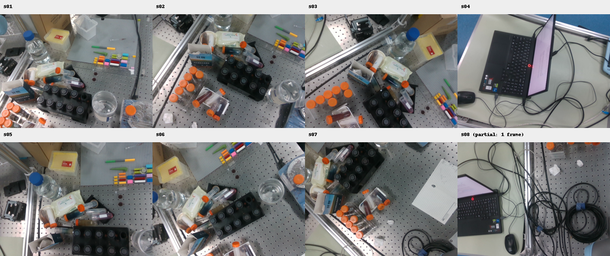
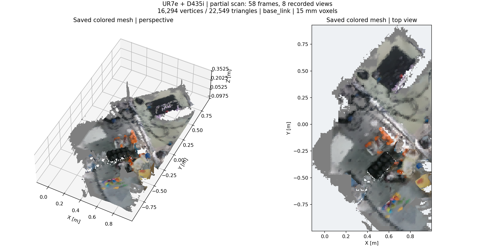
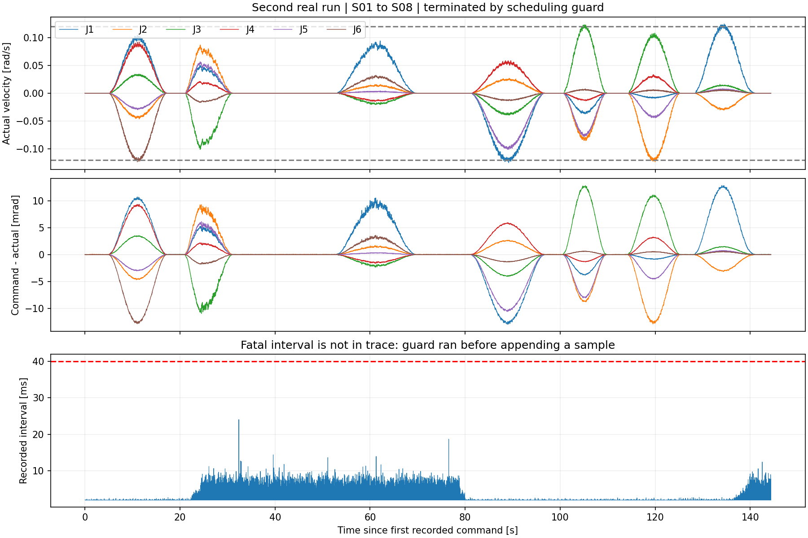

# UR7e + D435i 自动扫描真机测试报告

日期：2026-09-29，时间为 Asia/Shanghai。功能包：`ur7e_auto_reconstruction`。

## 1. 结论

本次已执行两轮真机测试。第二轮依次到达 **S01–S08 全部 8 个观察姿态**，保存 **58 帧融合数据、8 组观察数据和彩色地图**。用户对第二轮的现场反馈为：**“无明显抖动”**。

**完整扫描验收尚未通过。** 第二轮在 S08 停稳采集期间触发 `Servo scheduling deadline missed; no catch-up jump`，控制停止，最终状态为 ERROR。S01–S07 满足每点至少 8 帧；S08 只融合 1 帧，不能记作完成。没有自动续跑或返航。

本轮未获得关于实物接触的确认，不能把“无明显抖动”等同于“无碰撞”。本包未进行环境避障或完整自身碰撞验证。

最终只读检查确认：机械臂停在 S08，六关节反馈速度均为 0，机器人模式 RUNNING，安全状态 NORMAL，Dashboard 程序状态 STOPPED。旧 UR ROS 控制驱动已为独立 RTDE 交接而退出，External Control 不需要启动；相机和地图预览保留。

## 2. 测试配置与执行方式

- UR7e：`192.168.56.100`；D435i 序列号 `349622072343`。
- 环境：ROS Humble、Conda `whole_control`、`ur_rtde 1.6.3`。
- 工厂校准：`/home/wqj/ur_arm/my_robot_calibration.yaml`；运行模型：`/home/wqj/ur7e_real_setup/calibrated_with_camera.urdf`。
- 相机外参沿用已校核的 `tool0 → camera_color_optical_frame`；地图坐标系为 `base_link`。
- 同步五次关节插值，目标周期 2 ms（500 Hz），轨迹最大关节速度 0.12 rad/s，加速度配置 0.18 rad/s²；`servoJ` lookahead 0.1 s、gain 300。
- 到点误差阈值 0.008 rad、静止速度阈值 0.01 rad/s、连续停稳 0.7 s；每点要求至少 8 个有效融合帧。
- 独立进程彩色 TSDF，体素 15 mm、深度降采样 stride=2；仅停稳时开采集门；不计算 ESDF。
- 40 ms 控制周期超时、100 ms 反馈超时、0.1 rad 跟踪偏差保护保留。第二轮增加实测速度保护，默认阈值为 0.20 rad/s。

## 3. 两轮执行结果

| 项目 | 第一轮 | 第二轮 |
|---|---|---|
| 起点 | 原低位实际起点 | 第一轮停下后的 S01 附近 |
| 运行记录 | `run_20260929_130313_72d380` | `run_20260929_131301_6bccec` |
| 运动结果 | 到达 S01 | 依次到达 S01–S08 |
| 终止原因 | 首次 CUDA 初始化期间感知心跳缺失 | S08 采集时控制周期超时 |
| 已保存地图帧 | 0 | 58 |
| 达到每点帧数要求 | 0 点 | 7 点 |
| 记录内最大实际关节速度 | 0.616933 rad/s | 0.125664 rad/s |
| 记录内最大命令－反馈误差 | 0.086373 rad | 0.012965 rad |
| 最终状态 | ERROR | ERROR，部分地图已冻结保存 |

第一轮实测速度明显超过配置的低速目标，不能评价为低速通过。检查安装版本的源码后发现，每周期紧跟 `servoJ()` 调用 `kickWatchdog()` 会向同一命令寄存器写入 `NO_CMD`，存在覆盖伺服命令、延迟目标更新的风险。第二轮前移除了伺服循环内的显式 kick；`servoJ` 本身持续更新 watchdog 监视的输入寄存器，控制端 watchdog 仍启用。只在控制脚本启动、尚未伺服时显式 kick。

两轮起点和覆盖的运动段不同，不能将上述峰值差异当作同一路径、同负载的严格性能对照。原低位进入段未在修复后重测。

第二轮从 STARTING 到 ERROR 记录约 **152.5 秒**；控制轨迹记录跨度 **144.36 秒**、63,552 条样本。已记录周期的中位数/P95/P99/最大值为 **2.007 / 4.167 / 7.109 / 24.042 ms**。触发最终保护的超时间隔发生在追加样本之前，**未包含在这些统计中**；不能据此说全程周期都小于 40 ms。新版故障信息已增加实际超时间隔及阈值，后续重测才能获得该数据。

当时观察到感知状态延迟与控制线程超时接近发生，但没有系统调度跟踪证据，尚不能确定是 CPU 调度、Python 线程竞争、通信调用延迟或其他系统停顿。没有通过放宽超时阈值绕过问题。

## 4. 观察点与原始图像

下表位置是采集时记录的深度光学坐标系原点，单位 m。误差为同一时刻关节反馈与关节目标的最大差，属于编码器跟踪指标，不代表外部测量的相机绝对定位精度。

| 点位 | 相机 X / Y / Z | 最大关节误差 rad | 采集结果 |
|---|---|---:|---|
| S01 | 0.21835 / -0.43027 / 0.70000 | 0.0000196 | 达到 8 帧 |
| S02 | 0.37999 / -0.20000 / 0.73001 | 0.0000261 | 达到 8 帧 |
| S03 | 0.53999 / -0.20001 / 0.73000 | 0.0000259 | 达到 8 帧 |
| S04 | 0.54000 / 0.25000 / 0.73000 | 0.0000234 | 达到 8 帧 |
| S05 | 0.54000 / -0.44998 / 0.73001 | 0.0000234 | 达到 8 帧 |
| S06 | 0.37999 / -0.44999 / 0.73001 | 0.0000163 | 达到 8 帧 |
| S07 | 0.22001 / -0.20001 / 0.72999 | 0.0000166 | 关门前累计 9 帧 |
| S08 | 0.22000 / 0.05000 / 0.73001 | 0.0000304 | 仅 1 帧，未完成 |

协调器在 S07 达到 8 帧时记入结果，采集门实际关闭前还有 1 帧完成融合，因此总计 58 帧；这是门控和融合完成时序造成的正常差别。



原尺寸图像：[S01](assets/S01_rgb.png)、[S02](assets/S02_rgb.png)、[S03](assets/S03_rgb.png)、[S04](assets/S04_rgb.png)、[S05](assets/S05_rgb.png)、[S06](assets/S06_rgb.png)、[S07](assets/S07_rgb.png)、[S08](assets/S08_rgb.png)。图像直接复制自本轮采集记录；概览图仅缩放排版。

## 5. 已保存的彩色重建

地图包含 **16,294 个顶点、22,549 个三角面**，以 `base_link` 为坐标系，ESDF 未启用。



上图由本轮 `surface.npz` 离线绘制，不是 RViz 截图，也不是重新生成的场景。可以辨认桌面、黑色瓶架、橙色瓶盖、纸盒、彩色积木及旁边的笔记本区域，颜色信息已附着在网格上。薄物体、透明容器及遮挡区域仍有缺口，15 mm 体素也限制了细节；目前只有视觉对照，没有标定物或外部真值支撑的几何精度验收。



## 6. 本次修复及验证范围

1. **先预热 CUDA，再取得 RTDE 控制权**：一次性临时地图用于初始化，立即丢弃，不发布、不保存，也不计为真实帧。WARMING_UP 阶段允许初始化等待；开始控制后仍保留原感知心跳限制。
2. **修复伺服命令与显式 watchdog kick 的寄存器覆盖风险**，并加入实测关节速度上限保护。源码依据为本机安装版本对应的[官方 PyPI 源码包](https://files.pythonhosted.org/packages/0e/97/b14f774cfd63a46ca80cfadd2c24704a7eae2b4d26fc18cc7c8783c4ca8e/ur_rtde-1.6.3.tar.gz)，节选保存在工作区 `log/auto_real_20260929/rtde_reference/`。
3. **修复部分地图导出记录时序**：服务答复可能先于 SCANNING → FREEZING 状态到达，原实现会过早写 `partial_surface=null`。现在等待冻结结束并验证文件存在。历史 `result.json` 原样保留，本报告通过实际文件及 FROZEN 状态证明第二轮地图已保存。
4. **增加超时间隔诊断信息**，未放宽 40 ms 阈值。此改动不能等同于调度问题已解决。

回归结果：**18 项控制层测试、5 项协调器故障测试通过**；新增故障用例覆盖“先答复冻结请求、延后发布冻结完成”的部分地图记录。CUDA 预热闭环测试使用模拟控制接口和真实 CUDA，完成单点 8 帧采集；此前 8 点模拟闭环证据另行保留。最后两项诊断/保存修复只进行了软件回归，未再次发真机运动指令。

核对 `ur7e_real_reconstruction`、`ur7e_real_static`、`realtime_nvblox`、`realtime_nvblox_2` 共 **275 个原有文件，哈希无变化**。原手动扫描入口仍保留。

## 7. 后续事项

- 定位控制循环最坏延迟：细分 RTDE 发送/等待、反馈读取和 Python/ROS 回调耗时，并记录超时发生点；需要时将伺服执行独立到进程或 C++。
- 在保留所有保护的前提下，用隔离负载测试验证调度改进，然后重新生成当前实际起点预览，重新验证完整 8 点、每点至少 8 帧及最终 DONE。
- 修复后的低位进入段仍需单独验证；本轮没有自动从 S08 回到 S01。
- 对比地图覆盖与实物，按需要优化观察点、透明物体/细薄物体的采集策略及体素尺寸。
- 完整自身碰撞检查、避障规划与运动中精确时间同步仍不属于本轮已验证能力。

## 8. 数据索引

- 第二轮地图：`/home/wqj/nvblox_output/ur7e_auto_reconstruction/scan_20260929_131301_9fb3a9/`。
- 第二轮控制轨迹：`/home/wqj/nvblox_output/ur7e_auto_reconstruction/plans/run_20260929_131301_6bccec/servo_trace.npz`。
- 数值汇总：[metrics.json](metrics.json)；原始结果副本、状态事件和最终只读检查位于 [evidence](evidence/)。
- 图片生成脚本：[generate_report_assets.py](generate_report_assets.py)；图片校验：[figure_manifest.json](figure_manifest.json)。
- 原始日志：工作区 `log/auto_real_20260929/`。报告不会改写失败状态或原始运行结果。

回看本轮地图（不启动控制节点）：

```bash
./run_ur7e_auto_reconstruction.sh run_controller:=false \
  load:=/home/wqj/nvblox_output/ur7e_auto_reconstruction/scan_20260929_131301_9fb3a9/surface.npz
```

已有自动包预览运行时不要重复启动同名节点。恢复原手动扫描前，退出自动包，再按手动包流程启动 UR ROS 驱动及示教器 External Control。
