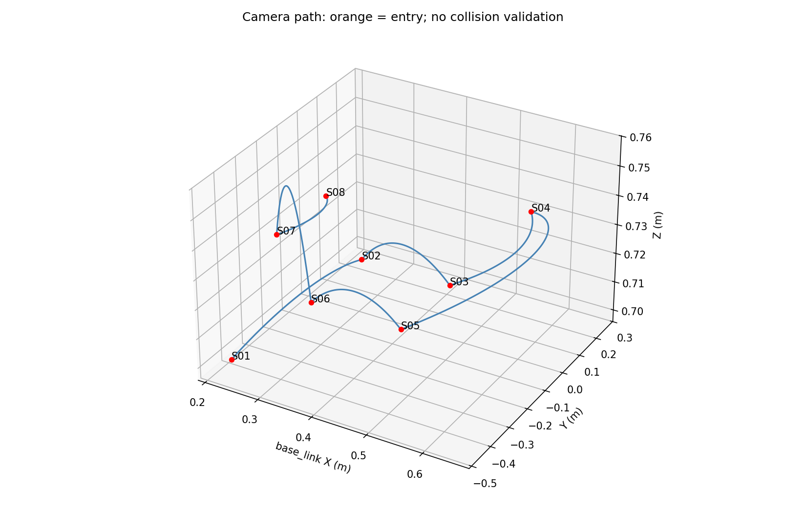

# 自动扫描轨迹预览

数据来源：`live_rtde`。SHA256：`a2e27f1c0e94a0e709c90e39389346cfaf8e89b6682d80dddf85f6172ae3cf38`。

这是一份关节轨迹预览，不是无碰撞证明。场景避障和完整自身碰撞检查未启用。
旧选点报告中相机/手腕球体间距未通过的记录仍然有效；本预览没有消除这个未验证项。
实际开始前将核对当前关节角、模型、参数和文件完整性。

初始关节角（度）：[-93.13, -79.69, 69.61, -220.08, -41.69, -82.35]
标称总运动时间：80.5 秒；不含停稳、采集、GPU 初始化/导出和速度缩放。

| 段终点 | 标称时间 s | 最大关节变化 ° | 相机最低高度 m |
|---|---:|---:|---:|
| S01 | 0.50 | 0.00 | 0.700 |
| S02 | 12.15 | 44.57 | 0.700 |
| S03 | 7.92 | 29.04 | 0.730 |
| S04 | 12.21 | 44.76 | 0.730 |
| S05 | 15.49 | 56.80 | 0.730 |
| S06 | 9.08 | 33.29 | 0.730 |
| S07 | 10.97 | 40.23 | 0.730 |
| S08 | 12.20 | 44.73 | 0.730 |

首段是当前姿态到 S01 的关节插值；相机路径通常不是竖直直线。
若首段不适合现场，请先手动移至合适的高位起点，再重新 prepare。不要执行旧报告中被拒绝的垂直提升路径。
