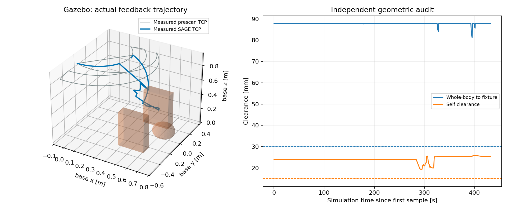

# Gazebo 预扫描 ESDF + SAGE 模式 B 验证

> 最新局部地图模式已完成无碰撞到达，见 [局部地图报告](partial_map/REPORT.md)。该模式显式允许有界未知使用，不代表原严格策略通过。

> 历史记录：本文中的到达测试使用了扫描通道预填充。2026-10-15 起规划已改为深度射线与观测顶部结构推断，旧地图失效。本文不能证明新策略已闭环到达；当前验证见 [tabletop/REPORT.md](tabletop/REPORT.md)。

测试日期：2026-10-14 至 2026-10-15。工作区 `/home/wqj/realtime_nvblox_ws`。本文记录真实 Gazebo 运行，不把离线几何检查等同于运动验证。

## 范围

新增 `ur7e_gazebo_esdf_sage` 包和三个根目录脚本；使用 ROS 域 87、Gazebo 端口 11387。没有连接真实机器人。原有包 881 个受检文件未改变，见 `source_integrity_after.json`。

相机和机械臂关节变换来自 `/home/wqj/ur7e_real_setup/calibrated_with_camera.urdf`。外壳使用真实 D435 网格和六球碰撞包络，连同原机械臂球共 22 球。固定底座只做深度像素过滤。未知空间禁止通行，固定扫描扫掠通道单独标记为先验；测量障碍优先于先验。

## 静态与实时检查

- 构建通过；7 项离线测试通过，包括渲染/TF 外参、扫掠通道、未知空间、障碍覆盖先验、过期反馈保持及持续丢失停止、时钟跳变、跟踪失败指令拦截。
- `dev13/runtime_probe.json`：实时 tool0→深度光学帧最大矩阵差 2.94e-8；深度表面误差中位数 0.52 mm、P95 1.17 mm。采样期间收到 63 帧深度、633 条关节状态、1262 条位置命令，两个控制器均 active。
- 离线检查覆盖整段扫描插值，加入采样间隙上界；并非只检查 16 个端点。

## 完整场景验收结果

证据目录：[/home/wqj/nvblox_output/gazebo_esdf_sage/validation_20261014](/home/wqj/nvblox_output/gazebo_esdf_sage/validation_20261014)。`system_scenario.json` 的五项检查全部通过，`motion_audit.json` 的独立断言全部通过。

| 场景 | 结果 |
|---|---|
| 自动预扫描 | 16 个停点、80 个融合帧、16 份原始深度/位姿观测 |
| 默认目标 `[0.50,0.00,0.60]` | 到达，位置误差 3.99 mm |
| 墙间低位目标 `[0.603,-0.073,0.442]` | 到达，位置误差 2.45 mm |
| 运动中改目标到 `[0.30,0.10,0.94]` | 到达，位置误差 3.31 mm；被取消目标已执行 13 个滚动小步 |
| 地图外目标 `[2,2,2]` | 拒绝；随后 6 秒命令变化为 0，实际关节变化约 4.44e-15 rad |
| 运动中注入反馈丢失 | 锁定停止；随后 6 秒命令变化为 0，实际关节变化 5.51e-7 rad |

地图冻结后保持 80 帧不变，UID 为 `7f6c987b1ea92244c81285c3ad150a09acb37bb318654a0021e793e7e71267e9`。观测自由体素 182071 个，固定先验自由体素 44003 个；二者分开保存，不能将总数都称作实测覆盖。

共检查 21916 条实际运动样本；执行 577 个 SAGE 小步，对应 577 个不同的真实反馈时间戳。优化使用实际 `q,dq`，地图在执行中不改变。

| 独立运动审计 | 实测值 | 要求 |
|---|---:|---:|
| 整臂/相机到工装最小间隙 | 81.21 mm | ≥30 mm |
| 自碰撞最小间隙 | 19.40 mm | ≥15 mm |
| 规划阶段 ESDF 最小间隙 | 37.57 mm | ≥30 mm |
| 最大关节跟踪误差 | 0.01333 rad | <0.06 rad |
| 最大扫描指令速度 | 0.25000 rad/s | ≤0.25 rad/s（数值误差容限） |
| 最大到达阶段指令速度 | 0.15000 rad/s | ≤0.15 rad/s（数值误差容限） |

默认目标与低位目标分别使用 3、7 个引导节点。其直接关节插值段的 ESDF 间隙分别为 -24.41、-0.57 mm，因此控制器没有直接执行这些插值段，而是在允许空间内滚动到达。这里主要验证的是对 ESDF 障碍/未知空间约束的遵守：本轮直接插值段在工装真值上的间隙仍为正，不能将其称为“无约束直线必撞墙”的强制绕障基准。

实时校验见 `runtime_probe_moving.json`：外参矩阵差 2.94e-8；深度表面误差中位数 0.61 mm、P95 1.93 mm。两个控制器 active，约 6 秒收到 633 条关节反馈、1236 条位置命令。

RViz 与规划并发的第一次运行出现最高 11.57 s 的优化延迟，过期结果均被丢弃。关闭并重新打开 RViz 后完成上述场景测试，但这不能证明显卡争用问题已根治；仅设置 `LIBGL_ALWAYS_SOFTWARE=1` 也未能确认切换到软件渲染。因此最终默认启动关闭 RViz，仍保留 `run_rviz:=true` 作为可选可视化。该轮结束后各任务进程正常退出。

## 调试记录与限制

保留了 dev01–dev12 的失败输出。主要修复包括：Gazebo 瞬时速度不适合停稳判据（改用带时间戳的位置差分）；底座未过滤导致肩部 ESDF 假障碍；仿真时钟与控制/状态回调互相阻塞；迟到反馈立即保持并设置持续丢失看门狗；滚动优化循环缩进错误。较低目标被覆盖检查拒绝时没有绕开未知空间约束。dev13 完成 80 帧扫描及默认目标到达，但首次运动审计发现控制积分时间与 CSV 记录时间使用不同次时钟读取，扫描速度统计虚高；已统一为同一时间戳，并重新启动完整验收。另将目标 IK 与连接搜索分配独立预算，避免 IK 用尽全部搜索时间。

`dev11_reach` 是同一静态工装上的显式地图调试重放，151 次 SAGE 优化到达 `[0.3,0.1,0.94]`，误差 2.46 mm；另测了地图外目标拒绝与运动中注入反馈丢失后停止。该轮不计作重新扫描的端到端验证。

本包验证静态地图上的实际运动反馈闭环，不包含运动中更新地图或动态障碍规避。扫描通道先验专用于本工装，不可直接迁移到真机。未测量的支架、工具和线缆不在包络中。到达目标只约束位置；未测试负载、接触任务和真实控制器动力学。

## 2026-10-15 默认入口复跑未通过

`default_20261015` 使用最终默认的后台启动方式；Gazebo 机器人、工装、相机与控制器均启动，但 nvBlox 预热超过 120 秒，流程锁定停止，未进入扫描或运动。同期采样显示几乎全部 CPU 核心约 400 MHz，电源在线。该相关性提示主机性能状态可能参与造成超时，但尚未确认根因；不能声称最终默认入口在本次环境下复跑成功。原始证据：`~/nvblox_output/gazebo_esdf_sage/default_20261015/host_conditions.json`、`events.jsonl` 和 `log/gazebo_esdf_sage/default_20261015.log`。没有调整系统电源设置或放宽运动保护来取得通过结果。

待主机运行状态恢复后，用 README 中的默认命令重新完整验收。这次失败不覆盖此前已保存的到达、换目标、停止保护和轨迹审计结果。
