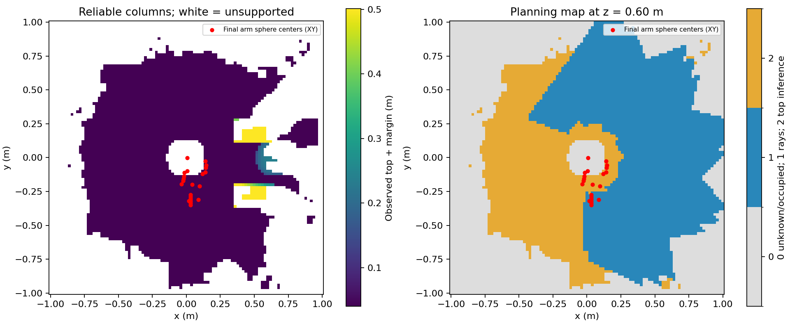

# 43 视角补扫与新规则闭环尝试（2026-10-15）

**215 帧预扫描和地图审计通过；闭环到达未通过。** 冻结后起始状态检查拒绝启动，SAGE 步数为 0。没有恢复旧扫描通道自由空间，也没有删除碰撞球或忽略未知空间来获得到达结果。

## 可复现入口与原始证据

```bash
cd /home/wqj/realtime_nvblox_ws
./build_ur7e_gazebo_esdf_sage.sh
./run_ur7e_gazebo_esdf_sage.sh output:=/新的绝对输出路径 scan_config:=/home/wqj/realtime_nvblox_ws/src/ur7e_gazebo_esdf_sage/config/scan_coverage.yaml
```

实测输出：`/home/wqj/nvblox_output/gazebo_esdf_sage/coverage_stationary_20261015`。
地图会话：`maps/scan_20261015_221847_c7fcce`。
冻结 UID：`03503077627e04eb7da1a62a9faa1b50262867e73e56d309c19205453af5c352`。
本目录保存状态、地图摘要、采集统计、独立审计、实时探针、覆盖图、测试日志及失败轮次摘要。完整深度、位姿、地图与控制记录保留在原始输出目录。

## 修改与验证

增加 43 停点补扫方案：原有 16 停点，加两组近身姿态的肩关节环视，再返回初始姿态。`test/design_coverage_scan.py` 用 104715 个插值样本核验扫描路径，环境最小间隙约 87.55 mm、自碰撞最小间隙约 21.38 mm；采样运动界约 0.77 mm。工装几何只用于预扫描核验和事后审计。

先前多轮采集出现延迟。自滤波批量化保持原判据，43 姿态逐像素对比通过；深度订阅使用最新帧队列，本进程 Python 线程切换间隔改为 1 ms。竞争基准见 `../tabletop/filter_contention.json`；它证明 Python 并发调度可以放大处理时间，但不声称解释机器上所有延迟。

输入融合前仍检查 1 秒新鲜度；静态停点结果另设 5 秒处理预算，接收前检查连续新鲜关节反馈、整个期间的停稳状态、采集门和保持租约。不是将动态规划输入容许延迟改为 5 秒。全部 14 项测试通过。881 个原项目文件的哈希未改变。

## 本轮实测

| 项目 | 结果 |
|---|---:|
| 完成停点 / 接收帧 | 43 / 215 |
| 按关节差异去重视点 | 41 |
| 深度射线自由体素 | 204866 |
| 顶部推断自由体素 | 181200 |
| 可靠水平列 | 4814 |
| 扫描通道进入规划地图 | 0 |
| 无可靠列支持的推断体素 | 0 |
| 自由体素落入工装内部 | 0 |
| 距离相对工装真值的最大高估 | -7.32 mm（未高估） |
| 独立运动审计样本 | 24592 |
| 实际整臂到工装最小间隙 | 87.54 mm |
| 实际最小自碰撞间隙 | 21.38 mm |
| 最终不满足地图间隙的球数 | 14 / 22 |
| SAGE 步数 / 到达次数 | 0 / 0 |

停止阶段审计的 2925 条命令记录变化为 0 rad。另做 6 秒实时保持检查：深度 62 帧、关节反馈 601 条、命令 301 条；命令变化为 0，实际关节变化约 4.44e-15 rad，两个控制器 active。该探针接收频率不是 200 Hz 执行频率验证，不能据此宣称已验证滚动控制性能。

实时 tool0→深度光学帧与真实标定的最大矩阵差为 2.94e-8；渲染表面误差 P95 为 2.17 mm。测试仅使用隔离 Gazebo 域 87 和端口 11387，没有连接实机。

退出时规划节点正常结束，但 Gazebo 未在 SIGINT/SIGTERM 的等待时限内退出，最终由 launch 发出 SIGKILL，退出码 -9。确认本轮进程均已结束；这不是一次干净的 Gazebo 退出，关闭问题尚未定位。

## 剩余阻塞及边界

补扫使可靠列从前一轮 1429 增至 4814，但当前球心 ESDF 检查仍受到近身未知区域阻塞。对冻结地图检查全部 43 个扫描姿态，没有一个满足全部 22 球的环境间隙要求，最佳姿态也有 7 个球不通过，详见 `pose_coverage.json`。

其中肩部中心位于真实 URDF 本体实体内。`../tabletop/invariant_core.json` 记录肩部凸碰撞网格在关节轴附近存在半径约 59.28 mm 的固有实体核心；相机不能把机器人实体内部观测为环境自由空间。当前实现将自滤波后的这类位置与环境未知空间同样处理，再查询内部球心，因此只增加视角无法消除这个结构性问题。负地图间隙不代表实际穿透工装；实际扫描间隙由独立审计确认。

下一步需要明确机器人本体实体与环境地图的处理边界，并继续解决其外侧的覆盖缺口。仅从准确本体几何区分自有实体，不等于允许将包络外的安装区、余量区或扫描通道标记自由。本轮未引入任何此类例外，也不保证解决本体处理后其余未知区域会自动满足规划要求。

## 保留失败轮次

`failed_runs.json` 保存六轮失败：`coverage_20261015`（52 帧）、`coverage_latest_20261015`（35 帧），以及 debug、serial、batch、quantum 四轮（各 30 帧），均在停点等待深度或对应关节反馈时超时。串行执行器试验没有解决问题，已撤回；其中该轮退出被 launch 强制终止，原日志保留。不能将这些采集失败与本轮冻结后覆盖不足混为同一原因。


