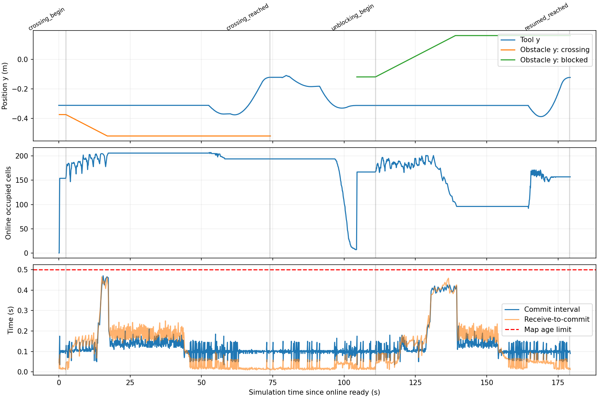

# 第二阶段：低速持续移动障碍闭环测试

日期：2026-10-18。已完成一次从重新预扫描开始的完整 Gazebo 验证，以及一次冻结地图回放验证。真实机器人未连接、未运动。

## 验收结论

最终轮次 `moving_stage2_r4`：63 个扫描停点、315 帧形成静态底图；随后在线感知新障碍，SAGE 使用实时反馈滚动规划。80 mm 方块以 10 mm/s 连续移动。横穿绕行到达、返回、目标堵塞保持、方块移开后恢复到达全部通过。

| 检查 | 最终轮次结果 |
|---|---:|
| 横穿后目标误差 | 3.57 mm |
| 返回观察位置误差 | 2.35 mm |
| 移开后恢复到达误差 | 4.34 mm |
| 堵塞时连续 3 秒命令变化范围 | 0 rad |
| 实际全臂/相机与横穿方块最小间隙 | 115.16 mm |
| 实际全臂/相机与堵塞方块最小间隙 | 134.15 mm |
| 实际全臂/相机与静态场景最小间隙 | 50.57 mm |
| 自碰撞最小间隙 | 21.38 mm |
| 已执行滚动步数 / 对应执行地图违规数 | 444 / 0 |
| 到达期间最大命令关节速度 | 0.15 rad/s |
| 最大位置跟踪误差 | 0.03338 rad |
| 全轮在线地图最大更新间隔 / P95 | 0.470 / 0.155 s |
| 全轮在线处理延迟 P95 / 最大 | 0.195 / 0.465 s |
| 场景测试活动期间在线提交数 / 延迟 P95 | 1555 / 0.219 s |

环境间隙阈值为 30 mm，自碰撞为 15 mm。在线动态距离另外扣除 20 mm 低速运动余量。全轮包括测试后的静止观察，共 10103 次在线提交、468 次占据变化；活动测试从仿真时间 681.75 s 到 861.06 s，不能把之后静止观察的时长当作持续避障时长。

静态地图 UID：`b5097b0df551b997ec73c1ab0050ff8e3eba64987988adc7554c46de857b0c1e`，整轮保持不变。在线占据/距离持续变化，并非冻结全部感知。

## 场景与证据含义

横穿方块起始中心 `(0.25,-0.375,0.675)` m，沿负 Y 方向移动到约 `-0.52` m；机械臂目标为 `(0.4,-0.12,0.5)` m。不含新增障碍时的感知底图基线路径为 2 个点；在线绕行引导为 3 个点。独立审计得到基线路径与方块扫掠体最小间隙 -37.40 mm，确认空间路径确实相交。这不是“如果不避让就必然在同一时刻碰撞”的反事实证明。

需要区分两轮的运动时序：r4 横穿期间（684.25–698.755 s）尚在求解引导，首个执行步到 733.678 s 才开始，因此 r4 单独不能证明机器人与障碍同时运动时滚动避让。完整回放 debug7 在横穿期间（58.755–73.255 s）执行了 42 个滚动步，并通过同样的动态间隙与执行版本审计；该轮提供同时运动的证据。引导求解延迟仍需后续优化，不能把本结果称为低延迟快速响应系统。

然后返回观察位置，在目标中心新增同尺寸方块。相机确认检测后发送目标，连续 3 秒命令完全保持。方块沿正 Y 方向以 10 mm/s 移至 `0.16` m，感知通过有效自由射线清除旧占据，重新求解并完成到达。运行中曾有一次地图短时过期等待，随后恢复；最长提交间隔小于 0.5 s 并不排除图像时间戳年龄超过阈值。

测试器的 Gazebo 位置/里程计仅用于驱动障碍和独立审计，不向感知、SAGE 或控制器提供真值。扫描通道没有预填充。静态底图仍使用已声明的可靠桌面列上方无物体假设、URDF 本体实体处理和 80 mm 有限未知准入策略；在线层只能增加约束，不能扩大准入。合成场是运动可行性距离，不能把有限未知区域称为已观测自由空间。



## 实现

保留 `online.py` 第一版，通过 `online_engine:=v2` 选择新版 `online_v2.py`。独立 ROS 感知进程接收图像、关节及 TF，纯几何工作进程执行自滤波、占据和距离计算，通过带锁共享内存向主控制进程提交完整快照，避免与 SAGE/伺服共用 Python GIL。

障碍端点按 4 倍降采样，清除射线保留 2 倍降采样；只对已有占据评估清除射线，保持遮挡与无效深度语义。6 邻接膨胀改为稀疏索引。无超时清除、无 TTL；离开视野的占据会保留。每帧校验图像时刻的关节插值、TF/FK、相机标定、数据年龄。执行每一步前使用最新快照重新检查整臂连接。

暂时过期时取消当前运动段，保持并等待，恢复后重新检查引导。引导缩短只允许完整替换连接通过同样的碰撞检查。测试器绑定运行目录和独立障碍命名空间，旧轮次不能向新轮次发送停止服务。

## 验证和原始文件

最终原始输出：`/home/wqj/nvblox_output/gazebo_esdf_sage/moving_stage2_r4/`。

- `maps/scan_20261018_141836_a2407d/`：新采集深度、相机位姿、静态图、桌面列证据、本体与部分地图策略。
- `online/updates.jsonl`、`diagnostics.jsonl`、`version_*.npz`、`observation_*.npz`：在线时间、版本、原始射线深度、降采样端点、自滤波与位姿。
- `execution.csv`、`sage_feedback.json`、`events.jsonl`：命令、实际关节、每步执行地图版本和到达事件。
- `moving_truth.jsonl`：独立 Gazebo 实际方块里程计。
- 本目录附 `moving_audit.json`、`motion_audit.json`、`moving_scenario.json` 和时间线图。

`audit_moving.py`、`audit_crossing_route.py`、`validate_run.py`、`audit_tabletop.py`、`audit_ownership.py` 均通过。25 项离线测试通过。构建通过。原始工程完整性清单中 881 个文件哈希无变化。

实机相机外参由同一校准 URDF 生成。回放完成后的实时探测 `moving_stage2_debug7/runtime_probe.json`：tool0 到深度光学帧矩阵最大误差 2.94e-8，渲染深度表面误差 P95 9.08 mm，两个 ros2_control 控制器均 active，保持命令变化 0。该探测不是在最终 r4 活动期间采样。

日志位于 `/home/wqj/realtime_nvblox_ws/log/gazebo_esdf_sage/`，包括 `runtime_stage2_r4.log`、`moving_scenario_r4.log`、`audit_moving_r4.log`、`motion_r4.log`、`crossing_r4.log`、`tabletop_r4.log`、`ownership_r4.log`、`tests_stage2_final.log`。

## 失败轮次及限制

- r1/r2：在线提交分别出现约 27.1/29.9 秒中断，未完成整套流程；保留原始输出与审计。
- r3：已完成新扫描，横穿到达超时；此轮地图仅用于后续调试回放，不冒充新扫描验收。
- debug1/2：分别发现回放起始姿态漂移、深度编码签名不匹配，均被校验拒绝。
- debug3–5：部分障碍位置离开视野后保留占据，或计算时延导致到达受阻；未作为通过证据。
- debug6：横穿到达成功，但被上一轮残留测试器的超时停止请求打断。之后加入运行标识与独立命名空间。
- debug7：完整回放通过，484 个执行步无违规；最大提交间隔 0.81 s，出现过期保持后恢复。
- r4：新扫描完整到达通过；启动时一帧因处理/接收年龄约 0.515 s 被拒绝，在测试 ready 前发生。退出时进程组与 launch 重复 SIGINT 中断清理，随后被强制结束并遗留工作进程。残留已清理，退出修复另行验证，见下文。

这些结果验证的是预先可见、80 mm 方块、10 mm/s、指定路径的低速反应式避障。没有实现障碍速度估计或未来轨迹预测；没有验证高速突然侵入、任意遮挡、细小物体或真实控制器制动距离。40 mm 静态表面差异阈值和降采样意味着贴近原表面的细小新增物仍可能漏检，不能据此直接宣称实机动态安全。

## 复现

```bash
cd /home/wqj/realtime_nvblox_ws
./build_ur7e_gazebo_esdf_sage.sh
./run_ur7e_gazebo_esdf_sage.sh output:=/绝对路径/新的输出目录 planning_policy:=bounded_unknown online_obstacles:=true online_engine:=v2 hold_after_scan:=true scan_config:=/home/wqj/realtime_nvblox_ws/src/ur7e_gazebo_esdf_sage/config/scan_high_central.yaml
```

另一终端：

```bash
source /opt/ros/humble/setup.bash
source /home/wqj/realtime_nvblox_ws/install/local_setup.bash
ROS_DOMAIN_ID=87 OPENBLAS_NUM_THREADS=1 OMP_NUM_THREADS=1 /home/wqj/miniconda3/envs/whole_control/bin/python -B /home/wqj/realtime_nvblox_ws/src/ur7e_gazebo_esdf_sage/test/moving_scenario.py /绝对路径/新的输出目录
```

`test_load_map` 只供调试回放，最终 r4 命令未使用。测试结束时机械臂保持，关闭本轮 launch 后再运行下一轮。

## 退出修复复测

退出修复仅调整信号和生命周期：几何工作进程忽略组 SIGINT，由感知进程有序关闭；感知进程由父进程停止事件控制；主节点清理阶段忽略重复 SIGINT，launch 给其 35 秒清理时间。闭环运动逻辑没有在 r4 验收之后变更。

`moving_stage2_shutdown` 加载 r4 底图进入 ONLINE_READY，实时外参与控制器检查通过，保持命令变化 0；然后用相同的进程组超时 SIGINT 复现退出。主闭环节点与 Gazebo 正常结束，未产生新的感知/几何残留。旧 r4 遗留进程因 SIGTERM 未退出，已按确认的 PID 单独 SIGKILL 清理。辅助 `spawn_fixture` 在重复 SIGINT 下仍打印 KeyboardInterrupt，关闭时也有 ROS context invalid 日志；不宣称整套 launch 已无退出警告。

修复后的 25 项测试再次通过（`tests_stage2_final.log`）。复测输出：`/home/wqj/nvblox_output/gazebo_esdf_sage/moving_stage2_shutdown/`；日志：`runtime_stage2_shutdown.log`、`probe_stage2_shutdown.log`。所有本任务仿真与工作进程最终已停止。
