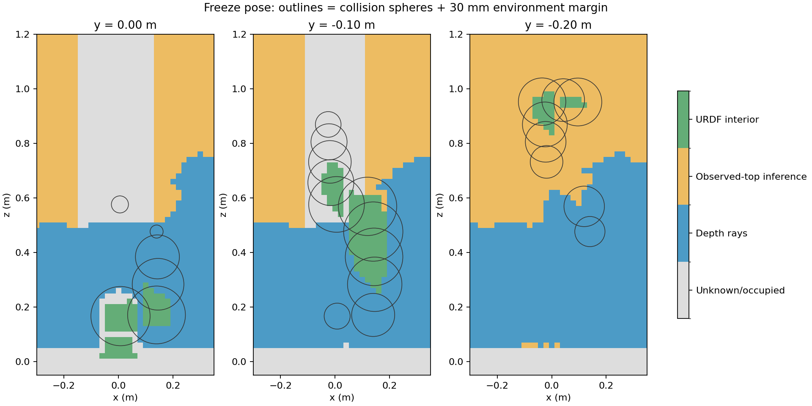

# 本体实体区分及 Gazebo 到达尝试（2026-10-16）

最新第三轮已完成高位补扫：阻挡球由 14 个减少到 9 个，但到达仍未通过；详见 [高位补扫报告](high_central_63_views/REPORT.md)。以下保留前两轮结果。

**本体区分已实现并通过边界审计；两轮预扫描完成，但闭环到达仍未通过。** 两轮均在冻结后的整臂起步检查停止，SAGE 步数和到达次数均为 0。正式到达验收脚本报 `No completed SAGE reaching`，没有将它记录为成功。

## 授权边界和实现

用户允许将 URDF 确认的本体实体与环境未知空间分别处理，但禁止扩大周围自由区或填充扫描通道，并要求保留外部环境碰撞检查。

`ownership.py` 使用真实标定 URDF 中七个封闭、凸、法向一致的本体碰撞网格，只接受**整个网格单元**均位于同一实体内部的单元：以各面半空间加轴对齐网格的支撑距离计算，独立审计另用凸包面方程验证每个单元的八个角点。只取冻结时刻实际关节姿态，不累计任何历史或未来姿态；不使用球包络膨胀、安装区、仿真相机外壳或工装真值。

原始感知 `frozen_map.npz` 及 source 标签保持原义。另存 `robot_ownership.npz/json`，包含 1187 个本体内部单元及派生碰撞距离场；绑定环境地图 UID、实际姿态、URDF/网格 SHA256 和独立碰撞场 UID。实测占据优先。起步、引导规划、SAGE 和实时整臂复核统一使用派生快照；外侧未知继续阻挡，自碰撞检查不变。

第二轮另外保留原始有效深度返回点之前的自由射线，仍使用原有截断余量。机器人返回点不进入 TSDF 和顶部推断，其后方也不清空。此策略通过 `tabletop.yaml` 的 `ray_evidence` 进入地图 identity。新增测试覆盖返回点前/后、顶部推断隔离、实测障碍优先、实体外未知保留及文件篡改拒绝。共 **18 项测试通过**。

## 两轮实测对比

| 项目 | 第一轮：本体区分 | 第二轮：增加低位斜视和保留射线 |
|---|---:|---:|
| 停点 / 接收帧数 | 43 / 215 | 63 / 315 |
| 按关节差异去重视点 | 41 | 59 |
| 深度射线自由单元 | 204866 | 234322 |
| 顶部推断自由单元 | 181200 | 169116 |
| 可靠水平列 | 4814 | 4813 |
| 本体内部单元 | 1187 | 1187 |
| 超出实体的本体单元 | 0 | 0 |
| 本体外未知被改为正距离 | 0 | 0 |
| 被本体记录覆盖的实测障碍 | 0 | 0 |
| 原始感知自由单元落入工装 | 0 | 0 |
| 本体单元落入工装 | 0 | 0 |
| 原始感知地图最小球间隙 | -113.24 mm | -113.24 mm |
| 派生碰撞场最小球间隙 | -82.56 mm | -82.56 mm |
| 不满足 30 mm 地图间隙的球数 | 14 / 22 | 14 / 22 |
| 肩部要求范围内、中心确实位于实体外的未知单元 | 359 | 101 |
| SAGE 步数 / 到达次数 | 0 / 0 | 0 / 0 |

射线证据优先于顶部推断标签，因此第二轮顶部标签数量减少不能单独解释为覆盖退化；可靠列数量基本相同，部分单元改由实际射线支持。第二轮两个上臂球的间隙已改善至约 +4.80 mm 和 +16.94 mm，但仍低于保留的 30 mm 要求。

`test/design_oblique_scan.py` 对新增 0.40 m、0.55 m 相机高度的斜视路径进行约 **195192** 个插值样本核验，采样间运动界为 0.77 mm；样本环境间隙至少 87.55 mm，自碰撞间隙至少 21.38 mm。工装真值只用于预扫描路径核验及事后审计，没有进入运行时规划地图。

第二轮事后运动审计的实际最小环境间隙为 **87.54 mm**，最小自碰撞间隙为 **21.38 mm**，最大命令速度约 0.25 rad/s。桌面规则审计中无缺少可靠列支持的推断单元，相对工装真值的距离最大差为 -7.32 mm，未发现高估。

独立保持探针确认两个控制器 active，指令变化为 0 rad，实际关节变化约 4.44e-15 rad。tool0→深度光学帧相对实机标定的最大矩阵差为 2.94e-8，渲染表面误差 P95 约 2.17 mm。探针只验证观测到的保持行为，不能作为 SAGE 滚动运行或 200 Hz 执行性能已通过的证据。

## 剩余缺口的含义

负地图间隙主要来自未知空间，不是实物已经碰撞。仅区分实体内部，不能证明实体外侧以及球包络和 30 mm 余量所需的整个区域自由。

例如第二轮肩部检查范围内的最近外侧未知网格中心为 `[0, 0.06, 0.16]` m，到肩部球心约 63.21 mm，仍落在要求检查的球及余量范围内。前臂附近还存在 `[−0.02, −0.10, 0.54]`、`[0, −0.12, 0.84]` m 等外侧未知位置。`oblique_63_views/ownership_audit.json` 保存了逐球数量、最近位置和间隙。部分球还受保守网格边界余量影响，不能把所有拒绝都归因于同一种缺口。

下图绿色仅为 URDF 实体内部，灰色仍是未知或占据，轮廓为碰撞球加 30 mm 余量；可以看到实体外侧及前臂上方的灰色缺口依然进入检查范围。



进一步的高位相机 IK 搜索找到了部分可连接候选，但未在 Gazebo 执行，不作为补扫成功或全局可达性的证据。搜索日志和脚本保留在本目录。现有证据只支持“已修正本体内部分类并改善部分覆盖”，不能支持“闭环已经跑通”或“已经具备实机闭环验证依据”。继续工作需要针对剩余外侧未知壳层和高位缺口解决可观测性与保守碰撞表示的问题，不能用扩大本体掩膜来替代观测。

## 重现与证据

```bash
cd /home/wqj/realtime_nvblox_ws
./build_ur7e_gazebo_esdf_sage.sh
./run_ur7e_gazebo_esdf_sage.sh output:=/新的绝对输出路径 scan_config:=/home/wqj/realtime_nvblox_ws/src/ur7e_gazebo_esdf_sage/config/scan_oblique.yaml
```

原始输出目录：

- `/home/wqj/nvblox_output/gazebo_esdf_sage/ownership_20261016`
- `/home/wqj/nvblox_output/gazebo_esdf_sage/ownership_oblique_20261016`

第二轮环境地图 UID：`24c44dff4b766ee8061fffc9d5a8065b40902c47664170c3f983deec9e3ac9c5`。
第二轮碰撞场 UID：`2253b195c2adba4f36d3f26ca2d9ff49656c74b594acaef78741fed974982ee1`。

`first_43_views/`、`oblique_63_views/` 保存两轮审计和摘要。完整深度、位姿、地图和控制日志保留在原始输出目录。`summary.json` 是原始感知场的检查结果，派生场结果以 `robot_ownership.json` 和 `ownership_audit.json` 为准。

881 个原项目文件哈希未改变。所有运行仅使用 Gazebo 域 87、端口 11387，未连接实机。两轮进程均已退出；第一轮关闭时有 publisher context invalid 告警但退出码正常，第二轮日志显示各进程正常退出。
