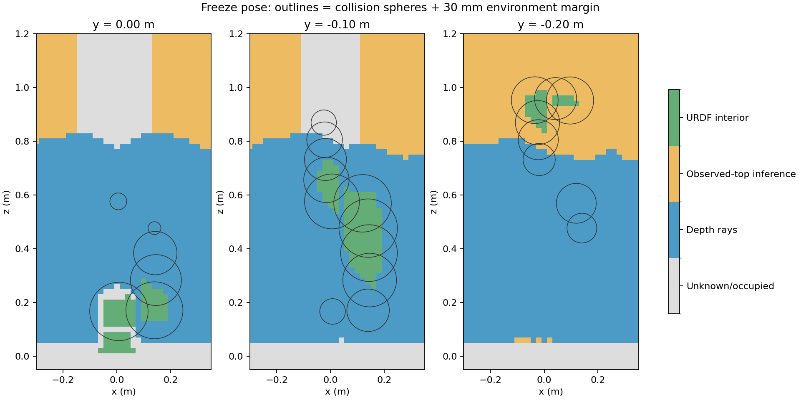

# 高位中心视角补扫及闭环到达尝试（2026-10-16）

**本轮完整完成 63 个停点、315 帧预扫描，冻结后仍未通过整臂起步检查，闭环到达尚未完成。** 阻挡球从上一轮 14 个减少到 9 个；SAGE 反馈步数和到达次数均为 0，正式验收以 `No completed SAGE reaching` 失败。未将预扫描成功当作到达成功。

## 本轮改动和实测

新增 `config/scan_high_central.yaml`、`test/design_high_central_scan.py`。保留原 43 停点及低位斜视，将上一轮约 0.55 m 高的补充相机视角换成约 0.90 m 高、距离机械臂中心更近的视角。整条路径在 199777 个插值样本上核验：最小工装间隙 87.55 mm，自碰撞间隙 21.38 mm，采样间运动界 0.77 mm。工装真值只用于离线扫描路径核验和事后审计。

本轮不改变运行时本体分类、相机外参、环境 30 mm 余量、自碰撞 15 mm 余量及自由空间规则。没有向规划地图写入扫描通道。原始深度射线及可靠顶部高度推断仍是环境自由空间的来源。

| 指标 | 上一轮低位/中位补扫 | 本轮低位/高位补扫 |
|---|---:|---:|
| 停点 / 帧数 | 63 / 315 | 63 / 315 |
| 深度射线自由单元 | 234322 | 306981 |
| 可靠水平列 | 4813 | 4829 |
| 顶部推断自由单元 | 169116 | 137668 |
| 未通过地图间隙的球 | 14 / 22 | 9 / 22 |
| 起始最小地图间隙 | −82.56 mm | −65.22 mm |
| 有真实实体外未知中心落入检查范围的球 | 10 | 6 |
| SAGE 步数 / 到达次数 | 0 / 0 | 0 / 0 |

射线标签优先，所以顶部推断单元减少不代表覆盖退化。球 2、4、5、6、8 本轮已通过 30 mm 检查。仍未通过的是 0、1、3、7、9、10、11、12、13。

本轮审计确认：本体内部单元 1187；超出实体、覆盖实测障碍、将外部未知变成正距离、自由单元落入测试工装、缺少可靠列支持的顶部推断，计数均为 0。实测运动最小工装间隙 87.54 mm，自碰撞间隙 21.38 mm；最大指令速度约 0.25 rad/s，最大跟踪误差 0.03238 rad。保持阶段指令变化 0 rad。实机标定与仿真光学帧矩阵最大差 2.94e-8，深度表面误差 P95 为 2.17 mm。

## 将两种缺口分开诊断

新增两个只读离线脚本，没有把诊断结果提供给控制器，也没有改写任何冻结地图：

- `test/diagnose_owned_boundary.py`：用肩部凸网格半空间证明，关节轴中心存在半径 59.28 mm 的实体核心。10 个未知体素的中心在该核心内，却未通过“整个 20 mm 体素在实体内”的条件。例如 `[0, 0, 0.22]` m。这证明当前边界表示会拒绝部分实际本体内部位置，而这些内部位置无法靠相机观测为空闲。
- `test/diagnose_subvoxel.py`：仅对混合边界单元递归细分，直到 1.25 mm；仅删除完整位于 URDF 实体内的子单元，保留所有未证实内部的部分。用保留未知/占据盒子的外接球计算保守距离下界。本轮最小下界间隙改善至 −22.11 mm，但仍无法证明上述 9 个球满足 30 mm 条件。该实验未应用 native ESDF 的正距离上限，也未生成 SAGE 可用地图，因此不是可部署替代场或到达验证。

真实实体外的缺口同样存在：肩部球范围内仍有 101 个未知单元中心，其中最近的是 `[0, 0.06, 0.16]` m；高位前臂附近还存在 `[−0.04, −0.12, 0.96]`、`[0, −0.12, 0.84]`、`[−0.02, −0.12, 0.86]` m 等未知中心。具体数量和距离见 `ownership_audit.json`。这不表示已经发生实物碰撞，表示感知与声明的假设尚不足以证明检查范围自由。



不能据此声称现有硬件和规则在所有视角下都不可能成功；但结果足以说明，继续重复同类扫描或仅细化本体边界不能作为“必然能到达”的依据。后续需要同时解决实体/环境混合单元的保守碰撞表示，并针对这些外侧未知区域设计可见且无碰撞的观测姿态。两者都通过后再启动 SAGE 验证。不能通过扩大本体、填充通道、忽略肩部或降低碰撞余量替代。

## 复现与状态

```bash
./build_ur7e_gazebo_esdf_sage.sh
./run_ur7e_gazebo_esdf_sage.sh output:=/新的绝对输出目录 scan_config:=/home/wqj/realtime_nvblox_ws/src/ur7e_gazebo_esdf_sage/config/scan_high_central.yaml
```

原始数据：`/home/wqj/nvblox_output/gazebo_esdf_sage/ownership_high_central_20261016`。
环境地图 UID：`41269bc64c54580242b191a4af1d63d90016fb64bc835039239a06242e4bf510`。
派生碰撞场 UID：`5f6330dcc54c426740711cb240d9f3681e107d59a2dfc5cdc7abaf018b402da2`。

构建成功，现有 18 项测试全部通过；到达验收失败，原始失败日志已保存。本目录包含审计、地图摘要、诊断、切片和运行日志；逐帧深度和控制记录保留在原始数据目录。881 个原项目文件哈希未变化。全部仿真进程已正常退出，未连接实机。
