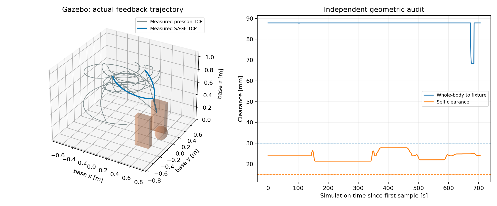
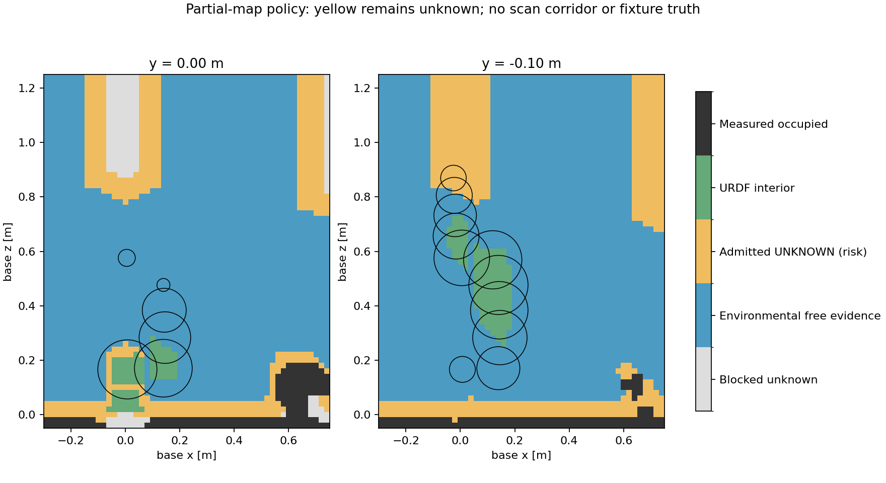

# 局部感知地图 + SAGE 滚动无碰撞到达验证

运行日志日期：2026-10-16；报告整理：2026-10-17。

**本轮完成了全新预扫描、冻结地图、实际反馈驱动 SAGE 滚动到达，并通过六项在线场景检查及独立运动审计。** 规划未读取仿真工装障碍真值，也没有把扫描通道写入感知自由空间。

必须区分：本轮使用显式 `bounded_unknown` 局部地图策略，允许有界地使用未知区域；这调整了此前“所有未知一律禁止”的执行规则。不能将本轮结果描述成原严格规则已经通过，也不能把未知区域称为已知自由空间。

## 问题与工程改动

此前接口把未知边界也作为碰撞距离场的障碍，要求整臂所有球及 30 mm 余量完全处于观测自由区/本体内部。局部地图即使正确测出了场景障碍，近身观测孔洞仍会导致整机无法起步。继续增加视角只能解决其中一部分。

本轮新增 `ur7e_gazebo_esdf_sage/partial_map.py`，将三类信息分开：

1. **环境证据不变**：`frozen_map.npz` 保留深度射线、可靠顶部高度推断及未知标签。source=0 不被改成自由；几何工装真值和扫描通道不进入此地图。
2. **已测障碍硬约束**：读取 native ESDF 的已知占据和已知距离。运动仍检查整个机械臂及相机球模型，环境间隙 30 mm、自碰撞间隙 15 mm 不变。
3. **未知使用策略**：只有距环境自由证据网格中心不超过 80 mm 的未知单元可以进入准入集合；远处未知和地图外继续阻挡。URDF 内部单元本身不膨胀，也不作为未知邻域距离的种子。目标点仍须位于观测或桌面假设支持的空间。

80 mm 是本次实验的显式风险参数，不是传感器误差界、自由空间证明或安全认证。离线比较过 40、60、80 mm，前两者仍拒绝起始状态；80 mm 能支持起步。结果完整保存在 `band_sensitivity.json`，没有声称该参数来自严格安全推导。距离定义基于 20 mm 网格中心，具有离散误差。

单独的 `partial_policy.npz/json` 保存障碍距离、未知程度、准入掩膜和合成的运动可行性距离。合成距离不是感知自由空间 ESDF。IK、引导连接、SAGE 和每个执行小步使用同一个可行性约束。SAGE 原优化器不改动，附加未知程度代价；代价在各球中心和六个极点采样，而完整球和连续连接仍由独立硬检查覆盖。

模式 B 控制链保持：实际 q/dq → SAGE 优化 → 第一小步 → 完整碰撞检查 → Gazebo ros2_control → 新实际反馈。冻结后地图和融合帧数不变。

## 实际运行结果

全新扫描完成 **63 个停点、315 帧**，原始地图含 306980 个射线自由单元、137568 个顶部推断单元；扫描通道来源单元为 0。本体内部记录 1187 个单元。局部策略另允许 122973 个未知单元，但这些单元在环境地图中的标签仍为 0。

| 在线场景 | 结果 |
|---|---|
| 默认目标 `[0.50,0.00,0.60]` | 到达，误差 **4.28 mm** |
| 墙间低位目标 `[0.603,−0.073,0.442]` | 到达，误差 **6.09 mm** |
| 运动中改目标到 `[0.30,0.10,0.94]` | 到达，误差 **5.63 mm** |
| 障碍内目标 `[0.50,0.20,0.23]` | 拒绝，保持 |
| 地图外目标 `[2,2,2]` | 拒绝，保持 |
| 运动中注入反馈丢失 | 锁定停止，保持 |

共 254 次优化计数，245 个实际执行并记录的 SAGE 小步，对应 245 个不同的实际反馈时间戳。另有 8 个优化结果因延迟超过 0.75 s 被丢弃，最大约 5.20 s；还有被目标修订/取消打断的计算。未放宽过期结果保护。该延迟说明主机负载下的时延稳定性还需要单独优化，不能据此宣称实时性能已经解决。

## 独立审计

`validate_run.py`、`audit_partial.py`、`audit_tabletop.py`、`audit_ownership.py` 全部退出码 0。

| 指标 | 实测 | 要求/含义 |
|---|---:|---|
| 审计实际运动样本 | 43034 | 包含预扫描与后续运动 |
| 最小实际环境间隙 | **68.36 mm** | ≥30 mm；仅事后使用工装真值核验 |
| 最小实际自碰撞间隙 | **21.38 mm** | ≥15 mm |
| 规划阶段已测障碍地图最小间隙 | **46.96 mm** | ≥30 mm |
| 规划阶段可行性距离最小间隙 | **45.27 mm** | 同时限制障碍与准入域边界 |
| 最大关节跟踪误差 | 0.03493 rad | <0.06 rad |
| 最大扫描指令速度 | 0.25000 rad/s | 扫描设定 0.25 rad/s |
| 最大滚动到达指令速度 | 0.15000 rad/s | 到达设定 0.15 rad/s |
| 未知位置采样比例 | **2.25%** | 球心及六极点的样本比例，不是体积比例 |
| 运动采样点最大未知距离 | **40 mm** | 网格中心定义；策略上限 80 mm |

独立策略审计确认：准入未知单元均满足设定邻域距离；实测占据没有进入准入集合；原环境 source 标签保持；所有硬检查使用的距离不高于障碍距离。桌面推断没有不可靠列支持、自由证据没有落入测试工装；本体记录没有扩张到实体外或覆盖实测障碍。

`audit_tabletop.json` 中 stopped_samples=0 是因为反馈故障触发后控制回调不再写正常执行 CSV。停止保持由独立实时探针验证：6 秒观测中命令变化 0 rad，实际关节变化约 3.55e-15 rad，两个控制器均 active。未把 CSV 缺少停止样本解释为已经验证停止。

实时 TF 与实机标定的最大矩阵差为 2.94e-8。运动扫描探针深度表面误差 P95 6.71 mm；停止探针为 5.60 mm，均通过 20 mm 核验阈值。





## 结论边界

本轮证明：在该静态 Gazebo 场景及明确的有限未知使用策略下，可以将不完整的感知地图接入 SAGE，实现实际反馈闭环无碰撞到达，而不使用仿真障碍真值规划或扫描通道预填充。

本轮各引导路径的直接关节插值本身也有正的工装间隙，不能宣称完成了“直接插值必撞墙、规划必须绕行”的强制绕障基准。本轮验证的是感知接口、整臂约束、滚动执行和无碰撞到达，以及障碍目标拒绝与反馈故障保护。

允许使用未知区域意味着存在未观测物体风险；本次事后无碰撞不等价于对任何隐藏障碍的先验保证。未实现运动中更新 ESDF、动态障碍响应或真实机器人验证。不能把原严格规则的失败隐去，也不能直接据此启动实机运动。

## 失败记录与复现

- 首次启动因共享配置解析器不接受新增字段而退出，尚未预扫描。修复为将本地策略放在 scan.yaml，共享原项目代码未改；保留 `runtime_partial_20261016.log`。
- 首次场景验收监视器使用旧 420 s 等待时限，在较长扫描结束、SAGE 已开始运动时超时。控制流程未中断；保留 `system_scenario_initial_wait_timeout.json`、`scenario_partial_r2.log`。将监视器整体等待改为可配置的 `--scan-timeout`（默认 1200 s）后继续同一次全新扫描运行，六项验收全部通过；控制器的反馈/规划时限没有放宽。

```bash
cd /home/wqj/realtime_nvblox_ws
./build_ur7e_gazebo_esdf_sage.sh
./run_ur7e_gazebo_esdf_sage.sh planning_policy:=bounded_unknown scan_config:=/home/wqj/realtime_nvblox_ws/src/ur7e_gazebo_esdf_sage/config/scan_high_central.yaml output:=/新的绝对输出目录
# 另一终端 source ROS 和 install/local_setup.bash 后：
OPENBLAS_NUM_THREADS=1 OMP_NUM_THREADS=1 ~/miniconda3/envs/whole_control/bin/python -B src/ur7e_gazebo_esdf_sage/test/system_scenario.py /同一输出目录
```

`strict` 仍是默认策略，保留先前行为；上面的参数显式选择已测试局部模式。构建成功，21 项离线测试通过。881 个原项目文件哈希未改变。

原始完整证据：`/home/wqj/nvblox_output/gazebo_esdf_sage/partial_closed_loop_r2_20261016`。深度、位姿、native ESDF、冻结地图、策略快照、逐步实际反馈和执行 CSV 均保留。

环境 UID：`0634f7f548db5abe81e124e2569d83a3c8a0b1c682634f22905472f60641c0e5`。
策略 UID：`88aef4abce85a341ce76987869e7902ba2c81d521c489d1360ed9c5b6ca09dc6`。

运行只使用 Gazebo 域 87、端口 11387，未连接真实机器人。测试结束后全部本轮进程正常退出。
