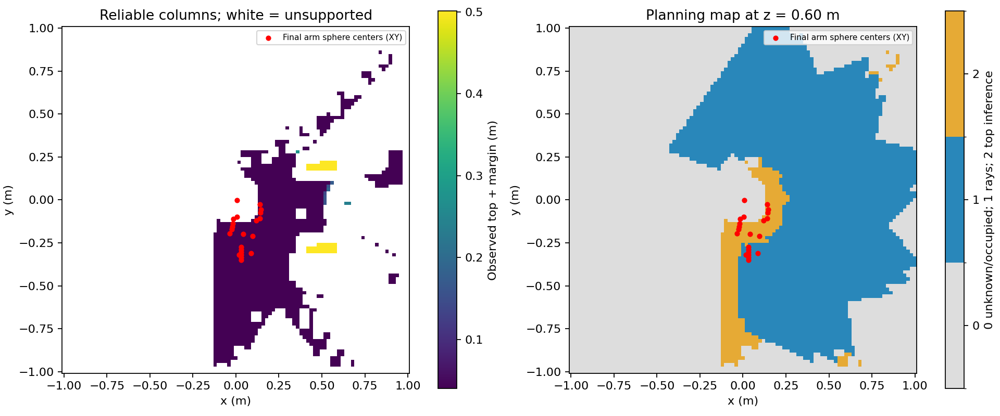

# 观测顶部结构假设：实现与验证

日期：2026-10-15。只涉及 Gazebo，ROS 域 87，Gazebo 端口 11387，没有连接真实机器人。

## 变更与边界

旧版规划地图含扫描通道预填充，不符合本次要求。现已将扫描和规划地图分开：固定通道仅用于预扫描；冻结地图只包含深度射线自由空间和观测顶部的结构推断。运行时规划不读取工装尺寸或障碍位姿。扫描点可以作为经过当前地图检查的关节路径候选，不能因此获得自由空间豁免。

`config/tabletop.yaml` 明确声明静态桌面场景、观测顶面以上无悬挂物或上层结构；推断限于 x/y ∈ [-1,1] m，z ∈ [-0.1,1.3] m。每个 20 mm 水平单元的四个子区均需有连续、朝上的表面观测，且至少两个不同相机位姿支持；重复同一视点拍摄不算新视点。支持区域再收缩一格，以邻域最高实测高度加 40 mm 作为上方自由空间下界。无效深度、遮挡和未可靠覆盖的列保持未知。相机向下是必要条件之一，不能单独证明整个水平工作区都空旷。

该规则是结构假设下的离散观测判据，不是对任意细小物体、任意噪声或遮挡的安全证明。实机需要按深度误差、标定误差、物体尺寸验证分辨率和余量。此包仍为静态地图；不支持冻结后加入动态障碍。

距离场从允许的自由体素集合重新计算，不沿用旧扫描通道对距离值的影响。native ESDF 测量障碍优先。`source=0/1/2` 分别为未知或占据 / 深度射线 / 观测顶部推断。保存 `tabletop_evidence.npz` 和策略版本 `depth_tabletop_columns_v1`；旧地图身份校验失败，不能继续用于规划。

## 离线检查

构建通过，12 项测试通过，见 `build.log` 和 `offline_tests.log`。新增检查包括多视点支持、重复帧不能增加支持、上方推断与射线来源区分、深度孔洞保持未知、测量障碍覆盖推断、更高顶面收回原推断、侧面不能充当顶面、重算距离与独立 EDT 一致、旧地图拒绝加载及规划地图身份不依赖扫描通道半径。

原有包 881 个受检文件 SHA256 均未改变，见 `source_integrity.json`。

## 旧观测回放（不等同于新一轮闭环运行）

输入为旧成功运行保存的 16 张原始深度、对应关节/相机位姿以及最终 native ESDF。没有读取旧规划自由空间或旧规划距离场；每视点仅保存一张深度，因此不能声称复现了全部 80 帧的积分过程。

结果：深度射线自由体素 182071，结构推断自由体素 49936，可靠水平列 1429，扫描通道体素 0。起始状态 14 个碰撞球不满足地图间隙要求，最小间隙约 -113.24 mm。负值在这里主要表示未知空间侵入球的检查范围，不能理解为实物已经穿透碰撞。详见 `replay/summary.json`。

这说明旧版的到达成功不能作为新策略已经可用的证据。固定通道原先填补了近身未知区域；上方结构推断只能补全有可靠水平支持的列，不能把肩部、上臂、前臂周围未观测区域直接变成自由空间。

## 新一轮 Gazebo 实测

第一轮输出：`/home/wqj/nvblox_output/gazebo_esdf_sage/tabletop_20261015`。完成 66 帧后，在第 14 个视点等待深度超时，状态为 `STOPPED / Timeout in SCAN_CAPTURE: WAIT_DEPTH`。没有冻结地图，没有执行 SAGE 到达；保留原始输出及 `runtime_first.log`。本次没有定位采集延迟的根因，不能将它归因于覆盖不足，也不能丢弃失败轮次只报告成功轮次。

第二轮输出：`/home/wqj/nvblox_output/gazebo_esdf_sage/tabletop_retry_20261015`。实际完成 16 个停点、80 帧融合（15 个不同关节视点，末点回到首点）；冻结地图 UID：`0302f967dc54674620d8c9fbb3157fb3fe8e05a73f37eac56a3d13175bbab923`。

| 项目 | 实测结果 |
|---|---|
| 深度射线自由体素 | 182070 |
| 顶部结构推断自由体素 | 49936 |
| 可靠水平列 | 1429 |
| 扫描通道预填充进入规划地图 | 0 |
| 不符合列支持关系的推断体素 | 0 |
| 自由体素落入工装内部 | 0（独立真值审计，仅用于事后验证） |
| 自由体素距离值相对工装真实距离的最大差 | -7.32 mm；本场景无高估 |
| 实际运动审计样本 | 13089 |
| 扫描整臂到工装最小间隙 | 87.56 mm |
| 扫描整臂最小自碰撞间隙 | 23.94 mm |
| 冻结后状态 | `STOPPED / FROZEN_START_NOT_OBSERVED_OR_BLOCKED` |
| SAGE 到达步数 | 0 |
| 停止阶段 3343 条记录中的指令范围 | 0 rad |

独立实时探针另外观察 6 秒，收到 63 帧深度、632 条关节状态和 1262 条位置命令；两个控制器均 active。指令范围 0 rad，实际关节变化约 4.44e-15 rad。真实标定的 tool0→深度光学帧与实时 TF 最大矩阵差 2.94e-8；渲染表面误差 P95 2.17 mm。见 `runtime_probe.json`。

退出后检查本轮 Gazebo、规划节点和 launch 进程均已结束。日志有两个 shutdown 期间 publisher context invalid 提示，进程退出码正常；不将此描述为无警告退出。

## 覆盖缺口与验收结论

**本次地图策略修改和扫描测试完成；新策略下的 SAGE 闭环到达尚未通过。** 停止来自整臂起始状态不能在新地图中证明有足够间隙，未取消该检查，也未重新加入旧通道。

`coverage_gaps.json` 对最终姿态的球半径加 30 mm 环境余量做了检查：肩部包络范围包含 673 个未知或占据标签的网格点，其中 native ESDF 实测占据点为 0，水平足迹可靠列比例为 0%；上臂与前臂也存在明显支持缺口。肩关节在 [-π,π] 的 361 个离线样本中，肩部球的地图间隙均约 -113.24 mm，因此在**当前冻结地图**中仅换目标或转动肩关节不能解决问题。这不是实物已穿透障碍的证据；它反映未知空间和距离场保守余量。

图左白色为缺乏可靠顶部支持的水平列；图右灰色为未知或占据，蓝色为射线自由空间，黄色为顶部推断。红点为最终各碰撞球中心的水平投影，并非都位于 z=0.6 m 切片。

继续闭环需要针对近身缺口重新设计保守补扫视点，先用独立几何检查保证预扫描轨迹安全，再用新增的实际深度验证覆盖。不能从仿真真值直接填补这些位置。对于固定底座、自遮挡和安装区域，若补扫仍无法获得证据，则须单独明确实机同样成立的安装/机器人几何建模边界；本次没有额外假设该区域自由，没有删掉肩部碰撞球，也没有扩大整体桌面平面来跨越未知列。

旧版三个目标的到达结果保留为历史记录，不能用作新规则的到达验收。第一轮采集超时的根因仍待单独定位；第二轮同一视点也出现等待，随后恢复，在现有超时限内完成，没有放宽帧新鲜度阈值。

