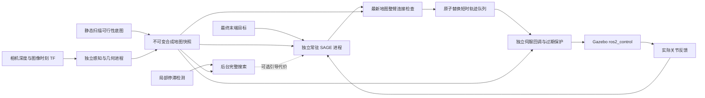

# UR7e 相机感知与连续局部 SAGE 闭环实验

本包是独立实验版本。旧包 `ur7e_gazebo_esdf_sage` 保留原来的“完整引导搜索 → SAGE 分段执行”，本次只在其 README 补充架构说明。新包使用自身的感知、节点、配置、launch 和测试代码副本，原 STORM、实机扫描、旧闭环源码不修改。公共模型/数学工具作为只读依赖使用。

## 感知与地图

Gazebo 相机沿用实机标定外参；多视角静态预扫描建立 TSDF/ESDF、可靠桌面列上方自由推断、URDF 本体实体处理和显式 80 mm 有限未知准入。静态底图冻结后，独立感知进程持续同步深度、图像时刻关节与 TF，几何工作进程生成在线新增占据/距离，通过完整共享快照提交。端点降采样 4、自由射线降采样 2，20 mm 网格。动态层与静态可行性场逐点取最小值，不扩大未知准入。

占据只通过有效自由射线清除，无 TTL，不把视野外障碍自动删除。合成场是运动可行性距离，不应把有限未知区域称作已观测自由空间。运行时不接收测试障碍真值。真实遮挡、静态表面附近细小新增物仍是能力限制。

## 连续规划与执行

1. CUDA 和 SAGE 在对外宣告 ONLINE_READY 前预热，无运动输出。
2. SAGE 在独立常驻进程运行，使用最多一个未完成请求的通道，地图仅在版本变化时传输；不与伺服回调共用 Python GIL。收到目标立即建立最终末端位置目标；不等待完整 IK/路径搜索。每轮从实际 `q,dq` 与最新不可变地图快照优化。
3. 新目标只重置一次分布。后续保留 SAGE 均值/形状序列，按已流逝仿真时间与 50 ms 预测步长计算 `shift_steps`；不每轮覆盖朝向引导点的固定速度初值。
4. 优化循环目标周期 40 ms，预测时域 40×50 ms。输出速度上限 0.15 rad/s，接近目标时降低执行速度。取得至多 4 步（200 ms）短时轨迹，用最新地图检查完整球包络和连接。
5. 200 Hz 伺服独立推进已检查轨迹。新轨迹基于当前命令位置原子检查和替换，不等待上一小段完成；后台计算期间可继续执行旧轨迹的有效剩余部分。300 ms 未获得新计划即停止推进，绝不无限外推。频率均为配置目标，实测见验证报告。
6. 实际末端误差低于 8 mm 时保持并报告到达。

地图版本变化及运行段定期重检、地图年龄 0.5 s、反馈时效、实际整臂间隙、执行连接、跟踪误差检查保留。环境余量 30 mm，自碰撞 15 mm；新增动态距离额外扣除 20 mm。物理堵塞目标或地图失效时保持，保留感知和恢复逻辑。新快照使当前轨迹失效时立即取消当前段与待执行队列。



## 后台完整搜索

末端误差超过 2 秒无明显改善且距上次搜索超过 5 秒时，可启动单独 CPU 工作进程。它在当时的感知快照上进行多初值 IK、扫描姿态图连接及采样搜索，预算 10 秒。局部 SAGE 不等待搜索结果；失败只记录事件。

返回的路径作为可选关节引导代价，经最新地图重检后使用，最终末端位置目标始终不变，不增加原版的强直线关节段约束。终点辅助引导保留至实际到达，不以较宽的关节接近判据提前撤销。搜索轨迹不直接下发，执行仍全部来自 SAGE 并经独立检查。该辅助并不保证解决所有局部极小值。

## 构建与运行

默认 ROS 域 **88**、Gazebo 端口 **11388**，与旧包默认 87/11387 隔离。同一新包端口不可同时启动两轮。

```bash
cd /home/wqj/realtime_nvblox_ws
./build_ur7e_gazebo_esdf_sage_continuous.sh
./run_ur7e_gazebo_esdf_sage_continuous.sh \
 output:=/绝对路径/新的输出目录 planning_policy:=bounded_unknown \
 online_obstacles:=true online_engine:=v2 hold_after_scan:=true \
 scan_config:=/home/wqj/realtime_nvblox_ws/src/ur7e_gazebo_esdf_sage_continuous/config/scan_high_central.yaml
```

默认执行新预扫描。开发调试可额外指定 `test_load_map:=/已有扫描会话/frozen_map.npz`，加载并复制感知证据，不得称作重新扫描。相机/地图身份校验与起始姿态连接检查仍执行。

另一终端启动独立移动场景测试：

```bash
source /opt/ros/humble/setup.bash
source /home/wqj/realtime_nvblox_ws/install/local_setup.bash
ROS_DOMAIN_ID=88 OPENBLAS_NUM_THREADS=1 OMP_NUM_THREADS=1 \
 /home/wqj/miniconda3/envs/whole_control/bin/python -B \
 /home/wqj/realtime_nvblox_ws/src/ur7e_gazebo_esdf_sage_continuous/test/moving_scenario.py /绝对路径/新的输出目录
```

80 mm 方块以 10 mm/s 横穿，验证到达、返回、目标堵塞保持、移开恢复。测试真值只用于障碍驱动与独立审计。可加 `run_rviz:=true` 查看机器人和静态图；动态显示使用本包 `test/visualize_moving.py` 与 `config/moving_stage2.rviz`，均设置域 88。

## 证据与验证

- `execution.csv`：实际关节、命令、下一点及速度。
- `sage_feedback.jsonl`：每次已接受的完整短时轨迹、规划/执行地图版本、时间移位、计算时间和后台搜索状态。
- `events.jsonl`：目标、后台搜索提交/失败/返回、拒绝执行、计算超时、到达与停止。
- `online/`：感知提交、占据版本及深度/TF/关节证据。
- `test/audit_moving.py`：实际全臂对静态/移动真值的独立间隙、提交间隔、执行首步检查。
- `test/audit_continuous.py`：全部短时轨迹连接检查、序列移位、后台搜索期间的提交与响应时间。

局部在线优化不代表绝对无停顿；安全保持、局部极小值、有限地图及感知盲区仍需如实统计。验证结论、失败轮次、速度连续性和限制将在 `validation/REPORT.md` 中记录。仅用于 Gazebo，不能直接作为实机动态安全保证。
