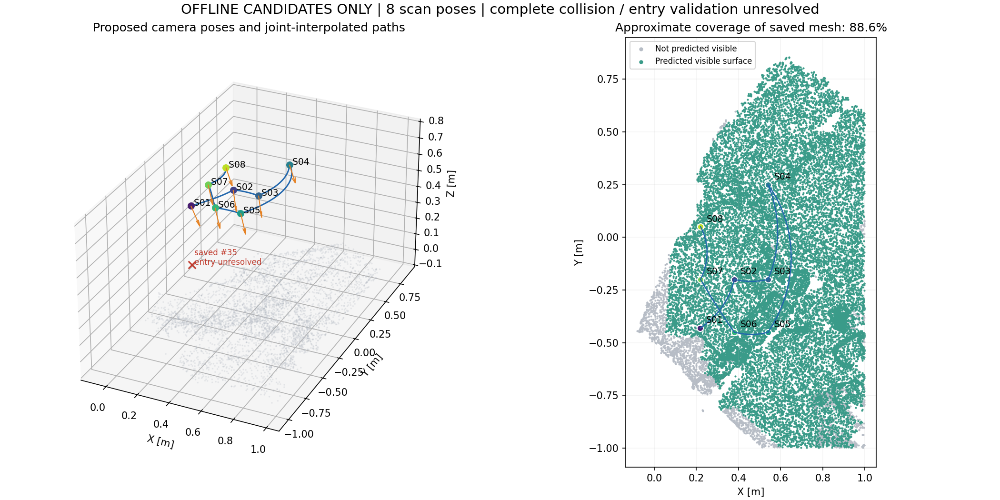

# 静态场景自动扫描观察点方案（仅离线选点）

**日期：2026-09-28**  
**基于数据：859 帧、35 个观察姿态的真实彩色重建**  
**状态：候选方案，`execution_ready: false`；本轮未连接 RTDE、未启动控制器、未发送运动指令。**

## 1. 选定结果

建议采用 **8 个新观察点**，主要保持相机在 `base_link` 下 z=0.70～0.73 m，观察顺序为：

**S01 → S02 → S03 → S04 → S05 → S06 → S07 → S08**

它们不是从原 35 个姿态中直接取出：S01 是以原记录 35 的相机位置/朝向为参考求得的高位目标，其余点由网格候选位姿、逆运动学和覆盖筛选得到。**实际机械臂尚未到达过这些新点。**

下面位置均指 **深度相机光学坐标系** 在 `base_link` 中的位置。朝向列只是便于阅读的光轴方向，不能代替完整旋转；实际完整目标由 YAML 中的四元数/齐次矩阵和关节角定义。彩色相机与 tool0 的目标也一并保存。

| 顺序 | 相机位置 x, y, z（m） | 光学 +Z 朝向 | 作用 |
|---|---|---|---|
| S01 | (0.218, -0.430, 0.700) | (0.519, -0.123, -0.846) | 入口斜视；前侧近区总览 |
| S02 | (0.380, -0.200, 0.730) | (0.249, -0.187, -0.950) | 中部斜视；前侧遮挡补充 |
| S03 | (0.540, -0.200, 0.730) | (0.249, -0.187, -0.950) | 右侧高位；从另一侧观察中部 |
| S04 | (0.540, 0.250, 0.730) | (0.249, 0.187, -0.950) | 后侧高位；补充 y 正方向区域 |
| S05 | (0.540, -0.450, 0.730) | (0.254, -0.000, -0.967) | 前右高位；俯视前侧物品 |
| S06 | (0.380, -0.450, 0.730) | (0.254, -0.000, -0.967) | 前中高位；与 S05 形成横向基线 |
| S07 | (0.220, -0.200, 0.730) | (0.254, -0.000, -0.967) | 前左高位；补充左侧视角 |
| S08 | (0.220, 0.050, 0.730) | (0.249, 0.187, -0.950) | 左后高位；补充中后区域 |

“前/后/左/右”是按本方案坐标分区的相对描述：前侧偏 y 负方向，后侧偏 y 正方向，右侧偏 x 正方向；以数值坐标为准。

蓝线是关节插值对应的相机路径，不是相机 XYZ 的直线。红色叉号仅标出上次保存的低位姿态 35，**没有把它连入可执行扫描路线**。

## 2. 为什么这样选

1. **覆盖优先，再安排顺序。** 从 x=[0.22, 0.38, 0.54]、y=[-0.45, -0.20, 0.05, 0.25]、z=[0.63, 0.73] m 和多个倾角生成候选，使用本机工厂校准 URDF 求逆解。保留同一肘部正角度分支，并约束腕部范围，得到 39 个初筛候选。
2. **正式扫描采用较高视角。** 最终候选集中选用 0.73 m 高度，另保留 0.70 m 的 S01。相机光轴主要向下并略向物体区域倾斜。这样减少在桌面物品高度横移的需求，但整臂仍需检查。
3. **完整姿态与关节分支固定。** 求解中允许相机绕光轴旋转，以改善关节可达性；求解后已保存完整姿态，后续不能只取 XYZ 任意重解另一组关节角。
4. **按新增可见表面筛选。** 在最终网格上按三角形面积随机采样 30000 个点，使用真实 RGB 内参、视场和近似 Z 缓冲遮挡筛查，逐步选择增加可见面积的点。
5. **按关节路径排序。** 对已选点之间进行关节插值初筛，在保留连接中枚举 7 个后续点的顺序，最小化相邻关节向量的欧氏距离之和；没有仅按相机位置的几何距离排序。

8 点对**已重建网格采样表面**的预测可见比例约 **88.6%**。这不是现实场景完整率，也不保证 8 次拍摄即可复现全部细节。估算不包含未知表面、真实反光/透明材料失效、实际相机噪声或精确光线追踪。

较高视角扩大覆盖，但物体在图像中会变小。建议先用这 8 点做主体扫描，之后根据实际空洞决定是否增加低位局部补拍，不先把所有低位动作自动化。

## 3. 相邻点的路径检查

使用实际校准机械臂模型和已有球包络，对每段关节线性插值加密采样；7 段合计 **5745 个采样配置**。利用模型运动上界使相邻样本之间的球心位移上界不超过 4 mm，并扣除样本间的保守余量。

已建表面间距通过“最近网格顶点距离 − 球半径 − 最大三角形边长 − 样本间余量”估算；本地图最大三角形边约 26.10 mm。该下界仅针对保存的三角网格与模型球，不包含未重建障碍物、工厂标定之外的安装误差或真实实体包络误差。

| 扫描段 | 最大单关节变化 ° | 已建表面间距下界 mm | 机械臂球模型间距下界 mm | 含相机的模型间距下界 mm |
|---|---:|---:|---:|---:|
| S01 → S02 | 44.6 | 34.6 | 16.4 | -18.3 |
| S02 → S03 | 29.0 | 55.2 | 16.0 | -18.4 |
| S03 → S04 | 44.8 | 69.4 | 16.0 | -18.3 |
| S04 → S05 | 56.8 | 54.7 | 16.5 | -18.3 |
| S05 → S06 | 33.3 | 46.9 | 16.4 | -18.5 |
| S06 → S07 | 40.2 | 44.7 | 16.3 | -18.5 |
| S07 → S08 | 44.7 | 44.7 | 16.3 | -18.5 |

**分项结论：** S01→S08 的各段通过本次“已建表面间距 ≥30 mm、机械臂部分球模型间距 ≥15 mm”的初筛；相机高度采样下界不低于 0.70 m。**包含相机球的完整自身检查全部未通过原 15 mm 门限，因此没有任何一段被批准用于真机执行。**

负的相机/腕部间距表示近似包络相交，是模型检查结果，不能直接当作实物碰撞证据；也不能为了让方案通过而删除这些球或关闭检查。现有模板在原手动扫描姿态上也会出现类似结果，后续需核对相机安装和腕部包络，或使用更贴合实体的碰撞几何。

另外，以最大单关节步长不超过 2° 的样本检查相机雅可比，旋转部分乘 0.3 m 尺度后的最小奇异值最低约 **0.0546**。这只用于发现明显的数值退化，不是连续路径无奇异或真机控制性能保证。

## 4. 入口路径：明确未完成的部分

上次保存的观察姿态 35 **不是本轮读取的当前机器人状态**。本轮只做离线分析，没有查询或控制真机。

评估了两种从记录 35 到 S01 的参考入口：

- 保持原相机姿态、逐步竖直抬升到 0.70 m；
- 两端关节配置直接插值。

两种参考入口都未通过机械臂 15 mm 自身间距要求。记录 35 本身的 `wrist_2_link` 与 `forearm_link` 球模型间距约 **7.46 mm**；竖直抬升检查的保守下界约 **3.28 mm**，直接关节插值约 **3.22 mm**。

因此，**入口方案已标记 rejected，不可直接从“当前位置”发送 S01 目标**。下一阶段要先读取实际起始关节角、核对包络模型，再规划到 S01 的入口路径；必要时增加单独的转场点。本次没有假定“向上抬就一定安全”。返回起点/循环闭环路线也尚未设计，当前方案在 S08 结束。

## 5. 后续控制：RTDE 可复用，但雅可比不是避障规划器

已阅读 `/home/wqj/storm/examples/HIL_sage_rtde`：

- `rtde_backend.py` 使用 `RTDEReceiveInterface` 读取实际关节，`RTDEControlInterface.servoJ` 下发关节命令；其构造函数会连接设备，本轮没有实例化。
- `joint_servo_executor.py` 将目标关节角变成高频 `q_cmd`，具有速度限制和可选加速度限制，并记录目标、实际关节和执行周期。
- 当前 YAML 基线为 500 Hz、lookahead=0.10 s、gain=300、最大关节速度 0.5 rad/s、加速度限制 0.0。本轮只读取这些设置，未修改或运行它们，也未将其直接定为本次扫描执行参数。

**对于这组固定扫描点，可以不用 SAGE 在线规划。** 但应区分三个任务：

1. **路径生成与检查：** 离线确定关节路径，检查整臂碰撞、未知障碍物、关节限位和奇异区域；必要时用离线路径搜索增加转场点。
2. **连续轨迹：** 对已通过检查的关节路径做速度/加速度连续的时间参数化，例如分段五次多项式或 S 曲线，并重新验证实际插值轨迹。任何圆角/样条平滑若改变几何路径，都要重查碰撞。
3. **执行跟踪：** 复用你已验证的 RTDE/servoJ 通道，稳定周期跟踪连续 q(t)，停稳后才采集；不要给执行器突然跳变的观察点目标。

雅可比可用于逆运动学、笛卡尔微调和奇异性评估，**不能单独证明中途无碰撞**。本方案已有对应关节角，后续跟踪已验证的关节轨迹时不必每周期重新用雅可比求解。若使用笛卡尔微调，需要阻尼、速度限制、姿态误差控制，并重新检查变化后的路径。

你报告的 ROS 抖动现象不能仅凭协议名称定位根因。RTDE 通道可以复用，但也需要避免目标噪声、周期抖动和不合适的 gain/lookahead；UR 官方同样说明过高 gain、过短 lookahead 或低频/噪声目标可能引发振动。[UR servoJ 文档](https://www.universal-robots.com/manuals/EN/HTML/SW5_24/Content/prod-scriptmanual/all_scripts/servoj_qavt0-008lookahead_time.htm)

后续 RTDE 执行应与 RGB-D/CUDA 重建分开调度，避免建图阻塞伺服周期；仅由一个控制端发送运动命令。保留实际反馈、跟踪误差、超时停止与日志。已有 ROS 相机/TF 输入可继续用于感知，不能同时让 ROS 运动控制器和 RTDE 对同一机械臂下命令。

建议到点后等待实际反馈连续停稳 0.5 s，再累计至少 5 个成功融合帧；约 2 s 是初始观察停留建议，不代替帧数条件。第一轮完成 8 点后检查原始图像与网格，再决定是否补点。

## 6. 文件与复现范围

- [目标位姿 YAML](selected_observation_poses.yaml)：8 个点的完整相机/彩色相机/tool0 位姿、四元数 xyzw、关节角（弧度及度）、顺序和未通过项。顶层 `execution_ready` 保持 false。
- [完整离线检查](route_analysis.json)：分段距离、参考入口、雅可比样本指标和数据指纹。
- [全部初筛候选](candidates.json)：候选 IK 与覆盖结果。
- [候选分析脚本](analyze_candidates.py)、[选序与路径检查](select_route.py)、[图示与诊断](render_plan.py)：均仅在离线文件上计算，不创建 ROS 节点或 RTDE 连接。
- [真实扫描报告](../report/2026-09-28_real_reconstruction_report.md)：本方案的数据来源。

这些文件不被现有重建启动脚本自动加载，本轮没有添加自动运动功能。数值检查基于源地图和模型指纹；环境或相机安装变化后不能直接沿用。

### 关节角速览

顺序：shoulder_pan、shoulder_lift、elbow、wrist_1、wrist_2、wrist_3。下表仅作阅读，完整精度用 YAML 的 `q_rad`；不要将 wrist_1 等角度自动折回 ±180° 后再插值，以免引入绕行。

| 观察点 | 六关节角（度，顺序同 YAML） |
|---|---|
| S01 | -93.13, -79.69, 69.61, -220.08, -41.69, -82.35 |
| S02 | -56.28, -95.81, 81.80, -187.73, -52.11, -126.92 |
| S03 | -42.19, -71.19, 52.76, -181.87, -35.95, -131.71 |
| S04 | 2.57, -64.19, 42.89, -188.79, -34.54, -116.52 |
| S05 | -54.22, -52.60, 25.00, -162.76, -81.14, -122.44 |
| S06 | -64.03, -75.50, 58.30, -166.16, -102.04, -120.84 |
| S07 | -66.65, -115.73, 93.09, -156.04, -116.35, -119.18 |
| S08 | -21.92, -126.45, 98.26, -154.00, -113.87, -117.33 |
