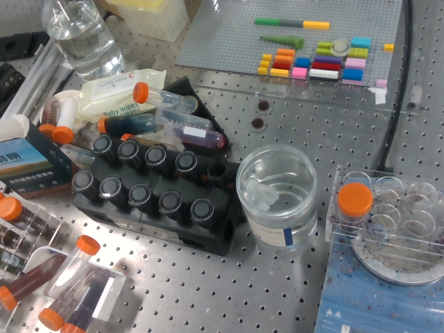
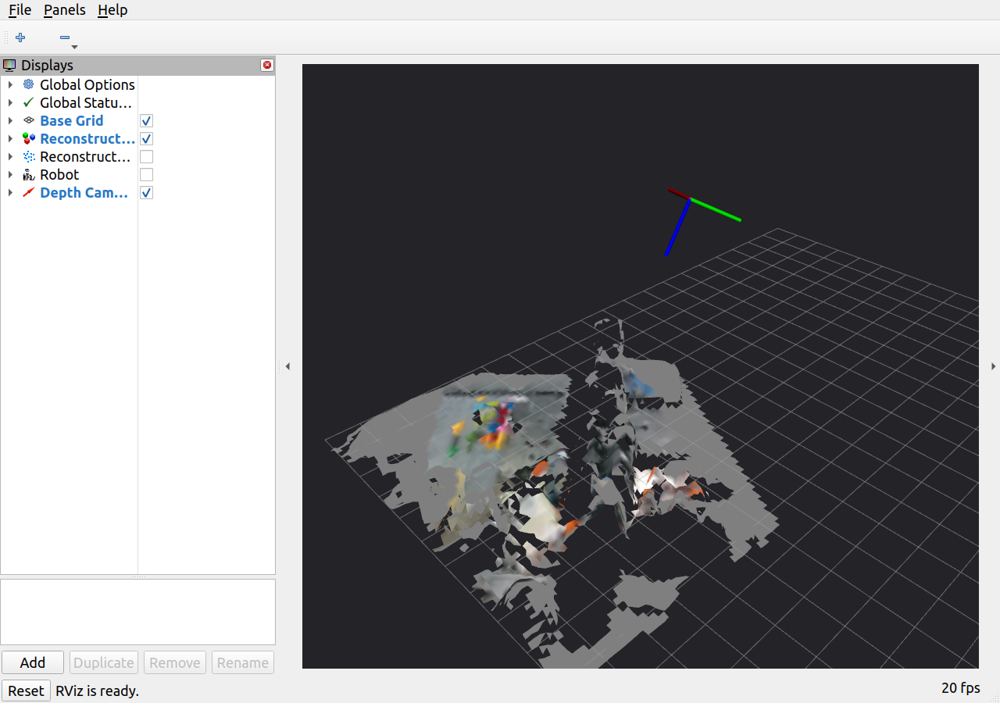
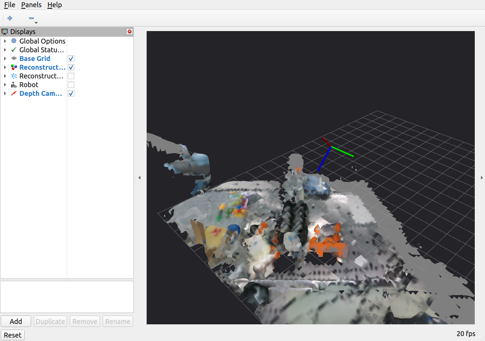

# 2026-09-28 重建预览测试

## 结论

新包 `ur7e_real_reconstruction` 已通过编译、输入单元测试、隔离 ROS 域的真实 CUDA 融合集成测试，以及真实 UR7e/D435i 当前静止视角测试。真实预览有 RGB 颜色，冻结后成功导出网格。现场多视角扫描随后已完成并冻结，见文末；几何精度和场景完整性仍未独立验收。

## 自动测试

- `whole_control` 下输入测试：3 项通过；涵盖静止历史/数据中断、无速度反馈差分、RGB 畸变校正和带行填充 BGR 输入。
- 集成测试使用 `ROS_DOMAIN_ID=83`、合成图像/TF/关节反馈，实际调用 nvBlox/CUDA。没有连接/命令真实机器人。
- 测试空闲不融合、运动拒绝、错误 TF 拒绝、空深度拒绝、关节反馈中断后暂停及恢复、两个观察姿态、冻结后不融合、迟到 RViz 订阅、保存与重新加载、新扫描保留旧文件。
- 将后端 `update_esdf` 替换为“调用即失败”，全流程通过。
- 合成平面 z=0.15 m：95% 顶点高度误差约 **0.365 mm**，红色顶点比例约 **92.57%**。这是合成输入的算法/接口检查，不是真实重建精度。
- 详细结果：[mock_results.json](mock_results.json)。

复现（工作区根目录）：

```bash
source /opt/ros/humble/setup.bash
source install/local_setup.bash
PYTEST_DISABLE_PLUGIN_AUTOLOAD=1 OPENBLAS_NUM_THREADS=1 OMP_NUM_THREADS=1 \
  /home/wqj/miniconda3/envs/whole_control/bin/python -B -m pytest -q \
  src/ur7e_real_reconstruction/test/test_inputs.py
ROS_DOMAIN_ID=83 OPENBLAS_NUM_THREADS=1 OMP_NUM_THREADS=1 \
  /home/wqj/miniconda3/envs/whole_control/bin/python -B \
  src/ur7e_real_reconstruction/test/run_integration.py
```

## 真实设备测试

1. 使用 UR7e 工厂校准启动驱动，日志确认校准匹配；等待操作员启动 External Control 后，日志确认回连。
2. 启动 D435i，真实 RGB/深度均为 640×480、15 Hz，使用已验证的 tool0→camera_link 安装 TF。
3. 启动新包与 RViz，只观察当前静止姿态，未发送机械臂运动指令。
4. 融合并冻结 **59 帧、1 个观察姿态**，得到 **6766 个顶点、8966 个三角形、1675 种顶点颜色**。
5. 所有顶点有限、三角形索引有效；PLY/NPZ 保存成功。首个 RGB/深度时间差约 **0.044 ms**，原图/深度/内参与双相机 TF 已记录。
6. 通过 ROS 节点接口清单确认没有 Action 客户端和机械臂命令发布接口；实际运动控制器均 inactive。

详细检查：[real_checks.json](real_checks.json)。本次单视角验证保存目录：

`log/real_reconstruction_20260928/real/scan_20260928_125627_635aea/`

运行证据在工作区 `log/real_reconstruction_20260928/`：驱动、相机、应用、编译与测试日志，控制器清单、节点接口清单、冻结状态。

### 同一真实视角的 RGB 原图



### RViz 彩色重建预览



截图为本轮单视角融合期间的 RViz 窗口，最终统计采用之后冻结的 59 帧结果。图中能看到积木和桌面物品的颜色；灰色部分可能没有 RGB 覆盖。金属、透明容器与遮挡处仍有孔洞，不能据此认定完整场景已重建。

## 性能与限制

本次真实验证最近有效帧的输入至融合延迟 P50 约 **341 ms**、P95 约 **494 ms**；记录到 65 次融合前过期丢弃和 3 次融合耗时超限。没有保证配置的 5 Hz 持续完成率。

融合前仍要求输入新鲜、TF 与图像时间一致、关节静止；完成较慢的静态重建融合保留并计数，不伪造图像时间戳。本包不使用这些结果驱动实时运动。

本次只验证真实单视角。后续需要操作员改变姿态补扫，比较重影、颜色边界和测量尺度。本轮重建与上一轮 ESDF 共享标定和传感器，二者一致不能单独证明距离场数值或真实标定精度正确。

## 重新启动后的反馈链路异常

应用重启准备下一轮时，发现真实 `/joint_states` 发布者数量为 0，`controller_manager` 服务不可发现，但驱动进程仍存在；当时新扫描保持 0 帧，未使用缓存关节位姿继续融合。证据见 `joints_missing.txt` 和 `current_session.json`。

随后仅重启真实 UR 驱动（仍不激活运动控制器），再次校准匹配，并等待操作员重新启动 External Control；重建预览先加载此前保存的网格。此次没有定位驱动/DDS 反馈消失的底层根因，不能宣称已彻底解决。节点新增 `WAIT_JOINT_FEEDBACK`、关节样本数和反馈年龄，便于区分输入缺失与机器人尚未停稳。

操作员确认重新启动 External Control 后，驱动回连、关节发布者和控制器服务恢复；再次核对运动控制器 inactive。正式扫描会话随后恢复融合，核查时已有 118 帧，未报错。最新运行证据为 `recovered_session.json` 与 `controllers_recovered.txt`。本轮继续扫描目录为 `/home/wqj/realtime_nvblox_ws/log/real_reconstruction_20260928/real/scan_20260928_130419_942f86`，最终多视角结果尚待操作员完成。

## 操作员完成多视角扫描后的最终结果

操作员确认“扫描完成”后，冻结成功，状态为 `FROZEN`：**859 帧、35 个观察姿态、17167 个顶点、24731 个三角形**。所有顶点有限、三角形索引有效，PLY 与 NPZ 统计一致；35 组 RGB、深度与位姿文件全部存在且可读。冻结后再次核对融合帧数保持 859。

保存目录：`log/real_reconstruction_20260928/real/scan_20260928_130419_942f86/`。

[最终数据检查](final_multiview_checks.json)



扫描已结束，RViz 保留最终显示。此结果仍有孔洞、未着色区域和粗糙边界；尚未独立验收场景完整性、重建精度或 ESDF 距离值。
