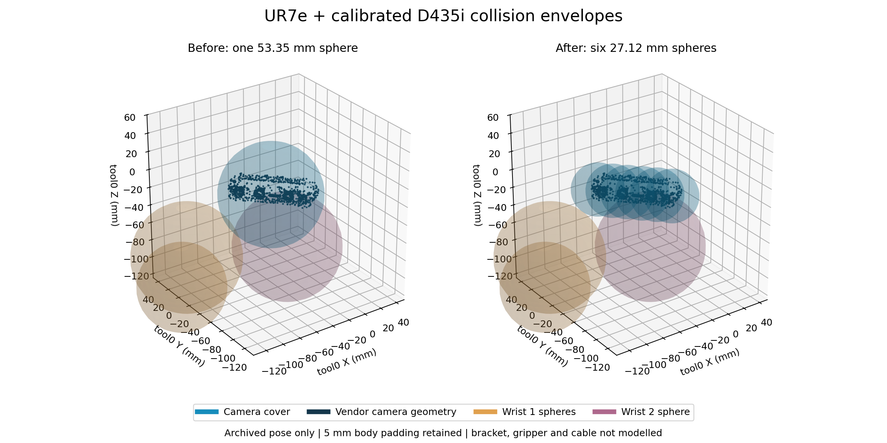

# UR7e + 实机标定 D435i 碰撞包络适配

2026-10-13。完成机械臂原有 16 球 + D435i 壳体 6 球的软件适配，共 22 球。
未连接机器人、相机或启动 Gazebo；没有发送运动命令。

## 模型与使用配置

- 模型：`src/ur7e_real_static/config/collision_spheres_d435i.yaml`。
- 配置：`src/ur7e_real_static/config/real_d435i.yaml`。
- 生成器：`ur7e_real_static.camera_collision`，使用本机已安装的 RealSense D435i 描述（包含 D435 壳体描述与网格）。
- 位置来自 `/home/wqj/ur7e_real_setup/calibrated_with_camera.urdf` 的固定 `tool0 → camera_link` 链。
- 将厂家 collision box 与正确应用 visual origin 后的 mesh 包围盒取并集，向外取整到 1 μm。
  在 camera_link 下，边界为 `[-0.020755, -0.062500, -0.012501]` 到 `[0.012525, 0.027501, 0.012501]` m。
- 沿最长轴分为 6 个闭合小长方体，每球半径为该小长方体半对角线 + 5 mm。
  因为每个球覆盖自己的整个小长方体及其 5 mm 邻域，覆盖证明不依赖表面采样。
- 相机原来的单球半径 53.354 mm，现为 6 个半径 27.123 mm 的球。没有改变机械臂球、碰撞对、15 mm 自碰撞阈值或 30 mm 环境阈值。
- 运行时检查模型记载的相机安装变换和 URDF 一致，且球列表符合完整包络。外参改变、球缺失或人为缩小球都会拒绝加载这个 profile。
- CPU 路径检查、SAGE rollout、深度自身过滤和 RViz 均从同一个 Geometry 球列表读取。



图为历史扫描结束姿态下的 tool0 坐标系，展示球包络而不是实体接触。这里没有展示或建模未测量的支架、夹爪和线缆。

## 离线结果

| 检查 | 结果 |
|---|---|
| 厂家网格全部顶点和碰撞盒角点 | 154,157 点均覆盖，最小包络余量 5.000565 mm |
| 历史扫描结束姿态整臂最小自碰撞间隙 | 6.5527 → 17.2822 mm，通过 15 mm 阈值 |
| 该姿态新的限制碰撞对 | wrist_2_link / forearm_link；不再是原相机大球 / wrist_2_link |
| 真实 SAGE/CUDA 与 CPU 球心一致性 | 9 个归档姿态最大绝对坐标差 1.575e-7 m；半径和碰撞对一致 |
| 256 个随机姿态 | 186 个低于自碰撞余量，确认检查没有被关闭 |
| 静态包全部测试 + 自动包控制单元测试 | 47 passed，含新增 7 项包络/安装/身份测试 |
| colcon 构建 | 通过 |
| 原底层 nvBlox 两包及历史相机模型/校准 URDF | 110 个文件哈希保持一致 |

历史姿态不等于当前机器人姿态。上述净空是几何模型结果，不是实物测量，也不表示环境 ESDF 覆盖问题已解决。

### 旧自动扫描点仍需重新选择

| 点 | 新整臂自碰撞间隙 / mm | 15 mm 余量检查 |
|---|---:|---|
| S01 | 14.988 | 不通过 |
| S02 | 13.000 | 不通过 |
| S03 | 13.789 | 不通过 |
| S04 | 11.809 | 不通过 |
| S05 | 11.459 | 不通过 |
| S06 | 10.496 | 不通过 |
| S07 | 7.513 | 不通过 |
| S08 | 9.681 | 不通过 |

限制对均涉及 tool0 相机球与 wrist_1_link。S01 接近阈值也未按四舍五入放行。
另检查 S01→S08 的 7 段关节插值路径，并按运动界扣除采样间隔余量，均未通过 15 mm 自碰撞阈值。
没有验证从当前实机位置进入 S01 的路径，也没有验证环境碰撞。

因此没有更新旧自动扫描配置的模型哈希、预览文件或执行授权；新模型不代表旧扫描路线已经可执行。
原手动重建、自动重建和旧静态预览配置保持原样，历史数据可继续复现。

## 使用与重新生成

新 profile 可供下一次静态感知/规划使用；默认 `execution_enabled=false`、`commissioned=false`，
输出到新的 `~/nvblox_output/ur7e_real_static_d435i`，避免覆盖旧地图。
它仍使用本机原有采样关节话题 `/ur7e_real_static/joint_states_sampled`；未在本次接入自动包的独立 TF/关节话题。

```bash
./run_ur7e_real_static.sh \
  config:=/home/wqj/realtime_nvblox_ws/src/ur7e_real_static/config/real_d435i.yaml
```

本次没有运行上面的启动命令。旧地图与轨迹的模型身份不同，不能直接加载成新模型的规划输入。

离线重建包络（仅写指定 YAML，不连接硬件；whole_control 已有 trimesh/pycollada，ROS 提供 xacro）：

```bash
source /opt/ros/humble/setup.bash
source /home/wqj/realtime_nvblox_ws/install/local_setup.bash
/home/wqj/miniconda3/envs/whole_control/bin/python -B -m ur7e_real_static.camera_collision \
  --urdf /home/wqj/ur7e_real_setup/calibrated_with_camera.urdf \
  --arm-spheres /home/wqj/realtime_nvblox_ws/src/ur7e_real_static/config/collision_spheres.template.yaml \
  --description /opt/ros/humble/share/realsense2_description/urdf/_d435i.urdf.xacro \
  --output /tmp/collision_spheres_d435i.yaml
```

证据：`results.json`、`validation.log`、`tests.log`、`build.log`。
验证程序：`test/validate_camera_profile.py`；对比图程序：`test/plot_camera_profile.py`。

## 实物范围

本次适配范围是原 UR7e 机械臂球模型和有厂家几何依据的 D435i 壳体。
原机械臂球模型未重新拟合，真实支架、夹爪/工具、线缆没有几何数据，明确记为 unmodelled；
文件的 physically_verified 仍为 false。本机原校准 URDF 的相机 link 仅含变换，也没有这些附件的几何。
这不是包含所有末端附件的实机碰撞验收。后续补充实际附件几何后，应继续补入、检查路径并重新生成地图身份。
Gazebo 的相机外参和对应旧演示包络尚未修改，属于后续仿真统一任务；新 profile 会拒绝与其绑定外参不一致的 URDF。
