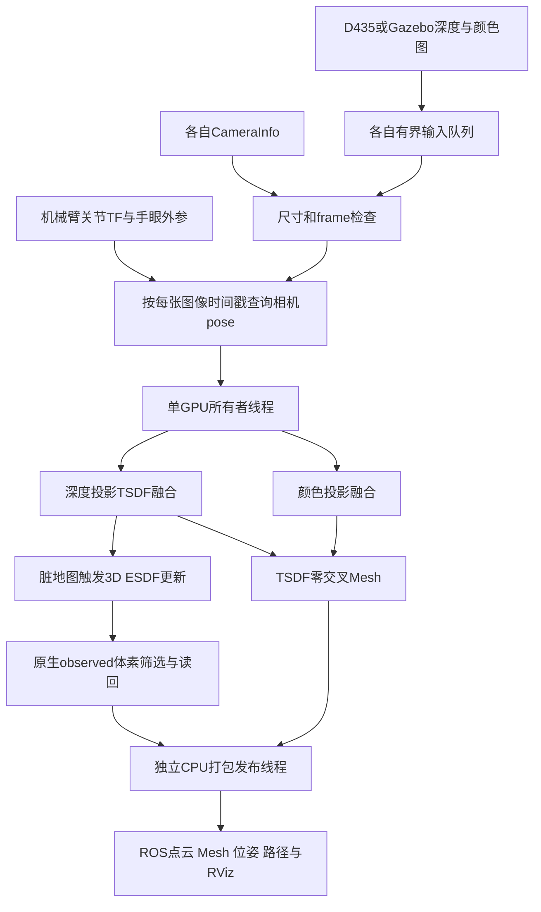

# ur7e_nvblox_in_hand：功能包、依赖、迁移与核心算法说明

核对日期：2026-11-09。依据当前工程源码、package.xml、构建脚本、随工程保留的上游头文件与官方技术文档。本文进行静态分析，不修改算法、不启动新测试；历史性能见[已有验收文档](VALIDATION_20261109.md)。

## 1. 这个工程是什么

`ur7e_nvblox_in_hand` 在最外层是一个独立 ROS 2 工作区，其中同名 ROS 包负责感知。它把 UR7e/D435 的图像和机械臂 TF 接入官方 `nvblox_torch`，由其 C++/CUDA 核心建立 TSDF、融合颜色、计算 ESDF、提取 Mesh，再通过标准 ROS 消息输出。

Python 负责接入和调度，未用 Python 重写三维距离变换；小型本地 C++/CUDA 桥接访问同一个 native Mapper，补充官方 Python 接口未直接暴露的导出/切片功能。项目没有另建第二套距离场，也没有使用原 workspaces 中的 nvBlox ROS 二进制。

官方 ROS 接口与当前 wheel 的核心版本、封装与显示协议不完全相同。当前工程保留重建、距离场、查询、地图服务等主要应用能力，但没有复刻完整官方动态地图管线或分块增量显示。官方也明确记录了 Python 接口在性能优化、动态场景和增量显示方面的边界，见[官方限制说明](https://nvidia-isaac.github.io/nvblox/v0.0.10/pages/limitations.html)。

## 2. 实际使用的三个本地功能包

| ROS 包 | 代码位置 | 实际承担的工作 | 何时使用 |
| --- | --- | --- | --- |
| ur7e_nvblox_in_hand | `src/ur7e_nvblox_in_hand/` | 图像、内参、TF接入，融合调度，原生地图导出，话题/服务/参数/统计 | 感知主体始终使用 |
| ur7e_nvblox_interfaces | `src/ur7e_nvblox_interfaces/` | 生成 FilePath、QueryEsdf 自定义服务类型 | Mapper的地图与查询服务使用 |
| ur7e_d435_gazebo | `src/ur7e_d435_gazebo/` | 机械臂模型、D435挂载/标定、障碍物、Gazebo相机插件、控制器及碰撞检查 | 仿真使用；当前整套build仍会编译 |

`native/`、`vendor/`不是额外 ROS 包。前者由 CMake 单独构建成 `libur7e_nvblox_bridge.so`；后者是匹配 wheel 的编译头文件。只把同名 Python 包拷走，会丢失接口包、桥接和场景。

同级旧工程也有名为 ur7e_d435_gazebo 的包，不应把两个工作区同时递归编译或混合 source。每次只构建本工程 `--base-paths src`，使用本工程 `env.sh`。

## 3. 外部 ROS 功能包分别做什么

根据三个 package.xml、实际 import 和 CMake，依赖分为以下组。表中描述的是功能依赖，安装用的 apt 名称与完整命令见[迁移部署文档](MIGRATION_DEPLOYMENT_20261109.md)和[公共安装说明](../../docs/deployment/SYSTEM_SETUP_UBUNTU2204.md)。

| 分组 | 主要 ROS 包 | 对本项目的作用 |
| --- | --- | --- |
| Python/C++ ROS基础 | rclpy、rclcpp、ament_index_python、rcl_interfaces | 节点、执行器、发布订阅、参数、包路径 |
| 启动编排 | launch、launch_ros | 启动场景、Mapper、相机、bag、RViz；互斥检查 |
| 坐标变换 | tf2_ros_py、tf2_msgs、robot_state_publisher | 根据关节与URDF产生TF；按图像时刻查询相机pose |
| 标准消息 | sensor_msgs、geometry_msgs、nav_msgs、std_msgs、visualization_msgs、rosgraph_msgs、std_srvs | 图像/内参/点云、pose、path、Mesh、统计、时钟、清图 |
| 仿真 | gazebo_dev、gazebo_ros、gazebo_msgs、gazebo_ros2_control | Gazebo11开发库、启动、实体和控制器接入 |
| 机械臂控制 | controller_manager、controller_manager_msgs、position_controllers、joint_state_broadcaster | 仿真关节状态与位置命令；观察路径工具检查控制器 |
| 相机插件支持 | image_transport、point_cloud_transport、camera_info_manager、cv_bridge | 仿真相机发布、内参管理和图像相关工具 |
| 模型与显示 | xacro、rviz2 | 展开机械臂/相机URDF，显示Mesh/点云/TF |
| 构建与接口生成 | ament_python、ament_cmake、rosidl_default_generators、rosidl_default_runtime | Python入口安装、C++构建与自定义服务生成 |
| DDS实现 | rmw_cyclonedds_cpp | env.sh选用的ROS中间件；DDS域和配置需一致 |
| 可选实机相机 | realsense2_camera、realsense2_description、librealsense2 | 连接真实D435；仿真不需要 |
| 可选bag工具 | rosbag2相关CLI/存储插件 | 使用ros2 bag play入口时需要 |

注意：Mapper主路径使用NumPy直接解析图像，不调用cv_bridge完成融合输入转换；cv_bridge等仍是随场景和工具声明的依赖。`point_cloud_transport`也不是 ESDF算法本身，而是相机插件编译链的一部分。

实机还需要机械臂驱动发布关节状态、准确的URDF与手眼标定。此驱动不随本工程自动提供；Gazebo位置控制器不是实机驱动。

## 4. Python库、C++库与CUDA库

### 4.1 必须明确的核心库

| 库 | 当前作用 | 实际加载/链接位置 |
| --- | --- | --- |
| nvblox_torch | Mapper、MapperParams、Sensor、查询与Mesh的Python接口 | 系统Python可见的已安装wheel |
| libpy_nvblox.so | Python/Torch与native Mapper的绑定 | wheel的 `lib/nvblox_torch/cpp/` |
| libnvblox_lib.so | 真正的TSDF、颜色、ESDF、Mesh等计算 | wheel的 `lib/nvblox/` |
| torch、libtorch.so、libtorch_cpu.so、libc10.so等 | 张量、CUDA传输、扩展算子注册与调用 | 当前Python安装的Torch目录；CUDA相关库亦由其依赖链加载 |
| libur7e_nvblox_bridge.so | 访问同一Mapper，原生ESDF/层导出、2D切片、半径清理 | 本工程 `install_native/lib/` |
| CUDART、CUDA开发头文件/nvcc | GPU运行时与本地CUDA编译 | Toolkit及Python依赖运行库；实际加载由链接与Torch环境决定 |
| Eigen3、glog | native桥接的数学声明、日志与链接依赖 | 系统开发包/动态库 |
| stdgpu头文件 | nvBlox GPU哈希结构的编译声明 | 本工程vendor；不在运行时回原workspaces取文件 |
| Gazebo、FCL | 相机插件、模型检查与碰撞计算 | 系统安装与本工程编译产物 |

`native/CMakeLists.txt`会调用系统Python查询wheel/Torch路径，并使用Torch实际ABI设置编译宏。`backend.py`先导入Torch，再显式加载wheel core，通过 `torch.ops.load_library` 注册本地桥接。运行后的 `metrics.loaded_libraries` 可用于核实真正加载的库，不应只根据“安装过什么”判断用了什么。

### 4.2 Python辅助依赖

| 库 | 用途 |
| --- | --- |
| NumPy | 按图像stride解码、位姿矩阵、点云结构化数组、批量Mesh编码 |
| SciPy | TF四元数转换为旋转矩阵，场景/运动相关计算 |
| PyYAML | 读取参数、场景与标定 |
| setuptools | ament_python安装与入口生成 |
| OpenCV / trimesh | 图像/几何工具与场景辅助依赖 |
| torchvision、open3d、einops、imageio、matplotlib、nvtx、timm、transforms3d | wheel依赖或其工具链所需；不是本工程都直接调用的主路径 |
| Pillow及X11工具 | 自动验收截图；不属于距离场计算内核 |

直接使用、wheel传递依赖、截图工具依赖应区分。安装timm/torchvision不表示项目在做人物识别；当前运行链没有相应模型节点。

`package.xml`只描述ROS与部分系统依赖，`setup.py`也仅声明setuptools；仅运行rosdep或pip install本地包不会补齐Torch、wheel、CUDA及桥接。需要按部署文档执行完整安装。

## 5. 目录与核心代码阅读顺序

```text
ur7e_nvblox_in_hand/
├── build.sh / env.sh / run.sh     编译、隔离环境、启动入口
├── install_dependencies.sh        显式安装配方，不安装驱动或Toolkit
├── src/
│   ├── ur7e_nvblox_in_hand/
│   │   ├── launch/bringup.launch.py   三类输入源、Mapper、RViz编排
│   │   ├── config/                   基础参数、两档profile、D435、DDS
│   │   ├── rviz/                     mesh、diagnostic、2d视图
│   │   └── ur7e_nvblox_in_hand/
│   │       ├── node.py               输入/时间/TF/线程/调度/服务/统计
│   │       ├── backend.py            参数映射、图像转换、wheel调用
│   │       └── messages.py           点云字段及标准Mesh消息批量编码
│   ├── ur7e_nvblox_interfaces/srv/    FilePath.srv、QueryEsdf.srv
│   └── ur7e_d435_gazebo/             模型、标定、插件、场景及控制器
├── native/
│   ├── bridge.cpp                   Torch算子与同一native Mapper接入
│   ├── export.cu                    原生体素遍历、筛选、压缩、读回
│   └── CMakeLists.txt               链接wheel/Torch、ABI与CUDA架构
├── vendor/                          固定版本头文件，不是全部核心源码
├── tools/                           GPU检查、观察运动、仿真验收、截图
├── tests/                           ROS消息字段与序列化契约验证
├── provenance/                      上游来源、版本、历史源码哈希
└── docs/                            结构、运行、迁移与测试说明
```

阅读顺序建议为 launch→config→node.py→backend.py→bridge.cpp/export.cu→messages.py→接口/测试。核心CUDA算法实现主要在wheel中，vendor只保留相应头文件及部分模板实现，不能把本地node.py的行数当成整个建图算法的规模。

## 6. 数据怎样流动



### 6.1 图像与pose

`image()`只登记图像、时间戳和接收墙钟，深度/颜色队列默认各3帧；满时覆盖最老帧并计数。`candidate()`依次检查：正且递增时间戳、图像/CameraInfo尺寸和frame一致、输入年龄不超0.5秒、融合频率门限、该图像时刻的TF可用。

TF查询为 `lookup_transform(global_frame, image.frame_id, image.stamp)`，不是用最新TF冒充图像拍摄时的位姿。得到的是 `T_global_camera`，由机械臂运动学和手眼链共同决定。外参、时间偏差或机械臂状态延迟仍会直接造成重影。

CameraInfo当前缓存每一路最近一条，Sensor使用其K矩阵；不是按时间戳配对内参，也没有实现注释所暗示的P矩阵回退。适用前提是输入已满足相应针孔/校正模型。实机若尺寸变更、畸变未处理或K/P语义不同，需要专门核查。

RGB和Depth独立队列、独立时间戳TF、独立融合，没有应用层严格RGB-D配对。D435配置中的 `enable_sync=true` 不等于已验证两路物理曝光时间完全一致。

### 6.2 三个执行边界

ROS执行器处理回调；单个GPU所有者线程负责融合、ESDF、Mesh、层导出与地图服务；独立发布线程负责CPU编码与发布。这样避免多个应用线程同时修改同一Mapper，并减少大消息打包阻塞融合。

输出按话题只保留最新待发快照，发布线程忙时旧快照会被覆盖，而不是无限排队。服务任务也在GPU所有者中执行；保存大地图/大查询可能暂停融合，服务超时不保证正在进行的GPU操作已撤销。

## 7. 核心算法逐项解释

### 7.1 稀疏体素结构

地图由TSDF/Color/ESDF等不同Layer组成，Layer中稀疏分配VoxelBlock，块内是8×8×8体素。全局并非预先分配一个密集大立方体；但单个已分配块内仍有未观测体素。该结构见[官方技术说明](https://nvidia-isaac.github.io/nvblox/v0.0.10/pages/technical_details.html)。

体素边长v决定原生离散精度；0.03m时一个块边长0.24m。相同充分观测体积下，v从0.03降到0.02，潜在体素规模约增加到3.375倍；真实数量还取决于视野、遮挡、块分配和筛选，不能只凭v预报精确ESDF点数。

### 7.2 深度到TSDF

`Backend.depth()`根据编码和stride读取16UC1/32FC1，16UC1按毫米乘0.001转米，非有限或超[0.1,3.0]m的值置零，再传GPU并调用 `Mapper.add_depth_frame()`。

每个可更新体素投影到深度图，在图像里取测得表面深度z与体素相机深度z_v，投影距离为 `s = z - z_v`。随工程保留的 `projective_tsdf_integrator_impl.cuh`给出的更新关系为：

```text
若 s < -μ：跳过该体素
w = weighting_function(z, z_v, μ)
D_new = clamp((W_old × D_old + w × s) / (W_old + w), -μ, μ)
W_new = min(W_old + w, W_max)
```

注意该实现先平均再截断，不能把它不加说明地改写成“先对每次测量截断再平均”的精确源码公式。当前 μ=truncation_vox×v=4×0.03=0.12m，W_max=5。μ是TSDF融合截断尺度，不能直接理解成障碍物一定膨胀12cm。

默认权重选择 `inverse_square_tsdf_distance_penalty`，由官方WeightingFunction处理距离与TSDF偏差惩罚；它不是所有像素恒定同权。权重上限限制历史累积置信度，但不等于“只保留最近5帧”。

融合平均可以压制噪声，也会把不一致pose/深度累积成厚面或模糊面。无效深度默认不启用该参数控制的侵蚀，自动decay/clear默认也关闭；看不到的新区域不会自行补齐，旧误融合也不一定迅速消失。

### 7.3 颜色融合

`Backend.color()`支持rgb8/bgr8，后者转RGB，上传uint8张量后调用 `Mapper.add_color_frame()`。颜色沿本帧相机模型投影到已有几何附近的颜色地图，再参与彩色Mesh生成。

几何主要来自深度；RGB融合频率提高不会增加深度几何分辨率。相机内外参、不同图像时刻、可见性边缘、粗体素和静态累计都可能引起串色。当前没有添加机器人自体遮罩，也没有额外深度边界/运动质量筛选。

### 7.4 从TSDF到3D ESDF

`Backend.update_esdf()`在3D模式调用 `mapper.update_esdf(0)`。底层根据有效TSDF权重、近表面site条件建立障碍物距离传播信息，在已知地图中计算到障碍物的欧氏距离。配置 `esdf_min_weight=0.1`、`esdf_max_site_vox=2`、`esdf_max_distance_m=2`，unknown策略为 `kIgnore`。

TSDF用于融合表面，ESDF用于距离/碰撞查询；它们的距离含义不同。没有相机观测支持的墙角、遮挡背后仍可unknown，不能把“ESDF计算到2m”解释成“整张图半径2m内全部已知”。

`EsdfVoxel`保存 `squared_distance_vox`、`observed`、`is_inside`、`is_site`等。当前导出恢复米制有符号距离：`d = sqrt(squared_distance_vox) × v`，inside时取负。显示点既可在自由空间，也可在物体内侧已观测截断区域，不是只提取障碍物外表面的点。

### 7.5 ESDF点是怎样得到的

`native/export.cu`对 `layer.getAllBlockIndices()` 列出的已分配块遍历，每块512体素，按原生标记筛选：

| 模式 | 条件 | 含义 |
| --- | --- | --- |
| observed | observed=true，平方距离有限且非负 | 内外侧所有有效已观测ESDF体素 |
| band | observed基础上，绝对距离≤band | 障碍物附近的距离带 |
| inside | observed基础上，is_inside=true | 仅内部，不能当完整规划距离场 |

坐标由块索引b和块内索引i直接恢复：`p = (8b + i + 0.5) × v`。GPU通过atomicAdd压缩有效记录，读回CPU后发布。它不在固定ROI预设一批query点后给点赋值；AABB采样仅在用户明确调用查询服务时发生。

不过，当前每次导出仍遍历全部已分配块，而不是只处理变更块；unknown虽然不发布，筛选前的扫描仍有开销。原生块结构本来就是离散网格，规则间隔不能单独作为“固定空间伪造ESDF”的证据。

### 7.6 Mesh与2D切片

Mesh路径调用 `update_color_mesh()`→`get_color_mesh()`，底层通过TSDF零交叉与Marching Cubes类方法生成三角网格；相应声明/模板在vendor的mesh目录。颜色由颜色层提供，当前打开顶点焊接，最小权重0.1。Python获取完整顶点、三角形、颜色数组，发布标准MarkerArray的TRIANGLE_LIST。

这是整图替换，未实现官方ROS的分块增量Mesh协议；随地图扩大，GPU读回、CPU编码、DDS传输和RViz负载都会增加。顶点焊接也不等于恢复丢失的高频几何细节。

2D模式通过桥接调用同一Mapper的 `updateEsdfSlice()`，采用高度区间与切片高度参数；不是把任意3D点云压平。当前2D/3D是启动时选定的模式，切换需重启。

## 8. 更新频率和实时性设计

| 参数/策略 | 当前realtime档 | 准确含义 |
| --- | --- | --- |
| D435/仿真图像输入 | 640×480、30Hz | 实际图像源目标频率 |
| depth_hz / color_hz | 40 / 40 | 时间戳门限上限，避免33ms量化撞30Hz门限；不生成40帧输入 |
| esdf_hz | 33.4 | 地图dirty时允许更新的墙钟调度上限 |
| esdf_view_hz | 33.4 | 显示导出上限，等于/高于更新上限时跟随版本 |
| mesh_hz / layer_hz | 5 / 5 | 降低整图/地图层输出负载 |
| 队列 / 年龄 | 每路3帧 / 0.5秒 | 控制积压，不保证零丢帧 |
| ESDF输出 | 每个新版本至多导出一次 | 不靠反复发送同一地图填满Hz |
| 订阅者检查 | 有订阅才导出显示数据 | 无RViz时少做显示导出，但内部ESDF仍可更新 |

`candidate()`比较相邻已融合图像时间戳；30Hz门限约33.333ms，若输入时间戳只有33ms会被跳过。40Hz门限是25ms，因此能接受这种30Hz输入。没有足够GPU/CPU处理能力时，提高门限不能解决所有瓶颈。

`export.cu`先 `cudaDeviceSynchronize()` 再导出，因为wheel私有stream未直接交给桥接。当前输入存在CPU→GPU拷贝，显示存在GPU→CPU读回和额外CPU拷贝，不能称为全链路零拷贝。批量点云编码、标准CDR批量Mesh编码、独立发布线程减少Python逐元素开销，但同步和全图扫描仍在。

metrics中 `*_integrated` 是成功调用融合的计数，`esdf_updated` 是更新调用计数；`*_submit_ms`主要是CPU调用时间，不能当CUDA kernel完成耗时。ESDF点云发布Hz、新图像关联Hz、输入到输出年龄、Mesh频率、RViz FPS要分开报告。`reference`档只是另一组参数：0.02m、深度30/颜色5/ESDF5Hz，不是完整workspaces功能模式。

## 9. 可以对外提供哪些信息

默认节点名为 `/ur7e_nvblox`，私有话题展开如下：

| 话题 | 消息 | 提供的信息 |
| --- | --- | --- |
| esdf_points | PointCloud2 | 3D坐标、intensity=米制有符号距离、rgb、observed、is_inside、is_site |
| static_esdf_pointcloud | PointCloud2 | 仅2D模式，原生切片点 |
| tsdf_layer | PointCloud2 | TSDF坐标、投影距离、weight |
| color_layer | PointCloud2 | 颜色体素坐标、rgb、weight；其intensity不是ESDF距离 |
| mesh | MarkerArray | 当前完整彩色三角网格 |
| camera_pose | PoseStamped | 成功深度融合对应的相机pose |
| camera_path | nav_msgs/Path | 有界机械臂相机轨迹，约5Hz采样，最多3000pose |
| metrics | std_msgs/String | JSON累计计数、墙钟频率、主机计时、版本和库路径 |

表内话题均加 `/ur7e_nvblox/` 前缀。输入使用sensor_data QoS；路径使用transient_local保存最近一条，普通输出为深度1的默认发布QoS。跨机器迁移需匹配域、RMW、QoS及DDS网卡配置。

ESDF每点24字节。默认打包rgb将inside设红、outside按距离在绿蓝之间变化，尺度在messages.py中固定为0.24m；这不等于所有RViz视图都使用该rgb，RViz也可按intensity和自己的范围着色。因此颜色配置与距离数据正确性应分开检查。

服务 `/ur7e_nvblox/` 下包括：save_ply、save_map、load_map、save_rates、save_timings（FilePath），clear_map（Trigger），get_esdf_and_gradient（QueryEsdf）。查询返回距离、梯度、observed、frame、输入stamp和voxel_size；unknown必须由observed处理，不能当安全距离。

AABB查询有max_query_points默认20万的限制；这是按需批量查询，不是默认显示算法。save_rates/save_timings保存本工程JSON快照，并非官方ROS节点原格式。load_map在临时Mapper检查体素大小后替换，但跨core版本地图格式兼容性未验收。

## 10. 迁移必须注意的内容

| 检查项 | 本工程具体要求 |
| --- | --- |
| 源代码完整性 | 三个src包、native、vendor、config/launch/rviz、tools、模型、标定、许可证都保留 |
| 不复制旧产物代替构建 | build/install/install_native含路径、ABI和GPU架构，目标机重编 |
| 平台 | 已验证Ubuntu22.04 amd64、Humble、Python3.10；ARM不能直接安装amd64 wheel |
| Python解释器 | 脚本显式/usr/bin/python3；只激活Conda/venv不会切换构建调用 |
| wheel与头文件 | 固定提交e4a2b00f45ecf989682d72a33a2c29defe39fd2d，check_wheel会拒绝不符 |
| 本机版本参考 | Torch2.9.1+cu128、torchvision0.24.1、nvblox-torch0.0.10.dev1+cu12ubuntu22、NumPy1.26.4、nvcc12.6 |
| 驱动与CUDA | 分别检查nvidia-smi、nvcc、torch.version.cuda；不能混为同一个版本 |
| GPU架构 | 本机4060为89，UR7E_CUDA_ARCH按目标卡设置，且需Toolkit/wheel支持 |
| 动态库来源 | nvblox来自wheel，bridge来自本工程；不能混入旧libnvblox_ros或另一个core |
| 环境隔离 | env.sh清理旧overlay，仅本工程与/opt/ros；不要同时source兄弟工作区 |
| 网络 | 默认ROS_LOCALHOST_ONLY=1，Cyclone配置面向本机；跨主机需调整localhost和接口配置 |
| 坐标和时间 | 相机光学frame、K内参、深度单位、RGB编码、手眼外参、图像时间TF、use_sim_time一致 |
| 输入命名 | 实机wrapper命名空间与Gazebo可能不同，核查实际topic和CameraInfo，不照抄假定名称 |
| ROS协议 | Mesh为标准MarkerArray，查询为自定义QueryEsdf，旧官方ROS客户端/插件需适配 |
| 真实机械臂 | 另外部署驱动和标定；不得拿Gazebo观察运动脚本操作实机 |
| 地图规模 | 默认workspace_bounds_type=unbounded，min/max值此时不构成ROI约束；只受视野/量程等限制 |
| 参数生效 | voxel_size/global_frame/esdf_mode/算法参数需重启新地图；仅部分开关/频率支持动态设置 |

wheel下载地址、SHA256、逐步apt/pip安装、编译、分终端仿真与排错已在[完整迁移说明](MIGRATION_DEPLOYMENT_20261109.md)，公共系统安装在[系统部署说明](../../docs/deployment/SYSTEM_SETUP_UBUNTU2204.md)。不需要再部署整套workspaces，也不需要为本版安装NITROS/GXF/VPI/cuVSLAM。

## 11. 当前不足及后续优先方向

1. **unknown与死角**：来自视野、遮挡和深度有效性，增加受控视角覆盖，并在规划层明确unknown策略；不能把unknown强制填自由空间来追求“完整”。
2. **运动残影和串色**：先验证图像实际曝光时间与TF延迟、标定、深度噪声、机器人自体污染；再评估RGB-D同步、边界过滤、TSDF参数和有条件的衰减。默认decay/clear关闭，静态融合不会自动实现完整动态物体清除。
3. **大地图性能**：当前原生导出扫描所有已分配块，Mesh整图读取；优先考虑变更块导出、缓存、增量显示和复用GPU/CPU缓冲，再优化跨stream同步。不能只把调用频率改大。
4. **几何精度**：体素、截断距离、权重与输入质量共同决定；先在相同分辨率/范围/路径下比较，避免把细体素图与粗体素图的显示差异误认为接口算法差异。
5. **部署可复现性**：目前安装脚本不是全传递依赖锁文件，ROS/驱动/CUDA仍需单独安装；后续可在干净环境验证后提供固定镜像与完整离线依赖包，当前不能宣称已做到。

本工程现阶段提供可独立部署的静态感知应用链。它在原生距离场语义上沿用nvBlox，在ROS调度、导出与消息协议上采用本工程适配；工程迁移成功还需要目标机通过GPU契约检查、话题/服务检查和同条件仿真质量/实时性验收。

## 12. 对照阅读材料

- [backend.py：参数、图像转换、官方Mapper调用](../src/ur7e_nvblox_in_hand/ur7e_nvblox_in_hand/backend.py)
- [node.py：队列、TF、线程、调度与服务](../src/ur7e_nvblox_in_hand/ur7e_nvblox_in_hand/node.py)
- [messages.py：点云字段与标准Mesh编码](../src/ur7e_nvblox_in_hand/ur7e_nvblox_in_hand/messages.py)
- [export.cu：原生体素导出](../native/export.cu)
- [bridge.cpp：访问同一Mapper](../native/bridge.cpp)
- [官方TSDF更新模板](../vendor/nvblox/include/nvblox/integrators/internal/cuda/impl/projective_tsdf_integrator_impl.cuh)
- [官方权重函数模板](../vendor/nvblox/include/nvblox/integrators/internal/impl/weighting_function_impl.h)
- [官方体素数据结构](../vendor/nvblox/include/nvblox/map/voxels.h)
- [代码结构与功能对应](ARCHITECTURE_AND_PARITY.md)
- [完整运行操作](OPERATIONS.md)
