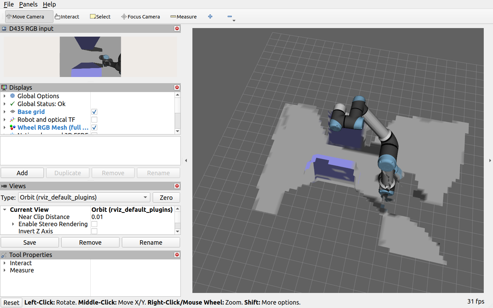
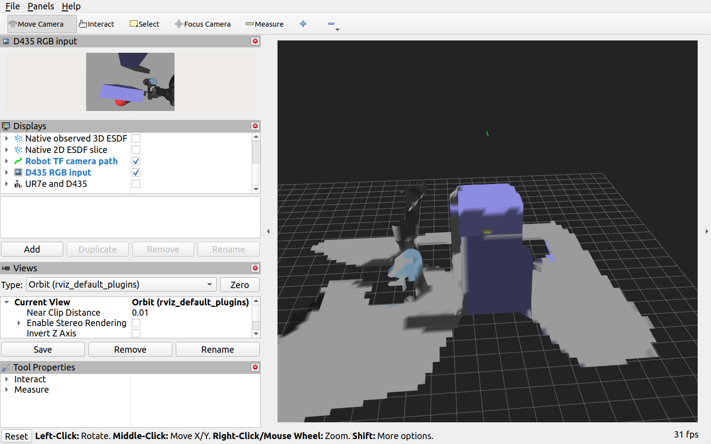
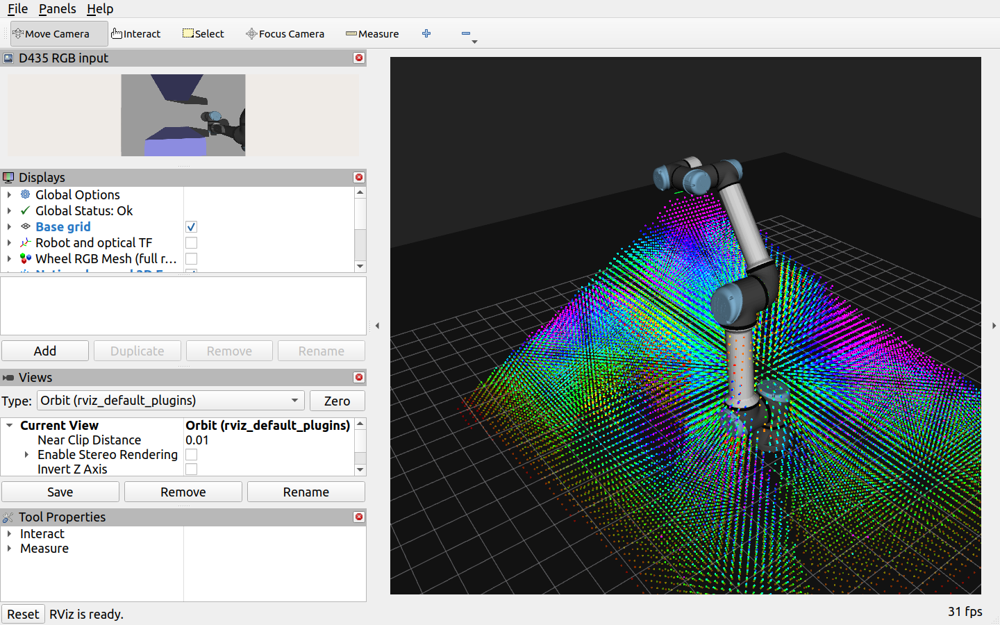
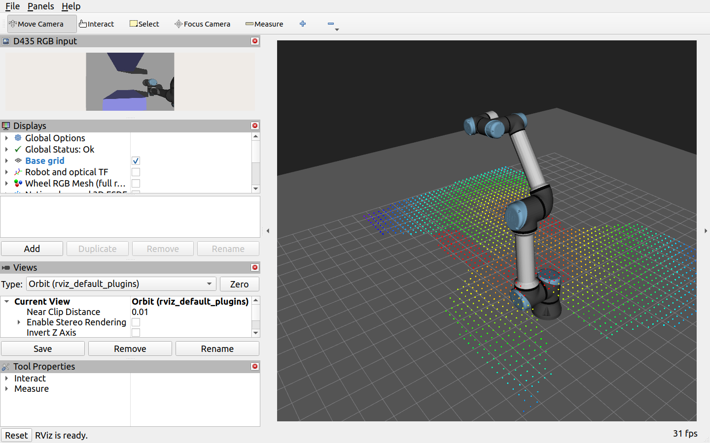

# 新Python接口工程的构建与仿真验收

日期：2026-11-09。工程与相邻nvblox_in_hand并列，名称ur7e_nvblox_in_hand。原C++工程/workspaces均未修改；本工程显式加载ROS Humble和自身安装环境。

## 1. 验证范围

完成本地C++/CUDA Torch桥接、机械臂场景、自定义服务和Python节点构建。三个ROS包均完成，当前机器依赖已经存在；没有执行安装脚本重装驱动/依赖，也没有在干净新机器/容器上重做完整安装。安装脚本完成bash语法检查，迁移时仍需满足固定版本条件。

GPU合成平面检查通过：14,380个原生已观测ESDF体素，其中4,148个inside；原生中心坐标、距离符号和标记正确，抽样含inside的查询与原生距离最大差0；unknown查询被识别。生成1,102个Mesh顶点/1,650个三角形；TSDF/RGB层、保存/加载/清空、半径清图调用及原生2D切片检查通过。2D合成切片728点，z≈0.255m，对应0.03m格网中包含slice_height=0.25m的体素中心。

ROS消息检查通过：批量MarkerArray CDR与标准ROS序列化逐字节一致，覆盖空/非空网格、不同frame、UTF-8和时间戳；PointCloud2的24字节布局和标记也通过。Mesh没有使用伪造的URI或替换为点云。

## 2. 最终Gazebo测试条件

- 使用自身复制的UR7e/D435场景、手眼标定、模型和本地相机插件。
- ROS_DOMAIN_ID=135，GAZEBO_MASTER_URI=http://127.0.0.1:11565，Gazebo GUI关闭、RViz开启。
- RGB/深度640×480，目标30Hz，体素0.03m，最大融合距离3m，TSDF截断4vox、ESDF最大距离2m。
- 深度/颜色门限40Hz，ESDF/导出33.4Hz，Mesh与TSDF/颜色层5Hz。采样器订阅Mesh、ESDF、两层、输入和统计；实际RViz订阅Mesh也经过检查。
- 先将机械臂移到已检查高位中心，再创建新地图；静止约12秒，然后执行20秒world Y小幅扫描并回中，统计运动窗口约27秒。没有环绕，实际位移/高度不以命令幅度替代独立轨迹精度测量。
- 每种状态一次短时测试，非多轮统计基准，机器不保证独占资源。没有把此前C++工程的数字充当本次Python结果。

## 3. 最终实际频率

| 状态 | 深度融合Hz | 颜色融合Hz | ESDF调用Hz | ESDF点云接收Hz | 新输入关联Hz | Mesh接收Hz | 输入年龄P50/P95 | 点数范围 |
| --- | ---: | ---: | ---: | ---: | ---: | ---: | --- | --- |
| 静止 | 29.19 | 29.86 | 29.19 | **26.65** | 26.65 | 4.98 | 40/45ms | 24,184～24,184 |
| 左右扫描及回中 | 29.54 | 29.84 | 29.54 | **25.95** | 25.95 | 4.97 | 39/44ms | 24,184～32,503 |

本轮两个采样窗口相邻点云header重复数均为0。点云接收Hz使用(N−1)/(最后到达−最初到达)；新输入关联Hz按header严格推进统计，不等于几何变化率。深度/颜色/ESDF调用Hz对已有累计计数作差，避开窗口最初2秒回调积压；与点云采样窗口略有差别。点云年龄为最近/clock减header，非GPU纯计算时间和屏幕延迟。

频率门限33.4不等于发布必达33.4或30Hz；内部ESDF调用约29Hz，而接收端约26Hz，仍有发布队列、DDS、订阅端采样和图形负载影响。本轮没有对每个ESDF版本逐级打点，不能唯一归因到某一环节。明确保留这部分差异，没有用重复发布补齐Hz。

保存的扫描后Mesh：4,213个顶点、6,014个三角形。原生ESDF快照32,503点，其中inside 11,595。点数不是固定查询网格；已知自由空间也属于ESDF，inside点不是错误放进障碍物的Mesh表面点。

## 4. 服务与开关验证

- `native_esdf_and_query`：{"passed": true, "points": 32503, "inside": 11595, "unknown_query": true}
- `color_switch`：true
- `inside_selection`：true
- `band_selection`：true
- `clear_map`：true
- `load_map`：true
- `native_2d_slice`：{"points": 1788, "z": 0.2549999952316284}
- `layers`：{"tsdf_points": 24184, "color_points": 11742}
- `enable_layers_switch`：true
- `enable_mesh_switch`：true
- `publish_esdf_distance_slice_switch`：true

颜色关闭后累计颜色融合计数停止、恢复后继续；inside和band筛选符合标记/距离条件。清图后点云为空，恢复深度重建后再次有点；保存PLY/map/statistics及加载map成功。

另起同场景新Mapper验证2D模式，原生切片1,788点，z≈0.255m；TSDF层24,184点、颜色层11,742点。层、Mesh与切片开关关闭后计数停止，恢复后继续。这不是把3D点投影到平面假装调用了官方二维计算。

## 5. 真实窗口

截图来自本工程RViz，非生成效果图。RobotModel是URDF可视模型，不代表该机械臂表面已经重建；画面可能被交互旋转/缩放，不能用不同截图作像素级质量比较。

### 静止时彩色Mesh



### 扫描期间彩色Mesh



### 扫描后3D ESDF



### 原生二维ESDF切片



Mesh仍有棱角圆钝、颜色跨边界和局部不完整。主体仍为体素TSDF/颜色融合，默认无机器人自体遮罩；本轮完成的是接口迁移、功能和实时路径，不宣称重建质量已全部解决，也没有新增全场景精度/完整率真值验收。

## 6. 开发过程中的性能问题与修正

初始实现直接给PointCloud2.data赋bytes，触发Humble的逐字节Python校验；Mesh逐个构造数万个Point/Color对象。初轮记录静止点云16.21Hz、运动12.59Hz，深度提交平均约37～42ms、点云打包约32～38ms、Mesh打包约78～105ms。主机计时含GIL等待/队列影响，不是GPU核函数时间。

改为array('B')批量点数据和标准CDR模板批量Mesh编码后，上述开销显著下降，融合接近30Hz。最终统计的host提交/打包时间是后续维护阶段滚动样本，不能当成正式采样窗口的独立GPU计时；原始metrics保留。

同时处理了wheel枚举字符串适配、ROS只读属性冲突、同速ESDF更新/显示双重限频、RViz MarkerArray话题键和订阅节点名检查。之前失败启动与缺少Mesh显示的开发轮次保留在artifacts，未当成最终显示成功证据。

这些轮次存在开发代码和图形订阅差异，不是严格受控A/B，也不能由此声称Python比现有C++工程更快。正式迁移结论是：本轮已在不加载原workspaces的情况下完成主要感知功能，并具有明确实测频率；更大地图、其他GPU、实机D435/新机器安装以及全部原协议兼容性尚未验收。

## 7. 实际库来源与复现

最终节点报告实际core库来自用户nvblox_torch wheel，CUDA运行时来自Python nvidia/cuda_runtime，Torch CUDA来自torch/lib；未报告workspaces的nvblox_ros/nvblox核心。构建时头文件来自本工程vendor，桥接链接wheel。系统ROS仍是必要依赖，并不是把ROS也去掉。

完整操作见OPERATIONS.md；核心自动入口：

```bash
cd /home/czz/perception_eye_in_hand/ur7e_nvblox_in_hand
./build.sh
export ROS_DOMAIN_ID=135 ROS_LOCALHOST_ONLY=1
export GAZEBO_MASTER_URI=http://127.0.0.1:11565
source ./env.sh
DISPLAY=:1 /usr/bin/python3 tools/sim_test.py
```

该命令先停止同域手动场景/Mapper，再执行；会创建新的证据目录，不覆盖本轮结果。

- [最终命令、检查和结果](/home/czz/perception_eye_in_hand/ur7e_nvblox_in_hand/artifacts/simulation_20261109_174244/results.json)
- [频率CSV](/home/czz/perception_eye_in_hand/ur7e_nvblox_in_hand/artifacts/simulation_20261109_174244/frequency_results.csv)
- [实际运行参数](/home/czz/perception_eye_in_hand/ur7e_nvblox_in_hand/artifacts/simulation_20261109_174244/parameters.yaml)
- [原生ESDF快照](/home/czz/perception_eye_in_hand/ur7e_nvblox_in_hand/artifacts/simulation_20261109_174244/native_esdf.npy)
- [保存的Mesh](/home/czz/perception_eye_in_hand/ur7e_nvblox_in_hand/artifacts/simulation_20261109_174244/mesh.ply)
- [保存的地图](/home/czz/perception_eye_in_hand/ur7e_nvblox_in_hand/artifacts/simulation_20261109_174244/map.blox)
- [逐秒累计计数与计时](/home/czz/perception_eye_in_hand/ur7e_nvblox_in_hand/artifacts/simulation_20261109_174244/metrics.json)
- [点云接收时间与header记录](/home/czz/perception_eye_in_hand/ur7e_nvblox_in_hand/artifacts/simulation_20261109_174244/cloud_records.json)

[GPU功能检查](/home/czz/perception_eye_in_hand/ur7e_nvblox_in_hand/artifacts/backend_contract_test.json)；[消息测试日志](/home/czz/perception_eye_in_hand/ur7e_nvblox_in_hand/artifacts/unit_tests.log)；[构建日志](/home/czz/perception_eye_in_hand/ur7e_nvblox_in_hand/artifacts/build.log)。

[可移植频率CSV](validation_frequency.csv)。空Mesh清屏报文最后补充标准DELETE动作，并通过空/非空CDR单元测试；不影响上述非空网格采样数据。
